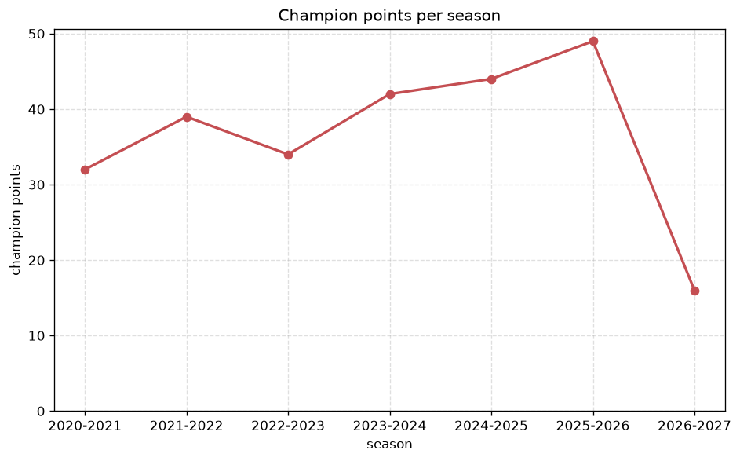
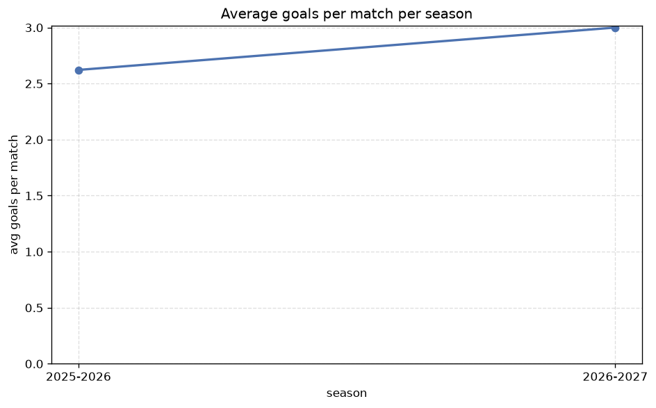

# Season Trends Analysis
- Report: `season_trends`
- Generated: 2026-10-29T02:07:30+00:00
- Script: `backend/scripts/analyze_seasons.py` v1.0.0
- League: Premier League (Kuwait)
- Scope: league `kuwait`

## 1. Champions per season
| season | champion | pts | runner-up | margin |
|---|---|---|---|---|
| 2020-2021 | Al Naser | 32 | Al Qadisiya | 0 pts |
| 2021-2022 | Al Kuwait | 39 | Kazma SC | 5 pts |
| 2022-2023 | Al Kuwait | 34 | Kazma SC | 8 pts |
| 2023-2024 | Al Kuwait | 42 | Al Arabi | 3 pts |
| 2024-2025 | Al Kuwait | 44 | Al Arabi | 2 pts |
| 2025-2026 | Al Kuwait | 49 | Al Qadisiya | 11 pts |
| 2026-2027 | Al Kuwait | 16 | Al Naser | 1 pts |

## 2. Title-race tightness
- Tight races (margin <= 3 pts): **4** of 7 seasons
- Tightest race: **2020-2021** - Al Naser beat Al Qadisiya by **0** pts

| season | margin | tight |
|---|---|---|
| 2020-2021 | 0 pts | yes |
| 2021-2022 | 5 pts |  |
| 2022-2023 | 8 pts |  |
| 2023-2024 | 3 pts | yes |
| 2024-2025 | 2 pts | yes |
| 2025-2026 | 11 pts |  |
| 2026-2027 | 1 pts | yes |

## 3. Points thresholds
_Position-specific points per season. Key: 1 = champion, 2 = runner-up, 4 = CL line, 6 = Europa, 9 = last safe, 12 = bottom._

| season | pos 1 | pos 2 | pos 4 | pos 6 | pos 9 | pos 12 |
|---|---|---|---|---|---|---|
| 2020-2021 | 32 | 32 | 28 | 21 | 17 | 8 |
| 2021-2022 | 39 | 34 | 28 | 23 | 11 | - |
| 2022-2023 | 34 | 26 | 25 | 21 | 14 | - |
| 2023-2024 | 42 | 39 | 24 | 17 | 12 | - |
| 2024-2025 | 44 | 42 | 28 | 19 | 12 | - |
| 2025-2026 | 49 | 38 | 35 | 22 | 15 | - |
| 2026-2027 | 16 | 15 | 12 | 9 | 4 | 3 |

## 4. Relegation battle
| season | safe pos | safe pts | drop pos | drop pts | gap |
|---|---|---|---|---|---|
| 2020-2021 | 9 | 17 | 10 | 16 | 1 pts |
| 2021-2022 | 9 | 11 | 10 | - | - |
| 2022-2023 | 9 | 14 | 10 | - | - |
| 2023-2024 | 9 | 12 | 10 | 9 | 3 pts |
| 2024-2025 | 9 | 12 | 10 | 11 | 1 pts |
| 2025-2026 | 9 | 15 | 10 | 8 | 7 pts |
| 2026-2027 | 9 | 4 | 10 | 3 | 1 pts |

## 5. League-level trends
| season | matches | total goals | avg goals | home win | draw | away win | goalless | avg pts/team |
|---|---|---|---|---|---|---|---|---|
| 2020-2021 | 105 | 282 | 2.686 | 32.4% | 22.9% | 44.8% | 8.6% | 18.0 |
| 2021-2022 | 90 | 253 | 2.811 | 44.4% | 20.0% | 35.6% | 5.6% | 22.8 |
| 2022-2023 | 90 | 279 | 3.1 | 37.8% | 31.1% | 31.1% | 5.6% | 21.6 |
| 2023-2024 | 90 | 266 | 2.956 | 41.1% | 23.3% | 35.6% | 7.8% | 22.4 |
| 2024-2025 | 90 | 276 | 3.067 | 46.7% | 20.0% | 33.3% | 4.4% | 22.6 |
| 2025-2026 | 98 | 257 | 2.622 | 40.8% | 25.5% | 33.7% | 7.1% | 26.9 |
| 2026-2027 | 30 | 96 | 3.2 | 40.0% | 20.0% | 40.0% | 3.3% | 7.5 |

## 6. View divergence
- Largest divergence: **2022-2023** (luck view, avg abs position diff = 8.700)

_Avg absolute position difference between classic view and alternative view per season._

| season | classic vs luck | classic vs goals |
|---|---|---|
| 2020-2021 | 5.200 | 6.267 |
| 2021-2022 | 5.300 | 4.500 |
| 2022-2023 | 8.700 | 6.100 |
| 2023-2024 | 4.900 | 5.000 |
| 2024-2025 | 4.400 | 6.500 |
| 2025-2026 | 2.600 | 3.400 |
| 2026-2027 | 1.083 | 4.833 |

---
*All statistics are computed from PostgreSQL tables (read-only). Run with `python backend/scripts/analyze_seasons.py` to regenerate.*

## Charts

