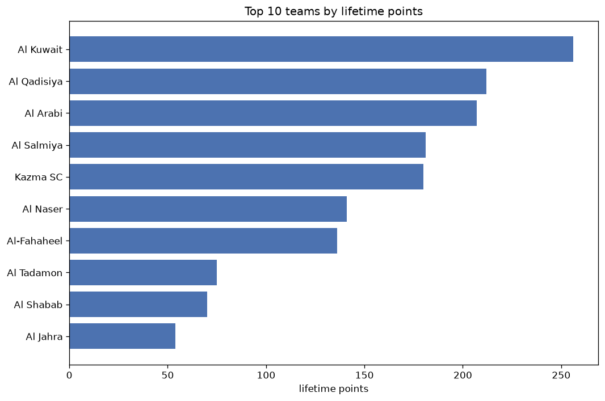
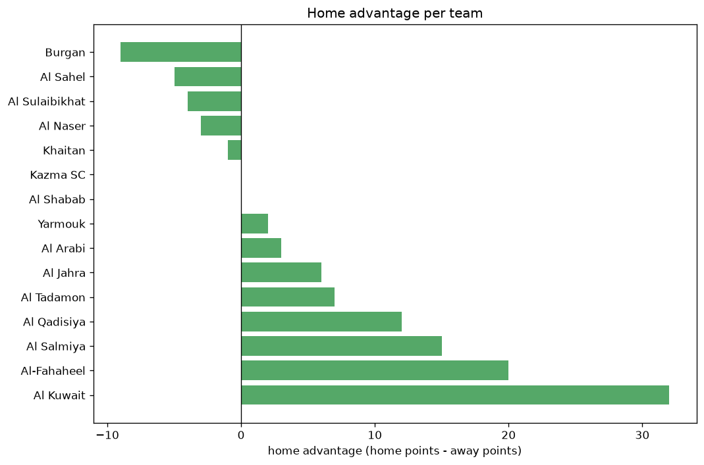

# Team Analysis
- Report: `teams_analysis`
- Generated: 2026-10-26T01:40:19+00:00
- Script: `backend/scripts/analyze_teams.py` v1.0.0
- League: Premier League (Kuwait)
- Scope: league `kuwait`

- Teams: **15** | Seasons: **7** | Matches: **593**

## 1. Team standings (lifetime)
| team | seasons | played | W | D | L | pts | GF | GA | GD | avg pts/season | best pos | worst pos | titles |
|---|---|---|---|---|---|---|---|---|---|---|---|---|---|
| Al Kuwait | 7 | 113 | 76 | 28 | 9 | 256 | 276 | 98 | 178 | 36.57 | 1 | 5 | 6 |
| Al Qadisiya | 7 | 112 | 63 | 23 | 26 | 212 | 191 | 114 | 77 | 30.29 | 2 | 5 | 0 |
| Al Arabi | 7 | 111 | 60 | 27 | 24 | 207 | 207 | 117 | 90 | 29.57 | 2 | 11 | 0 |
| Al Salmiya | 7 | 113 | 49 | 34 | 30 | 181 | 174 | 137 | 37 | 25.86 | 3 | 6 | 0 |
| Kazma SC | 7 | 113 | 49 | 33 | 31 | 180 | 156 | 135 | 21 | 25.71 | 2 | 6 | 0 |
| Al Naser | 7 | 108 | 40 | 21 | 47 | 141 | 159 | 167 | -8 | 20.14 | 1 | 9 | 1 |
| Al-Fahaheel | 7 | 111 | 37 | 25 | 49 | 136 | 147 | 177 | -30 | 19.43 | 6 | 15 | 0 |
| Al Tadamon | 6 | 91 | 20 | 15 | 56 | 75 | 108 | 191 | -83 | 12.5 | 5 | 14 | 0 |
| Al Shabab | 5 | 71 | 18 | 16 | 37 | 70 | 61 | 129 | -68 | 14.0 | 7 | 9 | 0 |
| Al Jahra | 5 | 73 | 13 | 15 | 45 | 54 | 67 | 128 | -61 | 10.8 | 7 | 12 | 0 |
| Khaitan | 3 | 50 | 9 | 14 | 27 | 41 | 39 | 87 | -48 | 13.67 | 8 | 10 | 0 |
| Al Sahel | 3 | 36 | 9 | 8 | 19 | 35 | 37 | 50 | -13 | 11.67 | 9 | 9 | 0 |
| Yarmouk | 3 | 50 | 5 | 11 | 34 | 26 | 59 | 115 | -56 | 8.67 | 8 | 13 | 0 |
| Burgan | 1 | 14 | 4 | 5 | 5 | 17 | 13 | 16 | -3 | 17.0 | 10 | 10 | 0 |
| Al Sulaibikhat | 2 | 20 | 1 | 5 | 14 | 8 | 15 | 48 | -33 | 4.0 | 12 | 16 | 0 |

## 2. Home vs away split
| team | home P | H-W | H-D | H-L | H-pts | away P | A-W | A-D | A-L | A-pts | adv |
|---|---|---|---|---|---|---|---|---|---|---|---|
| Al Kuwait | 59 | 45 | 9 | 5 | 144 | 54 | 31 | 19 | 4 | 112 | 32 |
| Al-Fahaheel | 57 | 22 | 12 | 23 | 78 | 54 | 15 | 13 | 26 | 58 | 20 |
| Al Salmiya | 56 | 28 | 14 | 14 | 98 | 57 | 21 | 20 | 16 | 83 | 15 |
| Al Qadisiya | 58 | 33 | 13 | 12 | 112 | 54 | 30 | 10 | 14 | 100 | 12 |
| Al Tadamon | 46 | 11 | 8 | 27 | 41 | 45 | 9 | 7 | 29 | 34 | 7 |
| Al Jahra | 35 | 7 | 9 | 19 | 30 | 38 | 6 | 6 | 26 | 24 | 6 |
| Al Arabi | 53 | 31 | 12 | 10 | 105 | 58 | 29 | 15 | 14 | 102 | 3 |
| Yarmouk | 28 | 2 | 8 | 18 | 14 | 22 | 3 | 3 | 16 | 12 | 2 |
| Kazma SC | 56 | 24 | 18 | 14 | 90 | 57 | 25 | 15 | 17 | 90 | 0 |
| Al Shabab | 35 | 9 | 8 | 18 | 35 | 36 | 9 | 8 | 19 | 35 | 0 |
| Khaitan | 25 | 4 | 8 | 13 | 20 | 25 | 5 | 6 | 14 | 21 | -1 |
| Al Naser | 51 | 18 | 15 | 18 | 69 | 57 | 22 | 6 | 29 | 72 | -3 |
| Al Sulaibikhat | 9 | 0 | 2 | 7 | 2 | 11 | 1 | 3 | 7 | 6 | -4 |
| Al Sahel | 18 | 4 | 3 | 11 | 15 | 18 | 5 | 5 | 8 | 20 | -5 |
| Burgan | 7 | 1 | 1 | 5 | 4 | 7 | 3 | 4 | 0 | 13 | -9 |

## 3. Top performers
### Best points per game (PPG)
| rank | team | PPG |
|---|---|---|
| 1 | Al Kuwait | 2.27 |
| 2 | Al Qadisiya | 1.89 |
| 3 | Al Arabi | 1.86 |
| 4 | Al Salmiya | 1.60 |
| 5 | Kazma SC | 1.59 |

### Most goals scored
| rank | team | goals |
|---|---|---|
| 1 | Al Kuwait | 276 |
| 2 | Al Arabi | 207 |
| 3 | Al Qadisiya | 191 |
| 4 | Al Salmiya | 174 |
| 5 | Al Naser | 159 |

### Best goal difference
| rank | team | GD |
|---|---|---|
| 1 | Al Kuwait | 178 |
| 2 | Al Arabi | 90 |
| 3 | Al Qadisiya | 77 |
| 4 | Al Salmiya | 37 |
| 5 | Kazma SC | 21 |

### Best defence (goals against per match, standings)
| rank | team | GA/match |
|---|---|---|
| 1 | Al Kuwait | 0.853 |
| 2 | Al Qadisiya | 1.046 |
| 3 | Al Arabi | 1.057 |
| 4 | Burgan | 1.154 |
| 5 | Kazma SC | 1.176 |

## 4. Team consistency
- Teams present in all **7** seasons: **7**

Al Arabi, Al Kuwait, Al Naser, Al Qadisiya, Al Salmiya, Al-Fahaheel, Kazma SC

## 5. Head-to-head dominance
- Distinct fixtures: **105** (showing the 15 most frequent)

| fixture | meetings | home wins | draws | away wins | home pct | draw pct | away pct |
|---|---|---|---|---|---|---|---|
| Al Kuwait vs Al Arabi | 13 | 6 | 4 | 3 | 46.2% | 30.8% | 23.1% |
| Al Qadisiya vs Al Kuwait | 13 | 5 | 5 | 3 | 38.5% | 38.5% | 23.1% |
| Al Qadisiya vs Al-Fahaheel | 13 | 5 | 1 | 7 | 38.5% | 7.7% | 53.8% |
| Kazma SC vs Al Arabi | 13 | 3 | 2 | 8 | 23.1% | 15.4% | 61.5% |
| Al Naser vs Al Qadisiya | 12 | 9 | 2 | 1 | 75.0% | 16.7% | 8.3% |
| Al Naser vs Al-Fahaheel | 12 | 8 | 1 | 3 | 66.7% | 8.3% | 25.0% |
| Al Kuwait vs Al-Fahaheel | 12 | 7 | 2 | 3 | 58.3% | 16.7% | 25.0% |
| Al Arabi vs Al-Fahaheel | 12 | 5 | 2 | 5 | 41.7% | 16.7% | 41.7% |
| Al Naser vs Al Kuwait | 12 | 5 | 3 | 4 | 41.7% | 25.0% | 33.3% |
| Al Salmiya vs Al Arabi | 12 | 5 | 4 | 3 | 41.7% | 33.3% | 25.0% |
| Al Naser vs Al Salmiya | 12 | 4 | 3 | 5 | 33.3% | 25.0% | 41.7% |
| Al Qadisiya vs Kazma SC | 12 | 4 | 3 | 5 | 33.3% | 25.0% | 41.7% |
| Al Salmiya vs Kazma SC | 12 | 4 | 4 | 4 | 33.3% | 33.3% | 33.3% |
| Kazma SC vs Al-Fahaheel | 12 | 4 | 5 | 3 | 33.3% | 41.7% | 25.0% |
| Al Qadisiya vs Al Salmiya | 12 | 3 | 3 | 6 | 25.0% | 25.0% | 50.0% |

## 6. Position per season (classic view)
_Cells show final position; '-' when the team was absent from that season._

| team | 2020-2021 | 2021-2022 | 2022-2023 | 2023-2024 | 2024-2025 | 2025-2026 | 2026-2027 |
|---|---|---|---|---|---|---|---|
| Al Kuwait | 5 | 1 | 1 | 1 | 1 | 1 | 1 |
| Al Qadisiya | 2 | 5 | 3 | 3 | 3 | 2 | 4 |
| Al Arabi | 6 | 3 | 4 | 2 | 2 | 4 | 11 |
| Al Salmiya | 3 | 4 | 5 | 5 | 4 | 3 | 6 |
| Kazma SC | 4 | 2 | 2 | 6 | 6 | 5 | 3 |
| Al Naser | 1 | 6 | 6 | 4 | 9 | 7 | 2 |
| Al-Fahaheel | 15 | 11 | 11 | 10 | 8 | 6 | 10 |
| Al Tadamon | 14 | 7 | 8 | - | 5 | 8 | 13 |
| Al Shabab | 7 | 9 | - | 8 | - | 9 | 7 |
| Al Jahra | 12 | - | 7 | 11 | - | 10 | 8 |
| Khaitan | 8 | - | - | 9 | 10 | - | - |
| Al Sahel | 9 | - | 9 | - | - | - | 9 |
| Yarmouk | 13 | 8 | - | - | 11 | - | - |
| Burgan | 10 | - | - | - | - | - | - |
| Al Sulaibikhat | 16 | - | - | - | - | - | 12 |

---
*All statistics are computed from PostgreSQL tables (read-only). Run with `python backend/scripts/analyze_teams.py` to regenerate.*

## Charts

