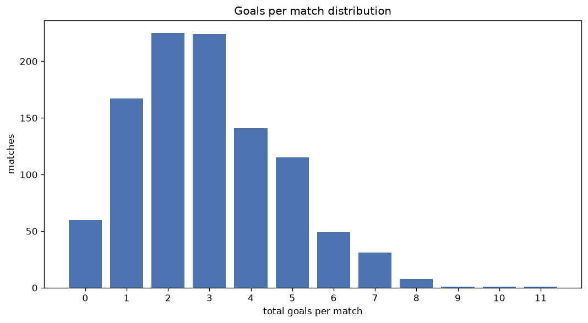
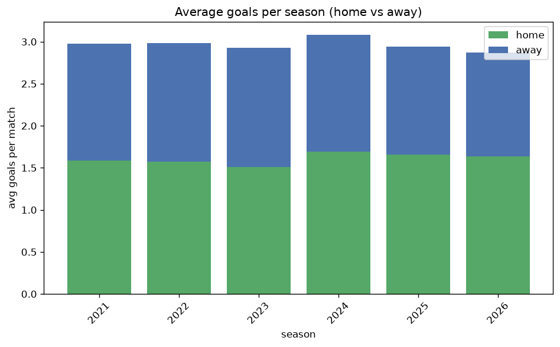

# Goal Analysis
- Report: `goals_analysis`
- Generated: 2026-10-30T04:01:40+00:00
- Script: `backend/scripts/analyze_goals.py` v1.0.0
- League: Virsliga (Latvia)
- Scope: league `latvia`

## 1. Goals per match distribution
| goals | matches | pct |
|---|---|---|
| 0 | 60 | 5.9% |
| 1 | 167 | 16.3% |
| 2 | 225 | 22.0% |
| 3 | 224 | 21.9% |
| 4 | 141 | 13.8% |
| 5 | 115 | 11.2% |
| 6 | 49 | 4.8% |
| 7 | 32 | 3.1% |
| 8 | 8 | 0.8% |
| 9 | 1 | 0.1% |
| 10 | 1 | 0.1% |
| 11 | 1 | 0.1% |

## 2. Goals per match per season
| season | matches | total goals | avg home | avg away | avg total |
|---|---|---|---|---|---|
| 2021 | 126 | 375 | 1.587 | 1.389 | 2.976 |
| 2022 | 182 | 543 | 1.571 | 1.412 | 2.984 |
| 2023 | 182 | 533 | 1.511 | 1.418 | 2.929 |
| 2024 | 182 | 561 | 1.692 | 1.39 | 3.082 |
| 2025 | 182 | 535 | 1.659 | 1.28 | 2.94 |
| 2026 | 170 | 493 | 1.612 | 1.288 | 2.9 |

## 3. Home vs away goal share
- Home goals: **1645** (54.1%)
- Away goals: **1395** (45.9%)
- Home/away ratio: **1.179**

| season | home goals | away goals | total | home pct | away pct |
|---|---|---|---|---|---|
| 2021 | 200 | 175 | 375 | 53.3% | 46.7% |
| 2022 | 286 | 257 | 543 | 52.7% | 47.3% |
| 2023 | 275 | 258 | 533 | 51.6% | 48.4% |
| 2024 | 308 | 253 | 561 | 54.9% | 45.1% |
| 2025 | 302 | 233 | 535 | 56.4% | 43.6% |
| 2026 | 274 | 219 | 493 | 55.6% | 44.4% |

## 4. BTTS (Both Teams To Score)
- Overall: **502** of `1024` (49.0%)

| season | matches | BTTS | pct |
|---|---|---|---|
| 2021 | 126 | 52 | 41.3% |
| 2022 | 182 | 88 | 48.4% |
| 2023 | 182 | 85 | 46.7% |
| 2024 | 182 | 86 | 47.3% |
| 2025 | 182 | 99 | 54.4% |
| 2026 | 170 | 92 | 54.1% |

## 5. Clean sheets
- Home clean sheets: **321** (31.3%)
- Away clean sheets: **261** (25.5%)
- Total clean sheets recorded: **582**
- Matches with at least one clean sheet: **522** (51.0%)
- Both teams kept clean sheets (0-0): **60**

| season | matches | home CS | away CS | total CS | matches w/ CS |
|---|---|---|---|---|---|
| 2021 | 126 | 41 | 37 | 78 | 74 (58.7%) |
| 2022 | 182 | 61 | 45 | 106 | 94 (51.6%) |
| 2023 | 182 | 57 | 52 | 109 | 97 (53.3%) |
| 2024 | 182 | 59 | 49 | 108 | 96 (52.7%) |
| 2025 | 182 | 58 | 36 | 94 | 83 (45.6%) |
| 2026 | 170 | 45 | 42 | 87 | 78 (45.9%) |

## 6. Scoring intensity
- First-half goals: **1352** (45.2%)
- Second-half goals: **1637** (54.8%)
- Avg first-half goals per match: **1.343**
- Avg second-half goals per match: **1.626**
- Second-half-only scoring (HT 0-0, FT goals >= 1): **202** (19.7%)
- *17 match(es) excluded (no HT score recorded).*

| season | matches | 1st half | 2nd half | 1st half pct | 2nd half pct |
|---|---|---|---|---|---|
| 2021 | 126 | 146 | 181 | 44.6% | 55.4% |
| 2022 | 182 | 238 | 302 | 44.1% | 55.9% |
| 2023 | 182 | 240 | 293 | 45.0% | 55.0% |
| 2024 | 182 | 257 | 304 | 45.8% | 54.2% |
| 2025 | 182 | 245 | 290 | 45.8% | 54.2% |
| 2026 | 170 | 226 | 267 | 45.8% | 54.2% |

## 7. First-goal timing
- Matches with first-goal time recorded: `947` of `1024` (92.5%)
- Goalless matches: `77`
- Min `1` | Max `97` | Mean `29.37` | Median (p50) `23`

| bucket | count | % of matches | % of scoring matches |
|---|---|---|---|
| 1-15 | 333 | 32.5% | 35.2% |
| 16-30 | 241 | 23.5% | 25.4% |
| 31-45 | 152 | 14.8% | 16.1% |
| 46-60 | 107 | 10.4% | 11.3% |
| 61-75 | 61 | 6.0% | 6.4% |
| 76-90 | 47 | 4.6% | 5.0% |
| 91-120 | 6 | 0.6% | 0.6% |

---
*All statistics are computed from PostgreSQL tables (read-only). Run with `python backend/scripts/analyze_goals.py` to regenerate.*

## Charts

