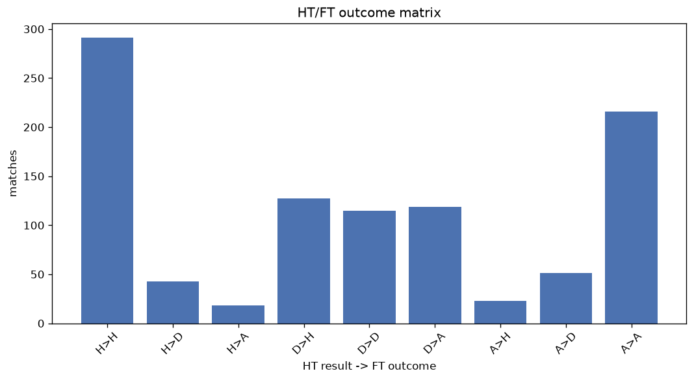
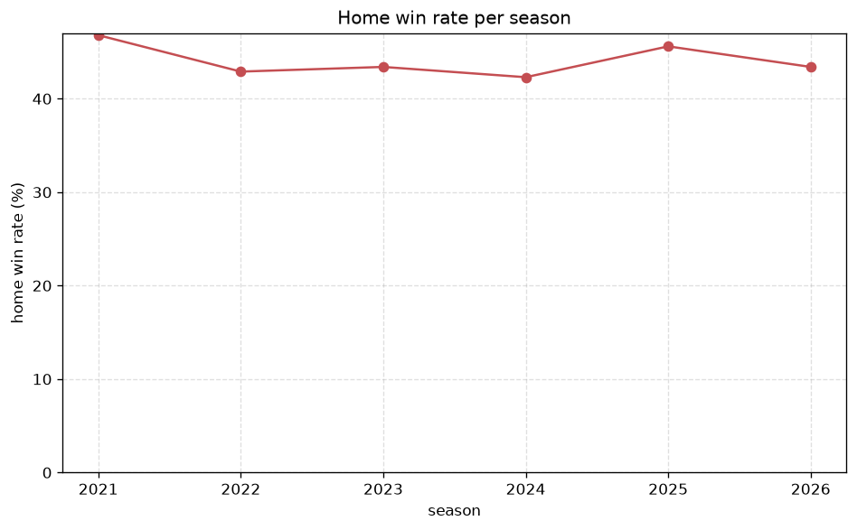

# Match Analysis
- Report: `matches_analysis`
- Generated: 2026-10-26T01:40:36+00:00
- Script: `backend/scripts/analyze_matches.py` v1.0.0
- League: Virsliga (Latvia)
- Scope: league `latvia`

## 1. Overall summary
| metric | value |
|---|---|
| Matches | 1020 |
| Home wins | 448 (43.9%) |
| Draws | 209 (20.5%) |
| Away wins | 363 (35.6%) |
| Total goals | 3024 |
| Average goals per match | 2.965 |
| Goalless matches | 60 (5.9%) |

## 2. Per-season breakdown
| season | matches | home wins | draws | away wins | total goals | avg goals | goalless |
|---|---|---|---|---|---|---|---|
| 2021 | 126 | 59 (46.8%) | 20 (15.9%) | 47 (37.3%) | 375 | 2.976 | 4 (3.2%) |
| 2022 | 182 | 78 (42.9%) | 32 (17.6%) | 72 (39.6%) | 543 | 2.984 | 12 (6.6%) |
| 2023 | 182 | 79 (43.4%) | 43 (23.6%) | 60 (33.0%) | 533 | 2.929 | 12 (6.6%) |
| 2024 | 182 | 77 (42.3%) | 33 (18.1%) | 72 (39.6%) | 561 | 3.082 | 12 (6.6%) |
| 2025 | 182 | 83 (45.6%) | 43 (23.6%) | 56 (30.8%) | 535 | 2.94 | 11 (6.0%) |
| 2026 | 166 | 72 (43.4%) | 38 (22.9%) | 56 (33.7%) | 477 | 2.873 | 9 (5.4%) |

## 3. HT/FT outcome matrix
| HT result \ FT result | Home | Draw | Away | total |
|---|---|---|---|---|
| HT home lead | 291 (82.7%) | 43 (12.2%) | 18 (5.1%) | 352 |
| HT draw | 127 (35.2%) | 115 (31.9%) | 119 (33.0%) | 361 |
| HT away lead | 23 (7.9%) | 51 (17.6%) | 216 (74.5%) | 290 |
- *17 match(es) excluded (no HT score recorded).*

## 4. Comeback matches
- Home comebacks (trailing at HT, won at FT): **23** (2.3%)
- Away comebacks (trailing at HT, won at FT): **18** (1.8%)

### Home comebacks
| season | home | away | HT | FT |
|---|---|---|---|---|
| 2021 | Riga FC | Spartaks | 0-1 | 2-1 |
| 2021 | BFC Daugavpils | Ventspils | 0-1 | 3-2 |
| 2021 | RFS | FK Liepaja | 0-1 | 2-1 |
| 2022 | Spartaks | Metta | 1-2 | 4-2 |
| 2022 | Riga FC | Spartaks | 0-1 | 2-1 |
| 2023 | Valmiera | Tukums 2000 | 1-2 | 4-3 |
| 2023 | FK Liepaja | Jelgava | 1-2 | 3-2 |
| 2023 | Valmiera | Metta | 0-1 | 2-1 |
| 2023 | BFC Daugavpils | Metta | 1-2 | 4-2 |
| 2024 | Valmiera | Riga FC | 0-1 | 2-1 |
| 2024 | Metta | Grobina | 0-1 | 2-1 |
| 2024 | Valmiera | Jelgava | 0-1 | 3-2 |
| 2025 | Grobina | BFC Daugavpils | 0-1 | 3-2 |
| 2025 | Metta | Tukums 2000 | 1-2 | 3-2 |
| 2025 | RFS | FK Liepaja | 0-1 | 4-1 |
| 2025 | Jelgava | Tukums 2000 | 0-1 | 2-1 |
| 2025 | BFC Daugavpils | Grobina | 1-2 | 3-2 |
| 2025 | Tukums 2000 | Super Nova | 0-1 | 2-1 |
| 2026 | Ogre United | Tukums 2000 | 1-2 | 3-2 |
| 2026 | Riga FC | Tukums 2000 | 0-1 | 3-1 |
| 2026 | Tukums 2000 | Ogre United | 0-1 | 2-1 |
| 2026 | RFS | Jelgava | 0-1 | 4-2 |
| 2026 | Riga FC | Super Nova | 0-1 | 2-1 |

### Away comebacks
| season | home | away | HT | FT |
|---|---|---|---|---|
| 2021 | FK Liepaja | RFS | 1-0 | 1-2 |
| 2022 | Spartaks | Auda | 1-0 | 1-2 |
| 2022 | Metta | BFC Daugavpils | 1-0 | 2-3 |
| 2022 | FK Liepaja | Tukums 2000 | 1-0 | 1-2 |
| 2022 | Spartaks | FK Liepaja | 1-0 | 2-3 |
| 2023 | Jelgava | Metta | 1-0 | 2-3 |
| 2023 | FK Liepaja | Valmiera | 1-0 | 1-2 |
| 2024 | FK Liepaja | Metta | 1-0 | 1-2 |
| 2024 | Jelgava | RFS | 1-0 | 1-2 |
| 2024 | FK Liepaja | Metta | 1-0 | 1-5 |
| 2024 | RFS | Auda | 1-0 | 1-2 |
| 2024 | BFC Daugavpils | Auda | 1-0 | 1-2 |
| 2026 | Jelgava | Auda | 2-1 | 2-3 |
| 2026 | Ogre United | RFS | 3-2 | 3-4 |
| 2026 | Super Nova | FK Liepaja | 1-0 | 1-2 |
| 2026 | Ogre United | Jelgava | 2-1 | 2-3 |
| 2026 | BFC Daugavpils | RFS | 1-0 | 1-2 |
| 2026 | FK Liepaja | Auda | 1-0 | 2-3 |

## 5. HT lead conversion
| HT state | matches | converted to win | held as draw | collapsed to loss |
|---|---|---|---|---|
| Home lead | 352 | 291 (82.7%) | 43 (12.2%) | 18 (5.1%) |
| Away lead | 290 | 216 (74.5%) | 51 (17.6%) | 23 (7.9%) |

### Matches level at half-time
| FT result | count | pct |
|---|---|---|
| Home win | 127 | 35.2% |
| Draw | 115 | 31.9% |
| Away win | 119 | 33.0% |
- *17 match(es) excluded (no HT score recorded).*

## 6. First-goal timing
- Matches with a first-goal time recorded: `943` of `1020` (92.5%)

Outcome distribution by first-goal timing bucket:
| bucket | matches | % of matches | home | draw | away |
|---|---|---|---|---|---|
| 1-15 | 332 | 32.5% | 165 (49.7%) | 40 (12.0%) | 127 (38.3%) |
| 16-30 | 240 | 23.5% | 120 (50.0%) | 43 (17.9%) | 77 (32.1%) |
| 31-45 | 152 | 14.9% | 60 (39.5%) | 30 (19.7%) | 62 (40.8%) |
| 46-60 | 106 | 10.4% | 46 (43.4%) | 14 (13.2%) | 46 (43.4%) |
| 61-75 | 61 | 6.0% | 26 (42.6%) | 17 (27.9%) | 18 (29.5%) |
| 76-90 | 46 | 4.5% | 22 (47.8%) | 5 (10.9%) | 19 (41.3%) |
| 91-120 | 6 | 0.6% | 2 (33.3%) | 0 (0.0%) | 4 (66.7%) |

## 7. Goalless matches
- Overall: **60** of `1020` (5.9%)

| season | matches | goalless | pct |
|---|---|---|---|
| 2021 | 126 | 4 | 3.2% |
| 2022 | 182 | 12 | 6.6% |
| 2023 | 182 | 12 | 6.6% |
| 2024 | 182 | 12 | 6.6% |
| 2025 | 182 | 11 | 6.0% |
| 2026 | 166 | 9 | 5.4% |

---
*All statistics are computed from PostgreSQL tables (read-only). Run with `python backend/scripts/analyze_matches.py` to regenerate.*

## Charts

