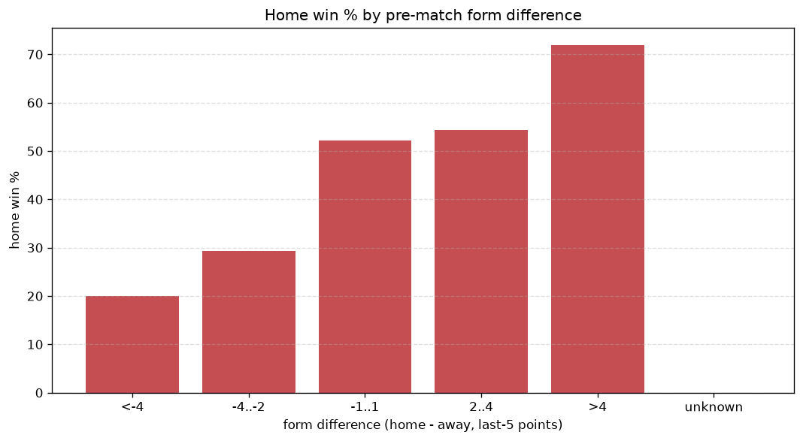
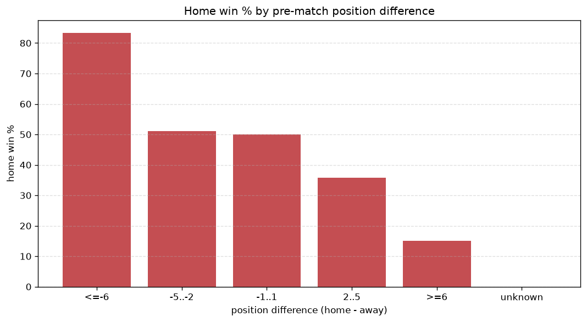

# Relationships Analysis
- Report: `relationships`
- Generated: 2026-10-27T02:01:39+00:00
- Script: `backend/scripts/analyze_relationships.py` v1.0.0
- League: Virsliga (Latvia)
- Scope: league `latvia`

- Matches analysed: **854** (23 leakage-safe pre-match features).

## 1. Correlation matrix
_Pearson correlation of each pre-match feature with observed goals; sorted by |corr(total goals)|._

| feature | corr(home) | corr(away) | corr(total) |
|---|---|---|---|
| home_points_before_match | 0.258 | -0.174 | 0.074 |
| away_team_away_goals_avg | -0.213 | 0.300 | 0.061 |
| away_points_before_match | -0.175 | 0.253 | 0.056 |
| away_team_goals_scored_last_5 | -0.189 | 0.266 | 0.054 |
| away_rest_days | -0.029 | 0.098 | 0.053 |
| away_team_away_win_rate | -0.224 | 0.293 | 0.047 |
| home_rest_days | 0.015 | 0.043 | 0.047 |
| home_team_goals_scored_last_5 | 0.243 | -0.203 | 0.039 |
| away_team_goals_conceded_last_5 | 0.202 | -0.167 | 0.034 |
| away_team_points_last_5 | -0.211 | 0.263 | 0.034 |
| home_team_points_last_5 | 0.267 | -0.246 | 0.025 |
| rest_days_difference | 0.046 | -0.080 | -0.025 |
| away_team_wins_last_5 | -0.207 | 0.245 | 0.022 |
| home_team_goals_conceded_last_5 | -0.227 | 0.264 | 0.022 |
| points_difference | 0.439 | -0.434 | 0.018 |
| home_team_home_conceded_avg | -0.244 | 0.277 | 0.018 |
| home_team_wins_last_5 | 0.266 | -0.256 | 0.017 |
| home_team_home_win_rate | 0.218 | -0.248 | -0.016 |
| away_position_before_match | 0.294 | -0.326 | -0.015 |
| position_difference | -0.431 | 0.457 | 0.007 |
| away_team_away_conceded_avg | 0.225 | -0.227 | 0.006 |
| home_position_before_match | -0.318 | 0.324 | -0.006 |
| home_team_home_goals_avg | 0.210 | -0.219 | -0.000 |

## 2. Form vs outcome
_Home win/draw/away % per bucket of `home_team_points_last_5 - away_team_points_last_5`._

| bucket | matches | home | draw | away | home % | draw % | away % |
|---|---|---|---|---|---|---|---|
| <-4 | 176 | 30 | 29 | 117 | 17.0% | 16.5% | 66.5% |
| -4..-2 | 154 | 45 | 37 | 72 | 29.2% | 24.0% | 46.8% |
| -1..1 | 209 | 94 | 50 | 65 | 45.0% | 23.9% | 31.1% |
| 2..4 | 150 | 84 | 35 | 31 | 56.0% | 23.3% | 20.7% |
| >4 | 165 | 123 | 20 | 22 | 74.5% | 12.1% | 13.3% |
| unknown | 0 | 0 | 0 | 0 | - | - | - |

## 3. Position vs outcome
_Home win/draw/away % per bucket of `position_difference` (home position - away position; negative favours the home team)._

| bucket | matches | home | draw | away | home % | draw % | away % |
|---|---|---|---|---|---|---|---|
| <=-6 | 76 | 65 | 5 | 6 | 85.5% | 6.6% | 7.9% |
| -5..-2 | 241 | 157 | 42 | 42 | 65.1% | 17.4% | 17.4% |
| -1..1 | 199 | 85 | 55 | 59 | 42.7% | 27.6% | 29.6% |
| 2..5 | 254 | 65 | 58 | 131 | 25.6% | 22.8% | 51.6% |
| >=6 | 84 | 4 | 11 | 69 | 4.8% | 13.1% | 82.1% |
| unknown | 0 | 0 | 0 | 0 | - | - | - |

## 4. Rest advantage
_Home win/draw/away % per bucket of `rest_days_difference` (home rest - away rest). Matches with unknown rest are bucketed separately._

| bucket | matches | home | draw | away | home % | draw % | away % |
|---|---|---|---|---|---|---|---|
| <-1 | 70 | 30 | 7 | 33 | 42.9% | 10.0% | 47.1% |
| -1..0 | 179 | 70 | 40 | 69 | 39.1% | 22.3% | 38.5% |
| 0 | 289 | 123 | 64 | 102 | 42.6% | 22.1% | 35.3% |
| 1..2 | 244 | 120 | 47 | 77 | 49.2% | 19.3% | 31.6% |
| >2 | 42 | 20 | 9 | 13 | 47.6% | 21.4% | 31.0% |
| unknown | 30 | 13 | 4 | 13 | 43.3% | 13.3% | 43.3% |
- *30 match(es) had unknown rest difference (missing rest data on at least one side).*

## 5. Home team quality
_Home win rate by `home_team_home_win_rate` tier (split at 0.5)._

- `< 0.5` tier: **33.3%** home win (149/447)
- `>= 0.5` tier: **55.8%** home win (227/407)
- Home-win gap (>= split minus < split): **+22.5 pp**

| tier | label | matches | home | draw | away | home % |
|---|---|---|---|---|---|---|
| low | < 0.5 | 447 | 149 | 96 | 202 | 33.3% |
| high | >= 0.5 | 407 | 227 | 75 | 105 | 55.8% |

## 6. Feature averages by result
_Mean feature value per outcome; `range` is home-minus-away spread of the group means._

| feature | home mean | draw mean | away mean | range |
|---|---|---|---|---|
| points_difference | 9.630 | -1.491 | -11.547 | 21.178 |
| away_points_before_match | 17.604 | 25.602 | 30.681 | 13.077 |
| home_points_before_match | 27.234 | 24.111 | 19.134 | 8.100 |
| position_difference | -2.080 | 0.608 | 2.492 | 4.572 |
| away_team_goals_scored_last_5 | 5.497 | 6.813 | 8.329 | 2.832 |
| away_team_points_last_5 | 5.162 | 6.322 | 7.899 | 2.737 |
| home_team_goals_conceded_last_5 | 5.447 | 7.263 | 8.176 | 2.729 |
| home_team_points_last_5 | 7.649 | 5.988 | 4.961 | 2.688 |
| away_position_before_match | 6.577 | 5.316 | 4.173 | 2.404 |
| home_team_goals_scored_last_5 | 7.883 | 6.591 | 5.544 | 2.339 |
| away_team_goals_conceded_last_5 | 7.872 | 6.719 | 5.586 | 2.286 |
| home_position_before_match | 4.497 | 5.924 | 6.664 | 2.167 |
| away_rest_days | 6.901 | 6.772 | 8.024 | 1.251 |
| rest_days_difference | 0.129 | 0.210 | -0.718 | 0.927 |
| home_team_wins_last_5 | 2.271 | 1.702 | 1.345 | 0.926 |
| away_team_wins_last_5 | 1.439 | 1.807 | 2.319 | 0.880 |
| away_team_away_goals_avg | 0.922 | 1.237 | 1.537 | 0.616 |
| away_team_away_conceded_avg | 1.730 | 1.426 | 1.215 | 0.515 |
| home_team_home_conceded_avg | 0.990 | 1.237 | 1.499 | 0.509 |
| home_team_home_goals_avg | 1.641 | 1.495 | 1.236 | 0.405 |
| home_rest_days | 7.055 | 7.006 | 7.331 | 0.325 |
| away_team_away_win_rate | 0.218 | 0.334 | 0.427 | 0.209 |
| home_team_home_win_rate | 0.509 | 0.444 | 0.358 | 0.151 |

---
*All features are leakage-safe pre-match values built by `ml.features.build_features.build_rows` from strictly prior matches. Run with `python backend/scripts/analyze_relationships.py` to regenerate.*

## Charts

