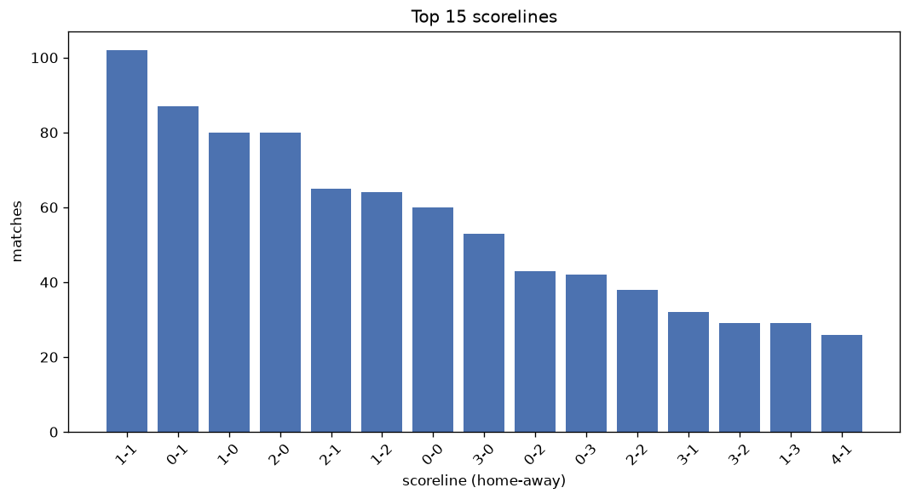
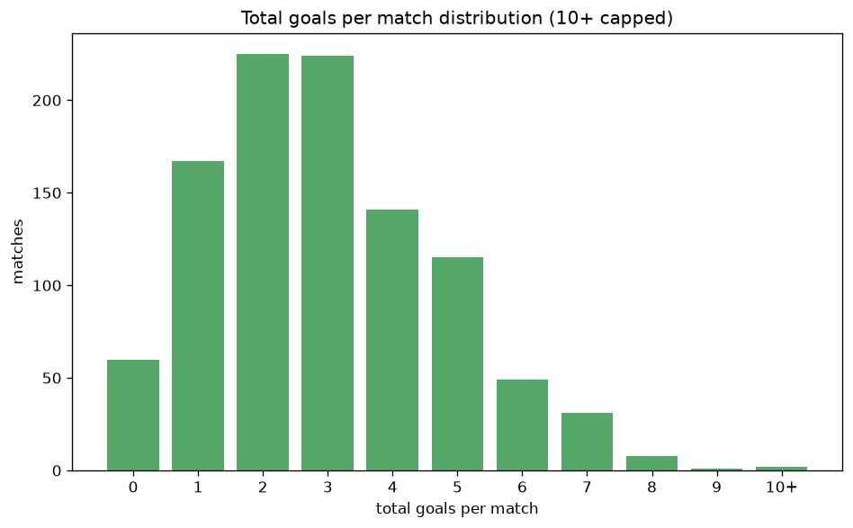

# Scoreline Analysis
- Report: `scoreline_analysis`
- Generated: 2026-10-27T02:01:36+00:00
- Script: `backend/scripts/analyze_scorelines.py` v1.0.0
- League: Virsliga (Latvia)
- Scope: league `latvia`

## 1. Scoreline frequency
- Matches analysed: **1023** across **6** seasons.
- Distinct scorelines seen: **45**.

| scoreline | count | pct |
|---|---|---|
| 1-1 | 102 | 10.0% |
| 0-1 | 87 | 8.5% |
| 1-0 | 80 | 7.8% |
| 2-0 | 80 | 7.8% |
| 2-1 | 65 | 6.4% |
| 1-2 | 64 | 6.3% |
| 0-0 | 60 | 5.9% |
| 3-0 | 53 | 5.2% |
| 0-2 | 43 | 4.2% |
| 0-3 | 42 | 4.1% |
| 2-2 | 38 | 3.7% |
| 3-1 | 32 | 3.1% |
| 3-2 | 29 | 2.8% |
| 1-3 | 29 | 2.8% |
| 4-1 | 26 | 2.5% |
| 4-0 | 26 | 2.5% |
| 2-3 | 24 | 2.3% |
| 1-4 | 18 | 1.8% |
| 0-4 | 16 | 1.6% |
| 5-0 | 12 | 1.2% |

## 2. Scoreline frequency per season

### 2021
| scoreline | count | pct |
|---|---|---|
| 0-3 | 17 | 13.5% |
| 3-0 | 13 | 10.3% |
| 1-1 | 12 | 9.5% |
| 1-0 | 12 | 9.5% |
| 0-1 | 9 | 7.1% |

### 2022
| scoreline | count | pct |
|---|---|---|
| 2-0 | 19 | 10.4% |
| 0-1 | 14 | 7.7% |
| 1-1 | 14 | 7.7% |
| 1-0 | 12 | 6.6% |
| 0-0 | 12 | 6.6% |

### 2023
| scoreline | count | pct |
|---|---|---|
| 1-1 | 23 | 12.6% |
| 1-0 | 18 | 9.9% |
| 0-1 | 13 | 7.1% |
| 0-0 | 12 | 6.6% |
| 2-0 | 12 | 6.6% |

### 2024
| scoreline | count | pct |
|---|---|---|
| 1-2 | 17 | 9.3% |
| 0-1 | 14 | 7.7% |
| 2-0 | 14 | 7.7% |
| 1-1 | 13 | 7.1% |
| 0-0 | 12 | 6.6% |

### 2025
| scoreline | count | pct |
|---|---|---|
| 1-1 | 20 | 11.0% |
| 2-0 | 19 | 10.4% |
| 0-1 | 18 | 9.9% |
| 1-0 | 16 | 8.8% |
| 2-2 | 12 | 6.6% |

### 2026
| scoreline | count | pct |
|---|---|---|
| 1-1 | 20 | 11.8% |
| 0-1 | 19 | 11.2% |
| 2-1 | 15 | 8.9% |
| 1-2 | 13 | 7.7% |
| 1-0 | 12 | 7.1% |

## 3. Total-goal histogram
_10+ groups all matches with 10 or more total goals._

| total goals | matches | pct |
|---|---|---|
| 0 | 60 | 5.9% |
| 1 | 167 | 16.3% |
| 2 | 225 | 22.0% |
| 3 | 224 | 21.9% |
| 4 | 141 | 13.8% |
| 5 | 115 | 11.2% |
| 6 | 49 | 4.8% |
| 7 | 31 | 3.0% |
| 8 | 8 | 0.8% |
| 9 | 1 | 0.1% |
| 10+ | 2 | 0.2% |

## 4. Extreme scorelines
- Matches with 7+ total goals: **42**

| season | date | scoreline | total goals |
|---|---|---|---|
| 2024 | 2024-10-27 | 10-1 | 11 |
| 2022 | 2022-04-11 | 0-10 | 10 |
| 2023 | 2023-10-21 | 4-5 | 9 |
| 2021 | 2021-09-15 | 7-1 | 8 |
| 2023 | 2023-04-28 | 2-6 | 8 |
| 2023 | 2023-05-09 | 1-7 | 8 |
| 2023 | 2023-09-01 | 3-5 | 8 |
| 2025 | 2025-06-30 | 1-7 | 8 |
| 2025 | 2025-07-26 | 6-2 | 8 |
| 2025 | 2025-08-30 | 2-6 | 8 |
| 2026 | 2026-04-04 | 0-8 | 8 |
| 2021 | 2021-04-03 | 6-1 | 7 |
| 2021 | 2021-05-01 | 5-2 | 7 |
| 2021 | 2021-05-20 | 0-7 | 7 |
| 2021 | 2021-06-17 | 5-2 | 7 |
| 2021 | 2021-07-13 | 7-0 | 7 |
| 2021 | 2021-10-20 | 2-5 | 7 |
| 2022 | 2022-07-24 | 6-1 | 7 |
| 2022 | 2022-08-06 | 6-1 | 7 |
| 2022 | 2022-08-27 | 7-0 | 7 |
| 2022 | 2022-09-17 | 1-6 | 7 |
| 2022 | 2022-10-01 | 5-2 | 7 |
| 2022 | 2022-11-06 | 1-6 | 7 |
| 2023 | 2023-04-06 | 4-3 | 7 |
| 2023 | 2023-05-26 | 5-2 | 7 |
| 2023 | 2023-06-04 | 1-6 | 7 |
| 2023 | 2023-06-30 | 2-5 | 7 |
| 2023 | 2023-07-23 | 2-5 | 7 |
| 2023 | 2023-07-29 | 7-0 | 7 |
| 2023 | 2023-11-22 | 6-1 | 7 |
| 2024 | 2024-06-01 | 1-6 | 7 |
| 2024 | 2024-06-14 | 6-1 | 7 |
| 2024 | 2024-07-05 | 7-0 | 7 |
| 2024 | 2024-07-19 | 6-1 | 7 |
| 2024 | 2024-08-31 | 6-1 | 7 |
| 2025 | 2025-04-03 | 2-5 | 7 |
| 2025 | 2025-05-25 | 2-5 | 7 |
| 2025 | 2025-11-07 | 3-4 | 7 |
| 2026 | 2026-05-02 | 3-4 | 7 |
| 2026 | 2026-05-07 | 6-1 | 7 |
| 2026 | 2026-05-07 | 7-0 | 7 |
| 2026 | 2026-08-10 | 6-1 | 7 |

## 5. Margin-of-victory distribution (decided matches)
- Decided matches: **814** (draws: **209**)
- Average winning margin: **2.14**

| margin | matches | pct |
|---|---|---|
| 1 | 353 | 43.4% |
| 2 | 198 | 24.3% |
| 3+ | 263 | 32.3% |

## 6. Margin by outcome

### Home wins
- Matches: **448** | avg margin: **2.23** | max margin: **9**
| margin | matches | pct |
|---|---|---|
| 1 | 175 | 39.1% |
| 2 | 120 | 26.8% |
| 3+ | 153 | 34.2% |
- *Full match-by-match list available in `scoreline_analysis.json`.*

### Away wins
- Matches: **366** | avg margin: **2.03** | max margin: **10**
| margin | matches | pct |
|---|---|---|
| 1 | 178 | 48.6% |
| 2 | 78 | 21.3% |
| 3+ | 110 | 30.1% |
- *Full match-by-match list available in `scoreline_analysis.json`.*

## 7. Most common exact score by outcome type
| outcome | matches | most common score | count | pct |
|---|---|---|---|---|
| home | 448 | 1-0 | 80 | 17.9% |
| draw | 209 | 1-1 | 102 | 48.8% |
| away | 366 | 0-1 | 87 | 23.8% |

---
*All statistics are computed from PostgreSQL tables (read-only). Run with `python backend/scripts/analyze_scorelines.py` to regenerate.*

## Charts

