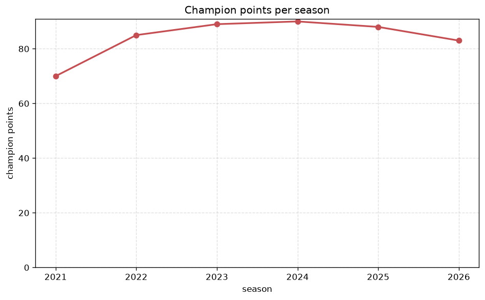
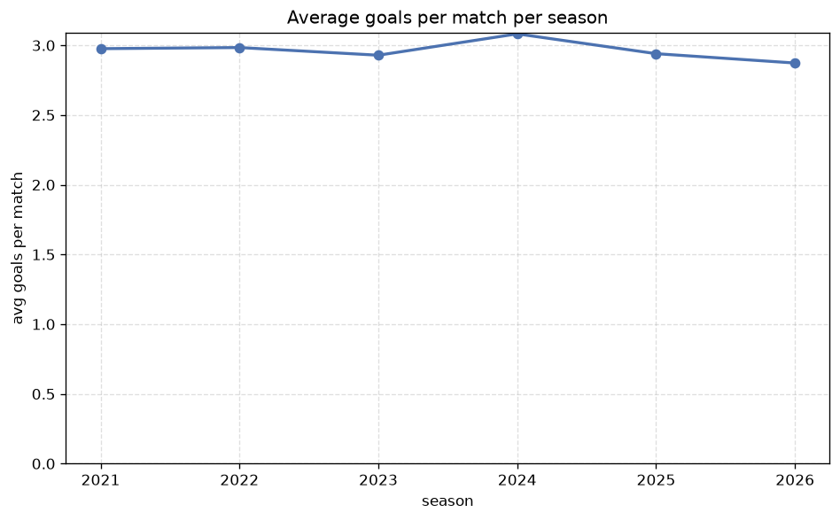

# Season Trends Analysis
- Report: `season_trends`
- Generated: 2026-10-26T01:40:42+00:00
- Script: `backend/scripts/analyze_seasons.py` v1.0.0
- League: Virsliga (Latvia)
- Scope: league `latvia`

## 1. Champions per season
| season | champion | pts | runner-up | margin |
|---|---|---|---|---|
| 2021 | RFS | 70 | Valmiera | 2 pts |
| 2022 | Valmiera | 85 | Riga FC | 4 pts |
| 2023 | RFS | 89 | Riga FC | 1 pts |
| 2024 | RFS | 90 | Riga FC | 3 pts |
| 2025 | Riga FC | 88 | RFS | 1 pts |
| 2026 | RFS | 83 | Riga FC | 4 pts |

## 2. Title-race tightness
- Tight races (margin <= 3 pts): **4** of 6 seasons
- Tightest race: **2023** - RFS beat Riga FC by **1** pts

| season | margin | tight |
|---|---|---|
| 2021 | 2 pts | yes |
| 2022 | 4 pts |  |
| 2023 | 1 pts | yes |
| 2024 | 3 pts | yes |
| 2025 | 1 pts | yes |
| 2026 | 4 pts |  |

## 3. Points thresholds
_Position-specific points per season. Key: 1 = champion, 2 = runner-up, 4 = CL line, 6 = Europa, 7 = last safe, 10 = bottom._

| season | pos 1 | pos 2 | pos 4 | pos 6 | pos 7 | pos 10 |
|---|---|---|---|---|---|---|
| 2021 | 70 | 68 | 56 | 36 | 20 | - |
| 2022 | 85 | 81 | 70 | 38 | 34 | 20 |
| 2023 | 89 | 88 | 53 | 40 | 39 | 14 |
| 2024 | 90 | 87 | 60 | 39 | 36 | 25 |
| 2025 | 88 | 87 | 48 | 38 | 36 | 31 |
| 2026 | 83 | 79 | 47 | 38 | 32 | 18 |

## 4. Relegation battle
| season | safe pos | safe pts | drop pos | drop pts | gap |
|---|---|---|---|---|---|
| 2021 | 7 | 20 | 8 | 9 | 11 pts |
| 2022 | 7 | 34 | 8 | 31 | 3 pts |
| 2023 | 7 | 39 | 8 | 36 | 3 pts |
| 2024 | 7 | 36 | 8 | 35 | 1 pts |
| 2025 | 7 | 36 | 8 | 36 | 0 pts |
| 2026 | 7 | 32 | 8 | 29 | 3 pts |

## 5. League-level trends
| season | matches | total goals | avg goals | home win | draw | away win | goalless | avg pts/team |
|---|---|---|---|---|---|---|---|---|
| 2021 | 126 | 375 | 2.976 | 46.8% | 15.9% | 37.3% | 3.2% | 39.78 |
| 2022 | 182 | 543 | 2.984 | 42.9% | 17.6% | 39.6% | 6.6% | 46.73 |
| 2023 | 182 | 533 | 2.929 | 43.4% | 23.6% | 33.0% | 6.6% | 45.73 |
| 2024 | 182 | 561 | 3.082 | 42.3% | 18.1% | 39.6% | 6.6% | 46.64 |
| 2025 | 182 | 535 | 2.94 | 45.6% | 23.6% | 30.8% | 6.0% | 45.73 |
| 2026 | 166 | 477 | 2.873 | 43.4% | 22.9% | 33.7% | 5.4% | 46.0 |

## 6. View divergence
- Largest divergence: **2023** (goals view, avg abs position diff = 4.545)

_Avg absolute position difference between classic view and alternative view per season._

| season | classic vs luck | classic vs goals |
|---|---|---|
| 2021 | 0.889 | 3.556 |
| 2022 | 2.364 | 3.636 |
| 2023 | 2.727 | 4.545 |
| 2024 | 3.091 | 3.273 |
| 2025 | 2.909 | 2.182 |
| 2026 | 1.600 | 3.400 |

---
*All statistics are computed from PostgreSQL tables (read-only). Run with `python backend/scripts/analyze_seasons.py` to regenerate.*

## Charts

