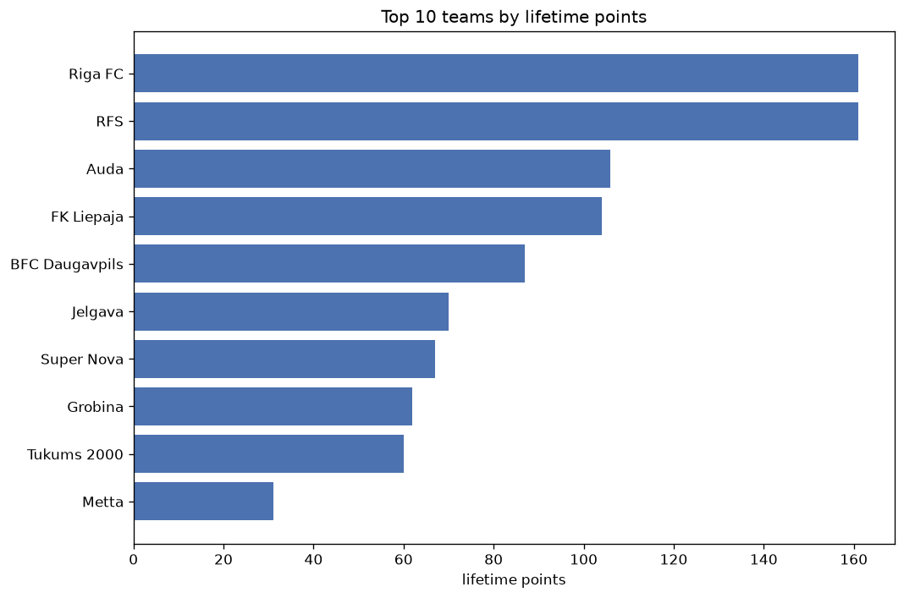
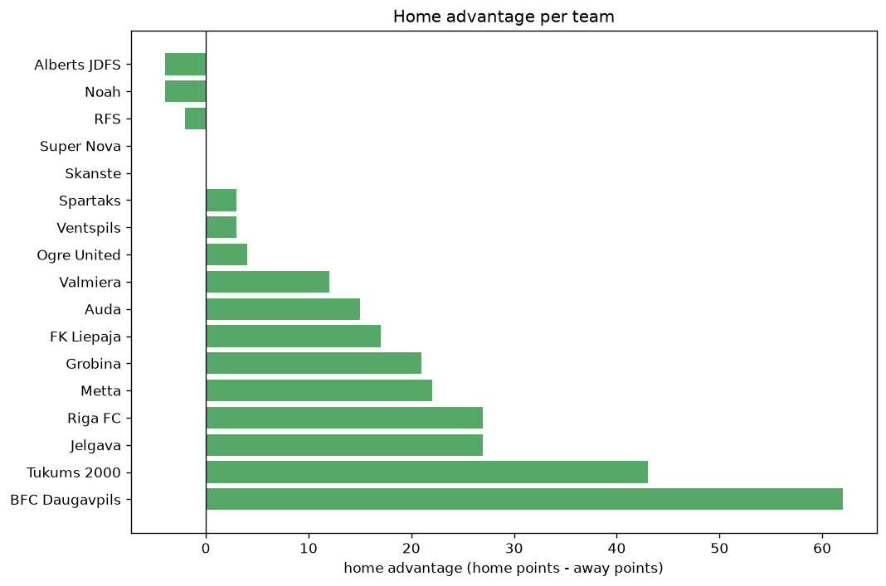

# Team Analysis
- Report: `teams_analysis`
- Generated: 2026-10-30T04:01:43+00:00
- Script: `backend/scripts/analyze_teams.py` v1.0.0
- League: Virsliga (Latvia)
- Scope: league `latvia`

- Teams: **17** | Seasons: **6** | Matches: **1024**

## 1. Team standings (lifetime)
| team | seasons | played | W | D | L | pts | GF | GA | GD | avg pts/season | best pos | worst pos | titles |
|---|---|---|---|---|---|---|---|---|---|---|---|---|---|
| RFS | 6 | 208 | 154 | 36 | 18 | 498 | 533 | 161 | 372 | 83.0 | 1 | 3 | 4 |
| Riga FC | 6 | 208 | 148 | 38 | 22 | 482 | 496 | 152 | 344 | 80.33 | 1 | 4 | 1 |
| FK Liepaja | 6 | 208 | 94 | 43 | 71 | 325 | 317 | 280 | 37 | 54.17 | 3 | 6 | 0 |
| Auda | 5 | 178 | 82 | 35 | 61 | 281 | 250 | 193 | 57 | 56.2 | 3 | 5 | 0 |
| Valmiera | 4 | 138 | 80 | 30 | 28 | 270 | 280 | 123 | 157 | 67.5 | 1 | 4 | 1 |
| BFC Daugavpils | 6 | 208 | 66 | 48 | 94 | 246 | 246 | 333 | -87 | 41.0 | 4 | 8 | 0 |
| Tukums 2000 | 5 | 178 | 43 | 40 | 95 | 169 | 206 | 361 | -155 | 33.8 | 6 | 9 | 0 |
| Metta | 5 | 177 | 40 | 34 | 103 | 154 | 203 | 363 | -160 | 30.8 | 7 | 10 | 0 |
| Jelgava | 4 | 142 | 32 | 39 | 71 | 135 | 143 | 242 | -99 | 33.75 | 6 | 10 | 0 |
| Super Nova | 4 | 142 | 24 | 32 | 86 | 104 | 125 | 283 | -158 | 26.0 | 6 | 10 | 0 |
| Grobina | 4 | 112 | 24 | 25 | 63 | 97 | 101 | 211 | -110 | 24.25 | 8 | 11 | 0 |
| Spartaks | 2 | 65 | 20 | 7 | 38 | 67 | 77 | 116 | -39 | 33.5 | 6 | 8 | 0 |
| Ogre United | 1 | 34 | 4 | 6 | 24 | 18 | 34 | 85 | -51 | 18.0 | 10 | 10 | 0 |
| Ventspils | 1 | 14 | 2 | 3 | 9 | 9 | 14 | 23 | -9 | 9.0 | 8 | 8 | 0 |
| Alberts JDFS | 2 | 4 | 1 | 1 | 2 | 4 | 3 | 5 | -2 | 2.0 | 11 | 11 | 0 |
| Noah | 1 | 30 | 1 | 1 | 28 | 4 | 10 | 101 | -91 | 4.0 | 9 | 9 | 0 |
| Skanste | 1 | 2 | 0 | 0 | 2 | 0 | 2 | 8 | -6 | 0.0 | 11 | 11 | 0 |

## 2. Home vs away split
| team | home P | H-W | H-D | H-L | H-pts | away P | A-W | A-D | A-L | A-pts | adv |
|---|---|---|---|---|---|---|---|---|---|---|---|
| BFC Daugavpils | 104 | 44 | 22 | 38 | 154 | 104 | 22 | 26 | 56 | 92 | 62 |
| Tukums 2000 | 89 | 28 | 22 | 39 | 106 | 89 | 15 | 18 | 56 | 63 | 43 |
| Jelgava | 71 | 21 | 18 | 32 | 81 | 71 | 11 | 21 | 39 | 54 | 27 |
| Riga FC | 104 | 79 | 16 | 9 | 253 | 104 | 69 | 22 | 13 | 229 | 24 |
| Metta | 88 | 22 | 22 | 44 | 88 | 89 | 18 | 12 | 59 | 66 | 22 |
| Grobina | 56 | 15 | 14 | 27 | 59 | 56 | 9 | 11 | 36 | 38 | 21 |
| FK Liepaja | 104 | 49 | 24 | 31 | 171 | 104 | 45 | 19 | 40 | 154 | 17 |
| Auda | 89 | 45 | 13 | 31 | 148 | 89 | 37 | 22 | 30 | 133 | 15 |
| Valmiera | 69 | 42 | 15 | 12 | 141 | 69 | 38 | 15 | 16 | 129 | 12 |
| Ogre United | 17 | 2 | 5 | 10 | 11 | 17 | 2 | 1 | 14 | 7 | 4 |
| Spartaks | 32 | 11 | 2 | 19 | 35 | 33 | 9 | 5 | 19 | 32 | 3 |
| Ventspils | 8 | 1 | 3 | 4 | 6 | 6 | 1 | 0 | 5 | 3 | 3 |
| Super Nova | 71 | 12 | 16 | 43 | 52 | 71 | 12 | 16 | 43 | 52 | 0 |
| Skanste | 1 | 0 | 0 | 1 | 0 | 1 | 0 | 0 | 1 | 0 | 0 |
| RFS | 104 | 77 | 17 | 10 | 248 | 104 | 77 | 19 | 8 | 250 | -2 |
| Alberts JDFS | 2 | 0 | 0 | 2 | 0 | 2 | 1 | 1 | 0 | 4 | -4 |
| Noah | 15 | 0 | 0 | 15 | 0 | 15 | 1 | 1 | 13 | 4 | -4 |

## 3. Top performers
### Best points per game (PPG)
| rank | team | PPG |
|---|---|---|
| 1 | RFS | 2.39 |
| 2 | Riga FC | 2.32 |
| 3 | Valmiera | 1.96 |
| 4 | Auda | 1.58 |
| 5 | FK Liepaja | 1.56 |

### Most goals scored
| rank | team | goals |
|---|---|---|
| 1 | RFS | 533 |
| 2 | Riga FC | 496 |
| 3 | FK Liepaja | 317 |
| 4 | Valmiera | 280 |
| 5 | Auda | 250 |

### Best goal difference
| rank | team | GD |
|---|---|---|
| 1 | RFS | 372 |
| 2 | Riga FC | 344 |
| 3 | Valmiera | 157 |
| 4 | Auda | 57 |
| 5 | FK Liepaja | 37 |

### Best defence (goals against per match, standings)
| rank | team | GA/match |
|---|---|---|
| 1 | Riga FC | 0.731 |
| 2 | RFS | 0.774 |
| 3 | Valmiera | 0.891 |
| 4 | Auda | 1.084 |
| 5 | Alberts JDFS | 1.250 |

## 4. Team consistency
- Teams present in all **6** seasons: **4**

BFC Daugavpils, FK Liepaja, RFS, Riga FC

## 5. Head-to-head dominance
- Distinct fixtures: **90** (showing the 15 most frequent)

| fixture | meetings | home wins | draws | away wins | home pct | draw pct | away pct |
|---|---|---|---|---|---|---|---|
| FK Liepaja vs Riga FC | 24 | 14 | 2 | 8 | 58.3% | 8.3% | 33.3% |
| RFS vs BFC Daugavpils | 24 | 12 | 1 | 11 | 50.0% | 4.2% | 45.8% |
| FK Liepaja vs BFC Daugavpils | 24 | 11 | 7 | 6 | 45.8% | 29.2% | 25.0% |
| RFS vs FK Liepaja | 24 | 10 | 6 | 8 | 41.7% | 25.0% | 33.3% |
| Riga FC vs BFC Daugavpils | 24 | 10 | 6 | 8 | 41.7% | 25.0% | 33.3% |
| RFS vs Riga FC | 23 | 5 | 12 | 6 | 21.7% | 52.2% | 26.1% |
| BFC Daugavpils vs Metta | 20 | 11 | 5 | 4 | 55.0% | 25.0% | 20.0% |
| RFS vs Metta | 20 | 11 | 3 | 6 | 55.0% | 15.0% | 30.0% |
| BFC Daugavpils vs Auda | 20 | 9 | 2 | 9 | 45.0% | 10.0% | 45.0% |
| RFS vs Tukums 2000 | 20 | 9 | 1 | 10 | 45.0% | 5.0% | 50.0% |
| Riga FC vs Tukums 2000 | 20 | 9 | 2 | 9 | 45.0% | 10.0% | 45.0% |
| FK Liepaja vs Auda | 20 | 8 | 6 | 6 | 40.0% | 30.0% | 30.0% |
| FK Liepaja vs Metta | 20 | 8 | 4 | 8 | 40.0% | 20.0% | 40.0% |
| FK Liepaja vs Tukums 2000 | 20 | 8 | 5 | 7 | 40.0% | 25.0% | 35.0% |
| Riga FC vs Auda | 20 | 8 | 3 | 9 | 40.0% | 15.0% | 45.0% |

## 6. Position per season (classic view)
_Cells show final position; '-' when the team was absent from that season._

| team | 2021 | 2022 | 2023 | 2024 | 2025 | 2026 |
|---|---|---|---|---|---|---|
| RFS | 1 | 3 | 1 | 1 | 2 | 1 |
| Riga FC | 4 | 2 | 2 | 2 | 1 | 2 |
| FK Liepaja | 3 | 4 | 5 | 6 | 3 | 5 |
| Auda | - | 5 | 3 | 4 | 5 | 3 |
| Valmiera | 2 | 1 | 4 | 3 | - | - |
| BFC Daugavpils | 5 | 7 | 8 | 5 | 4 | 4 |
| Tukums 2000 | - | 6 | 9 | 8 | 7 | 9 |
| Metta | 7 | 9 | 7 | 7 | 10 | - |
| Jelgava | - | - | 6 | 10 | 6 | 7 |
| Super Nova | - | 10 | 10 | - | 9 | 6 |
| Grobina | - | 11 | - | 9 | 8 | 8 |
| Spartaks | 6 | 8 | - | - | - | - |
| Ogre United | - | - | - | - | - | 10 |
| Ventspils | 8 | - | - | - | - | - |
| Alberts JDFS | - | - | - | 11 | 11 | - |
| Noah | 9 | - | - | - | - | - |
| Skanste | - | - | 11 | - | - | - |

---
*All statistics are computed from PostgreSQL tables (read-only). Run with `python backend/scripts/analyze_teams.py` to regenerate.*

## Charts

