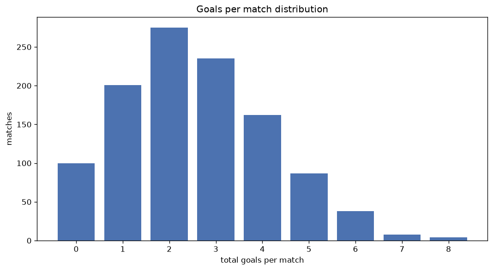
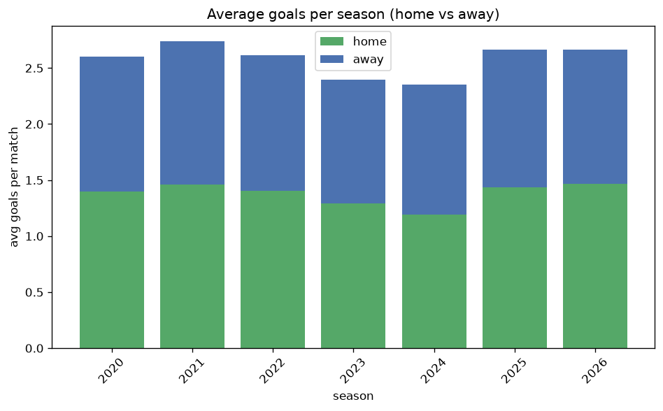

# Goal Analysis
- Report: `goals_analysis`
- Generated: 2026-10-30T04:02:01+00:00
- Script: `backend/scripts/analyze_goals.py` v1.0.0
- League: TOPLYGA (Lithuania)
- Scope: league `lithuania`

## 1. Goals per match distribution
| goals | matches | pct |
|---|---|---|
| 0 | 102 | 9.2% |
| 1 | 201 | 18.1% |
| 2 | 275 | 24.7% |
| 3 | 236 | 21.2% |
| 4 | 162 | 14.6% |
| 5 | 87 | 7.8% |
| 6 | 38 | 3.4% |
| 7 | 8 | 0.7% |
| 8 | 4 | 0.4% |

## 2. Goals per match per season
| season | matches | total goals | avg home | avg away | avg total |
|---|---|---|---|---|---|
| 2020 | 60 | 156 | 1.4 | 1.2 | 2.6 |
| 2021 | 180 | 493 | 1.461 | 1.278 | 2.739 |
| 2022 | 180 | 471 | 1.406 | 1.211 | 2.617 |
| 2023 | 180 | 431 | 1.289 | 1.106 | 2.394 |
| 2024 | 180 | 423 | 1.189 | 1.161 | 2.35 |
| 2025 | 180 | 479 | 1.433 | 1.228 | 2.661 |
| 2026 | 153 | 405 | 1.458 | 1.19 | 2.647 |

## 3. Home vs away goal share
- Home goals: **1527** (53.4%)
- Away goals: **1331** (46.6%)
- Home/away ratio: **1.147**

| season | home goals | away goals | total | home pct | away pct |
|---|---|---|---|---|---|
| 2020 | 84 | 72 | 156 | 53.8% | 46.2% |
| 2021 | 263 | 230 | 493 | 53.3% | 46.7% |
| 2022 | 253 | 218 | 471 | 53.7% | 46.3% |
| 2023 | 232 | 199 | 431 | 53.8% | 46.2% |
| 2024 | 214 | 209 | 423 | 50.6% | 49.4% |
| 2025 | 258 | 221 | 479 | 53.9% | 46.1% |
| 2026 | 223 | 182 | 405 | 55.1% | 44.9% |

## 4. BTTS (Both Teams To Score)
- Overall: **517** of `1113` (46.5%)

| season | matches | BTTS | pct |
|---|---|---|---|
| 2020 | 60 | 28 | 46.7% |
| 2021 | 180 | 97 | 53.9% |
| 2022 | 180 | 81 | 45.0% |
| 2023 | 180 | 69 | 38.3% |
| 2024 | 180 | 78 | 43.3% |
| 2025 | 180 | 92 | 51.1% |
| 2026 | 153 | 72 | 47.1% |

## 5. Clean sheets
- Home clean sheets: **363** (32.6%)
- Away clean sheets: **335** (30.1%)
- Total clean sheets recorded: **698**
- Matches with at least one clean sheet: **596** (53.5%)
- Both teams kept clean sheets (0-0): **102**

| season | matches | home CS | away CS | total CS | matches w/ CS |
|---|---|---|---|---|---|
| 2020 | 60 | 19 | 15 | 34 | 32 (53.3%) |
| 2021 | 180 | 50 | 43 | 93 | 83 (46.1%) |
| 2022 | 180 | 58 | 56 | 114 | 99 (55.0%) |
| 2023 | 180 | 73 | 59 | 132 | 111 (61.7%) |
| 2024 | 180 | 57 | 68 | 125 | 102 (56.7%) |
| 2025 | 180 | 51 | 50 | 101 | 88 (48.9%) |
| 2026 | 153 | 55 | 44 | 99 | 81 (52.9%) |

## 6. Scoring intensity
- First-half goals: **1233** (43.3%)
- Second-half goals: **1616** (56.7%)
- Avg first-half goals per match: **1.111**
- Avg second-half goals per match: **1.456**
- Second-half-only scoring (HT 0-0, FT goals >= 1): **271** (24.3%)
- *3 match(es) excluded (no HT score recorded).*

| season | matches | 1st half | 2nd half | 1st half pct | 2nd half pct |
|---|---|---|---|---|---|
| 2020 | 60 | 69 | 87 | 44.2% | 55.8% |
| 2021 | 180 | 209 | 284 | 42.4% | 57.6% |
| 2022 | 180 | 217 | 254 | 46.1% | 53.9% |
| 2023 | 180 | 175 | 253 | 40.9% | 59.1% |
| 2024 | 180 | 175 | 245 | 41.7% | 58.3% |
| 2025 | 180 | 210 | 269 | 43.8% | 56.2% |
| 2026 | 153 | 178 | 224 | 44.3% | 55.7% |

## 7. First-goal timing
- Matches with first-goal time recorded: `1008` of `1113` (90.6%)
- Goalless matches: `105`
- Min `1` | Max `99` | Mean `33.13` | Median (p50) `28.0`

| bucket | count | % of matches | % of scoring matches |
|---|---|---|---|
| 1-15 | 307 | 27.6% | 30.5% |
| 16-30 | 239 | 21.5% | 23.7% |
| 31-45 | 170 | 15.3% | 16.9% |
| 46-60 | 142 | 12.8% | 14.1% |
| 61-75 | 75 | 6.7% | 7.4% |
| 76-90 | 57 | 5.1% | 5.7% |
| 91-120 | 18 | 1.6% | 1.8% |

---
*All statistics are computed from PostgreSQL tables (read-only). Run with `python backend/scripts/analyze_goals.py` to regenerate.*

## Charts

