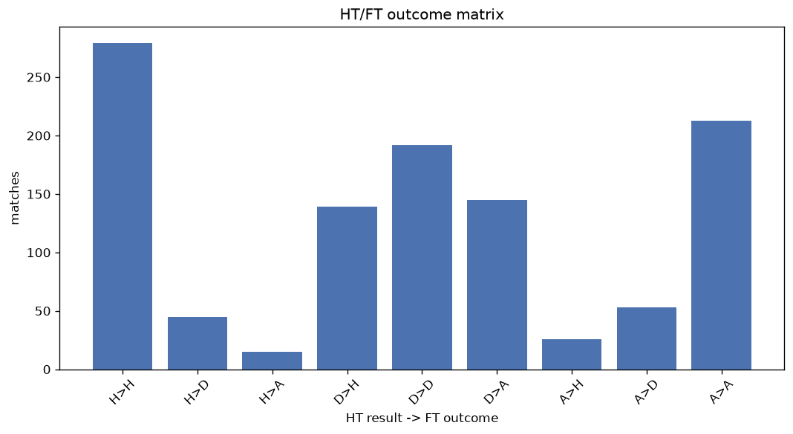
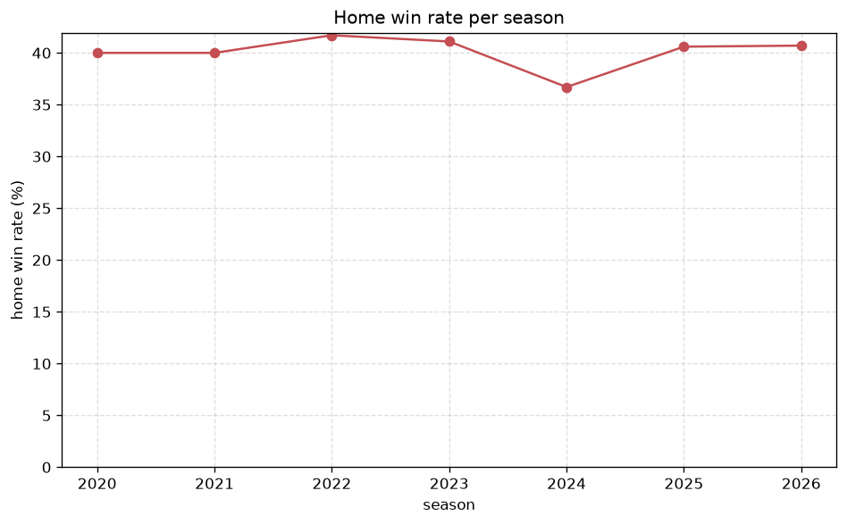

# Match Analysis
- Report: `matches_analysis`
- Generated: 2026-10-26T01:40:52+00:00
- Script: `backend/scripts/analyze_matches.py` v1.0.0
- League: TOPLYGA (Lithuania)
- Scope: league `lithuania`

## 1. Overall summary
| metric | value |
|---|---|
| Matches | 1110 |
| Home wins | 445 (40.1%) |
| Draws | 290 (26.1%) |
| Away wins | 375 (33.8%) |
| Total goals | 2855 |
| Average goals per match | 2.572 |
| Goalless matches | 100 (9.0%) |

## 2. Per-season breakdown
| season | matches | home wins | draws | away wins | total goals | avg goals | goalless |
|---|---|---|---|---|---|---|---|
| 2020 | 60 | 24 (40.0%) | 14 (23.3%) | 22 (36.7%) | 156 | 2.6 | 2 (3.3%) |
| 2021 | 180 | 72 (40.0%) | 49 (27.2%) | 59 (32.8%) | 493 | 2.739 | 10 (5.6%) |
| 2022 | 180 | 75 (41.7%) | 46 (25.6%) | 59 (32.8%) | 471 | 2.617 | 15 (8.3%) |
| 2023 | 180 | 74 (41.1%) | 46 (25.6%) | 60 (33.3%) | 431 | 2.394 | 21 (11.7%) |
| 2024 | 180 | 66 (36.7%) | 50 (27.8%) | 64 (35.6%) | 423 | 2.35 | 23 (12.8%) |
| 2025 | 180 | 73 (40.6%) | 44 (24.4%) | 63 (35.0%) | 479 | 2.661 | 13 (7.2%) |
| 2026 | 150 | 61 (40.7%) | 41 (27.3%) | 48 (32.0%) | 402 | 2.68 | 16 (10.7%) |

## 3. HT/FT outcome matrix
| HT result \ FT result | Home | Draw | Away | total |
|---|---|---|---|---|
| HT home lead | 279 (82.3%) | 45 (13.3%) | 15 (4.4%) | 339 |
| HT draw | 139 (29.2%) | 192 (40.3%) | 145 (30.5%) | 476 |
| HT away lead | 26 (8.9%) | 53 (18.2%) | 213 (72.9%) | 292 |
- *3 match(es) excluded (no HT score recorded).*

## 4. Comeback matches
- Home comebacks (trailing at HT, won at FT): **26** (2.3%)
- Away comebacks (trailing at HT, won at FT): **15** (1.4%)

### Home comebacks
| season | home | away | HT | FT |
|---|---|---|---|---|
| 2021 | Riteriai | Dainava Alytus | 0-1 | 2-1 |
| 2021 | Banga | Nevezis Kedainiai | 0-1 | 3-1 |
| 2022 | Kauno Zalgiris | FK Panevezys | 0-1 | 2-1 |
| 2022 | Riteriai | Jonava | 0-1 | 2-1 |
| 2023 | Dainava Alytus | Banga | 0-1 | 2-1 |
| 2023 | FK Panevezys | Kauno Zalgiris | 0-1 | 2-1 |
| 2023 | Kauno Zalgiris | Dziugas Telsiai | 0-1 | 3-1 |
| 2023 | Hegelmann | Kauno Zalgiris | 0-1 | 3-2 |
| 2023 | FK Panevezys | Riteriai | 0-1 | 3-1 |
| 2023 | Suduva | Zalgiris | 0-1 | 2-1 |
| 2023 | Dainava Alytus | Suduva | 0-1 | 2-1 |
| 2024 | Siauliai FA | Kauno Zalgiris | 0-1 | 2-1 |
| 2024 | Zalgiris | Dziugas Telsiai | 0-1 | 3-1 |
| 2024 | Transinvest | Kauno Zalgiris | 0-2 | 3-2 |
| 2024 | Kauno Zalgiris | Siauliai FA | 0-1 | 2-1 |
| 2024 | Hegelmann | Suduva | 1-2 | 3-2 |
| 2024 | Dainava Alytus | Dziugas Telsiai | 0-1 | 3-1 |
| 2024 | Kauno Zalgiris | Siauliai FA | 0-1 | 2-1 |
| 2025 | Hegelmann | Dainava Alytus | 0-2 | 3-2 |
| 2025 | Dainava Alytus | Banga | 0-1 | 2-1 |
| 2025 | Dziugas Telsiai | Riteriai | 0-1 | 2-1 |
| 2025 | Suduva | Banga | 0-1 | 2-1 |
| 2026 | FA Siauliai | FK Panevezys | 0-1 | 3-1 |
| 2026 | FA Siauliai | Suduva | 0-1 | 2-1 |
| 2026 | FK Panevezys | Zalgiris | 0-1 | 2-1 |
| 2026 | FK Panevezys | Banga | 0-1 | 2-1 |

### Away comebacks
| season | home | away | HT | FT |
|---|---|---|---|---|
| 2021 | Banga | Kauno Zalgiris | 2-1 | 2-3 |
| 2023 | Hegelmann | FK Panevezys | 2-1 | 2-4 |
| 2023 | Suduva | Kauno Zalgiris | 2-1 | 2-6 |
| 2023 | Banga | Riteriai | 1-0 | 1-2 |
| 2023 | Dainava Alytus | FK Panevezys | 1-0 | 1-2 |
| 2024 | Kauno Zalgiris | Hegelmann | 1-0 | 1-2 |
| 2024 | Zalgiris | Hegelmann | 1-0 | 1-3 |
| 2024 | Hegelmann | Dainava Alytus | 1-0 | 1-2 |
| 2025 | Kauno Zalgiris | Dziugas Telsiai | 1-0 | 1-2 |
| 2025 | Siauliai FA | Kauno Zalgiris | 2-1 | 2-3 |
| 2025 | Banga | Siauliai FA | 1-0 | 1-2 |
| 2025 | Zalgiris | FK Panevezys | 2-1 | 2-3 |
| 2026 | Riteriai | Kauno Zalgiris | 1-0 | 1-2 |
| 2026 | Transinvest | Kauno Zalgiris | 1-0 | 1-2 |
| 2026 | FK Panevezys | Suduva | 1-0 | 1-2 |

## 5. HT lead conversion
| HT state | matches | converted to win | held as draw | collapsed to loss |
|---|---|---|---|---|
| Home lead | 339 | 279 (82.3%) | 45 (13.3%) | 15 (4.4%) |
| Away lead | 292 | 213 (72.9%) | 53 (18.2%) | 26 (8.9%) |

### Matches level at half-time
| FT result | count | pct |
|---|---|---|
| Home win | 139 | 29.2% |
| Draw | 192 | 40.3% |
| Away win | 145 | 30.5% |
- *3 match(es) excluded (no HT score recorded).*

## 6. First-goal timing
- Matches with a first-goal time recorded: `1007` of `1110` (90.7%)

Outcome distribution by first-goal timing bucket:
| bucket | matches | % of matches | home | draw | away |
|---|---|---|---|---|---|
| 1-15 | 307 | 27.7% | 147 (47.9%) | 58 (18.9%) | 102 (33.2%) |
| 16-30 | 238 | 21.4% | 111 (46.6%) | 43 (18.1%) | 84 (35.3%) |
| 31-45 | 170 | 15.3% | 72 (42.4%) | 31 (18.2%) | 67 (39.4%) |
| 46-60 | 142 | 12.8% | 55 (38.7%) | 30 (21.1%) | 57 (40.1%) |
| 61-75 | 75 | 6.8% | 30 (40.0%) | 17 (22.7%) | 28 (37.3%) |
| 76-90 | 57 | 5.1% | 20 (35.1%) | 10 (17.5%) | 27 (47.4%) |
| 91-120 | 18 | 1.6% | 9 (50.0%) | 1 (5.6%) | 8 (44.4%) |

## 7. Goalless matches
- Overall: **100** of `1110` (9.0%)

| season | matches | goalless | pct |
|---|---|---|---|
| 2020 | 60 | 2 | 3.3% |
| 2021 | 180 | 10 | 5.6% |
| 2022 | 180 | 15 | 8.3% |
| 2023 | 180 | 21 | 11.7% |
| 2024 | 180 | 23 | 12.8% |
| 2025 | 180 | 13 | 7.2% |
| 2026 | 150 | 16 | 10.7% |

---
*All statistics are computed from PostgreSQL tables (read-only). Run with `python backend/scripts/analyze_matches.py` to regenerate.*

## Charts

