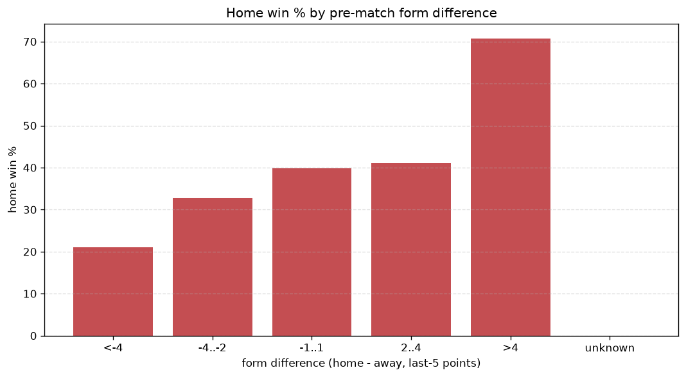
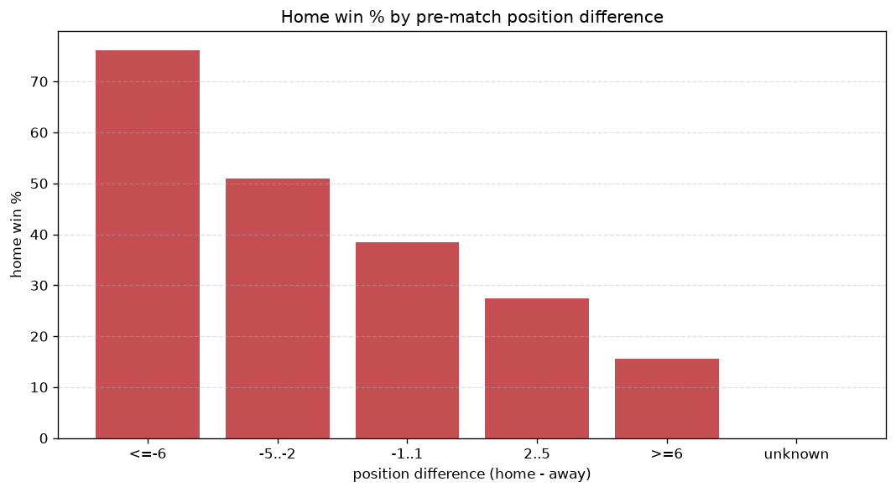

# Relationships Analysis
- Report: `relationships`
- Generated: 2026-10-26T01:41:00+00:00
- Script: `backend/scripts/analyze_relationships.py` v1.0.0
- League: TOPLYGA (Lithuania)
- Scope: league `lithuania`

- Matches analysed: **960** (23 leakage-safe pre-match features).

## 1. Correlation matrix
_Pearson correlation of each pre-match feature with observed goals; sorted by |corr(total goals)|._

| feature | corr(home) | corr(away) | corr(total) |
|---|---|---|---|
| home_points_before_match | 0.201 | -0.105 | 0.080 |
| home_position_before_match | -0.286 | 0.205 | -0.073 |
| position_difference | -0.348 | 0.280 | -0.068 |
| away_team_away_conceded_avg | 0.215 | -0.153 | 0.056 |
| home_team_home_goals_avg | 0.196 | -0.148 | 0.045 |
| points_difference | 0.341 | -0.304 | 0.043 |
| away_points_before_match | -0.096 | 0.161 | 0.043 |
| home_team_goals_scored_last_5 | 0.184 | -0.139 | 0.042 |
| home_team_points_last_5 | 0.224 | -0.189 | 0.036 |
| home_team_wins_last_5 | 0.213 | -0.178 | 0.036 |
| home_team_home_conceded_avg | -0.132 | 0.181 | 0.030 |
| away_team_away_win_rate | -0.155 | 0.128 | -0.028 |
| away_team_points_last_5 | -0.134 | 0.177 | 0.025 |
| away_position_before_match | 0.209 | -0.192 | 0.023 |
| rest_days_difference | -0.017 | -0.011 | -0.021 |
| away_team_goals_conceded_last_5 | 0.162 | -0.148 | 0.018 |
| away_rest_days | 0.050 | -0.030 | 0.017 |
| away_team_wins_last_5 | -0.131 | 0.160 | 0.015 |
| home_team_home_win_rate | 0.196 | -0.191 | 0.014 |
| home_team_goals_conceded_last_5 | -0.172 | 0.197 | 0.010 |
| away_team_away_goals_avg | -0.137 | 0.132 | -0.010 |
| away_team_goals_scored_last_5 | -0.135 | 0.154 | 0.007 |
| home_rest_days | 0.039 | -0.034 | 0.006 |

## 2. Form vs outcome
_Home win/draw/away % per bucket of `home_team_points_last_5 - away_team_points_last_5`._

| bucket | matches | home | draw | away | home % | draw % | away % |
|---|---|---|---|---|---|---|---|
| <-4 | 176 | 37 | 36 | 103 | 21.0% | 20.5% | 58.5% |
| -4..-2 | 201 | 66 | 47 | 88 | 32.8% | 23.4% | 43.8% |
| -1..1 | 248 | 99 | 79 | 70 | 39.9% | 31.9% | 28.2% |
| 2..4 | 185 | 76 | 57 | 52 | 41.1% | 30.8% | 28.1% |
| >4 | 150 | 106 | 30 | 14 | 70.7% | 20.0% | 9.3% |
| unknown | 0 | 0 | 0 | 0 | - | - | - |

## 3. Position vs outcome
_Home win/draw/away % per bucket of `position_difference` (home position - away position; negative favours the home team)._

| bucket | matches | home | draw | away | home % | draw % | away % |
|---|---|---|---|---|---|---|---|
| <=-6 | 88 | 67 | 10 | 11 | 76.1% | 11.4% | 12.5% |
| -5..-2 | 273 | 139 | 80 | 54 | 50.9% | 29.3% | 19.8% |
| -1..1 | 226 | 87 | 75 | 64 | 38.5% | 33.2% | 28.3% |
| 2..5 | 277 | 76 | 66 | 135 | 27.4% | 23.8% | 48.7% |
| >=6 | 96 | 15 | 18 | 63 | 15.6% | 18.8% | 65.6% |
| unknown | 0 | 0 | 0 | 0 | - | - | - |

## 4. Rest advantage
_Home win/draw/away % per bucket of `rest_days_difference` (home rest - away rest). Matches with unknown rest are bucketed separately._

| bucket | matches | home | draw | away | home % | draw % | away % |
|---|---|---|---|---|---|---|---|
| <-1 | 113 | 45 | 37 | 31 | 39.8% | 32.7% | 27.4% |
| -1..0 | 182 | 86 | 45 | 51 | 47.3% | 24.7% | 28.0% |
| 0 | 279 | 109 | 71 | 99 | 39.1% | 25.4% | 35.5% |
| 1..2 | 283 | 107 | 68 | 108 | 37.8% | 24.0% | 38.2% |
| >2 | 73 | 26 | 22 | 25 | 35.6% | 30.1% | 34.2% |
| unknown | 30 | 11 | 6 | 13 | 36.7% | 20.0% | 43.3% |
- *30 match(es) had unknown rest difference (missing rest data on at least one side).*

## 5. Home team quality
_Home win rate by `home_team_home_win_rate` tier (split at 0.5)._

- `< 0.5` tier: **33.1%** home win (200/604)
- `>= 0.5` tier: **51.7%** home win (184/356)
- Home-win gap (>= split minus < split): **+18.6 pp**

| tier | label | matches | home | draw | away | home % |
|---|---|---|---|---|---|---|
| low | < 0.5 | 604 | 200 | 159 | 245 | 33.1% |
| high | >= 0.5 | 356 | 184 | 90 | 82 | 51.7% |

## 6. Feature averages by result
_Mean feature value per outcome; `range` is home-minus-away spread of the group means._

| feature | home mean | draw mean | away mean | range |
|---|---|---|---|---|
| points_difference | 6.172 | -0.257 | -7.945 | 14.117 |
| home_points_before_match | 26.714 | 24.329 | 18.514 | 8.200 |
| away_points_before_match | 20.542 | 24.586 | 26.459 | 5.917 |
| position_difference | -1.544 | 0.016 | 2.049 | 3.593 |
| home_team_points_last_5 | 7.083 | 6.341 | 4.908 | 2.175 |
| home_position_before_match | 4.622 | 5.482 | 6.554 | 1.931 |
| home_team_goals_conceded_last_5 | 5.115 | 5.647 | 6.829 | 1.714 |
| away_team_points_last_5 | 5.604 | 6.466 | 7.297 | 1.692 |
| away_position_before_match | 6.167 | 5.466 | 4.505 | 1.662 |
| home_team_goals_scored_last_5 | 6.336 | 5.747 | 4.869 | 1.467 |
| away_team_goals_scored_last_5 | 5.190 | 5.904 | 6.596 | 1.406 |
| away_team_goals_conceded_last_5 | 6.307 | 5.566 | 4.908 | 1.399 |
| away_rest_days | 7.668 | 7.963 | 7.187 | 0.776 |
| home_team_wins_last_5 | 1.971 | 1.715 | 1.266 | 0.705 |
| away_team_wins_last_5 | 1.471 | 1.755 | 2.037 | 0.565 |
| home_rest_days | 7.797 | 8.004 | 7.487 | 0.517 |
| away_team_away_conceded_avg | 1.408 | 1.195 | 1.033 | 0.375 |
| home_team_home_goals_avg | 1.382 | 1.264 | 1.030 | 0.352 |
| home_team_home_conceded_avg | 0.948 | 1.079 | 1.244 | 0.296 |
| rest_days_difference | 0.147 | 0.037 | 0.296 | 0.259 |
| away_team_away_goals_avg | 0.971 | 1.087 | 1.230 | 0.258 |
| home_team_home_win_rate | 0.442 | 0.382 | 0.293 | 0.149 |
| away_team_away_win_rate | 0.280 | 0.336 | 0.391 | 0.111 |

---
*All features are leakage-safe pre-match values built by `ml.features.build_features.build_rows` from strictly prior matches. Run with `python backend/scripts/analyze_relationships.py` to regenerate.*

## Charts

