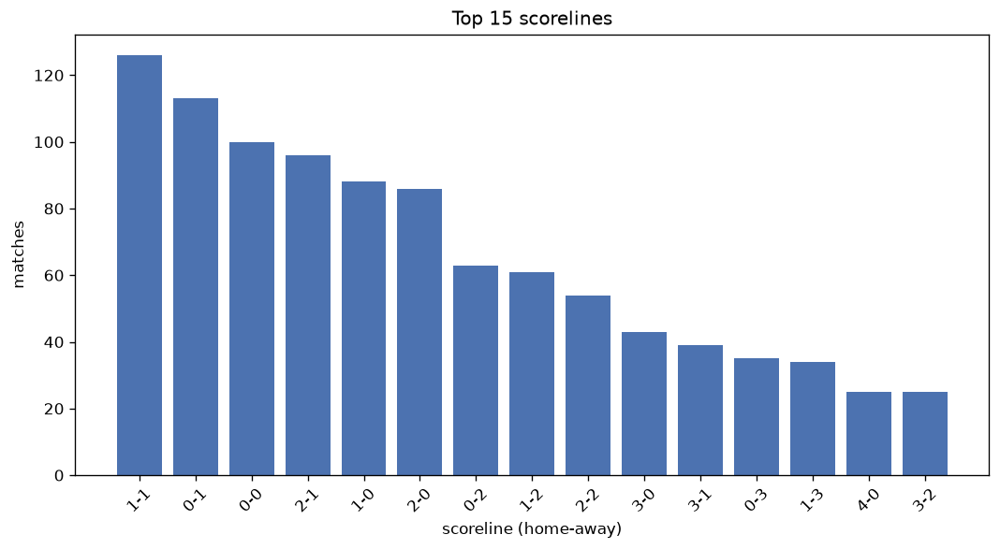
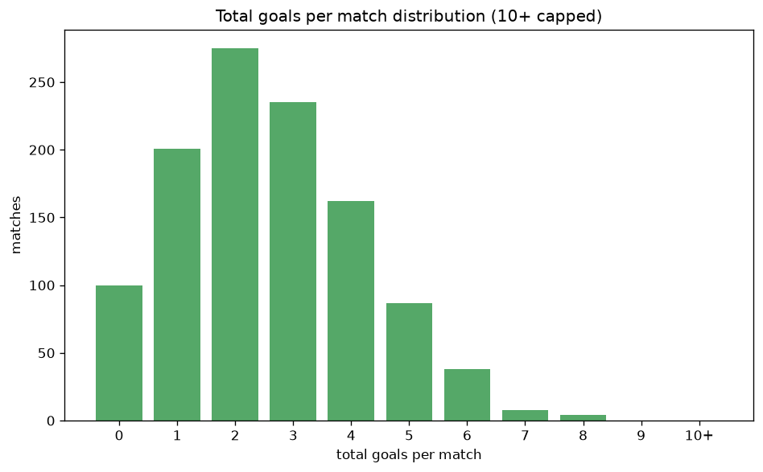

# Scoreline Analysis
- Report: `scoreline_analysis`
- Generated: 2026-10-26T01:40:58+00:00
- Script: `backend/scripts/analyze_scorelines.py` v1.0.0
- League: TOPLYGA (Lithuania)
- Scope: league `lithuania`

## 1. Scoreline frequency
- Matches analysed: **1110** across **7** seasons.
- Distinct scorelines seen: **37**.

| scoreline | count | pct |
|---|---|---|
| 1-1 | 126 | 11.4% |
| 0-1 | 113 | 10.2% |
| 0-0 | 100 | 9.0% |
| 2-1 | 96 | 8.6% |
| 1-0 | 88 | 7.9% |
| 2-0 | 86 | 7.7% |
| 0-2 | 63 | 5.7% |
| 1-2 | 61 | 5.5% |
| 2-2 | 54 | 4.9% |
| 3-0 | 43 | 3.9% |
| 3-1 | 39 | 3.5% |
| 0-3 | 35 | 3.2% |
| 1-3 | 34 | 3.1% |
| 4-0 | 25 | 2.3% |
| 3-2 | 25 | 2.3% |
| 2-3 | 21 | 1.9% |
| 5-0 | 13 | 1.2% |
| 4-1 | 11 | 1.0% |
| 3-3 | 10 | 0.9% |
| 0-4 | 10 | 0.9% |

## 2. Scoreline frequency per season

### 2020
| scoreline | count | pct |
|---|---|---|
| 1-1 | 10 | 16.7% |
| 0-1 | 8 | 13.3% |
| 1-0 | 7 | 11.7% |
| 1-2 | 5 | 8.3% |
| 2-0 | 4 | 6.7% |

### 2021
| scoreline | count | pct |
|---|---|---|
| 1-1 | 27 | 15.0% |
| 2-0 | 18 | 10.0% |
| 2-1 | 17 | 9.4% |
| 0-1 | 14 | 7.8% |
| 0-2 | 12 | 6.7% |

### 2022
| scoreline | count | pct |
|---|---|---|
| 2-1 | 22 | 12.2% |
| 1-1 | 21 | 11.7% |
| 0-1 | 20 | 11.1% |
| 2-0 | 16 | 8.9% |
| 0-0 | 15 | 8.3% |

### 2023
| scoreline | count | pct |
|---|---|---|
| 0-0 | 21 | 11.7% |
| 1-0 | 20 | 11.1% |
| 1-1 | 19 | 10.6% |
| 2-0 | 17 | 9.4% |
| 0-1 | 16 | 8.9% |

### 2024
| scoreline | count | pct |
|---|---|---|
| 0-1 | 27 | 15.0% |
| 0-0 | 23 | 12.8% |
| 2-1 | 17 | 9.4% |
| 1-0 | 16 | 8.9% |
| 1-1 | 15 | 8.3% |

### 2025
| scoreline | count | pct |
|---|---|---|
| 0-1 | 20 | 11.1% |
| 2-1 | 19 | 10.6% |
| 1-1 | 16 | 8.9% |
| 2-2 | 13 | 7.2% |
| 1-0 | 13 | 7.2% |

### 2026
| scoreline | count | pct |
|---|---|---|
| 1-1 | 18 | 12.0% |
| 0-0 | 16 | 10.7% |
| 1-2 | 12 | 8.0% |
| 1-0 | 12 | 8.0% |
| 2-0 | 9 | 6.0% |

## 3. Total-goal histogram
_10+ groups all matches with 10 or more total goals._

| total goals | matches | pct |
|---|---|---|
| 0 | 100 | 9.0% |
| 1 | 201 | 18.1% |
| 2 | 275 | 24.8% |
| 3 | 235 | 21.2% |
| 4 | 162 | 14.6% |
| 5 | 87 | 7.8% |
| 6 | 38 | 3.4% |
| 7 | 8 | 0.7% |
| 8 | 4 | 0.4% |
| 9 | 0 | 0.0% |
| 10+ | 0 | 0.0% |

## 4. Extreme scorelines
- Matches with 7+ total goals: **12**

| season | date | scoreline | total goals |
|---|---|---|---|
| 2020 | 2020-09-27 | 7-1 | 8 |
| 2022 | 2022-04-13 | 3-5 | 8 |
| 2023 | 2023-08-26 | 2-6 | 8 |
| 2023 | 2023-09-17 | 2-6 | 8 |
| 2020 | 2020-06-28 | 0-7 | 7 |
| 2021 | 2021-04-21 | 5-2 | 7 |
| 2023 | 2023-06-27 | 2-5 | 7 |
| 2025 | 2025-03-01 | 3-4 | 7 |
| 2025 | 2025-07-05 | 5-2 | 7 |
| 2025 | 2025-09-14 | 6-1 | 7 |
| 2026 | 2026-06-12 | 4-3 | 7 |
| 2026 | 2026-08-09 | 3-4 | 7 |

## 5. Margin-of-victory distribution (decided matches)
- Decided matches: **820** (draws: **290**)
- Average winning margin: **1.87**

| margin | matches | pct |
|---|---|---|
| 1 | 407 | 49.6% |
| 2 | 235 | 28.7% |
| 3+ | 178 | 21.7% |

## 6. Margin by outcome

### Home wins
- Matches: **445** | avg margin: **1.94** | max margin: **6**
| margin | matches | pct |
|---|---|---|
| 1 | 210 | 47.2% |
| 2 | 129 | 29.0% |
| 3+ | 106 | 23.8% |
- *Full match-by-match list available in `scoreline_analysis.json`.*

### Away wins
- Matches: **375** | avg margin: **1.78** | max margin: **7**
| margin | matches | pct |
|---|---|---|
| 1 | 197 | 52.5% |
| 2 | 106 | 28.3% |
| 3+ | 72 | 19.2% |
- *Full match-by-match list available in `scoreline_analysis.json`.*

## 7. Most common exact score by outcome type
| outcome | matches | most common score | count | pct |
|---|---|---|---|---|
| home | 445 | 2-1 | 96 | 21.6% |
| draw | 290 | 1-1 | 126 | 43.4% |
| away | 375 | 0-1 | 113 | 30.1% |

---
*All statistics are computed from PostgreSQL tables (read-only). Run with `python backend/scripts/analyze_scorelines.py` to regenerate.*

## Charts

