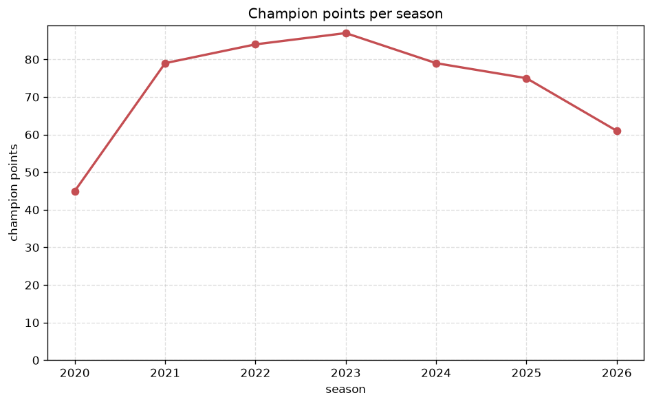
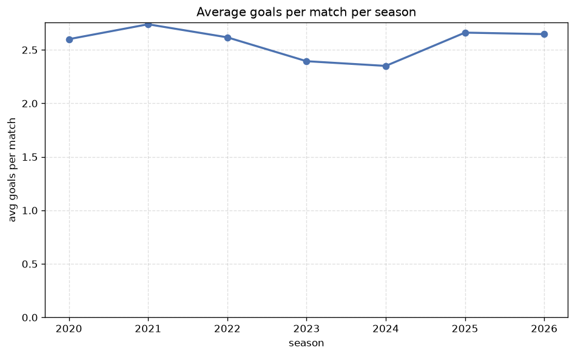

# Season Trends Analysis
- Report: `season_trends`
- Generated: 2026-10-29T02:08:03+00:00
- Script: `backend/scripts/analyze_seasons.py` v1.0.0
- League: TOPLYGA (Lithuania)
- Scope: league `lithuania`

## 1. Champions per season
| season | champion | pts | runner-up | margin |
|---|---|---|---|---|
| 2020 | Zalgiris | 45 | Suduva | 2 pts |
| 2021 | Zalgiris | 79 | Suduva | 9 pts |
| 2022 | Zalgiris | 84 | Kauno Zalgiris | 21 pts |
| 2023 | FK Panevezys | 87 | Zalgiris | 12 pts |
| 2024 | Zalgiris | 79 | Hegelmann | 12 pts |
| 2025 | Kauno Zalgiris | 75 | Hegelmann | 8 pts |
| 2026 | Kauno Zalgiris | 61 | Suduva | 5 pts |

## 2. Title-race tightness
- Tight races (margin <= 3 pts): **1** of 7 seasons
- Tightest race: **2020** - Zalgiris beat Suduva by **2** pts

| season | margin | tight |
|---|---|---|
| 2020 | 2 pts | yes |
| 2021 | 9 pts |  |
| 2022 | 21 pts |  |
| 2023 | 12 pts |  |
| 2024 | 12 pts |  |
| 2025 | 8 pts |  |
| 2026 | 5 pts |  |

## 3. Points thresholds
_Position-specific points per season. Key: 1 = champion, 2 = runner-up, 4 = CL line, 6 = Europa, 7 = last safe, 10 = bottom._

| season | pos 1 | pos 2 | pos 4 | pos 6 | pos 7 | pos 10 |
|---|---|---|---|---|---|---|
| 2020 | 45 | 43 | 16 | 12 | - | - |
| 2021 | 79 | 70 | 60 | 46 | 38 | 10 |
| 2022 | 84 | 63 | 61 | 55 | 50 | 3 |
| 2023 | 87 | 75 | 59 | 36 | 35 | 25 |
| 2024 | 79 | 67 | 45 | 42 | 42 | 38 |
| 2025 | 75 | 67 | 59 | 49 | 46 | 18 |
| 2026 | 61 | 56 | 55 | 48 | 41 | 3 |

## 4. Relegation battle
| season | safe pos | safe pts | drop pos | drop pts | gap |
|---|---|---|---|---|---|
| 2020 | 7 | - | 8 | - | - |
| 2021 | 7 | 38 | 8 | 36 | 2 pts |
| 2022 | 7 | 50 | 8 | 30 | 20 pts |
| 2023 | 7 | 35 | 8 | 31 | 4 pts |
| 2024 | 7 | 42 | 8 | 41 | 1 pts |
| 2025 | 7 | 46 | 8 | 42 | 4 pts |
| 2026 | 7 | 41 | 8 | 27 | 14 pts |

## 5. League-level trends
| season | matches | total goals | avg goals | home win | draw | away win | goalless | avg pts/team |
|---|---|---|---|---|---|---|---|---|
| 2020 | 60 | 156 | 2.6 | 40.0% | 23.3% | 36.7% | 3.3% | 27.67 |
| 2021 | 180 | 493 | 2.739 | 40.0% | 27.2% | 32.8% | 5.6% | 49.1 |
| 2022 | 180 | 471 | 2.617 | 41.7% | 25.6% | 32.8% | 8.3% | 49.4 |
| 2023 | 180 | 431 | 2.394 | 41.1% | 25.6% | 33.3% | 11.7% | 49.4 |
| 2024 | 180 | 423 | 2.35 | 36.7% | 27.8% | 35.6% | 12.8% | 49.0 |
| 2025 | 180 | 479 | 2.661 | 40.6% | 24.4% | 35.0% | 7.2% | 49.6 |
| 2026 | 153 | 405 | 2.647 | 40.5% | 28.1% | 31.4% | 11.8% | 41.6 |

## 6. View divergence
- Largest divergence: **2021** (goals view, avg abs position diff = 4.200)

_Avg absolute position difference between classic view and alternative view per season._

| season | classic vs luck | classic vs goals |
|---|---|---|
| 2020 | 0.667 | 2.333 |
| 2021 | 3.000 | 4.200 |
| 2022 | 1.800 | 3.000 |
| 2023 | 1.600 | 3.200 |
| 2024 | 2.600 | 1.800 |
| 2025 | 1.600 | 4.000 |
| 2026 | 1.800 | 3.800 |

---
*All statistics are computed from PostgreSQL tables (read-only). Run with `python backend/scripts/analyze_seasons.py` to regenerate.*

## Charts

