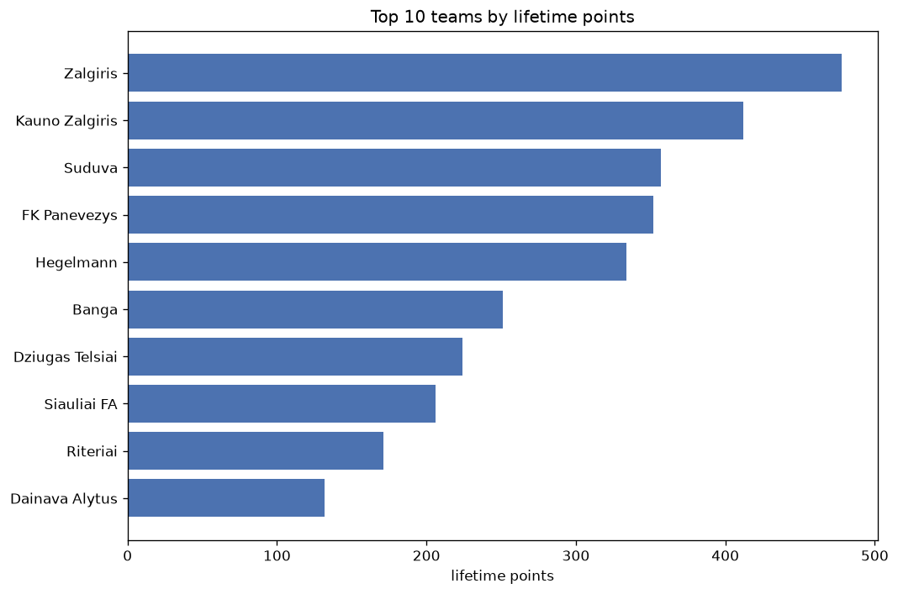
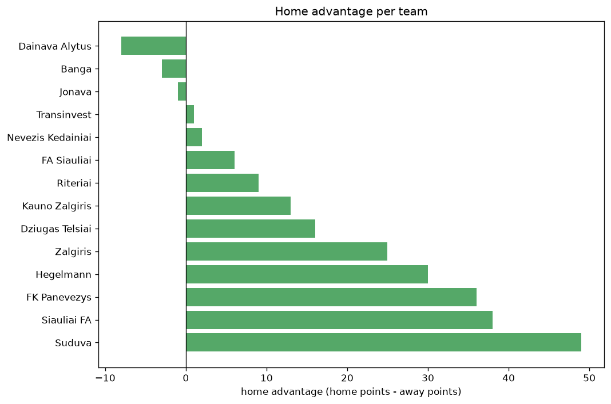

# Team Analysis
- Report: `teams_analysis`
- Generated: 2026-10-30T04:02:03+00:00
- Script: `backend/scripts/analyze_teams.py` v1.0.0
- League: TOPLYGA (Lithuania)
- Scope: league `lithuania`

- Teams: **14** | Seasons: **7** | Matches: **1113**

## 1. Team standings (lifetime)
| team | seasons | played | W | D | L | pts | GF | GA | GD | avg pts/season | best pos | worst pos | titles |
|---|---|---|---|---|---|---|---|---|---|---|---|---|---|
| Zalgiris | 7 | 233 | 143 | 50 | 40 | 479 | 452 | 206 | 246 | 68.43 | 1 | 4 | 4 |
| Kauno Zalgiris | 7 | 232 | 117 | 62 | 53 | 413 | 374 | 221 | 153 | 59.0 | 1 | 4 | 2 |
| Suduva | 7 | 232 | 98 | 63 | 71 | 357 | 300 | 255 | 45 | 51.0 | 2 | 9 | 0 |
| FK Panevezys | 7 | 232 | 97 | 61 | 74 | 352 | 315 | 259 | 56 | 50.29 | 1 | 8 | 1 |
| Hegelmann | 6 | 212 | 92 | 58 | 62 | 334 | 325 | 250 | 75 | 55.67 | 2 | 8 | 0 |
| Banga | 7 | 232 | 63 | 62 | 107 | 251 | 228 | 319 | -91 | 35.86 | 4 | 9 | 0 |
| Dziugas Telsiai | 6 | 212 | 54 | 62 | 96 | 224 | 220 | 321 | -101 | 37.33 | 6 | 9 | 0 |
| Siauliai FA | 4 | 144 | 53 | 47 | 44 | 206 | 188 | 177 | 11 | 51.5 | 3 | 7 | 0 |
| Riteriai | 6 | 181 | 40 | 51 | 90 | 171 | 187 | 297 | -110 | 28.5 | 5 | 10 | 0 |
| Dainava Alytus | 4 | 144 | 31 | 39 | 74 | 132 | 124 | 212 | -88 | 33.0 | 4 | 10 | 0 |
| Transinvest | 2 | 68 | 27 | 12 | 29 | 93 | 91 | 88 | 3 | 46.5 | 3 | 10 | 0 |
| FA Siauliai | 1 | 32 | 4 | 10 | 18 | 22 | 27 | 59 | -32 | 22.0 | 9 | 9 | 0 |
| Nevezis Kedainiai | 1 | 36 | 2 | 4 | 30 | 10 | 15 | 91 | -76 | 10.0 | 10 | 10 | 0 |
| Jonava | 1 | 36 | 0 | 3 | 33 | 3 | 12 | 103 | -91 | 3.0 | 10 | 10 | 0 |

## 2. Home vs away split
| team | home P | H-W | H-D | H-L | H-pts | away P | A-W | A-D | A-L | A-pts | adv |
|---|---|---|---|---|---|---|---|---|---|---|---|
| Suduva | 115 | 57 | 32 | 26 | 203 | 117 | 41 | 31 | 45 | 154 | 49 |
| Siauliai FA | 72 | 32 | 26 | 14 | 122 | 72 | 21 | 21 | 30 | 84 | 38 |
| FK Panevezys | 115 | 55 | 29 | 31 | 194 | 117 | 42 | 32 | 43 | 158 | 36 |
| Hegelmann | 106 | 49 | 35 | 22 | 182 | 106 | 43 | 23 | 40 | 152 | 30 |
| Zalgiris | 117 | 77 | 21 | 19 | 252 | 116 | 66 | 29 | 21 | 227 | 25 |
| Dziugas Telsiai | 107 | 29 | 33 | 45 | 120 | 105 | 25 | 29 | 51 | 104 | 16 |
| Kauno Zalgiris | 117 | 62 | 27 | 28 | 213 | 115 | 55 | 35 | 25 | 200 | 13 |
| Riteriai | 90 | 21 | 27 | 42 | 90 | 91 | 19 | 24 | 48 | 81 | 9 |
| FA Siauliai | 16 | 4 | 2 | 10 | 14 | 16 | 0 | 8 | 8 | 8 | 6 |
| Nevezis Kedainiai | 18 | 1 | 3 | 14 | 6 | 18 | 1 | 1 | 16 | 4 | 2 |
| Transinvest | 34 | 14 | 5 | 15 | 47 | 34 | 13 | 7 | 14 | 46 | 1 |
| Jonava | 18 | 0 | 1 | 17 | 1 | 18 | 0 | 2 | 16 | 2 | -1 |
| Banga | 116 | 31 | 31 | 54 | 124 | 116 | 32 | 31 | 53 | 127 | -3 |
| Dainava Alytus | 72 | 14 | 20 | 38 | 62 | 72 | 17 | 19 | 36 | 70 | -8 |

## 3. Top performers
### Best points per game (PPG)
| rank | team | PPG |
|---|---|---|
| 1 | Zalgiris | 2.06 |
| 2 | Kauno Zalgiris | 1.78 |
| 3 | Hegelmann | 1.57 |
| 4 | Suduva | 1.54 |
| 5 | FK Panevezys | 1.52 |

### Most goals scored
| rank | team | goals |
|---|---|---|
| 1 | Zalgiris | 452 |
| 2 | Kauno Zalgiris | 374 |
| 3 | Hegelmann | 325 |
| 4 | FK Panevezys | 315 |
| 5 | Suduva | 300 |

### Best goal difference
| rank | team | GD |
|---|---|---|
| 1 | Zalgiris | 246 |
| 2 | Kauno Zalgiris | 153 |
| 3 | Hegelmann | 75 |
| 4 | FK Panevezys | 56 |
| 5 | Suduva | 45 |

### Best defence (goals against per match, standings)
| rank | team | GA/match |
|---|---|---|
| 1 | Zalgiris | 0.884 |
| 2 | Kauno Zalgiris | 0.953 |
| 3 | Suduva | 1.099 |
| 4 | FK Panevezys | 1.116 |
| 5 | Hegelmann | 1.179 |

## 4. Team consistency
- Teams present in all **7** seasons: **5**

Banga, FK Panevezys, Kauno Zalgiris, Suduva, Zalgiris

## 5. Head-to-head dominance
- Distinct fixtures: **82** (showing the 15 most frequent)

| fixture | meetings | home wins | draws | away wins | home pct | draw pct | away pct |
|---|---|---|---|---|---|---|---|
| Kauno Zalgiris vs FK Panevezys | 28 | 14 | 6 | 8 | 50.0% | 21.4% | 28.6% |
| Banga vs FK Panevezys | 28 | 13 | 7 | 8 | 46.4% | 25.0% | 28.6% |
| Suduva vs FK Panevezys | 28 | 13 | 8 | 7 | 46.4% | 28.6% | 25.0% |
| Zalgiris vs FK Panevezys | 28 | 13 | 4 | 11 | 46.4% | 14.3% | 39.3% |
| Zalgiris vs Suduva | 28 | 13 | 9 | 6 | 46.4% | 32.1% | 21.4% |
| Suduva vs Kauno Zalgiris | 28 | 10 | 11 | 7 | 35.7% | 39.3% | 25.0% |
| Zalgiris vs Kauno Zalgiris | 28 | 7 | 6 | 15 | 25.0% | 21.4% | 53.6% |
| Kauno Zalgiris vs Banga | 28 | 6 | 11 | 11 | 21.4% | 39.3% | 39.3% |
| Suduva vs Banga | 27 | 14 | 4 | 9 | 51.9% | 14.8% | 33.3% |
| Zalgiris vs Banga | 27 | 11 | 4 | 12 | 40.7% | 14.8% | 44.4% |
| Suduva vs Hegelmann | 24 | 13 | 4 | 7 | 54.2% | 16.7% | 29.2% |
| Zalgiris vs Hegelmann | 24 | 12 | 6 | 6 | 50.0% | 25.0% | 25.0% |
| Banga vs Hegelmann | 24 | 11 | 5 | 8 | 45.8% | 20.8% | 33.3% |
| Hegelmann vs Dziugas Telsiai | 24 | 11 | 8 | 5 | 45.8% | 33.3% | 20.8% |
| Zalgiris vs Dziugas Telsiai | 24 | 11 | 4 | 9 | 45.8% | 16.7% | 37.5% |

## 6. Position per season (classic view)
_Cells show final position; '-' when the team was absent from that season._

| team | 2020 | 2021 | 2022 | 2023 | 2024 | 2025 | 2026 |
|---|---|---|---|---|---|---|---|
| Zalgiris | 1 | 1 | 1 | 2 | 1 | 3 | 4 |
| Kauno Zalgiris | 3 | 3 | 2 | 4 | 3 | 1 | 1 |
| Suduva | 2 | 2 | 6 | 7 | 9 | 4 | 2 |
| FK Panevezys | 5 | 4 | 3 | 1 | 8 | 6 | 7 |
| Hegelmann | - | 5 | 4 | 5 | 2 | 2 | 8 |
| Banga | 4 | 9 | 8 | 6 | 5 | 8 | 5 |
| Dziugas Telsiai | - | 8 | 9 | 9 | 7 | 7 | 6 |
| Siauliai FA | - | - | 7 | 3 | 6 | 5 | - |
| Riteriai | 6 | 6 | 5 | 10 | - | 9 | 10 |
| Dainava Alytus | - | 7 | - | 8 | 4 | 10 | - |
| Transinvest | - | - | - | - | 10 | - | 3 |
| FA Siauliai | - | - | - | - | - | - | 9 |
| Nevezis Kedainiai | - | 10 | - | - | - | - | - |
| Jonava | - | - | 10 | - | - | - | - |

---
*All statistics are computed from PostgreSQL tables (read-only). Run with `python backend/scripts/analyze_teams.py` to regenerate.*

## Charts

