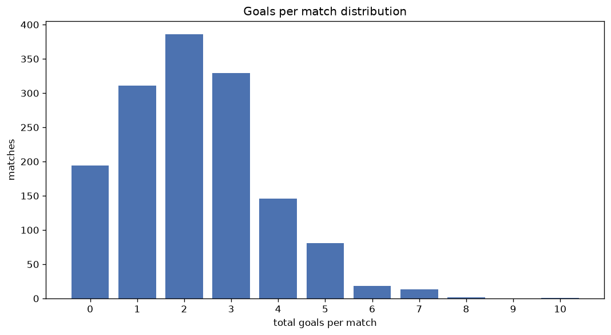
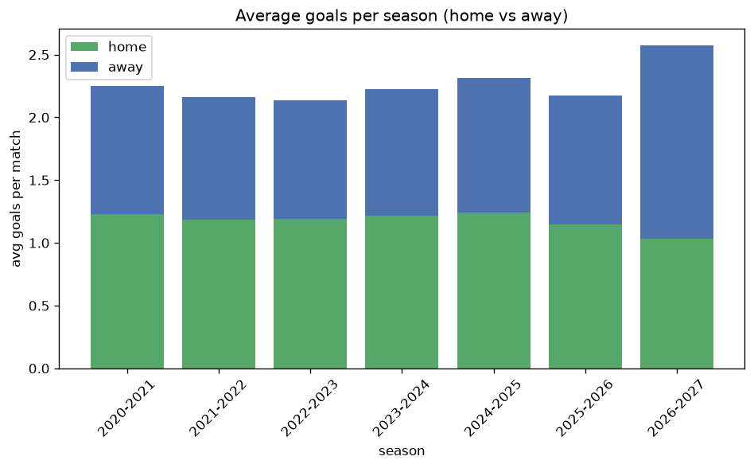

# Goal Analysis
- Report: `goals_analysis`
- Generated: 2026-10-26T01:41:09+00:00
- Script: `backend/scripts/analyze_goals.py` v1.0.0
- League: Botola Pro (Morocco)
- Scope: league `morocco`

## 1. Goals per match distribution
| goals | matches | pct |
|---|---|---|
| 0 | 194 | 13.1% |
| 1 | 311 | 21.0% |
| 2 | 386 | 26.1% |
| 3 | 329 | 22.2% |
| 4 | 146 | 9.9% |
| 5 | 81 | 5.5% |
| 6 | 18 | 1.2% |
| 7 | 13 | 0.9% |
| 8 | 2 | 0.1% |
| 9 | 0 | 0.0% |
| 10 | 1 | 0.1% |

## 2. Goals per match per season
| season | matches | total goals | avg home | avg away | avg total |
|---|---|---|---|---|---|
| 2020-2021 | 240 | 540 | 1.229 | 1.021 | 2.25 |
| 2021-2022 | 240 | 519 | 1.183 | 0.979 | 2.163 |
| 2022-2023 | 240 | 512 | 1.188 | 0.946 | 2.133 |
| 2023-2024 | 240 | 534 | 1.217 | 1.008 | 2.225 |
| 2024-2025 | 240 | 555 | 1.242 | 1.071 | 2.312 |
| 2025-2026 | 248 | 539 | 1.149 | 1.024 | 2.173 |
| 2026-2027 | 33 | 85 | 1.03 | 1.545 | 2.576 |

## 3. Home vs away goal share
- Home goals: **1773** (54.0%)
- Away goals: **1511** (46.0%)
- Home/away ratio: **1.173**

| season | home goals | away goals | total | home pct | away pct |
|---|---|---|---|---|---|
| 2020-2021 | 295 | 245 | 540 | 54.6% | 45.4% |
| 2021-2022 | 284 | 235 | 519 | 54.7% | 45.3% |
| 2022-2023 | 285 | 227 | 512 | 55.7% | 44.3% |
| 2023-2024 | 292 | 242 | 534 | 54.7% | 45.3% |
| 2024-2025 | 298 | 257 | 555 | 53.7% | 46.3% |
| 2025-2026 | 285 | 254 | 539 | 52.9% | 47.1% |
| 2026-2027 | 34 | 51 | 85 | 40.0% | 60.0% |

## 4. BTTS (Both Teams To Score)
- Overall: **708** of `1481` (47.8%)

| season | matches | BTTS | pct |
|---|---|---|---|
| 2020-2021 | 240 | 116 | 48.3% |
| 2021-2022 | 240 | 111 | 46.2% |
| 2022-2023 | 240 | 112 | 46.7% |
| 2023-2024 | 240 | 115 | 47.9% |
| 2024-2025 | 240 | 107 | 44.6% |
| 2025-2026 | 248 | 129 | 52.0% |
| 2026-2027 | 33 | 18 | 54.5% |

## 5. Clean sheets
- Home clean sheets: **530** (35.8%)
- Away clean sheets: **437** (29.5%)
- Total clean sheets recorded: **967**
- Matches with at least one clean sheet: **773** (52.2%)
- Both teams kept clean sheets (0-0): **194**

| season | matches | home CS | away CS | total CS | matches w/ CS |
|---|---|---|---|---|---|
| 2020-2021 | 240 | 84 | 74 | 158 | 124 (51.7%) |
| 2021-2022 | 240 | 92 | 77 | 169 | 129 (53.8%) |
| 2022-2023 | 240 | 87 | 75 | 162 | 128 (53.3%) |
| 2023-2024 | 240 | 84 | 71 | 155 | 125 (52.1%) |
| 2024-2025 | 240 | 89 | 66 | 155 | 133 (55.4%) |
| 2025-2026 | 248 | 86 | 62 | 148 | 119 (48.0%) |
| 2026-2027 | 33 | 8 | 12 | 20 | 15 (45.5%) |

## 6. Scoring intensity
- First-half goals: **1445** (44.0%)
- Second-half goals: **1839** (56.0%)
- Avg first-half goals per match: **0.976**
- Avg second-half goals per match: **1.242**
- Second-half-only scoring (HT 0-0, FT goals >= 1): **376** (25.4%)

| season | matches | 1st half | 2nd half | 1st half pct | 2nd half pct |
|---|---|---|---|---|---|
| 2020-2021 | 240 | 250 | 290 | 46.3% | 53.7% |
| 2021-2022 | 240 | 225 | 294 | 43.4% | 56.6% |
| 2022-2023 | 240 | 226 | 286 | 44.1% | 55.9% |
| 2023-2024 | 240 | 227 | 307 | 42.5% | 57.5% |
| 2024-2025 | 240 | 228 | 327 | 41.1% | 58.9% |
| 2025-2026 | 248 | 250 | 289 | 46.4% | 53.6% |
| 2026-2027 | 33 | 39 | 46 | 45.9% | 54.1% |

## 7. First-goal timing
- Matches with first-goal time recorded: `1287` of `1481` (86.9%)
- Goalless matches: `194`
- Min `1` | Max `104` | Mean `34.92` | Median (p50) `31`

| bucket | count | % of matches | % of scoring matches |
|---|---|---|---|
| 1-15 | 357 | 24.1% | 27.7% |
| 16-30 | 284 | 19.2% | 22.1% |
| 31-45 | 220 | 14.9% | 17.1% |
| 46-60 | 216 | 14.6% | 16.8% |
| 61-75 | 102 | 6.9% | 7.9% |
| 76-90 | 74 | 5.0% | 5.7% |
| 91-120 | 34 | 2.3% | 2.6% |

---
*All statistics are computed from PostgreSQL tables (read-only). Run with `python backend/scripts/analyze_goals.py` to regenerate.*

## Charts

