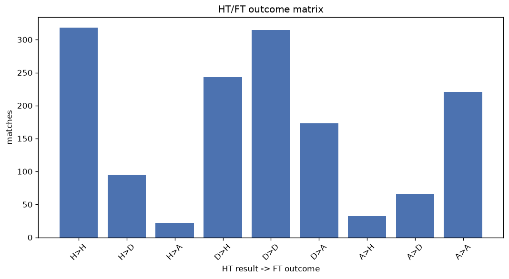
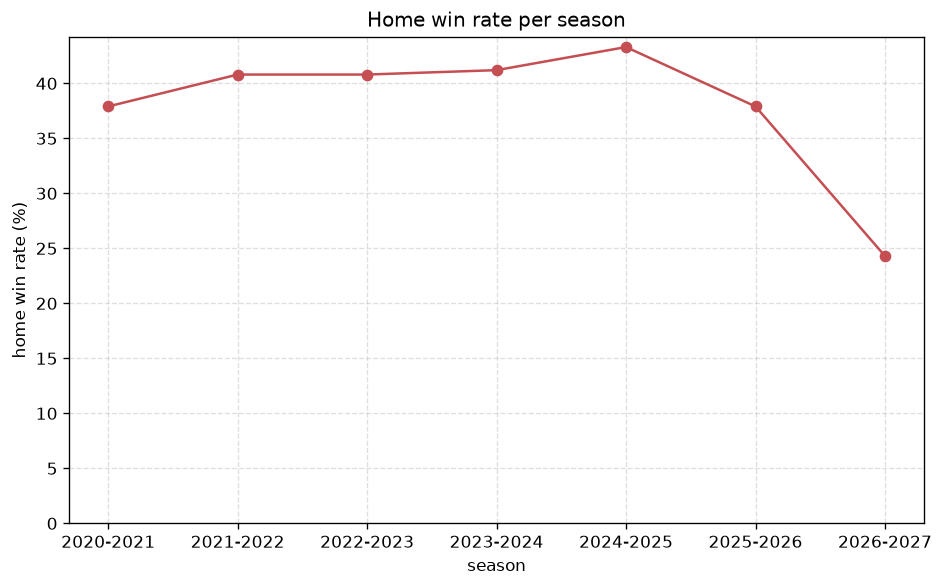

# Match Analysis
- Report: `matches_analysis`
- Generated: 2026-10-30T04:02:21+00:00
- Script: `backend/scripts/analyze_matches.py` v1.0.0
- League: Botola Pro (Morocco)
- Scope: league `morocco`

## 1. Overall summary
| metric | value |
|---|---|
| Matches | 1485 |
| Home wins | 593 (39.9%) |
| Draws | 476 (32.1%) |
| Away wins | 416 (28.0%) |
| Total goals | 3291 |
| Average goals per match | 2.216 |
| Goalless matches | 194 (13.1%) |

## 2. Per-season breakdown
| season | matches | home wins | draws | away wins | total goals | avg goals | goalless |
|---|---|---|---|---|---|---|---|
| 2020-2021 | 240 | 91 (37.9%) | 79 (32.9%) | 70 (29.2%) | 540 | 2.25 | 34 (14.2%) |
| 2021-2022 | 240 | 98 (40.8%) | 82 (34.2%) | 60 (25.0%) | 519 | 2.163 | 40 (16.7%) |
| 2022-2023 | 240 | 98 (40.8%) | 77 (32.1%) | 65 (27.1%) | 512 | 2.133 | 34 (14.2%) |
| 2023-2024 | 240 | 99 (41.2%) | 73 (30.4%) | 68 (28.3%) | 534 | 2.225 | 30 (12.5%) |
| 2024-2025 | 240 | 104 (43.3%) | 68 (28.3%) | 68 (28.3%) | 555 | 2.312 | 22 (9.2%) |
| 2025-2026 | 248 | 94 (37.9%) | 85 (34.3%) | 69 (27.8%) | 539 | 2.173 | 29 (11.7%) |
| 2026-2027 | 37 | 9 (24.3%) | 12 (32.4%) | 16 (43.2%) | 92 | 2.486 | 5 (13.5%) |

## 3. HT/FT outcome matrix
| HT result \ FT result | Home | Draw | Away | total |
|---|---|---|---|---|
| HT home lead | 318 (73.1%) | 95 (21.8%) | 22 (5.1%) | 435 |
| HT draw | 243 (33.2%) | 315 (43.1%) | 173 (23.7%) | 731 |
| HT away lead | 32 (10.0%) | 66 (20.7%) | 221 (69.3%) | 319 |

## 4. Comeback matches
- Home comebacks (trailing at HT, won at FT): **32** (2.2%)
- Away comebacks (trailing at HT, won at FT): **22** (1.5%)

### Home comebacks
| season | home | away | HT | FT |
|---|---|---|---|---|
| 2020-2021 | IR Tanger | Wydad | 0-2 | 3-2 |
| 2021-2022 | Raja Casablanca | Chabab Mohammedia | 0-1 | 2-1 |
| 2021-2022 | Berkane | Youssoufia Berrechid | 0-1 | 4-1 |
| 2021-2022 | Mouloudia Oujda | Olympique de Safi | 0-1 | 3-1 |
| 2021-2022 | Olympique de Safi | FUS Rabat | 0-1 | 2-1 |
| 2021-2022 | FAR Rabat | Rapide Oued Zem | 0-1 | 3-1 |
| 2021-2022 | Jeunesse Sportive Soualem | Chabab Mohammedia | 0-1 | 2-1 |
| 2021-2022 | Rapide Oued Zem | Berkane | 0-2 | 3-2 |
| 2022-2023 | Chabab Mohammedia | Moghreb Tetouan | 1-2 | 4-3 |
| 2022-2023 | Union Touarga | Jeunesse Sportive Soualem | 0-1 | 2-1 |
| 2022-2023 | Raja Casablanca | Union Touarga | 0-1 | 2-1 |
| 2022-2023 | Hassania Agadir | FAR Rabat | 0-1 | 2-1 |
| 2022-2023 | FAR Rabat | Moghreb Tetouan | 0-1 | 2-1 |
| 2022-2023 | IR Tanger | Berkane | 0-1 | 2-1 |
| 2022-2023 | Mouloudia Oujda | Moghreb Tetouan | 0-1 | 2-1 |
| 2023-2024 | IR Tanger | Youssoufia Berrechid | 0-1 | 2-1 |
| 2023-2024 | Union Touarga | FAR Rabat | 0-1 | 2-1 |
| 2023-2024 | FAR Rabat | Wydad | 0-1 | 3-1 |
| 2023-2024 | Mouloudia Oujda | FUS Rabat | 0-1 | 2-1 |
| 2023-2024 | FUS Rabat | Wydad | 0-1 | 2-1 |
| 2023-2024 | IR Tanger | Union Touarga | 0-1 | 2-1 |
| 2024-2025 | Hassania Agadir | Union Touarga | 0-1 | 2-1 |
| 2024-2025 | Jeunesse Sportive Soualem | IR Tanger | 0-1 | 2-1 |
| 2024-2025 | Raja Casablanca | Union Touarga | 0-1 | 2-1 |
| 2024-2025 | FUS Rabat | Raja Casablanca | 0-1 | 2-1 |
| 2024-2025 | Difaa El Jadidi | COD Meknes | 0-1 | 2-1 |
| 2024-2025 | Difaa El Jadidi | IR Tanger | 0-1 | 2-1 |
| 2025-2026 | Dcheira | Kawkab Marrakech | 0-1 | 2-1 |
| 2025-2026 | FAR Rabat | Dcheira | 1-2 | 3-2 |
| 2025-2026 | Hassania Agadir | Olympique de Safi | 0-1 | 2-1 |
| 2025-2026 | Maghreb Fez | Difaa El Jadidi | 0-1 | 2-1 |
| 2026-2027 | IR Tanger | Maghreb Fez | 0-1 | 2-1 |

### Away comebacks
| season | home | away | HT | FT |
|---|---|---|---|---|
| 2020-2021 | FUS Rabat | Youssoufia Berrechid | 1-0 | 1-2 |
| 2020-2021 | Berkane | FAR Rabat | 1-0 | 1-2 |
| 2020-2021 | Chabab Mohammedia | IR Tanger | 1-0 | 1-2 |
| 2020-2021 | Renaissance Zemamra | Mouloudia Oujda | 2-1 | 3-4 |
| 2020-2021 | Chabab Mohammedia | Raja Casablanca | 1-0 | 1-2 |
| 2020-2021 | Difaa El Jadidi | Youssoufia Berrechid | 1-0 | 2-3 |
| 2021-2022 | FUS Rabat | Olympique Khouribga | 1-0 | 1-2 |
| 2021-2022 | Youssoufia Berrechid | FUS Rabat | 1-0 | 1-2 |
| 2021-2022 | Hassania Agadir | Maghreb Fez | 1-0 | 1-2 |
| 2021-2022 | Raja Casablanca | Olympique de Safi | 2-1 | 2-3 |
| 2021-2022 | Wydad | FUS Rabat | 1-0 | 1-2 |
| 2022-2023 | Union Touarga | Wydad | 1-0 | 1-2 |
| 2022-2023 | Chabab Mohammedia | Hassania Agadir | 1-0 | 1-2 |
| 2023-2024 | Olympique de Safi | Union Touarga | 1-0 | 1-3 |
| 2023-2024 | Jeunesse Sportive Soualem | Berkane | 1-0 | 1-2 |
| 2024-2025 | Olympique de Safi | Raja Casablanca | 2-1 | 2-3 |
| 2024-2025 | Moghreb Tetouan | Difaa El Jadidi | 1-0 | 1-3 |
| 2025-2026 | FUS Rabat | Hassania Agadir | 1-0 | 1-2 |
| 2025-2026 | Union Touarga | Wydad AC | 2-1 | 3-4 |
| 2025-2026 | Wydad AC | Yacoub El Mansour | 1-0 | 1-2 |
| 2025-2026 | Olympique de Safi | IR Tanger | 1-0 | 1-2 |
| 2025-2026 | Kawkab Marrakech | Renaissance Zemamra | 1-0 | 1-2 |

## 5. HT lead conversion
| HT state | matches | converted to win | held as draw | collapsed to loss |
|---|---|---|---|---|
| Home lead | 435 | 318 (73.1%) | 95 (21.8%) | 22 (5.1%) |
| Away lead | 319 | 221 (69.3%) | 66 (20.7%) | 32 (10.0%) |

### Matches level at half-time
| FT result | count | pct |
|---|---|---|
| Home win | 243 | 33.2% |
| Draw | 315 | 43.1% |
| Away win | 173 | 23.7% |

## 6. First-goal timing
- Matches with a first-goal time recorded: `1291` of `1485` (86.9%)

Outcome distribution by first-goal timing bucket:
| bucket | matches | % of matches | home | draw | away |
|---|---|---|---|---|---|
| 1-15 | 357 | 24.0% | 172 (48.2%) | 83 (23.2%) | 102 (28.6%) |
| 16-30 | 285 | 19.2% | 116 (40.7%) | 71 (24.9%) | 98 (34.4%) |
| 31-45 | 220 | 14.8% | 96 (43.6%) | 57 (25.9%) | 67 (30.5%) |
| 46-60 | 216 | 14.5% | 101 (46.8%) | 38 (17.6%) | 77 (35.6%) |
| 61-75 | 104 | 7.0% | 53 (51.0%) | 15 (14.4%) | 36 (34.6%) |
| 76-90 | 75 | 5.1% | 36 (48.0%) | 16 (21.3%) | 23 (30.7%) |
| 91-120 | 34 | 2.3% | 19 (55.9%) | 2 (5.9%) | 13 (38.2%) |

## 7. Goalless matches
- Overall: **194** of `1485` (13.1%)

| season | matches | goalless | pct |
|---|---|---|---|
| 2020-2021 | 240 | 34 | 14.2% |
| 2021-2022 | 240 | 40 | 16.7% |
| 2022-2023 | 240 | 34 | 14.2% |
| 2023-2024 | 240 | 30 | 12.5% |
| 2024-2025 | 240 | 22 | 9.2% |
| 2025-2026 | 248 | 29 | 11.7% |
| 2026-2027 | 37 | 5 | 13.5% |

---
*All statistics are computed from PostgreSQL tables (read-only). Run with `python backend/scripts/analyze_matches.py` to regenerate.*

## Charts

