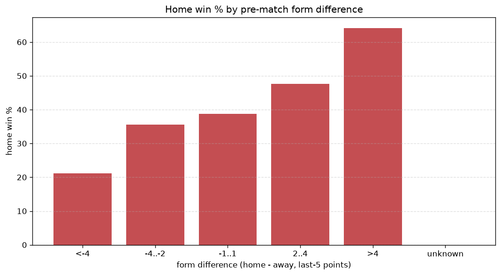
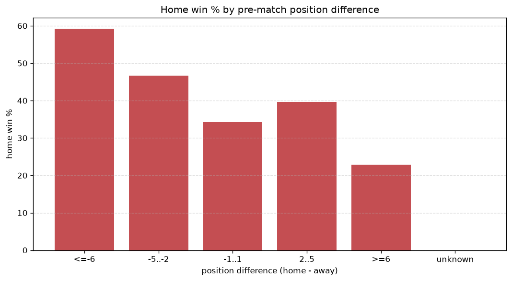

# Relationships Analysis
- Report: `relationships`
- Generated: 2026-10-30T04:02:30+00:00
- Script: `backend/scripts/analyze_relationships.py` v1.0.0
- League: Botola Pro (Morocco)
- Scope: league `morocco`

- Matches analysed: **1448** (23 leakage-safe pre-match features).

## 1. Correlation matrix
_Pearson correlation of each pre-match feature with observed goals; sorted by |corr(total goals)|._

| feature | corr(home) | corr(away) | corr(total) |
|---|---|---|---|
| away_team_away_conceded_avg | 0.134 | -0.030 | 0.074 |
| away_team_goals_conceded_last_5 | 0.127 | -0.039 | 0.064 |
| home_points_before_match | 0.125 | -0.052 | 0.054 |
| away_position_before_match | 0.159 | -0.094 | 0.049 |
| away_points_before_match | -0.037 | 0.103 | 0.043 |
| away_team_away_win_rate | -0.096 | 0.050 | -0.035 |
| away_team_wins_last_5 | -0.096 | 0.051 | -0.034 |
| position_difference | -0.204 | 0.167 | -0.033 |
| away_team_goals_scored_last_5 | -0.091 | 0.059 | -0.025 |
| away_team_away_goals_avg | -0.063 | 0.035 | -0.021 |
| away_team_points_last_5 | -0.085 | 0.062 | -0.019 |
| home_team_points_last_5 | 0.138 | -0.120 | 0.018 |
| points_difference | 0.212 | -0.203 | 0.014 |
| home_team_wins_last_5 | 0.127 | -0.114 | 0.013 |
| home_team_home_win_rate | 0.116 | -0.106 | 0.011 |
| home_team_goals_conceded_last_5 | -0.068 | 0.057 | -0.010 |
| away_rest_days | -0.009 | 0.022 | 0.008 |
| home_rest_days | 0.007 | 0.003 | 0.007 |
| home_team_home_conceded_avg | -0.076 | 0.076 | -0.003 |
| home_position_before_match | -0.126 | 0.138 | 0.003 |
| rest_days_difference | 0.021 | -0.026 | -0.003 |
| home_team_home_goals_avg | 0.117 | -0.120 | 0.002 |
| home_team_goals_scored_last_5 | 0.111 | -0.120 | -0.002 |

## 2. Form vs outcome
_Home win/draw/away % per bucket of `home_team_points_last_5 - away_team_points_last_5`._

| bucket | matches | home | draw | away | home % | draw % | away % |
|---|---|---|---|---|---|---|---|
| <-4 | 226 | 63 | 75 | 88 | 27.9% | 33.2% | 38.9% |
| -4..-2 | 286 | 91 | 95 | 100 | 31.8% | 33.2% | 35.0% |
| -1..1 | 452 | 172 | 156 | 124 | 38.1% | 34.5% | 27.4% |
| 2..4 | 298 | 153 | 90 | 55 | 51.3% | 30.2% | 18.5% |
| >4 | 186 | 105 | 48 | 33 | 56.5% | 25.8% | 17.7% |
| unknown | 0 | 0 | 0 | 0 | - | - | - |

## 3. Position vs outcome
_Home win/draw/away % per bucket of `position_difference` (home position - away position; negative favours the home team)._

| bucket | matches | home | draw | away | home % | draw % | away % |
|---|---|---|---|---|---|---|---|
| <=-6 | 292 | 162 | 80 | 50 | 55.5% | 27.4% | 17.1% |
| -5..-2 | 305 | 143 | 100 | 62 | 46.9% | 32.8% | 20.3% |
| -1..1 | 241 | 96 | 75 | 70 | 39.8% | 31.1% | 29.0% |
| 2..5 | 295 | 98 | 97 | 100 | 33.2% | 32.9% | 33.9% |
| >=6 | 315 | 85 | 112 | 118 | 27.0% | 35.6% | 37.5% |
| unknown | 0 | 0 | 0 | 0 | - | - | - |

## 4. Rest advantage
_Home win/draw/away % per bucket of `rest_days_difference` (home rest - away rest). Matches with unknown rest are bucketed separately._

| bucket | matches | home | draw | away | home % | draw % | away % |
|---|---|---|---|---|---|---|---|
| <-1 | 224 | 101 | 70 | 53 | 45.1% | 31.2% | 23.7% |
| -1..0 | 234 | 100 | 68 | 66 | 42.7% | 29.1% | 28.2% |
| 0 | 452 | 183 | 145 | 124 | 40.5% | 32.1% | 27.4% |
| 1..2 | 334 | 126 | 117 | 91 | 37.7% | 35.0% | 27.2% |
| >2 | 155 | 58 | 49 | 48 | 37.4% | 31.6% | 31.0% |
| unknown | 49 | 16 | 15 | 18 | 32.7% | 30.6% | 36.7% |
- *49 match(es) had unknown rest difference (missing rest data on at least one side).*

## 5. Home team quality
_Home win rate by `home_team_home_win_rate` tier (split at 0.5)._

- `< 0.5` tier: **36.1%** home win (349/967)
- `>= 0.5` tier: **48.9%** home win (235/481)
- Home-win gap (>= split minus < split): **+12.8 pp**

| tier | label | matches | home | draw | away | home % |
|---|---|---|---|---|---|---|
| low | < 0.5 | 967 | 349 | 325 | 293 | 36.1% |
| high | >= 0.5 | 481 | 235 | 139 | 107 | 48.9% |

## 6. Feature averages by result
_Mean feature value per outcome; `range` is home-minus-away spread of the group means._

| feature | home mean | draw mean | away mean | range |
|---|---|---|---|---|
| points_difference | 2.822 | -0.664 | -4.082 | 6.904 |
| home_points_before_match | 21.353 | 18.127 | 17.308 | 4.045 |
| position_difference | -1.591 | 0.532 | 2.147 | 3.738 |
| away_points_before_match | 18.531 | 18.791 | 21.390 | 2.859 |
| home_position_before_match | 7.998 | 9.127 | 9.877 | 1.879 |
| away_position_before_match | 9.589 | 8.595 | 7.730 | 1.859 |
| home_team_points_last_5 | 6.587 | 5.748 | 5.150 | 1.437 |
| home_team_goals_scored_last_5 | 5.310 | 4.709 | 4.258 | 1.052 |
| away_team_goals_conceded_last_5 | 5.296 | 4.672 | 4.442 | 0.854 |
| away_team_points_last_5 | 5.709 | 6.226 | 6.513 | 0.804 |
| away_team_goals_scored_last_5 | 4.692 | 4.966 | 5.305 | 0.613 |
| away_rest_days | 9.401 | 9.686 | 9.927 | 0.525 |
| home_team_goals_conceded_last_5 | 4.670 | 5.002 | 5.188 | 0.518 |
| home_team_wins_last_5 | 1.676 | 1.442 | 1.245 | 0.431 |
| home_rest_days | 9.269 | 9.586 | 9.563 | 0.316 |
| away_team_wins_last_5 | 1.409 | 1.591 | 1.698 | 0.288 |
| rest_days_difference | -0.132 | -0.100 | -0.364 | 0.264 |
| home_team_home_goals_avg | 1.163 | 1.050 | 0.940 | 0.222 |
| away_team_away_conceded_avg | 1.136 | 1.054 | 0.972 | 0.163 |
| home_team_home_conceded_avg | 0.869 | 0.926 | 0.993 | 0.124 |
| home_team_home_win_rate | 0.391 | 0.348 | 0.305 | 0.086 |
| away_team_away_goals_avg | 0.881 | 0.935 | 0.964 | 0.083 |
| away_team_away_win_rate | 0.243 | 0.264 | 0.294 | 0.052 |

---
*All features are leakage-safe pre-match values built by `ml.features.build_features.build_rows` from strictly prior matches. Run with `python backend/scripts/analyze_relationships.py` to regenerate.*

## Charts

