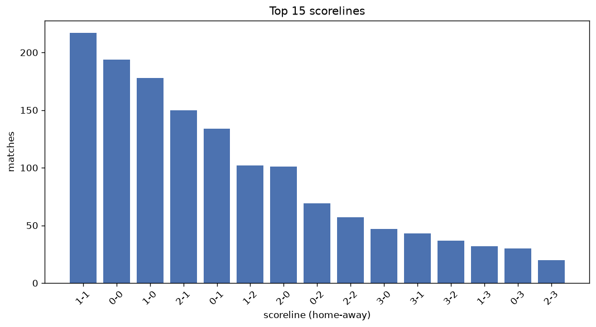
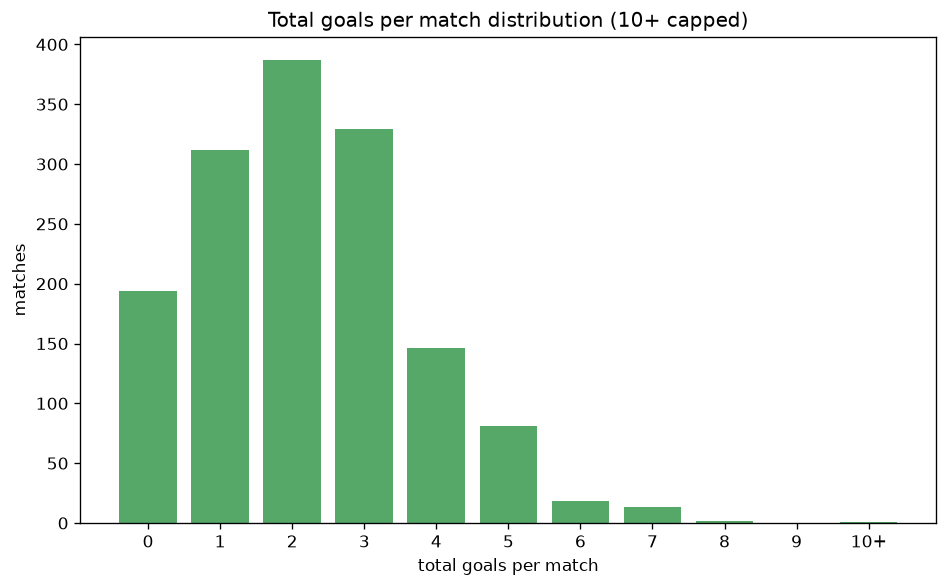

# Scoreline Analysis
- Report: `scoreline_analysis`
- Generated: 2026-10-27T02:23:00+00:00
- Script: `backend/scripts/analyze_scorelines.py` v1.0.0
- League: Botola Pro (Morocco)
- Scope: league `morocco`

## 1. Scoreline frequency
- Matches analysed: **1483** across **7** seasons.
- Distinct scorelines seen: **35**.

| scoreline | count | pct |
|---|---|---|
| 1-1 | 217 | 14.6% |
| 0-0 | 194 | 13.1% |
| 1-0 | 178 | 12.0% |
| 2-1 | 150 | 10.1% |
| 0-1 | 134 | 9.0% |
| 1-2 | 102 | 6.9% |
| 2-0 | 101 | 6.8% |
| 0-2 | 69 | 4.7% |
| 2-2 | 57 | 3.8% |
| 3-0 | 47 | 3.2% |
| 3-1 | 43 | 2.9% |
| 3-2 | 37 | 2.5% |
| 1-3 | 32 | 2.2% |
| 0-3 | 30 | 2.0% |
| 2-3 | 20 | 1.3% |
| 4-1 | 12 | 0.8% |
| 4-0 | 8 | 0.5% |
| 3-3 | 7 | 0.5% |
| 4-2 | 6 | 0.4% |
| 1-4 | 6 | 0.4% |

## 2. Scoreline frequency per season

### 2020-2021
| scoreline | count | pct |
|---|---|---|
| 1-1 | 36 | 15.0% |
| 0-0 | 34 | 14.2% |
| 0-1 | 25 | 10.4% |
| 1-0 | 22 | 9.2% |
| 2-0 | 19 | 7.9% |

### 2021-2022
| scoreline | count | pct |
|---|---|---|
| 0-0 | 40 | 16.7% |
| 1-1 | 34 | 14.2% |
| 1-0 | 28 | 11.7% |
| 2-1 | 25 | 10.4% |
| 2-0 | 17 | 7.1% |

### 2022-2023
| scoreline | count | pct |
|---|---|---|
| 0-0 | 34 | 14.2% |
| 2-1 | 32 | 13.3% |
| 1-1 | 31 | 12.9% |
| 1-0 | 30 | 12.5% |
| 0-1 | 29 | 12.1% |

### 2023-2024
| scoreline | count | pct |
|---|---|---|
| 1-0 | 33 | 13.8% |
| 1-1 | 31 | 12.9% |
| 0-0 | 30 | 12.5% |
| 2-1 | 22 | 9.2% |
| 0-1 | 22 | 9.2% |

### 2024-2025
| scoreline | count | pct |
|---|---|---|
| 1-1 | 35 | 14.6% |
| 1-0 | 30 | 12.5% |
| 2-0 | 23 | 9.6% |
| 2-1 | 23 | 9.6% |
| 0-0 | 22 | 9.2% |

### 2025-2026
| scoreline | count | pct |
|---|---|---|
| 1-1 | 46 | 18.5% |
| 1-0 | 32 | 12.9% |
| 0-0 | 29 | 11.7% |
| 2-1 | 27 | 10.9% |
| 1-2 | 26 | 10.5% |

### 2026-2027
| scoreline | count | pct |
|---|---|---|
| 0-1 | 6 | 17.1% |
| 0-0 | 5 | 14.3% |
| 2-1 | 4 | 11.4% |
| 1-1 | 4 | 11.4% |
| 1-0 | 3 | 8.6% |

## 3. Total-goal histogram
_10+ groups all matches with 10 or more total goals._

| total goals | matches | pct |
|---|---|---|
| 0 | 194 | 13.1% |
| 1 | 312 | 21.0% |
| 2 | 387 | 26.1% |
| 3 | 329 | 22.2% |
| 4 | 146 | 9.8% |
| 5 | 81 | 5.5% |
| 6 | 18 | 1.2% |
| 7 | 13 | 0.9% |
| 8 | 2 | 0.1% |
| 9 | 0 | 0.0% |
| 10+ | 1 | 0.1% |

## 4. Extreme scorelines
- Matches with 7+ total goals: **16**

| season | date | scoreline | total goals |
|---|---|---|---|
| 2022-2023 | 2023-06-23 | 6-4 | 10 |
| 2020-2021 | 2021-06-13 | 3-5 | 8 |
| 2026-2027 | 2026-09-26 | 2-6 | 8 |
| 2020-2021 | 2020-12-05 | 4-3 | 7 |
| 2020-2021 | 2021-05-23 | 3-4 | 7 |
| 2021-2022 | 2021-11-19 | 3-4 | 7 |
| 2021-2022 | 2022-05-01 | 4-3 | 7 |
| 2022-2023 | 2022-10-08 | 3-4 | 7 |
| 2022-2023 | 2022-10-30 | 4-3 | 7 |
| 2023-2024 | 2023-12-28 | 6-1 | 7 |
| 2023-2024 | 2024-02-11 | 5-2 | 7 |
| 2025-2026 | 2026-03-08 | 3-4 | 7 |
| 2025-2026 | 2026-05-07 | 4-3 | 7 |
| 2025-2026 | 2026-06-17 | 3-4 | 7 |
| 2026-2027 | 2026-10-08 | 2-5 | 7 |
| 2026-2027 | 2026-10-10 | 2-5 | 7 |

## 5. Margin-of-victory distribution (decided matches)
- Decided matches: **1008** (draws: **475**)
- Average winning margin: **1.53**

| margin | matches | pct |
|---|---|---|
| 1 | 630 | 62.5% |
| 2 | 255 | 25.3% |
| 3+ | 123 | 12.2% |

## 6. Margin by outcome

### Home wins
- Matches: **592** | avg margin: **1.52** | max margin: **5**
| margin | matches | pct |
|---|---|---|
| 1 | 369 | 62.3% |
| 2 | 151 | 25.5% |
| 3+ | 72 | 12.2% |
- *Full match-by-match list available in `scoreline_analysis.json`.*

### Away wins
- Matches: **416** | avg margin: **1.54** | max margin: **6**
| margin | matches | pct |
|---|---|---|
| 1 | 261 | 62.7% |
| 2 | 104 | 25.0% |
| 3+ | 51 | 12.3% |
- *Full match-by-match list available in `scoreline_analysis.json`.*

## 7. Most common exact score by outcome type
| outcome | matches | most common score | count | pct |
|---|---|---|---|---|
| home | 592 | 1-0 | 178 | 30.1% |
| draw | 475 | 1-1 | 217 | 45.7% |
| away | 416 | 0-1 | 134 | 32.2% |

---
*All statistics are computed from PostgreSQL tables (read-only). Run with `python backend/scripts/analyze_scorelines.py` to regenerate.*

## Charts

