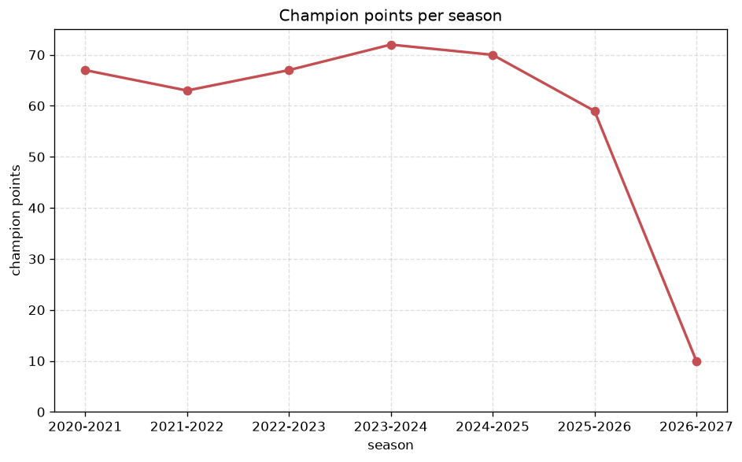
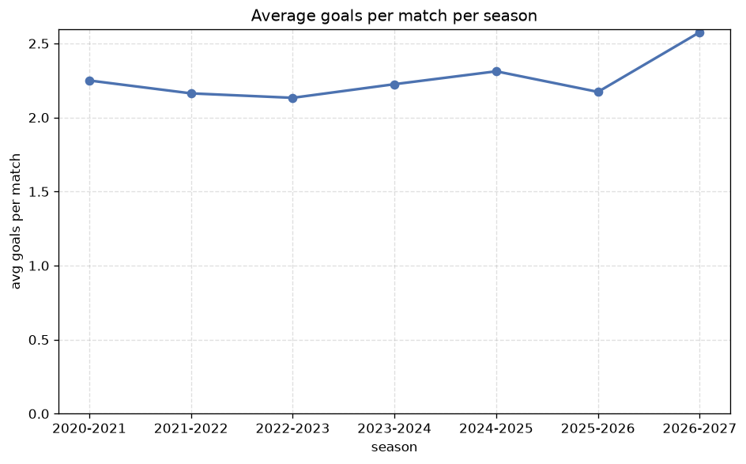

# Season Trends Analysis
- Report: `season_trends`
- Generated: 2026-10-26T01:41:13+00:00
- Script: `backend/scripts/analyze_seasons.py` v1.0.0
- League: Botola Pro (Morocco)
- Scope: league `morocco`

## 1. Champions per season
| season | champion | pts | runner-up | margin |
|---|---|---|---|---|
| 2020-2021 | Wydad | 67 | Raja Casablanca | 8 pts |
| 2021-2022 | Wydad | 63 | Raja Casablanca | 3 pts |
| 2022-2023 | FAR Rabat | 67 | Wydad | 1 pts |
| 2023-2024 | Raja Casablanca | 72 | FAR Rabat | 1 pts |
| 2024-2025 | Berkane | 70 | FAR Rabat | 13 pts |
| 2025-2026 | Maghreb Fez | 59 | Raja Casablanca | 2 pts |
| 2026-2027 | COD Meknes | 10 | Kawkab Marrakech | 1 pts |

## 2. Title-race tightness
- Tight races (margin <= 3 pts): **5** of 7 seasons
- Tightest race: **2022-2023** - FAR Rabat beat Wydad by **1** pts

| season | margin | tight |
|---|---|---|
| 2020-2021 | 8 pts |  |
| 2021-2022 | 3 pts | yes |
| 2022-2023 | 1 pts | yes |
| 2023-2024 | 1 pts | yes |
| 2024-2025 | 13 pts |  |
| 2025-2026 | 2 pts | yes |
| 2026-2027 | 1 pts | yes |

## 3. Points thresholds
_Position-specific points per season. Key: 1 = champion, 2 = runner-up, 4 = CL line, 6 = Europa, 13 = last safe, 16 = bottom._

| season | pos 1 | pos 2 | pos 4 | pos 6 | pos 13 | pos 16 |
|---|---|---|---|---|---|---|
| 2020-2021 | 67 | 59 | 45 | 37 | 33 | 30 |
| 2021-2022 | 63 | 60 | 45 | 41 | 33 | 26 |
| 2022-2023 | 67 | 66 | 47 | 44 | 30 | 25 |
| 2023-2024 | 72 | 71 | 44 | 44 | 30 | 20 |
| 2024-2025 | 70 | 57 | 53 | 47 | 29 | 4 |
| 2025-2026 | 59 | 57 | 55 | 40 | 31 | 22 |
| 2026-2027 | 10 | 9 | 7 | 7 | 3 | 1 |

## 4. Relegation battle
| season | safe pos | safe pts | drop pos | drop pts | gap |
|---|---|---|---|---|---|
| 2020-2021 | 13 | 33 | 14 | 33 | 0 pts |
| 2021-2022 | 13 | 33 | 14 | 33 | 0 pts |
| 2022-2023 | 13 | 30 | 14 | 29 | 1 pts |
| 2023-2024 | 13 | 30 | 14 | 25 | 5 pts |
| 2024-2025 | 13 | 29 | 14 | 25 | 4 pts |
| 2025-2026 | 13 | 31 | 14 | 31 | 0 pts |
| 2026-2027 | 13 | 3 | 14 | 3 | 0 pts |

## 5. League-level trends
| season | matches | total goals | avg goals | home win | draw | away win | goalless | avg pts/team |
|---|---|---|---|---|---|---|---|---|
| 2020-2021 | 240 | 540 | 2.25 | 37.9% | 32.9% | 29.2% | 14.2% | 40.06 |
| 2021-2022 | 240 | 519 | 2.163 | 40.8% | 34.2% | 25.0% | 16.7% | 39.88 |
| 2022-2023 | 240 | 512 | 2.133 | 40.8% | 32.1% | 27.1% | 14.2% | 40.19 |
| 2023-2024 | 240 | 534 | 2.225 | 41.2% | 30.4% | 28.3% | 12.5% | 40.44 |
| 2024-2025 | 240 | 555 | 2.312 | 43.3% | 28.3% | 28.3% | 9.2% | 40.75 |
| 2025-2026 | 248 | 539 | 2.173 | 37.9% | 34.3% | 27.8% | 11.7% | 38.76 |
| 2026-2027 | 33 | 85 | 2.576 | 24.2% | 30.3% | 45.5% | 15.2% | 5.56 |

## 6. View divergence
- Largest divergence: **2025-2026** (goals view, avg abs position diff = 6.706)

_Avg absolute position difference between classic view and alternative view per season._

| season | classic vs luck | classic vs goals |
|---|---|---|
| 2020-2021 | 3.750 | 3.875 |
| 2021-2022 | 2.375 | 6.000 |
| 2022-2023 | 2.000 | 6.250 |
| 2023-2024 | 2.750 | 5.875 |
| 2024-2025 | 2.625 | 5.000 |
| 2025-2026 | 3.882 | 6.706 |
| 2026-2027 | 1.500 | 4.875 |

---
*All statistics are computed from PostgreSQL tables (read-only). Run with `python backend/scripts/analyze_seasons.py` to regenerate.*

## Charts

