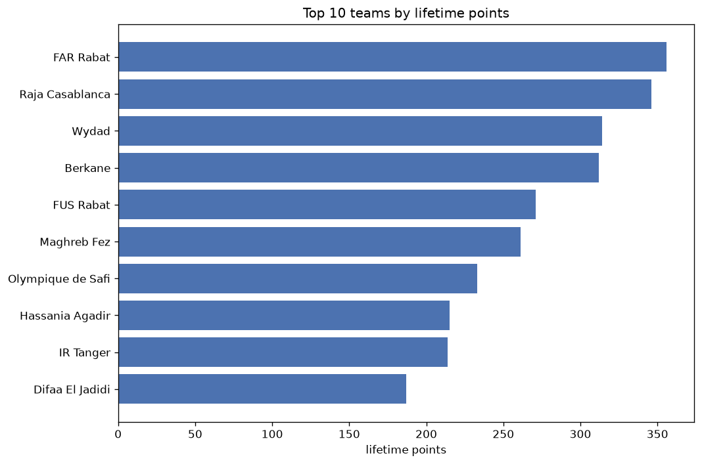
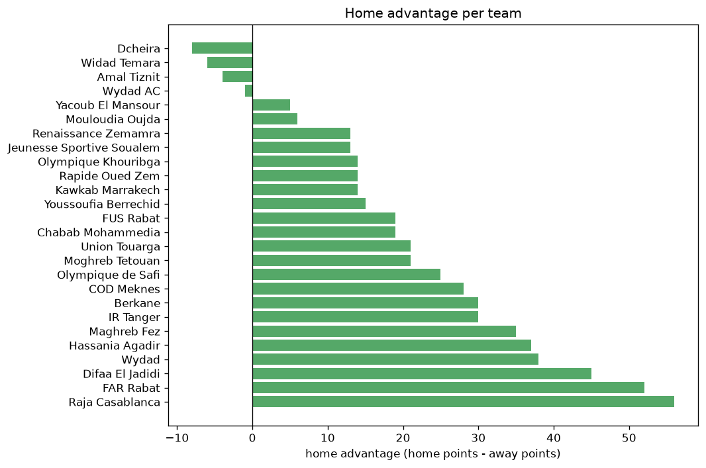

# Team Analysis
- Report: `teams_analysis`
- Generated: 2026-10-30T04:02:24+00:00
- Script: `backend/scripts/analyze_teams.py` v1.0.0
- League: Botola Pro (Morocco)
- Scope: league `morocco`

- Teams: **26** | Seasons: **7** | Matches: **1485**

## 1. Team standings (lifetime)
| team | seasons | played | W | D | L | pts | GF | GA | GD | avg pts/season | best pos | worst pos | titles |
|---|---|---|---|---|---|---|---|---|---|---|---|---|---|
| FAR Rabat | 7 | 183 | 100 | 56 | 27 | 356 | 290 | 147 | 143 | 50.86 | 1 | 5 | 1 |
| Raja Casablanca | 7 | 185 | 95 | 61 | 29 | 346 | 252 | 134 | 118 | 49.43 | 1 | 11 | 1 |
| Wydad | 6 | 158 | 90 | 44 | 24 | 314 | 241 | 130 | 111 | 52.33 | 1 | 17 | 2 |
| Berkane | 7 | 183 | 85 | 57 | 41 | 312 | 240 | 164 | 76 | 44.57 | 1 | 14 | 1 |
| FUS Rabat | 7 | 185 | 70 | 61 | 54 | 271 | 221 | 176 | 45 | 38.71 | 3 | 12 | 0 |
| Maghreb Fez | 7 | 184 | 61 | 78 | 45 | 261 | 198 | 169 | 29 | 37.29 | 1 | 11 | 1 |
| Olympique de Safi | 6 | 181 | 55 | 68 | 58 | 233 | 184 | 199 | -15 | 38.83 | 4 | 16 | 0 |
| Hassania Agadir | 7 | 186 | 54 | 53 | 79 | 215 | 185 | 214 | -29 | 30.71 | 3 | 13 | 0 |
| IR Tanger | 7 | 186 | 53 | 55 | 78 | 214 | 181 | 231 | -50 | 30.57 | 7 | 14 | 0 |
| Difaa El Jadidi | 6 | 155 | 45 | 52 | 58 | 187 | 166 | 212 | -46 | 31.17 | 6 | 16 | 0 |
| Union Touarga | 5 | 125 | 37 | 42 | 46 | 153 | 134 | 150 | -16 | 30.6 | 5 | 13 | 0 |
| Renaissance Zemamra | 5 | 126 | 40 | 31 | 55 | 151 | 134 | 155 | -21 | 30.2 | 6 | 16 | 0 |
| Mouloudia Oujda | 4 | 120 | 32 | 36 | 52 | 132 | 123 | 154 | -31 | 33.0 | 5 | 15 | 0 |
| Chabab Mohammedia | 5 | 150 | 29 | 42 | 79 | 129 | 112 | 204 | -92 | 25.8 | 9 | 16 | 0 |
| Jeunesse Sportive Soualem | 4 | 120 | 32 | 31 | 57 | 127 | 120 | 166 | -46 | 31.75 | 9 | 14 | 0 |
| Moghreb Tetouan | 5 | 125 | 24 | 51 | 50 | 123 | 118 | 160 | -42 | 24.6 | 9 | 15 | 0 |
| COD Meknes | 3 | 66 | 21 | 19 | 26 | 82 | 61 | 84 | -23 | 27.33 | 1 | 11 | 1 |
| Youssoufia Berrechid | 3 | 90 | 16 | 31 | 43 | 79 | 69 | 125 | -56 | 26.33 | 14 | 16 | 0 |
| Olympique Khouribga | 2 | 60 | 13 | 25 | 22 | 64 | 61 | 73 | -12 | 32.0 | 10 | 15 | 0 |
| Rapide Oued Zem | 2 | 60 | 14 | 20 | 26 | 62 | 47 | 75 | -28 | 31.0 | 13 | 15 | 0 |
| Wydad AC | 2 | 35 | 15 | 6 | 14 | 51 | 44 | 37 | 7 | 25.5 | 4 | 5 | 0 |
| Kawkab Marrakech | 2 | 36 | 11 | 13 | 12 | 46 | 34 | 32 | 2 | 23.0 | 2 | 9 | 0 |
| Yacoub El Mansour | 1 | 31 | 7 | 10 | 14 | 31 | 35 | 45 | -10 | 31.0 | 14 | 14 | 0 |
| Dcheira | 1 | 30 | 7 | 9 | 14 | 30 | 29 | 40 | -11 | 30.0 | 15 | 15 | 0 |
| Widad Temara | 1 | 5 | 2 | 0 | 3 | 6 | 6 | 4 | 2 | 6.0 | 10 | 10 | 0 |
| Amal Tiznit | 1 | 5 | 1 | 1 | 3 | 4 | 6 | 11 | -5 | 4.0 | 13 | 13 | 0 |

## 2. Home vs away split
| team | home P | H-W | H-D | H-L | H-pts | away P | A-W | A-D | A-L | A-pts | adv |
|---|---|---|---|---|---|---|---|---|---|---|---|
| Raja Casablanca | 92 | 59 | 24 | 9 | 201 | 93 | 36 | 37 | 20 | 145 | 56 |
| FAR Rabat | 92 | 59 | 27 | 6 | 204 | 91 | 41 | 29 | 21 | 152 | 52 |
| Difaa El Jadidi | 78 | 29 | 29 | 20 | 116 | 77 | 16 | 23 | 38 | 71 | 45 |
| Wydad | 79 | 54 | 14 | 11 | 176 | 79 | 36 | 30 | 13 | 138 | 38 |
| Hassania Agadir | 93 | 32 | 30 | 31 | 126 | 93 | 22 | 23 | 48 | 89 | 37 |
| Maghreb Fez | 92 | 39 | 31 | 22 | 148 | 92 | 22 | 47 | 23 | 113 | 35 |
| Berkane | 91 | 48 | 27 | 16 | 171 | 92 | 37 | 30 | 25 | 141 | 30 |
| IR Tanger | 92 | 30 | 32 | 30 | 122 | 94 | 23 | 23 | 48 | 92 | 30 |
| COD Meknes | 33 | 16 | 7 | 10 | 55 | 33 | 5 | 12 | 16 | 27 | 28 |
| Olympique de Safi | 92 | 29 | 42 | 21 | 129 | 89 | 26 | 26 | 37 | 104 | 25 |
| Union Touarga | 63 | 22 | 21 | 20 | 87 | 62 | 15 | 21 | 26 | 66 | 21 |
| Moghreb Tetouan | 63 | 14 | 30 | 19 | 72 | 62 | 10 | 21 | 31 | 51 | 21 |
| FUS Rabat | 92 | 37 | 34 | 21 | 145 | 93 | 33 | 27 | 33 | 126 | 19 |
| Chabab Mohammedia | 75 | 19 | 17 | 39 | 74 | 75 | 10 | 25 | 40 | 55 | 19 |
| Youssoufia Berrechid | 44 | 11 | 14 | 19 | 47 | 46 | 5 | 17 | 24 | 32 | 15 |
| Olympique Khouribga | 30 | 8 | 15 | 7 | 39 | 30 | 5 | 10 | 15 | 25 | 14 |
| Rapide Oued Zem | 30 | 11 | 5 | 14 | 38 | 30 | 3 | 15 | 12 | 24 | 14 |
| Kawkab Marrakech | 18 | 8 | 6 | 4 | 30 | 18 | 3 | 7 | 8 | 16 | 14 |
| Renaissance Zemamra | 62 | 21 | 19 | 22 | 82 | 64 | 19 | 12 | 33 | 69 | 13 |
| Jeunesse Sportive Soualem | 60 | 17 | 19 | 24 | 70 | 60 | 15 | 12 | 33 | 57 | 13 |
| Mouloudia Oujda | 60 | 17 | 18 | 25 | 69 | 60 | 15 | 18 | 27 | 63 | 6 |
| Yacoub El Mansour | 16 | 4 | 6 | 6 | 18 | 15 | 3 | 4 | 8 | 13 | 5 |
| Wydad AC | 18 | 7 | 4 | 7 | 25 | 17 | 8 | 2 | 7 | 26 | -1 |
| Amal Tiznit | 3 | 0 | 0 | 3 | 0 | 2 | 1 | 1 | 0 | 4 | -4 |
| Widad Temara | 2 | 0 | 0 | 2 | 0 | 3 | 2 | 0 | 1 | 6 | -6 |
| Dcheira | 15 | 2 | 5 | 8 | 11 | 15 | 5 | 4 | 6 | 19 | -8 |

## 3. Top performers
### Best points per game (PPG)
| rank | team | PPG |
|---|---|---|
| 1 | Wydad | 1.99 |
| 2 | FAR Rabat | 1.95 |
| 3 | Raja Casablanca | 1.87 |
| 4 | Berkane | 1.71 |
| 5 | FUS Rabat | 1.47 |

### Most goals scored
| rank | team | goals |
|---|---|---|
| 1 | FAR Rabat | 290 |
| 2 | Raja Casablanca | 252 |
| 3 | Wydad | 241 |
| 4 | Berkane | 240 |
| 5 | FUS Rabat | 221 |

### Best goal difference
| rank | team | GD |
|---|---|---|
| 1 | FAR Rabat | 143 |
| 2 | Raja Casablanca | 118 |
| 3 | Wydad | 111 |
| 4 | Berkane | 76 |
| 5 | FUS Rabat | 45 |

### Best defence (goals against per match, standings)
| rank | team | GA/match |
|---|---|---|
| 1 | Raja Casablanca | 0.724 |
| 2 | Widad Temara | 0.800 |
| 3 | FAR Rabat | 0.803 |
| 4 | Wydad | 0.823 |
| 5 | Kawkab Marrakech | 0.889 |

## 4. Team consistency
- Teams present in all **7** seasons: **7**

Berkane, FAR Rabat, FUS Rabat, Hassania Agadir, IR Tanger, Maghreb Fez, Raja Casablanca

## 5. Head-to-head dominance
- Distinct fixtures: **250** (showing the 15 most frequent)

| fixture | meetings | home wins | draws | away wins | home pct | draw pct | away pct |
|---|---|---|---|---|---|---|---|
| FAR Rabat vs Hassania Agadir | 13 | 7 | 1 | 5 | 53.8% | 7.7% | 38.5% |
| FAR Rabat vs IR Tanger | 13 | 6 | 3 | 4 | 46.2% | 23.1% | 30.8% |
| Raja Casablanca vs FUS Rabat | 13 | 6 | 4 | 3 | 46.2% | 30.8% | 23.1% |
| Raja Casablanca vs Hassania Agadir | 13 | 6 | 3 | 4 | 46.2% | 23.1% | 30.8% |
| Hassania Agadir vs Maghreb Fez | 13 | 5 | 5 | 3 | 38.5% | 38.5% | 23.1% |
| Maghreb Fez vs IR Tanger | 13 | 4 | 6 | 3 | 30.8% | 46.2% | 23.1% |
| Raja Casablanca vs Maghreb Fez | 13 | 3 | 8 | 2 | 23.1% | 61.5% | 15.4% |
| Berkane vs FUS Rabat | 12 | 8 | 2 | 2 | 66.7% | 16.7% | 16.7% |
| Berkane vs Hassania Agadir | 12 | 6 | 2 | 4 | 50.0% | 16.7% | 33.3% |
| Berkane vs IR Tanger | 12 | 6 | 2 | 4 | 50.0% | 16.7% | 33.3% |
| FAR Rabat vs FUS Rabat | 12 | 6 | 3 | 3 | 50.0% | 25.0% | 25.0% |
| FAR Rabat vs Maghreb Fez | 12 | 6 | 4 | 2 | 50.0% | 33.3% | 16.7% |
| IR Tanger vs Olympique de Safi | 12 | 6 | 4 | 2 | 50.0% | 33.3% | 16.7% |
| Raja Casablanca vs IR Tanger | 12 | 6 | 3 | 3 | 50.0% | 25.0% | 25.0% |
| FUS Rabat vs Olympique de Safi | 12 | 5 | 4 | 3 | 41.7% | 33.3% | 25.0% |

## 6. Position per season (classic view)
_Cells show final position; '-' when the team was absent from that season._

| team | 2020-2021 | 2021-2022 | 2022-2023 | 2023-2024 | 2024-2025 | 2025-2026 | 2026-2027 |
|---|---|---|---|---|---|---|---|
| FAR Rabat | 3 | 3 | 1 | 2 | 2 | 4 | 5 |
| Raja Casablanca | 2 | 2 | 5 | 1 | 5 | 2 | 11 |
| Wydad | 1 | 1 | 2 | 4 | 3 | 17 | - |
| Berkane | 4 | 6 | 6 | 3 | 1 | 3 | 14 |
| FUS Rabat | 10 | 5 | 3 | 7 | 4 | 8 | 12 |
| Maghreb Fez | 7 | 4 | 10 | 11 | 7 | 1 | 6 |
| Olympique de Safi | 12 | 7 | 4 | 6 | 8 | 16 | - |
| Hassania Agadir | 6 | 11 | 7 | 10 | 13 | 12 | 3 |
| IR Tanger | 8 | 14 | 14 | 12 | 10 | 7 | 8 |
| Difaa El Jadidi | 11 | 8 | 16 | - | 9 | 6 | 7 |
| Union Touarga | - | - | 8 | 5 | 12 | 13 | 9 |
| Renaissance Zemamra | 16 | - | - | 8 | 6 | 11 | 16 |
| Mouloudia Oujda | 5 | 13 | 11 | 15 | - | - | - |
| Chabab Mohammedia | 9 | 12 | 12 | 14 | 16 | - | - |
| Jeunesse Sportive Soualem | - | 9 | 9 | 13 | 14 | - | - |
| Moghreb Tetouan | 15 | - | 13 | 9 | 15 | - | 15 |
| COD Meknes | - | - | - | - | 11 | 10 | 1 |
| Youssoufia Berrechid | 14 | 16 | - | 16 | - | - | - |
| Olympique Khouribga | - | 10 | 15 | - | - | - | - |
| Rapide Oued Zem | 13 | 15 | - | - | - | - | - |
| Wydad AC | - | - | - | - | - | 5 | 4 |
| Kawkab Marrakech | - | - | - | - | - | 9 | 2 |
| Yacoub El Mansour | - | - | - | - | - | 14 | - |
| Dcheira | - | - | - | - | - | 15 | - |
| Widad Temara | - | - | - | - | - | - | 10 |
| Amal Tiznit | - | - | - | - | - | - | 13 |

---
*All statistics are computed from PostgreSQL tables (read-only). Run with `python backend/scripts/analyze_teams.py` to regenerate.*

## Charts

