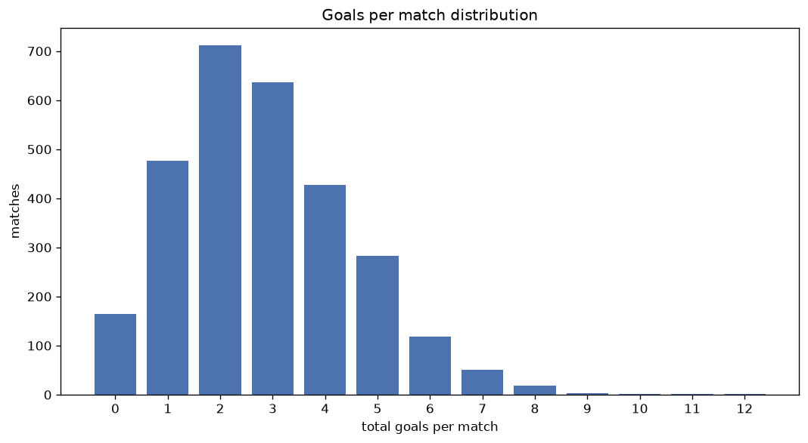
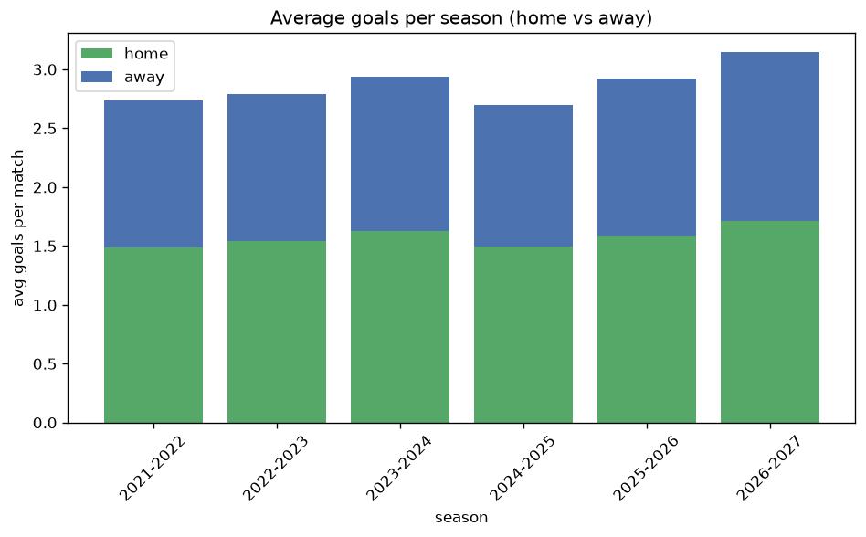

# Goal Analysis
- Report: `goals_analysis`
- Generated: 2026-10-29T02:08:35+00:00
- Script: `backend/scripts/analyze_goals.py` v1.0.0
- League: National League (England)
- Scope: league `national`

## 1. Goals per match distribution
| goals | matches | pct |
|---|---|---|
| 0 | 164 | 5.7% |
| 1 | 476 | 16.4% |
| 2 | 712 | 24.6% |
| 3 | 637 | 22.0% |
| 4 | 428 | 14.8% |
| 5 | 283 | 9.8% |
| 6 | 119 | 4.1% |
| 7 | 50 | 1.7% |
| 8 | 19 | 0.7% |
| 9 | 3 | 0.1% |
| 10 | 1 | 0.0% |
| 11 | 1 | 0.0% |
| 12 | 1 | 0.0% |

## 2. Goals per match per season
| season | matches | total goals | avg home | avg away | avg total |
|---|---|---|---|---|---|
| 2021-2022 | 506 | 1386 | 1.49 | 1.249 | 2.739 |
| 2022-2023 | 552 | 1540 | 1.54 | 1.25 | 2.79 |
| 2023-2024 | 552 | 1623 | 1.629 | 1.312 | 2.94 |
| 2024-2025 | 552 | 1488 | 1.496 | 1.199 | 2.696 |
| 2025-2026 | 557 | 1626 | 1.585 | 1.334 | 2.919 |
| 2026-2027 | 175 | 551 | 1.709 | 1.44 | 3.149 |

## 3. Home vs away goal share
- Home goals: **4511** (54.9%)
- Away goals: **3703** (45.1%)
- Home/away ratio: **1.218**

| season | home goals | away goals | total | home pct | away pct |
|---|---|---|---|---|---|
| 2021-2022 | 754 | 632 | 1386 | 54.4% | 45.6% |
| 2022-2023 | 850 | 690 | 1540 | 55.2% | 44.8% |
| 2023-2024 | 899 | 724 | 1623 | 55.4% | 44.6% |
| 2024-2025 | 826 | 662 | 1488 | 55.5% | 44.5% |
| 2025-2026 | 883 | 743 | 1626 | 54.3% | 45.7% |
| 2026-2027 | 299 | 252 | 551 | 54.3% | 45.7% |

## 4. BTTS (Both Teams To Score)
- Overall: **1615** of `2894` (55.8%)

| season | matches | BTTS | pct |
|---|---|---|---|
| 2021-2022 | 506 | 254 | 50.2% |
| 2022-2023 | 552 | 309 | 56.0% |
| 2023-2024 | 552 | 327 | 59.2% |
| 2024-2025 | 552 | 298 | 54.0% |
| 2025-2026 | 557 | 314 | 56.4% |
| 2026-2027 | 175 | 113 | 64.6% |

## 5. Clean sheets
- Home clean sheets: **809** (28.0%)
- Away clean sheets: **634** (21.9%)
- Total clean sheets recorded: **1443**
- Matches with at least one clean sheet: **1279** (44.2%)
- Both teams kept clean sheets (0-0): **164**

| season | matches | home CS | away CS | total CS | matches w/ CS |
|---|---|---|---|---|---|
| 2021-2022 | 506 | 167 | 121 | 288 | 252 (49.8%) |
| 2022-2023 | 552 | 156 | 114 | 270 | 243 (44.0%) |
| 2023-2024 | 552 | 139 | 119 | 258 | 225 (40.8%) |
| 2024-2025 | 552 | 159 | 132 | 291 | 254 (46.0%) |
| 2025-2026 | 557 | 150 | 121 | 271 | 243 (43.6%) |
| 2026-2027 | 175 | 38 | 27 | 65 | 62 (35.4%) |

## 6. Scoring intensity
- First-half goals: **3589** (43.7%)
- Second-half goals: **4621** (56.3%)
- Avg first-half goals per match: **1.241**
- Avg second-half goals per match: **1.598**
- Second-half-only scoring (HT 0-0, FT goals >= 1): **635** (21.9%)
- *2 match(es) excluded (no HT score recorded).*

| season | matches | 1st half | 2nd half | 1st half pct | 2nd half pct |
|---|---|---|---|---|---|
| 2021-2022 | 506 | 611 | 775 | 44.1% | 55.9% |
| 2022-2023 | 552 | 668 | 872 | 43.4% | 56.6% |
| 2023-2024 | 552 | 710 | 913 | 43.7% | 56.3% |
| 2024-2025 | 552 | 668 | 820 | 44.9% | 55.1% |
| 2025-2026 | 557 | 707 | 916 | 43.6% | 56.4% |
| 2026-2027 | 175 | 225 | 325 | 40.9% | 59.1% |

## 7. First-goal timing
- Matches with first-goal time recorded: `2728` of `2894` (94.3%)
- Goalless matches: `166`
- Min `1` | Max `108` | Mean `30.59` | Median (p50) `25.0`

| bucket | count | % of matches | % of scoring matches |
|---|---|---|---|
| 1-15 | 911 | 31.5% | 33.4% |
| 16-30 | 675 | 23.3% | 24.7% |
| 31-45 | 454 | 15.7% | 16.6% |
| 46-60 | 347 | 12.0% | 12.7% |
| 61-75 | 198 | 6.8% | 7.3% |
| 76-90 | 107 | 3.7% | 3.9% |
| 91-120 | 36 | 1.2% | 1.3% |

---
*All statistics are computed from PostgreSQL tables (read-only). Run with `python backend/scripts/analyze_goals.py` to regenerate.*

## Charts

