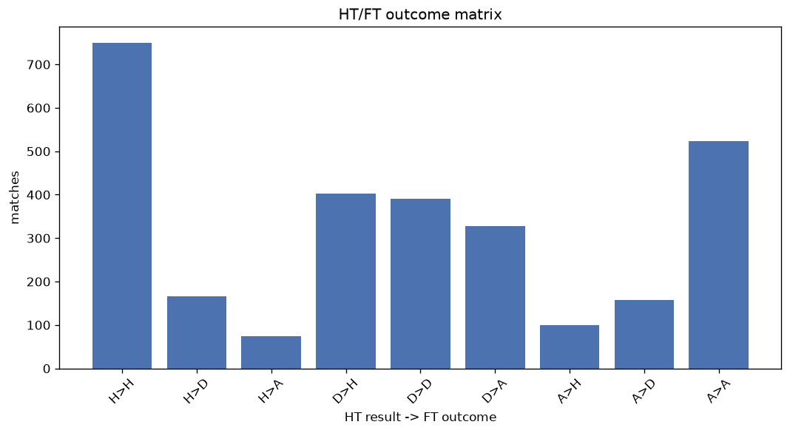
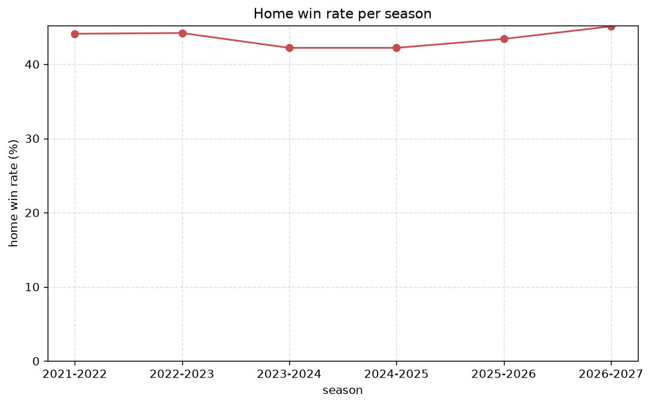

# Match Analysis
- Report: `matches_analysis`
- Generated: 2026-10-29T02:08:33+00:00
- Script: `backend/scripts/analyze_matches.py` v1.0.0
- League: National League (England)
- Scope: league `national`

## 1. Overall summary
| metric | value |
|---|---|
| Matches | 2894 |
| Home wins | 1254 (43.3%) |
| Draws | 715 (24.7%) |
| Away wins | 925 (32.0%) |
| Total goals | 8214 |
| Average goals per match | 2.838 |
| Goalless matches | 164 (5.7%) |

## 2. Per-season breakdown
| season | matches | home wins | draws | away wins | total goals | avg goals | goalless |
|---|---|---|---|---|---|---|---|
| 2021-2022 | 506 | 223 (44.1%) | 116 (22.9%) | 167 (33.0%) | 1386 | 2.739 | 36 (7.1%) |
| 2022-2023 | 552 | 244 (44.2%) | 142 (25.7%) | 166 (30.1%) | 1540 | 2.79 | 27 (4.9%) |
| 2023-2024 | 552 | 233 (42.2%) | 141 (25.5%) | 178 (32.2%) | 1623 | 2.94 | 33 (6.0%) |
| 2024-2025 | 552 | 233 (42.2%) | 157 (28.4%) | 162 (29.3%) | 1488 | 2.696 | 37 (6.7%) |
| 2025-2026 | 557 | 242 (43.4%) | 128 (23.0%) | 187 (33.6%) | 1626 | 2.919 | 28 (5.0%) |
| 2026-2027 | 175 | 79 (45.1%) | 31 (17.7%) | 65 (37.1%) | 551 | 3.149 | 3 (1.7%) |

## 3. HT/FT outcome matrix
| HT result \ FT result | Home | Draw | Away | total |
|---|---|---|---|---|
| HT home lead | 749 (75.7%) | 166 (16.8%) | 74 (7.5%) | 989 |
| HT draw | 403 (36.0%) | 391 (34.9%) | 327 (29.2%) | 1121 |
| HT away lead | 100 (12.8%) | 158 (20.2%) | 524 (67.0%) | 782 |
- *2 match(es) excluded (no HT score recorded).*

## 4. Comeback matches
- Home comebacks (trailing at HT, won at FT): **100** (3.5%)
- Away comebacks (trailing at HT, won at FT): **74** (2.6%)

### Home comebacks
| season | home | away | HT | FT |
|---|---|---|---|---|
| 2021-2022 | Grimsby | Barnet | 1-2 | 4-3 |
| 2021-2022 | Dag & Red | Weymouth | 1-2 | 4-2 |
| 2021-2022 | Stockport County | Wrexham | 0-1 | 2-1 |
| 2021-2022 | Eastleigh | Woking | 1-2 | 3-2 |
| 2021-2022 | Bromley | Grimsby | 0-1 | 3-1 |
| 2021-2022 | Woking | Chesterfield | 0-1 | 3-1 |
| 2021-2022 | FC Halifax | Notts Co | 0-1 | 3-2 |
| 2021-2022 | Eastleigh | Altrincham | 0-1 | 2-1 |
| 2021-2022 | Eastleigh | Torquay | 0-1 | 2-1 |
| 2021-2022 | Wealdstone | Dover | 0-1 | 2-1 |
| 2021-2022 | Southend | King’s Lynn | 0-1 | 2-1 |
| 2021-2022 | Chesterfield | Notts Co | 0-1 | 3-1 |
| 2021-2022 | Wealdstone | Weymouth | 0-1 | 3-2 |
| 2021-2022 | Stockport County | Wealdstone | 0-2 | 4-2 |
| 2021-2022 | Grimsby | Stockport County | 0-1 | 2-1 |
| 2021-2022 | Woking | Wrexham | 0-1 | 2-1 |
| 2021-2022 | Wealdstone | King’s Lynn | 0-1 | 2-1 |
| 2022-2023 | Wrexham | Eastleigh | 0-1 | 2-1 |
| 2022-2023 | Wealdstone | Bromley | 1-2 | 3-2 |
| 2022-2023 | Maidstone | York City | 0-1 | 2-1 |
| 2022-2023 | Eastleigh | Southend | 0-1 | 2-1 |
| 2022-2023 | York City | Bromley | 0-1 | 2-1 |
| 2022-2023 | Oldham | Eastleigh | 1-2 | 3-2 |
| 2022-2023 | Scunthorpe | Dorking | 0-2 | 3-2 |
| 2022-2023 | Wrexham | FC Halifax | 0-1 | 3-1 |
| 2022-2023 | Eastleigh | Maidstone | 1-2 | 5-2 |
| 2022-2023 | Altrincham | York City | 0-1 | 2-1 |
| 2022-2023 | Woking | Maidstone | 0-1 | 3-1 |
| 2022-2023 | Dorking | Maidstone | 1-2 | 3-2 |
| 2022-2023 | Altrincham | FC Halifax | 0-1 | 2-1 |
| 2022-2023 | Oldham | Dag & Red | 0-1 | 4-2 |
| 2022-2023 | Notts Co | Barnet | 0-1 | 4-1 |
| 2022-2023 | Southend | FC Halifax | 0-1 | 2-1 |
| 2022-2023 | Notts Co | Eastleigh | 0-1 | 3-1 |
| 2022-2023 | FC Halifax | Wrexham | 0-1 | 3-1 |
| 2022-2023 | Wrexham | Notts Co | 0-1 | 3-2 |
| 2022-2023 | Dorking | Altrincham | 1-2 | 3-2 |
| 2022-2023 | Chesterfield | Eastleigh | 0-2 | 3-2 |
| 2022-2023 | Southend | Wealdstone | 0-1 | 2-1 |
| 2023-2024 | Wealdstone | York City | 0-1 | 2-1 |
| 2023-2024 | Woking | Rochdale | 0-1 | 3-2 |
| 2023-2024 | Altrincham | Chesterfield | 0-1 | 2-1 |
| 2023-2024 | Chesterfield | Hartlepool | 1-2 | 3-2 |
| 2023-2024 | Oxford City | Hartlepool | 1-2 | 5-2 |
| 2023-2024 | Chesterfield | Dag & Red | 0-1 | 3-1 |
| 2023-2024 | Chesterfield | Wealdstone | 0-1 | 3-2 |
| 2023-2024 | Barnet | AFC Fylde | 0-1 | 2-1 |
| 2023-2024 | Barnet | Maidenhead | 1-2 | 3-2 |
| 2023-2024 | Southend | Chesterfield | 0-1 | 2-1 |
| 2023-2024 | Wealdstone | Barnet | 1-2 | 3-2 |
| 2023-2024 | Boreham Wood | Woking | 1-2 | 4-2 |
| 2023-2024 | Altrincham | AFC Fylde | 0-1 | 2-1 |
| 2023-2024 | Chesterfield | Solihull Moors | 0-1 | 3-2 |
| 2023-2024 | Gateshead | Barnet | 0-1 | 2-1 |
| 2023-2024 | Kidderminster | Oxford City | 0-2 | 3-2 |
| 2023-2024 | Oldham | Boreham Wood | 0-1 | 2-1 |
| 2023-2024 | Bromley | Chesterfield | 0-1 | 4-3 |
| 2023-2024 | Hartlepool | Altrincham | 0-1 | 3-2 |
| 2023-2024 | Southend | Aldershot | 0-1 | 4-1 |
| 2023-2024 | Woking | Gateshead | 1-2 | 3-2 |
| 2023-2024 | Woking | Kidderminster | 0-1 | 2-1 |
| 2023-2024 | Ebbsfleet | Gateshead | 1-2 | 4-2 |
| 2023-2024 | AFC Fylde | Oxford City | 0-1 | 2-1 |
| 2023-2024 | York City | Chesterfield | 0-1 | 2-1 |
| 2023-2024 | Gateshead | Bromley | 0-1 | 2-1 |
| 2024-2025 | AFC Fylde | Solihull Moors | 1-2 | 3-2 |
| 2024-2025 | Eastleigh | AFC Fylde | 1-2 | 4-2 |
| 2024-2025 | Braintree | Aldershot | 0-1 | 2-1 |
| 2024-2025 | Woking | Hartlepool | 0-2 | 3-2 |
| 2024-2025 | Barnet | Boston Utd | 0-1 | 3-1 |
| 2024-2025 | Hartlepool | Sutton | 0-2 | 4-3 |
| 2024-2025 | FC Halifax | Tamworth | 0-2 | 3-2 |
| 2024-2025 | Wealdstone | Braintree | 1-2 | 3-2 |
| 2024-2025 | Tamworth | Dag & Red | 0-1 | 2-1 |
| 2024-2025 | Oldham | Wealdstone | 1-2 | 3-2 |
| 2024-2025 | Forest Green | Yeovil | 0-1 | 2-1 |
| 2024-2025 | Yeovil | Tamworth | 0-1 | 2-1 |
| 2024-2025 | Aldershot | Hartlepool | 0-1 | 3-2 |
| 2024-2025 | Solihull Moors | Boston Utd | 1-2 | 3-2 |
| 2024-2025 | Tamworth | AFC Fylde | 2-3 | 4-3 |
| 2025-2026 | Eastleigh | Altrincham | 0-1 | 2-1 |
| 2025-2026 | Altrincham | Sutton | 0-1 | 2-1 |
| 2025-2026 | Wealdstone | Sutton | 1-2 | 4-2 |
| 2025-2026 | Forest Green | FC Halifax | 0-1 | 2-1 |
| 2025-2026 | Hartlepool | Gateshead | 0-1 | 2-1 |
| 2025-2026 | Forest Green | Woking | 1-2 | 4-2 |
| 2025-2026 | Aldershot | FC Halifax | 0-1 | 3-2 |
| 2025-2026 | Boreham Wood | York City | 0-1 | 3-2 |
| 2025-2026 | Scunthorpe | Altrincham | 0-1 | 2-1 |
| 2025-2026 | Carlisle | Boston Utd | 1-2 | 6-2 |
| 2026-2027 | Forest Green | FC Halifax | 0-1 | 3-2 |
| 2026-2027 | Woking | AFC Fylde | 0-1 | 3-2 |
| 2026-2027 | Boreham Wood | Boston Utd | 0-1 | 2-1 |
| 2026-2027 | Tamworth | Worthing | 0-1 | 3-2 |
| 2026-2027 | Southend | Yeovil | 0-1 | 3-2 |
| 2026-2027 | Tamworth | Wealdstone | 0-1 | 2-1 |
| 2026-2027 | Boreham Wood | Altrincham | 0-1 | 3-1 |
| 2026-2027 | FC Halifax | Gateshead | 0-1 | 4-1 |
| 2026-2027 | AFC Fylde | Hartlepool | 0-1 | 3-1 |
| 2026-2027 | Boston Utd | Gateshead | 0-1 | 2-1 |

### Away comebacks
| season | home | away | HT | FT |
|---|---|---|---|---|
| 2021-2022 | FC Halifax | Maidenhead | 1-0 | 1-2 |
| 2021-2022 | Yeovil | King’s Lynn | 1-0 | 1-2 |
| 2021-2022 | Weymouth | Stockport County | 1-0 | 1-2 |
| 2021-2022 | Notts Co | Woking | 1-0 | 1-4 |
| 2021-2022 | Maidenhead | King’s Lynn | 1-0 | 2-3 |
| 2021-2022 | Dag & Red | Altrincham | 2-1 | 2-3 |
| 2021-2022 | Altrincham | Solihull Moors | 1-0 | 1-2 |
| 2021-2022 | Woking | Aldershot | 1-0 | 2-3 |
| 2021-2022 | King’s Lynn | Notts Co | 1-0 | 2-4 |
| 2021-2022 | Yeovil | Wrexham | 1-0 | 1-2 |
| 2021-2022 | Weymouth | Dag & Red | 1-0 | 1-2 |
| 2021-2022 | Notts Co | Grimsby | 1-0 | 1-2 |
| 2021-2022 | Chesterfield | Solihull Moors | 2-1 | 2-3 |
| 2021-2022 | Grimsby | Solihull Moors | 1-0 | 1-2 |
| 2021-2022 | Eastleigh | Barnet | 1-0 | 2-3 |
| 2021-2022 | Weymouth | Wrexham | 1-0 | 1-6 |
| 2022-2023 | Scunthorpe | Solihull Moors | 3-2 | 3-4 |
| 2022-2023 | Dorking | Boreham Wood | 1-0 | 1-4 |
| 2022-2023 | Altrincham | Chesterfield | 1-0 | 1-2 |
| 2022-2023 | Aldershot | Wealdstone | 1-0 | 1-2 |
| 2022-2023 | Oldham | Wrexham | 1-0 | 1-2 |
| 2022-2023 | York City | Wealdstone | 1-0 | 1-2 |
| 2022-2023 | Wealdstone | Gateshead | 1-0 | 1-2 |
| 2022-2023 | York City | Solihull Moors | 1-0 | 2-3 |
| 2022-2023 | Barnet | Altrincham | 2-1 | 2-4 |
| 2022-2023 | Southend | Aldershot | 1-0 | 1-2 |
| 2022-2023 | Torquay | Dag & Red | 1-0 | 1-2 |
| 2023-2024 | Gateshead | Woking | 1-0 | 1-3 |
| 2023-2024 | Woking | FC Halifax | 1-0 | 1-2 |
| 2023-2024 | Dorking | Barnet | 2-0 | 2-3 |
| 2023-2024 | Bromley | Aldershot | 2-0 | 2-3 |
| 2023-2024 | Solihull Moors | Oldham | 1-0 | 2-3 |
| 2023-2024 | Oldham | Gateshead | 1-0 | 1-2 |
| 2023-2024 | FC Halifax | Aldershot | 1-0 | 1-2 |
| 2023-2024 | Altrincham | Gateshead | 1-0 | 2-3 |
| 2023-2024 | Eastleigh | Maidenhead | 2-0 | 2-3 |
| 2023-2024 | Oldham | Wealdstone | 1-0 | 2-3 |
| 2024-2025 | AFC Fylde | Yeovil | 2-0 | 3-4 |
| 2024-2025 | Boston Utd | Hartlepool | 1-0 | 1-2 |
| 2024-2025 | Eastleigh | Forest Green | 1-0 | 1-3 |
| 2024-2025 | Boston Utd | AFC Fylde | 1-0 | 1-2 |
| 2024-2025 | FC Halifax | York City | 1-0 | 1-2 |
| 2024-2025 | Eastleigh | Braintree | 1-0 | 1-2 |
| 2024-2025 | Dag & Red | Barnet | 2-1 | 3-4 |
| 2024-2025 | Sutton | Tamworth | 1-0 | 1-2 |
| 2024-2025 | Braintree | Wealdstone | 1-0 | 1-2 |
| 2024-2025 | AFC Fylde | Sutton | 1-0 | 1-2 |
| 2024-2025 | Gateshead | Braintree | 1-0 | 1-3 |
| 2024-2025 | Wealdstone | Aldershot | 1-0 | 1-3 |
| 2024-2025 | Aldershot | Boston Utd | 1-0 | 1-2 |
| 2024-2025 | Oldham | Woking | 1-0 | 1-2 |
| 2024-2025 | Tamworth | Solihull Moors | 1-0 | 1-2 |
| 2024-2025 | Yeovil | Sutton | 1-0 | 1-2 |
| 2025-2026 | Yeovil | Gateshead | 3-0 | 3-4 |
| 2025-2026 | Sutton | Boreham Wood | 2-1 | 3-4 |
| 2025-2026 | Braintree | York City | 1-0 | 2-3 |
| 2025-2026 | Morecambe | FC Halifax | 1-0 | 1-2 |
| 2025-2026 | Eastleigh | York City | 2-1 | 2-4 |
| 2025-2026 | Boston Utd | Brackley Town | 1-0 | 1-2 |
| 2025-2026 | Boreham Wood | Boston Utd | 1-0 | 1-2 |
| 2025-2026 | Solihull Moors | Eastleigh | 2-0 | 2-3 |
| 2025-2026 | Eastleigh | Forest Green | 2-1 | 2-4 |
| 2025-2026 | Sutton | Altrincham | 1-0 | 1-2 |
| 2025-2026 | Boreham Wood | Rochdale | 1-0 | 2-3 |
| 2026-2027 | Carlisle | Worthing | 1-0 | 2-3 |
| 2026-2027 | Worthing | Forest Green | 1-0 | 1-2 |
| 2026-2027 | Southend | Kidderminster | 1-0 | 1-3 |
| 2026-2027 | Worthing | Boreham Wood | 1-0 | 2-3 |
| 2026-2027 | Boston Utd | Hornchurch | 2-1 | 2-3 |
| 2026-2027 | Solihull Moors | Aldershot | 1-0 | 1-2 |
| 2026-2027 | Yeovil | Altrincham | 1-0 | 1-2 |
| 2026-2027 | Solihull Moors | Carlisle | 1-0 | 1-2 |
| 2026-2027 | Kidderminster | Worthing | 1-0 | 1-2 |
| 2026-2027 | FC Halifax | Barrow | 1-0 | 2-3 |

## 5. HT lead conversion
| HT state | matches | converted to win | held as draw | collapsed to loss |
|---|---|---|---|---|
| Home lead | 989 | 749 (75.7%) | 166 (16.8%) | 74 (7.5%) |
| Away lead | 782 | 524 (67.0%) | 158 (20.2%) | 100 (12.8%) |

### Matches level at half-time
| FT result | count | pct |
|---|---|---|
| Home win | 403 | 36.0% |
| Draw | 391 | 34.9% |
| Away win | 327 | 29.2% |
- *2 match(es) excluded (no HT score recorded).*

## 6. First-goal timing
- Matches with a first-goal time recorded: `2728` of `2894` (94.3%)

Outcome distribution by first-goal timing bucket:
| bucket | matches | % of matches | home | draw | away |
|---|---|---|---|---|---|
| 1-15 | 911 | 31.5% | 438 (48.1%) | 166 (18.2%) | 307 (33.7%) |
| 16-30 | 675 | 23.3% | 319 (47.3%) | 139 (20.6%) | 217 (32.1%) |
| 31-45 | 454 | 15.7% | 206 (45.4%) | 97 (21.4%) | 151 (33.3%) |
| 46-60 | 347 | 12.0% | 142 (40.9%) | 87 (25.1%) | 118 (34.0%) |
| 61-75 | 198 | 6.8% | 80 (40.4%) | 42 (21.2%) | 76 (38.4%) |
| 76-90 | 107 | 3.7% | 48 (44.9%) | 17 (15.9%) | 42 (39.3%) |
| 91-120 | 36 | 1.2% | 19 (52.8%) | 3 (8.3%) | 14 (38.9%) |

## 7. Goalless matches
- Overall: **164** of `2894` (5.7%)

| season | matches | goalless | pct |
|---|---|---|---|
| 2021-2022 | 506 | 36 | 7.1% |
| 2022-2023 | 552 | 27 | 4.9% |
| 2023-2024 | 552 | 33 | 6.0% |
| 2024-2025 | 552 | 37 | 6.7% |
| 2025-2026 | 557 | 28 | 5.0% |
| 2026-2027 | 175 | 3 | 1.7% |

---
*All statistics are computed from PostgreSQL tables (read-only). Run with `python backend/scripts/analyze_matches.py` to regenerate.*

## Charts

