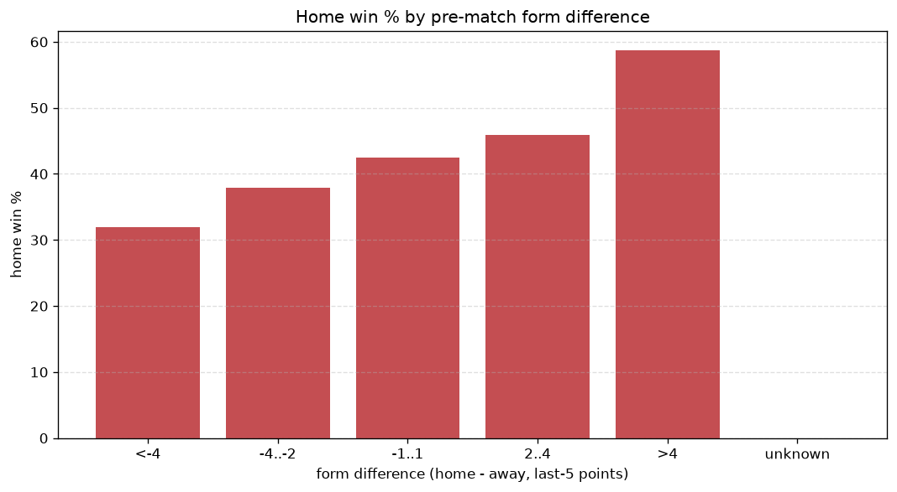
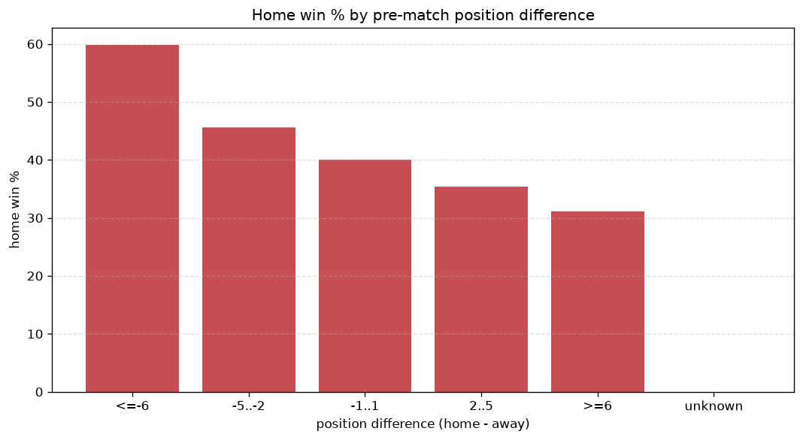

# Relationships Analysis
- Report: `relationships`
- Generated: 2026-10-26T01:41:39+00:00
- Script: `backend/scripts/analyze_relationships.py` v1.0.0
- League: National League (England)
- Scope: league `national`

- Matches analysed: **2719** (23 leakage-safe pre-match features).

## 1. Correlation matrix
_Pearson correlation of each pre-match feature with observed goals; sorted by |corr(total goals)|._

| feature | corr(home) | corr(away) | corr(total) |
|---|---|---|---|
| home_team_home_goals_avg | 0.161 | -0.065 | 0.082 |
| away_team_goals_conceded_last_5 | 0.117 | -0.043 | 0.061 |
| away_team_away_conceded_avg | 0.111 | -0.049 | 0.053 |
| home_team_goals_scored_last_5 | 0.126 | -0.072 | 0.049 |
| home_team_home_conceded_avg | -0.033 | 0.102 | 0.043 |
| points_difference | 0.228 | -0.200 | 0.042 |
| home_team_home_win_rate | 0.135 | -0.105 | 0.034 |
| away_team_away_goals_avg | -0.041 | 0.093 | 0.031 |
| position_difference | -0.217 | 0.204 | -0.030 |
| away_team_goals_scored_last_5 | -0.056 | 0.108 | 0.029 |
| home_rest_days | 0.034 | 0.004 | 0.029 |
| home_position_before_match | -0.167 | 0.152 | -0.027 |
| home_team_goals_conceded_last_5 | -0.066 | 0.109 | 0.022 |
| away_points_before_match | -0.074 | 0.057 | -0.019 |
| away_rest_days | 0.018 | 0.007 | 0.019 |
| away_position_before_match | 0.133 | -0.131 | 0.015 |
| home_team_points_last_5 | 0.124 | -0.121 | 0.015 |
| away_team_away_win_rate | -0.089 | 0.081 | -0.014 |
| home_team_wins_last_5 | 0.120 | -0.118 | 0.013 |
| home_points_before_match | 0.094 | -0.091 | 0.012 |
| rest_days_difference | 0.018 | -0.004 | 0.011 |
| away_team_wins_last_5 | -0.080 | 0.102 | 0.007 |
| away_team_points_last_5 | -0.089 | 0.103 | 0.000 |

## 2. Form vs outcome
_Home win/draw/away % per bucket of `home_team_points_last_5 - away_team_points_last_5`._

| bucket | matches | home | draw | away | home % | draw % | away % |
|---|---|---|---|---|---|---|---|
| <-4 | 466 | 149 | 103 | 214 | 32.0% | 22.1% | 45.9% |
| -4..-2 | 546 | 207 | 127 | 212 | 37.9% | 23.3% | 38.8% |
| -1..1 | 734 | 312 | 205 | 217 | 42.5% | 27.9% | 29.6% |
| 2..4 | 501 | 230 | 135 | 136 | 45.9% | 26.9% | 27.1% |
| >4 | 472 | 277 | 114 | 81 | 58.7% | 24.2% | 17.2% |
| unknown | 0 | 0 | 0 | 0 | - | - | - |

## 3. Position vs outcome
_Home win/draw/away % per bucket of `position_difference` (home position - away position; negative favours the home team)._

| bucket | matches | home | draw | away | home % | draw % | away % |
|---|---|---|---|---|---|---|---|
| <=-6 | 793 | 474 | 164 | 155 | 59.8% | 20.7% | 19.5% |
| -5..-2 | 397 | 181 | 114 | 102 | 45.6% | 28.7% | 25.7% |
| -1..1 | 305 | 122 | 97 | 86 | 40.0% | 31.8% | 28.2% |
| 2..5 | 413 | 146 | 103 | 164 | 35.4% | 24.9% | 39.7% |
| >=6 | 811 | 252 | 206 | 353 | 31.1% | 25.4% | 43.5% |
| unknown | 0 | 0 | 0 | 0 | - | - | - |

## 4. Rest advantage
_Home win/draw/away % per bucket of `rest_days_difference` (home rest - away rest). Matches with unknown rest are bucketed separately._

| bucket | matches | home | draw | away | home % | draw % | away % |
|---|---|---|---|---|---|---|---|
| <-1 | 321 | 137 | 84 | 100 | 42.7% | 26.2% | 31.2% |
| -1..0 | 69 | 28 | 14 | 27 | 40.6% | 20.3% | 39.1% |
| 0 | 1901 | 827 | 486 | 588 | 43.5% | 25.6% | 30.9% |
| 1..2 | 63 | 17 | 17 | 29 | 27.0% | 27.0% | 46.0% |
| >2 | 302 | 140 | 67 | 95 | 46.4% | 22.2% | 31.5% |
| unknown | 63 | 26 | 16 | 21 | 41.3% | 25.4% | 33.3% |
- *63 match(es) had unknown rest difference (missing rest data on at least one side).*

## 5. Home team quality
_Home win rate by `home_team_home_win_rate` tier (split at 0.5)._

- `< 0.5` tier: **38.3%** home win (648/1693)
- `>= 0.5` tier: **51.4%** home win (527/1026)
- Home-win gap (>= split minus < split): **+13.1 pp**

| tier | label | matches | home | draw | away | home % |
|---|---|---|---|---|---|---|
| low | < 0.5 | 1693 | 648 | 426 | 619 | 38.3% |
| high | >= 0.5 | 1026 | 527 | 258 | 241 | 51.4% |

## 6. Feature averages by result
_Mean feature value per outcome; `range` is home-minus-away spread of the group means._

| feature | home mean | draw mean | away mean | range |
|---|---|---|---|---|
| points_difference | 4.416 | -0.722 | -5.557 | 9.973 |
| position_difference | -2.569 | 0.516 | 3.395 | 5.965 |
| home_points_before_match | 33.447 | 30.241 | 27.609 | 5.838 |
| away_points_before_match | 29.031 | 30.963 | 33.166 | 4.136 |
| home_position_before_match | 10.795 | 12.633 | 14.173 | 3.378 |
| away_position_before_match | 13.364 | 12.117 | 10.778 | 2.586 |
| home_team_points_last_5 | 6.926 | 6.525 | 5.569 | 1.357 |
| home_team_goals_scored_last_5 | 6.956 | 6.614 | 5.962 | 0.994 |
| away_team_points_last_5 | 6.063 | 6.424 | 7.050 | 0.987 |
| home_team_goals_conceded_last_5 | 6.254 | 6.539 | 7.193 | 0.939 |
| away_team_goals_scored_last_5 | 6.315 | 6.563 | 7.157 | 0.842 |
| away_team_goals_conceded_last_5 | 6.878 | 6.493 | 6.174 | 0.704 |
| home_team_wins_last_5 | 1.914 | 1.801 | 1.464 | 0.450 |
| away_team_wins_last_5 | 1.635 | 1.770 | 1.944 | 0.309 |
| home_rest_days | 6.017 | 5.747 | 5.843 | 0.270 |
| home_team_home_goals_avg | 1.602 | 1.442 | 1.374 | 0.228 |
| away_rest_days | 5.995 | 5.813 | 5.854 | 0.182 |
| away_team_away_conceded_avg | 1.553 | 1.477 | 1.393 | 0.159 |
| home_team_home_conceded_avg | 1.175 | 1.196 | 1.283 | 0.108 |
| away_team_away_goals_avg | 1.173 | 1.213 | 1.280 | 0.107 |
| home_team_home_win_rate | 0.454 | 0.409 | 0.368 | 0.087 |
| rest_days_difference | 0.019 | -0.066 | -0.010 | 0.085 |
| away_team_away_win_rate | 0.281 | 0.303 | 0.330 | 0.049 |

---
*All features are leakage-safe pre-match values built by `ml.features.build_features.build_rows` from strictly prior matches. Run with `python backend/scripts/analyze_relationships.py` to regenerate.*

## Charts

