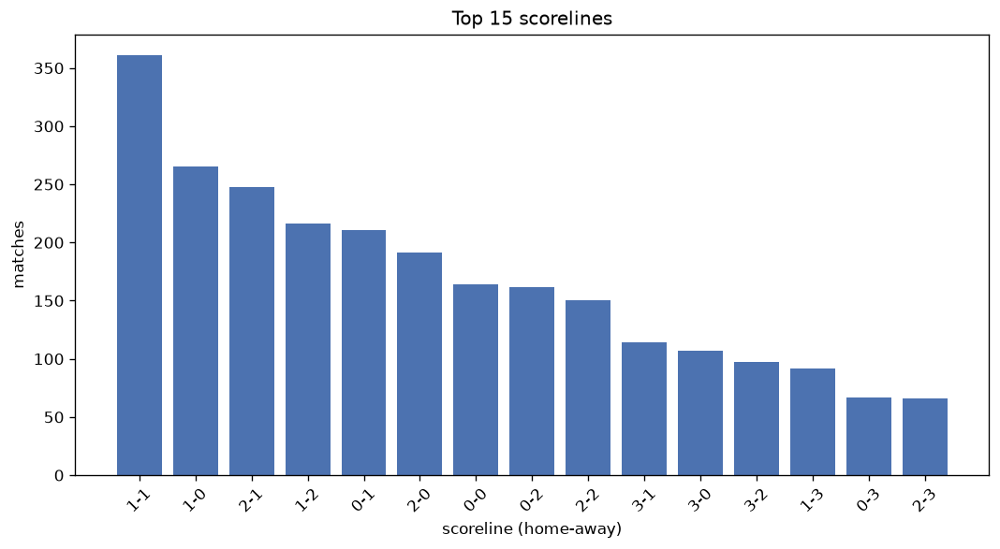
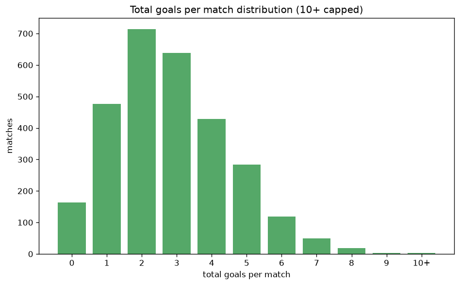

# Scoreline Analysis
- Report: `scoreline_analysis`
- Generated: 2026-10-30T04:02:52+00:00
- Script: `backend/scripts/analyze_scorelines.py` v1.0.0
- League: National League (England)
- Scope: league `national`

## 1. Scoreline frequency
- Matches analysed: **2897** across **6** seasons.
- Distinct scorelines seen: **47**.

| scoreline | count | pct |
|---|---|---|
| 1-1 | 361 | 12.5% |
| 1-0 | 265 | 9.1% |
| 2-1 | 248 | 8.6% |
| 1-2 | 216 | 7.5% |
| 0-1 | 211 | 7.3% |
| 2-0 | 191 | 6.6% |
| 0-0 | 164 | 5.7% |
| 0-2 | 162 | 5.6% |
| 2-2 | 150 | 5.2% |
| 3-1 | 114 | 3.9% |
| 3-0 | 107 | 3.7% |
| 3-2 | 97 | 3.3% |
| 1-3 | 92 | 3.2% |
| 0-3 | 67 | 2.3% |
| 2-3 | 66 | 2.3% |
| 4-1 | 59 | 2.0% |
| 4-0 | 55 | 1.9% |
| 3-3 | 33 | 1.1% |
| 4-2 | 32 | 1.1% |
| 1-4 | 31 | 1.1% |

## 2. Scoreline frequency per season

### 2021-2022
| scoreline | count | pct |
|---|---|---|
| 1-0 | 60 | 11.9% |
| 1-1 | 52 | 10.3% |
| 2-0 | 39 | 7.7% |
| 1-2 | 36 | 7.1% |
| 0-0 | 36 | 7.1% |

### 2022-2023
| scoreline | count | pct |
|---|---|---|
| 1-1 | 81 | 14.7% |
| 1-0 | 55 | 10.0% |
| 2-0 | 42 | 7.6% |
| 2-1 | 42 | 7.6% |
| 0-1 | 38 | 6.9% |

### 2023-2024
| scoreline | count | pct |
|---|---|---|
| 1-1 | 66 | 12.0% |
| 2-1 | 54 | 9.8% |
| 0-1 | 45 | 8.2% |
| 1-2 | 43 | 7.8% |
| 2-0 | 37 | 6.7% |

### 2024-2025
| scoreline | count | pct |
|---|---|---|
| 1-1 | 80 | 14.5% |
| 1-0 | 51 | 9.2% |
| 0-1 | 48 | 8.7% |
| 2-1 | 47 | 8.5% |
| 0-0 | 37 | 6.7% |

### 2025-2026
| scoreline | count | pct |
|---|---|---|
| 1-1 | 64 | 11.5% |
| 2-1 | 54 | 9.7% |
| 1-0 | 50 | 9.0% |
| 1-2 | 47 | 8.4% |
| 0-2 | 36 | 6.5% |

### 2026-2027
| scoreline | count | pct |
|---|---|---|
| 1-1 | 18 | 10.1% |
| 1-2 | 17 | 9.6% |
| 1-0 | 16 | 9.0% |
| 2-1 | 15 | 8.4% |
| 0-1 | 13 | 7.3% |

## 3. Total-goal histogram
_10+ groups all matches with 10 or more total goals._

| total goals | matches | pct |
|---|---|---|
| 0 | 164 | 5.7% |
| 1 | 476 | 16.4% |
| 2 | 714 | 24.6% |
| 3 | 638 | 22.0% |
| 4 | 428 | 14.8% |
| 5 | 283 | 9.8% |
| 6 | 119 | 4.1% |
| 7 | 50 | 1.7% |
| 8 | 19 | 0.7% |
| 9 | 3 | 0.1% |
| 10+ | 3 | 0.1% |

## 4. Extreme scorelines
- Matches with 7+ total goals: **75**

| season | date | scoreline | total goals |
|---|---|---|---|
| 2022-2023 | 2022-10-08 | 7-5 | 12 |
| 2021-2022 | 2022-03-26 | 6-5 | 11 |
| 2021-2022 | 2022-04-15 | 7-3 | 10 |
| 2022-2023 | 2022-09-24 | 5-4 | 9 |
| 2024-2025 | 2025-04-12 | 7-2 | 9 |
| 2025-2026 | 2026-02-14 | 3-6 | 9 |
| 2021-2022 | 2021-11-13 | 2-6 | 8 |
| 2021-2022 | 2022-03-19 | 5-3 | 8 |
| 2021-2022 | 2022-05-15 | 4-4 | 8 |
| 2022-2023 | 2022-10-22 | 4-4 | 8 |
| 2023-2024 | 2023-12-16 | 3-5 | 8 |
| 2023-2024 | 2023-12-23 | 4-4 | 8 |
| 2023-2024 | 2024-01-01 | 4-4 | 8 |
| 2023-2024 | 2024-01-24 | 4-4 | 8 |
| 2023-2024 | 2024-02-10 | 7-1 | 8 |
| 2023-2024 | 2024-03-26 | 7-1 | 8 |
| 2024-2025 | 2024-09-14 | 7-1 | 8 |
| 2024-2025 | 2024-11-09 | 5-3 | 8 |
| 2024-2025 | 2024-11-30 | 6-2 | 8 |
| 2025-2026 | 2025-09-13 | 4-4 | 8 |
| 2025-2026 | 2025-12-26 | 7-1 | 8 |
| 2025-2026 | 2026-02-25 | 4-4 | 8 |
| 2025-2026 | 2026-03-07 | 5-3 | 8 |
| 2025-2026 | 2026-03-21 | 6-2 | 8 |
| 2025-2026 | 2026-04-18 | 2-6 | 8 |
| 2021-2022 | 2021-09-04 | 3-4 | 7 |
| 2021-2022 | 2021-09-04 | 3-4 | 7 |
| 2021-2022 | 2021-09-04 | 4-3 | 7 |
| 2021-2022 | 2021-10-30 | 2-5 | 7 |
| 2021-2022 | 2022-02-08 | 6-1 | 7 |
| 2021-2022 | 2022-04-26 | 1-6 | 7 |
| 2022-2023 | 2022-08-20 | 3-4 | 7 |
| 2022-2023 | 2022-10-04 | 4-3 | 7 |
| 2022-2023 | 2022-10-25 | 1-6 | 7 |
| 2022-2023 | 2022-11-01 | 6-1 | 7 |
| 2022-2023 | 2022-11-08 | 5-2 | 7 |
| 2022-2023 | 2022-12-10 | 3-4 | 7 |
| 2022-2023 | 2023-02-18 | 3-4 | 7 |
| 2022-2023 | 2023-04-12 | 2-5 | 7 |
| 2022-2023 | 2023-04-22 | 2-5 | 7 |
| 2023-2024 | 2023-08-05 | 5-2 | 7 |
| 2023-2024 | 2023-08-05 | 4-3 | 7 |
| 2023-2024 | 2023-09-02 | 3-4 | 7 |
| 2023-2024 | 2023-09-09 | 5-2 | 7 |
| 2023-2024 | 2023-09-23 | 6-1 | 7 |
| 2023-2024 | 2023-10-03 | 5-2 | 7 |
| 2023-2024 | 2023-10-21 | 3-4 | 7 |
| 2023-2024 | 2023-11-25 | 6-1 | 7 |
| 2023-2024 | 2024-02-17 | 4-3 | 7 |
| 2023-2024 | 2024-02-20 | 2-5 | 7 |
| 2023-2024 | 2024-03-12 | 6-1 | 7 |
| 2023-2024 | 2024-04-20 | 3-4 | 7 |
| 2024-2025 | 2024-08-31 | 7-0 | 7 |
| 2024-2025 | 2024-08-31 | 4-3 | 7 |
| 2024-2025 | 2024-09-07 | 3-4 | 7 |
| 2024-2025 | 2024-10-05 | 5-2 | 7 |
| 2024-2025 | 2024-10-05 | 4-3 | 7 |
| 2024-2025 | 2024-10-19 | 4-3 | 7 |
| 2024-2025 | 2024-11-16 | 3-4 | 7 |
| 2024-2025 | 2024-11-23 | 3-4 | 7 |
| 2024-2025 | 2024-12-14 | 3-4 | 7 |
| 2024-2025 | 2024-12-26 | 4-3 | 7 |
| 2024-2025 | 2025-02-18 | 4-3 | 7 |
| 2024-2025 | 2025-04-26 | 4-3 | 7 |
| 2024-2025 | 2025-04-26 | 6-1 | 7 |
| 2025-2026 | 2025-08-25 | 3-4 | 7 |
| 2025-2026 | 2025-09-03 | 3-4 | 7 |
| 2025-2026 | 2025-09-20 | 4-3 | 7 |
| 2025-2026 | 2025-09-30 | 2-5 | 7 |
| 2025-2026 | 2026-02-21 | 3-4 | 7 |
| 2025-2026 | 2026-03-31 | 7-0 | 7 |
| 2025-2026 | 2026-04-21 | 4-3 | 7 |
| 2026-2027 | 2026-08-08 | 5-2 | 7 |
| 2026-2027 | 2026-09-19 | 1-6 | 7 |
| 2026-2027 | 2026-09-26 | 2-5 | 7 |

## 5. Margin-of-victory distribution (decided matches)
- Decided matches: **2182** (draws: **715**)
- Average winning margin: **1.79**

| margin | matches | pct |
|---|---|---|
| 1 | 1132 | 51.9% |
| 2 | 614 | 28.1% |
| 3+ | 436 | 20.0% |

## 6. Margin by outcome

### Home wins
- Matches: **1257** | avg margin: **1.88** | max margin: **7**
| margin | matches | pct |
|---|---|---|
| 1 | 624 | 49.6% |
| 2 | 341 | 27.1% |
| 3+ | 292 | 23.2% |
- *Full match-by-match list available in `scoreline_analysis.json`.*

### Away wins
- Matches: **925** | avg margin: **1.67** | max margin: **6**
| margin | matches | pct |
|---|---|---|
| 1 | 508 | 54.9% |
| 2 | 273 | 29.5% |
| 3+ | 144 | 15.6% |
- *Full match-by-match list available in `scoreline_analysis.json`.*

## 7. Most common exact score by outcome type
| outcome | matches | most common score | count | pct |
|---|---|---|---|---|
| home | 1257 | 1-0 | 265 | 21.1% |
| draw | 715 | 1-1 | 361 | 50.5% |
| away | 925 | 1-2 | 216 | 23.4% |

---
*All statistics are computed from PostgreSQL tables (read-only). Run with `python backend/scripts/analyze_scorelines.py` to regenerate.*

## Charts

