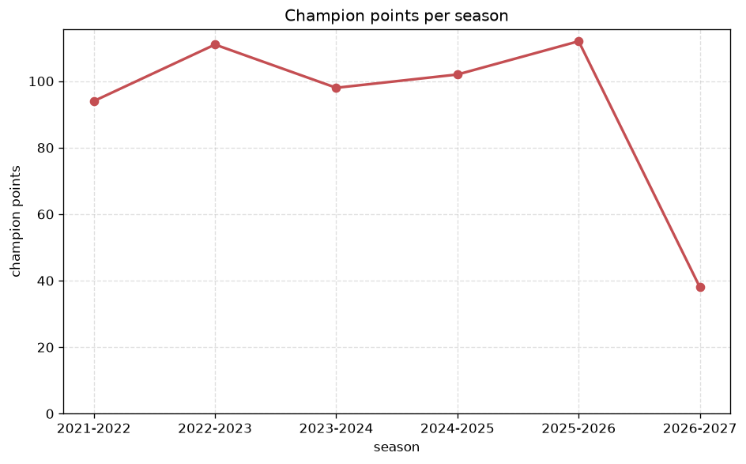
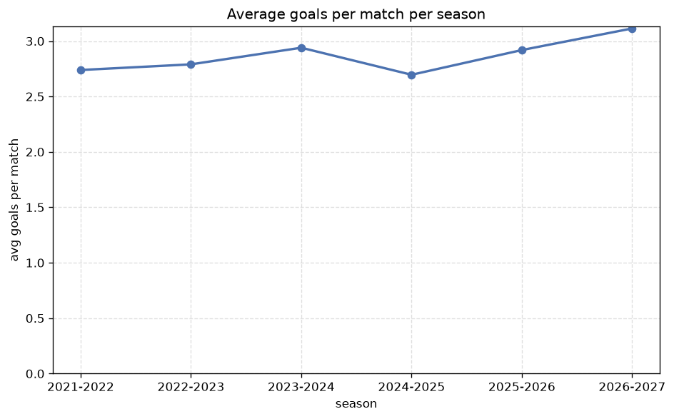

# Season Trends Analysis
- Report: `season_trends`
- Generated: 2026-10-26T01:41:35+00:00
- Script: `backend/scripts/analyze_seasons.py` v1.0.0
- League: National League (England)
- Scope: league `national`

## 1. Champions per season
| season | champion | pts | runner-up | margin |
|---|---|---|---|---|
| 2021-2022 | Stockport County | 94 | Wrexham | 6 pts |
| 2022-2023 | Wrexham | 111 | Notts Co | 4 pts |
| 2023-2024 | Chesterfield | 98 | Barnet | 12 pts |
| 2024-2025 | Barnet | 102 | York City | 6 pts |
| 2025-2026 | Rochdale | 112 | York City | 4 pts |
| 2026-2027 | Boreham Wood | 38 | Harrogate | 7 pts |

## 2. Title-race tightness
- Tight races (margin <= 3 pts): **0** of 6 seasons
- Tightest race: **2022-2023** - Wrexham beat Notts Co by **4** pts

| season | margin | tight |
|---|---|---|
| 2021-2022 | 6 pts |  |
| 2022-2023 | 4 pts |  |
| 2023-2024 | 12 pts |  |
| 2024-2025 | 6 pts |  |
| 2025-2026 | 4 pts |  |
| 2026-2027 | 7 pts |  |

## 3. Points thresholds
_Position-specific points per season. Key: 1 = champion, 2 = runner-up, 4 = CL line, 6 = Europa, 21 = last safe, 24 = bottom._

| season | pos 1 | pos 2 | pos 4 | pos 6 | pos 21 | pos 24 |
|---|---|---|---|---|---|---|
| 2021-2022 | 94 | 88 | 84 | 77 | 34 | - |
| 2022-2023 | 111 | 107 | 82 | 72 | 48 | 25 |
| 2023-2024 | 98 | 86 | 77 | 75 | 52 | 33 |
| 2024-2025 | 102 | 96 | 74 | 70 | 52 | 22 |
| 2025-2026 | 112 | 108 | 90 | 81 | 42 | 34 |
| 2026-2027 | 38 | 31 | 27 | 25 | 12 | 4 |

## 4. Relegation battle
| season | safe pos | safe pts | drop pos | drop pts | gap |
|---|---|---|---|---|---|
| 2021-2022 | 21 | 34 | 22 | 28 | 6 pts |
| 2022-2023 | 21 | 48 | 22 | 40 | 8 pts |
| 2023-2024 | 21 | 52 | 22 | 46 | 6 pts |
| 2024-2025 | 21 | 52 | 22 | 52 | 0 pts |
| 2025-2026 | 21 | 42 | 22 | 38 | 4 pts |
| 2026-2027 | 21 | 12 | 22 | 10 | 2 pts |

## 5. League-level trends
| season | matches | total goals | avg goals | home win | draw | away win | goalless | avg pts/team |
|---|---|---|---|---|---|---|---|---|
| 2021-2022 | 506 | 1386 | 2.739 | 44.1% | 22.9% | 33.0% | 7.1% | 60.96 |
| 2022-2023 | 552 | 1540 | 2.79 | 44.2% | 25.7% | 30.1% | 4.9% | 63.08 |
| 2023-2024 | 552 | 1623 | 2.94 | 42.2% | 25.5% | 32.2% | 6.0% | 63.12 |
| 2024-2025 | 552 | 1488 | 2.696 | 42.2% | 28.4% | 29.3% | 6.7% | 62.46 |
| 2025-2026 | 557 | 1626 | 2.919 | 43.4% | 23.0% | 33.6% | 5.0% | 63.92 |
| 2026-2027 | 166 | 517 | 3.114 | 45.8% | 17.5% | 36.7% | 1.2% | 19.54 |

## 6. View divergence
- Largest divergence: **2024-2025** (goals view, avg abs position diff = 8.500)

_Avg absolute position difference between classic view and alternative view per season._

| season | classic vs luck | classic vs goals |
|---|---|---|
| 2021-2022 | 3.043 | 7.913 |
| 2022-2023 | 3.500 | 7.250 |
| 2023-2024 | 4.583 | 6.917 |
| 2024-2025 | 5.500 | 8.500 |
| 2025-2026 | 2.833 | 7.083 |
| 2026-2027 | 1.917 | 6.583 |

---
*All statistics are computed from PostgreSQL tables (read-only). Run with `python backend/scripts/analyze_seasons.py` to regenerate.*

## Charts

