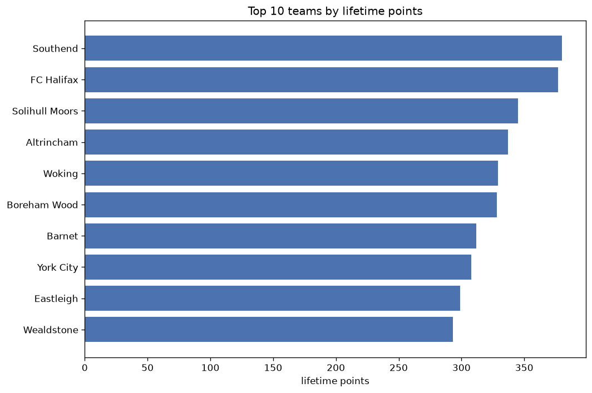
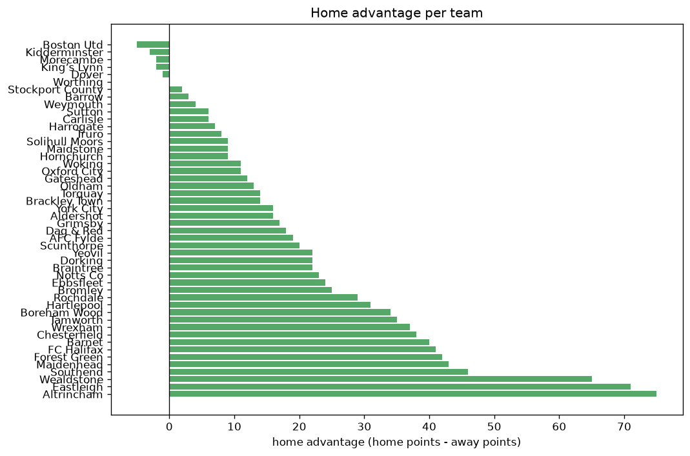

# Team Analysis
- Report: `teams_analysis`
- Generated: 2026-10-30T04:02:47+00:00
- Script: `backend/scripts/analyze_teams.py` v1.0.0
- League: National League (England)
- Scope: league `national`

- Teams: **48** | Seasons: **6** | Matches: **2897**

## 1. Team standings (lifetime)
| team | seasons | played | W | D | L | pts | GF | GA | GD | avg pts/season | best pos | worst pos | titles |
|---|---|---|---|---|---|---|---|---|---|---|---|---|---|
| Southend | 6 | 245 | 105 | 65 | 75 | 380 | 351 | 273 | 78 | 63.33 | 3 | 13 | 0 |
| FC Halifax | 6 | 243 | 105 | 62 | 76 | 377 | 314 | 265 | 49 | 62.83 | 4 | 11 | 0 |
| Solihull Moors | 6 | 243 | 94 | 63 | 86 | 345 | 365 | 351 | 14 | 57.5 | 3 | 23 | 0 |
| Altrincham | 6 | 243 | 94 | 55 | 94 | 337 | 359 | 357 | 2 | 56.17 | 4 | 17 | 0 |
| Woking | 6 | 243 | 89 | 62 | 92 | 329 | 324 | 301 | 23 | 54.83 | 4 | 17 | 0 |
| Boreham Wood | 5 | 200 | 91 | 55 | 54 | 328 | 300 | 229 | 71 | 65.6 | 1 | 21 | 1 |
| Barnet | 4 | 182 | 91 | 39 | 52 | 312 | 322 | 254 | 68 | 78.0 | 1 | 18 | 1 |
| York City | 4 | 184 | 87 | 47 | 50 | 308 | 319 | 215 | 104 | 77.0 | 2 | 20 | 0 |
| Eastleigh | 6 | 243 | 79 | 62 | 102 | 299 | 314 | 383 | -69 | 49.83 | 9 | 19 | 0 |
| Wealdstone | 6 | 242 | 77 | 62 | 103 | 293 | 311 | 386 | -75 | 48.83 | 14 | 20 | 0 |
| Aldershot | 6 | 243 | 77 | 55 | 111 | 286 | 340 | 421 | -81 | 47.67 | 9 | 20 | 0 |
| Chesterfield | 3 | 136 | 76 | 28 | 32 | 256 | 256 | 168 | 88 | 85.33 | 1 | 7 | 1 |
| Gateshead | 5 | 198 | 71 | 43 | 84 | 256 | 294 | 317 | -23 | 51.2 | 7 | 24 | 0 |
| Rochdale | 3 | 141 | 73 | 32 | 36 | 251 | 233 | 153 | 80 | 83.67 | 1 | 11 | 1 |
| Dag & Red | 4 | 182 | 66 | 46 | 70 | 244 | 271 | 250 | 21 | 61.0 | 8 | 21 | 0 |
| Yeovil | 5 | 197 | 60 | 54 | 83 | 234 | 212 | 252 | -40 | 46.8 | 4 | 22 | 0 |
| Bromley | 3 | 136 | 58 | 45 | 33 | 219 | 202 | 155 | 47 | 73.0 | 3 | 10 | 0 |
| Maidenhead | 4 | 182 | 55 | 46 | 81 | 211 | 212 | 275 | -63 | 52.75 | 14 | 22 | 0 |
| Hartlepool | 4 | 153 | 54 | 41 | 58 | 203 | 198 | 226 | -28 | 50.75 | 9 | 20 | 0 |
| Wrexham | 2 | 90 | 60 | 19 | 11 | 199 | 207 | 89 | 118 | 99.5 | 1 | 2 | 1 |
| Oldham | 3 | 138 | 50 | 47 | 41 | 197 | 190 | 172 | 18 | 65.67 | 5 | 12 | 0 |
| Notts Co | 2 | 90 | 56 | 21 | 13 | 189 | 198 | 94 | 104 | 94.5 | 2 | 5 | 0 |
| Forest Green | 3 | 107 | 50 | 32 | 25 | 182 | 172 | 118 | 54 | 60.67 | 3 | 16 | 0 |
| Tamworth | 3 | 106 | 39 | 26 | 41 | 143 | 153 | 174 | -21 | 47.67 | 10 | 18 | 0 |
| Boston Utd | 3 | 107 | 34 | 27 | 46 | 129 | 136 | 162 | -26 | 43.0 | 12 | 21 | 0 |
| Sutton | 3 | 107 | 32 | 32 | 43 | 128 | 135 | 164 | -29 | 42.67 | 12 | 19 | 0 |
| Scunthorpe | 3 | 107 | 34 | 24 | 49 | 126 | 146 | 179 | -33 | 42.0 | 5 | 23 | 0 |
| AFC Fylde | 3 | 107 | 34 | 19 | 54 | 121 | 151 | 190 | -39 | 40.33 | 8 | 23 | 0 |
| Carlisle | 2 | 62 | 35 | 13 | 14 | 118 | 116 | 74 | 42 | 59.0 | 3 | 9 | 0 |
| Torquay | 2 | 90 | 30 | 24 | 36 | 114 | 124 | 134 | -10 | 57.0 | 11 | 21 | 0 |
| Dorking | 2 | 92 | 28 | 18 | 46 | 102 | 121 | 176 | -55 | 51.0 | 16 | 23 | 0 |
| Stockport County | 1 | 44 | 30 | 4 | 10 | 94 | 87 | 38 | 49 | 94.0 | 1 | 1 | 1 |
| Braintree | 2 | 92 | 23 | 23 | 46 | 92 | 89 | 135 | -46 | 46.0 | 17 | 23 | 0 |
| Grimsby | 1 | 44 | 23 | 8 | 13 | 77 | 68 | 46 | 22 | 77.0 | 6 | 6 | 0 |
| Ebbsfleet | 2 | 92 | 17 | 25 | 50 | 76 | 97 | 172 | -75 | 38.0 | 19 | 24 | 0 |
| Kidderminster | 2 | 61 | 16 | 19 | 26 | 67 | 56 | 73 | -17 | 33.5 | 11 | 22 | 0 |
| Brackley Town | 1 | 46 | 10 | 12 | 24 | 42 | 40 | 75 | -35 | 42.0 | 21 | 21 | 0 |
| Morecambe | 1 | 46 | 9 | 11 | 26 | 38 | 66 | 103 | -37 | 38.0 | 22 | 22 | 0 |
| Truro | 1 | 46 | 8 | 10 | 28 | 34 | 42 | 72 | -30 | 34.0 | 24 | 24 | 0 |
| King’s Lynn | 1 | 44 | 8 | 10 | 26 | 34 | 47 | 79 | -32 | 34.0 | 21 | 21 | 0 |
| Oxford City | 1 | 46 | 8 | 9 | 29 | 33 | 54 | 94 | -40 | 33.0 | 24 | 24 | 0 |
| Harrogate | 1 | 15 | 10 | 1 | 4 | 31 | 32 | 21 | 11 | 31.0 | 2 | 2 | 0 |
| Worthing | 1 | 15 | 8 | 4 | 3 | 28 | 32 | 22 | 10 | 28.0 | 5 | 5 | 0 |
| Weymouth | 1 | 44 | 6 | 10 | 28 | 28 | 40 | 88 | -48 | 28.0 | 22 | 22 | 0 |
| Barrow | 1 | 15 | 8 | 3 | 4 | 27 | 26 | 18 | 8 | 27.0 | 7 | 7 | 0 |
| Maidstone | 1 | 46 | 5 | 10 | 31 | 25 | 45 | 104 | -59 | 25.0 | 24 | 24 | 0 |
| Hornchurch | 1 | 15 | 7 | 0 | 8 | 21 | 17 | 23 | -6 | 21.0 | 13 | 13 | 0 |
| Dover | 1 | 44 | 2 | 7 | 35 | 13 | 37 | 101 | -64 | 13.0 | 23 | 23 | 0 |

## 2. Home vs away split
| team | home P | H-W | H-D | H-L | H-pts | away P | A-W | A-D | A-L | A-pts | adv |
|---|---|---|---|---|---|---|---|---|---|---|---|
| Altrincham | 121 | 61 | 23 | 37 | 206 | 122 | 33 | 32 | 57 | 131 | 75 |
| Eastleigh | 122 | 50 | 35 | 37 | 185 | 121 | 29 | 27 | 65 | 114 | 71 |
| Wealdstone | 121 | 49 | 32 | 40 | 179 | 121 | 28 | 30 | 63 | 114 | 65 |
| Southend | 121 | 62 | 27 | 32 | 213 | 124 | 43 | 38 | 43 | 167 | 46 |
| Maidenhead | 91 | 33 | 28 | 30 | 127 | 91 | 22 | 18 | 51 | 84 | 43 |
| Forest Green | 54 | 33 | 13 | 8 | 112 | 53 | 17 | 19 | 17 | 70 | 42 |
| FC Halifax | 122 | 59 | 32 | 31 | 209 | 121 | 46 | 30 | 45 | 168 | 41 |
| Barnet | 91 | 52 | 20 | 19 | 176 | 91 | 39 | 19 | 33 | 136 | 40 |
| Chesterfield | 68 | 45 | 12 | 11 | 147 | 68 | 31 | 16 | 21 | 109 | 38 |
| Wrexham | 45 | 37 | 7 | 1 | 118 | 45 | 23 | 12 | 10 | 81 | 37 |
| Tamworth | 53 | 25 | 14 | 14 | 89 | 53 | 14 | 12 | 27 | 54 | 35 |
| Boreham Wood | 100 | 51 | 28 | 21 | 181 | 100 | 40 | 27 | 33 | 147 | 34 |
| Hartlepool | 76 | 32 | 21 | 23 | 117 | 77 | 22 | 20 | 35 | 86 | 31 |
| Rochdale | 71 | 42 | 14 | 15 | 140 | 70 | 31 | 18 | 21 | 111 | 29 |
| Bromley | 68 | 33 | 23 | 12 | 122 | 68 | 25 | 22 | 21 | 97 | 25 |
| Ebbsfleet | 46 | 13 | 11 | 22 | 50 | 46 | 4 | 14 | 28 | 26 | 24 |
| Notts Co | 45 | 32 | 10 | 3 | 106 | 45 | 24 | 11 | 10 | 83 | 23 |
| Yeovil | 99 | 33 | 29 | 37 | 128 | 98 | 27 | 25 | 46 | 106 | 22 |
| Dorking | 46 | 18 | 8 | 20 | 62 | 46 | 10 | 10 | 26 | 40 | 22 |
| Braintree | 46 | 15 | 12 | 19 | 57 | 46 | 8 | 11 | 27 | 35 | 22 |
| Scunthorpe | 52 | 21 | 10 | 21 | 73 | 55 | 13 | 14 | 28 | 53 | 20 |
| AFC Fylde | 53 | 19 | 13 | 21 | 70 | 54 | 15 | 6 | 33 | 51 | 19 |
| Dag & Red | 91 | 37 | 20 | 34 | 131 | 91 | 29 | 26 | 36 | 113 | 18 |
| Grimsby | 22 | 15 | 2 | 5 | 47 | 22 | 8 | 6 | 8 | 30 | 17 |
| York City | 92 | 46 | 24 | 22 | 162 | 92 | 41 | 23 | 28 | 146 | 16 |
| Aldershot | 121 | 40 | 31 | 50 | 151 | 122 | 37 | 24 | 61 | 135 | 16 |
| Torquay | 45 | 17 | 13 | 15 | 64 | 45 | 13 | 11 | 21 | 50 | 14 |
| Brackley Town | 23 | 7 | 7 | 9 | 28 | 23 | 3 | 5 | 15 | 14 | 14 |
| Oldham | 69 | 28 | 21 | 20 | 105 | 69 | 22 | 26 | 21 | 92 | 13 |
| Gateshead | 98 | 37 | 23 | 38 | 134 | 100 | 34 | 20 | 46 | 122 | 12 |
| Woking | 122 | 46 | 32 | 44 | 170 | 121 | 43 | 30 | 48 | 159 | 11 |
| Oxford City | 23 | 6 | 4 | 13 | 22 | 23 | 2 | 5 | 16 | 11 | 11 |
| Solihull Moors | 122 | 50 | 27 | 45 | 177 | 121 | 44 | 36 | 41 | 168 | 9 |
| Maidstone | 23 | 3 | 8 | 12 | 17 | 23 | 2 | 2 | 19 | 8 | 9 |
| Hornchurch | 7 | 5 | 0 | 2 | 15 | 8 | 2 | 0 | 6 | 6 | 9 |
| Truro | 23 | 5 | 6 | 12 | 21 | 23 | 3 | 4 | 16 | 13 | 8 |
| Harrogate | 8 | 6 | 1 | 1 | 19 | 7 | 4 | 0 | 3 | 12 | 7 |
| Sutton | 54 | 17 | 16 | 21 | 67 | 53 | 15 | 16 | 22 | 61 | 6 |
| Carlisle | 32 | 18 | 8 | 6 | 62 | 30 | 17 | 5 | 8 | 56 | 6 |
| Weymouth | 22 | 3 | 7 | 12 | 16 | 22 | 3 | 3 | 16 | 12 | 4 |
| Barrow | 7 | 5 | 0 | 2 | 15 | 8 | 3 | 3 | 2 | 12 | 3 |
| Stockport County | 22 | 15 | 3 | 4 | 48 | 22 | 15 | 1 | 6 | 46 | 2 |
| Worthing | 8 | 4 | 2 | 2 | 14 | 7 | 4 | 2 | 1 | 14 | 0 |
| Dover | 22 | 1 | 3 | 18 | 6 | 22 | 1 | 4 | 17 | 7 | -1 |
| Morecambe | 23 | 4 | 6 | 13 | 18 | 23 | 5 | 5 | 13 | 20 | -2 |
| King’s Lynn | 22 | 4 | 4 | 14 | 16 | 22 | 4 | 6 | 12 | 18 | -2 |
| Kidderminster | 31 | 7 | 11 | 13 | 32 | 30 | 9 | 8 | 13 | 35 | -3 |
| Boston Utd | 54 | 16 | 14 | 24 | 62 | 53 | 18 | 13 | 22 | 67 | -5 |

## 3. Top performers
### Best points per game (PPG)
| rank | team | PPG |
|---|---|---|
| 1 | Wrexham | 2.21 |
| 2 | Stockport County | 2.14 |
| 3 | Notts Co | 2.10 |
| 4 | Harrogate | 2.07 |
| 5 | Carlisle | 1.90 |

### Most goals scored
| rank | team | goals |
|---|---|---|
| 1 | Solihull Moors | 365 |
| 2 | Altrincham | 359 |
| 3 | Southend | 351 |
| 4 | Aldershot | 340 |
| 5 | Woking | 324 |

### Best goal difference
| rank | team | GD |
|---|---|---|
| 1 | Wrexham | 118 |
| 2 | York City | 104 |
| 3 | Notts Co | 104 |
| 4 | Chesterfield | 88 |
| 5 | Rochdale | 80 |

### Best defence (goals against per match, standings)
| rank | team | GA/match |
|---|---|---|
| 1 | Stockport County | 0.864 |
| 2 | Wrexham | 0.989 |
| 3 | Notts Co | 1.044 |
| 4 | Grimsby | 1.045 |
| 5 | Rochdale | 1.079 |

## 4. Team consistency
- Teams present in all **6** seasons: **8**

Aldershot, Altrincham, Eastleigh, FC Halifax, Solihull Moors, Southend, Wealdstone, Woking

## 5. Head-to-head dominance
- Distinct fixtures: **766** (showing the 15 most frequent)

| fixture | meetings | home wins | draws | away wins | home pct | draw pct | away pct |
|---|---|---|---|---|---|---|---|
| Altrincham vs Eastleigh | 11 | 9 | 0 | 2 | 81.8% | 0.0% | 18.2% |
| Altrincham vs Aldershot | 11 | 8 | 2 | 1 | 72.7% | 18.2% | 9.1% |
| Southend vs Altrincham | 11 | 8 | 1 | 2 | 72.7% | 9.1% | 18.2% |
| FC Halifax vs Wealdstone | 11 | 7 | 2 | 2 | 63.6% | 18.2% | 18.2% |
| FC Halifax vs Aldershot | 11 | 6 | 1 | 4 | 54.5% | 9.1% | 36.4% |
| Southend vs Eastleigh | 11 | 6 | 2 | 3 | 54.5% | 18.2% | 27.3% |
| Southend vs FC Halifax | 11 | 6 | 3 | 2 | 54.5% | 27.3% | 18.2% |
| Altrincham vs Woking | 11 | 5 | 3 | 3 | 45.5% | 27.3% | 27.3% |
| Solihull Moors vs Wealdstone | 11 | 5 | 4 | 2 | 45.5% | 36.4% | 18.2% |
| Solihull Moors vs Woking | 11 | 5 | 2 | 4 | 45.5% | 18.2% | 36.4% |
| FC Halifax vs Altrincham | 11 | 4 | 4 | 3 | 36.4% | 36.4% | 27.3% |
| Eastleigh vs Aldershot | 11 | 3 | 3 | 5 | 27.3% | 27.3% | 45.5% |
| Solihull Moors vs Aldershot | 11 | 3 | 1 | 7 | 27.3% | 9.1% | 63.6% |
| Southend vs Solihull Moors | 11 | 3 | 3 | 5 | 27.3% | 27.3% | 45.5% |
| Wealdstone vs Aldershot | 11 | 3 | 2 | 6 | 27.3% | 18.2% | 54.5% |

## 6. Position per season (classic view)
_Cells show final position; '-' when the team was absent from that season._

| team | 2021-2022 | 2022-2023 | 2023-2024 | 2024-2025 | 2025-2026 | 2026-2027 |
|---|---|---|---|---|---|---|
| Southend | 13 | 8 | 6 | 7 | 6 | 3 |
| FC Halifax | 4 | 11 | 8 | 6 | 8 | 10 |
| Solihull Moors | 3 | 15 | 5 | 14 | 14 | 23 |
| Altrincham | 14 | 17 | 4 | 9 | 13 | 6 |
| Woking | 15 | 4 | 17 | 15 | 10 | 14 |
| Boreham Wood | 9 | 6 | 21 | - | 4 | 1 |
| Barnet | 18 | 5 | 2 | 1 | - | - |
| York City | - | 19 | 20 | 2 | 2 | - |
| Eastleigh | 19 | 9 | 13 | 13 | 17 | 17 |
| Wealdstone | 16 | 14 | 16 | 20 | 15 | 19 |
| Aldershot | 20 | 18 | 9 | 16 | 20 | 15 |
| Chesterfield | 7 | 3 | 1 | - | - | - |
| Gateshead | - | 13 | 7 | 8 | 18 | 24 |
| Rochdale | - | - | 11 | 4 | 1 | - |
| Dag & Red | 8 | 10 | 15 | 21 | - | - |
| Yeovil | 12 | 22 | - | 18 | 16 | 4 |
| Bromley | 10 | 7 | 3 | - | - | - |
| Maidenhead | 17 | 20 | 14 | 22 | - | - |
| Hartlepool | - | - | 12 | 11 | 9 | 20 |
| Wrexham | 2 | 1 | - | - | - | - |
| Oldham | - | 12 | 10 | 5 | - | - |
| Notts Co | 5 | 2 | - | - | - | - |
| Forest Green | - | - | - | 3 | 7 | 16 |
| Tamworth | - | - | - | 10 | 11 | 18 |
| Boston Utd | - | - | - | 19 | 12 | 21 |
| Sutton | - | - | - | 12 | 19 | 12 |
| Scunthorpe | - | 23 | - | - | 5 | 22 |
| AFC Fylde | - | - | 18 | 23 | - | 8 |
| Carlisle | - | - | - | - | 3 | 9 |
| Torquay | 11 | 21 | - | - | - | - |
| Dorking | - | 16 | 23 | - | - | - |
| Stockport County | 1 | - | - | - | - | - |
| Braintree | - | - | - | 17 | 23 | - |
| Grimsby | 6 | - | - | - | - | - |
| Ebbsfleet | - | - | 19 | 24 | - | - |
| Kidderminster | - | - | 22 | - | - | 11 |
| Brackley Town | - | - | - | - | 21 | - |
| Morecambe | - | - | - | - | 22 | - |
| Truro | - | - | - | - | 24 | - |
| King’s Lynn | 21 | - | - | - | - | - |
| Oxford City | - | - | 24 | - | - | - |
| Harrogate | - | - | - | - | - | 2 |
| Worthing | - | - | - | - | - | 5 |
| Weymouth | 22 | - | - | - | - | - |
| Barrow | - | - | - | - | - | 7 |
| Maidstone | - | 24 | - | - | - | - |
| Hornchurch | - | - | - | - | - | 13 |
| Dover | 23 | - | - | - | - | - |

---
*All statistics are computed from PostgreSQL tables (read-only). Run with `python backend/scripts/analyze_teams.py` to regenerate.*

## Charts

