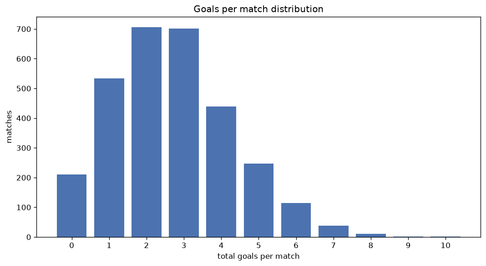
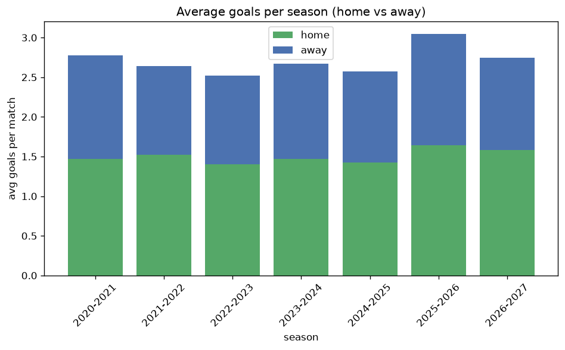

# Goal Analysis
- Report: `goals_analysis`
- Generated: 2026-10-27T02:23:37+00:00
- Script: `backend/scripts/analyze_goals.py` v1.0.0
- League: National League North (England)
- Scope: league `north`

## 1. Goals per match distribution
| goals | matches | pct |
|---|---|---|
| 0 | 211 | 7.0% |
| 1 | 529 | 17.7% |
| 2 | 706 | 23.6% |
| 3 | 698 | 23.3% |
| 4 | 438 | 14.6% |
| 5 | 246 | 8.2% |
| 6 | 114 | 3.8% |
| 7 | 38 | 1.3% |
| 8 | 11 | 0.4% |
| 9 | 1 | 0.0% |
| 10 | 2 | 0.1% |

## 2. Goals per match per season
| season | matches | total goals | avg home | avg away | avg total |
|---|---|---|---|---|---|
| 2020-2021 | 165 | 458 | 1.473 | 1.303 | 2.776 |
| 2021-2022 | 462 | 1220 | 1.519 | 1.121 | 2.641 |
| 2022-2023 | 552 | 1390 | 1.4 | 1.118 | 2.518 |
| 2023-2024 | 552 | 1474 | 1.467 | 1.203 | 2.67 |
| 2024-2025 | 552 | 1420 | 1.426 | 1.147 | 2.572 |
| 2025-2026 | 560 | 1707 | 1.643 | 1.405 | 3.048 |
| 2026-2027 | 151 | 415 | 1.583 | 1.166 | 2.748 |

## 3. Home vs away goal share
- Home goals: **4474** (55.3%)
- Away goals: **3610** (44.7%)
- Home/away ratio: **1.239**

| season | home goals | away goals | total | home pct | away pct |
|---|---|---|---|---|---|
| 2020-2021 | 243 | 215 | 458 | 53.1% | 46.9% |
| 2021-2022 | 702 | 518 | 1220 | 57.5% | 42.5% |
| 2022-2023 | 773 | 617 | 1390 | 55.6% | 44.4% |
| 2023-2024 | 810 | 664 | 1474 | 55.0% | 45.0% |
| 2024-2025 | 787 | 633 | 1420 | 55.4% | 44.6% |
| 2025-2026 | 920 | 787 | 1707 | 53.9% | 46.1% |
| 2026-2027 | 239 | 176 | 415 | 57.6% | 42.4% |

## 4. BTTS (Both Teams To Score)
- Overall: **1543** of `2994` (51.5%)

| season | matches | BTTS | pct |
|---|---|---|---|
| 2020-2021 | 165 | 93 | 56.4% |
| 2021-2022 | 462 | 227 | 49.1% |
| 2022-2023 | 552 | 275 | 49.8% |
| 2023-2024 | 552 | 260 | 47.1% |
| 2024-2025 | 552 | 259 | 46.9% |
| 2025-2026 | 560 | 341 | 60.9% |
| 2026-2027 | 151 | 88 | 58.3% |

## 5. Clean sheets
- Home clean sheets: **931** (31.1%)
- Away clean sheets: **731** (24.4%)
- Total clean sheets recorded: **1662**
- Matches with at least one clean sheet: **1451** (48.5%)
- Both teams kept clean sheets (0-0): **211**

| season | matches | home CS | away CS | total CS | matches w/ CS |
|---|---|---|---|---|---|
| 2020-2021 | 165 | 41 | 39 | 80 | 72 (43.6%) |
| 2021-2022 | 462 | 162 | 113 | 275 | 235 (50.9%) |
| 2022-2023 | 552 | 185 | 144 | 329 | 277 (50.2%) |
| 2023-2024 | 552 | 188 | 144 | 332 | 292 (52.9%) |
| 2024-2025 | 552 | 184 | 151 | 335 | 293 (53.1%) |
| 2025-2026 | 560 | 135 | 107 | 242 | 219 (39.1%) |
| 2026-2027 | 151 | 36 | 33 | 69 | 63 (41.7%) |

## 6. Scoring intensity
- First-half goals: **3631** (44.9%)
- Second-half goals: **4448** (55.1%)
- Avg first-half goals per match: **1.214**
- Avg second-half goals per match: **1.488**
- Second-half-only scoring (HT 0-0, FT goals >= 1): **667** (22.3%)
- *4 match(es) excluded (no HT score recorded).*

| season | matches | 1st half | 2nd half | 1st half pct | 2nd half pct |
|---|---|---|---|---|---|
| 2020-2021 | 165 | 211 | 247 | 46.1% | 53.9% |
| 2021-2022 | 462 | 548 | 672 | 44.9% | 55.1% |
| 2022-2023 | 552 | 615 | 775 | 44.2% | 55.8% |
| 2023-2024 | 552 | 673 | 801 | 45.7% | 54.3% |
| 2024-2025 | 552 | 657 | 763 | 46.3% | 53.7% |
| 2025-2026 | 560 | 746 | 956 | 43.8% | 56.2% |
| 2026-2027 | 151 | 181 | 234 | 43.6% | 56.4% |

## 7. First-goal timing
- Matches with first-goal time recorded: `2780` of `2994` (92.9%)
- Goalless matches: `214`
- Min `1` | Max `102` | Mean `30.54` | Median (p50) `25.0`

| bucket | count | % of matches | % of scoring matches |
|---|---|---|---|
| 1-15 | 937 | 31.3% | 33.7% |
| 16-30 | 658 | 22.0% | 23.7% |
| 31-45 | 472 | 15.8% | 17.0% |
| 46-60 | 374 | 12.5% | 13.5% |
| 61-75 | 178 | 5.9% | 6.4% |
| 76-90 | 129 | 4.3% | 4.6% |
| 91-120 | 32 | 1.1% | 1.2% |

---
*All statistics are computed from PostgreSQL tables (read-only). Run with `python backend/scripts/analyze_goals.py` to regenerate.*

## Charts

