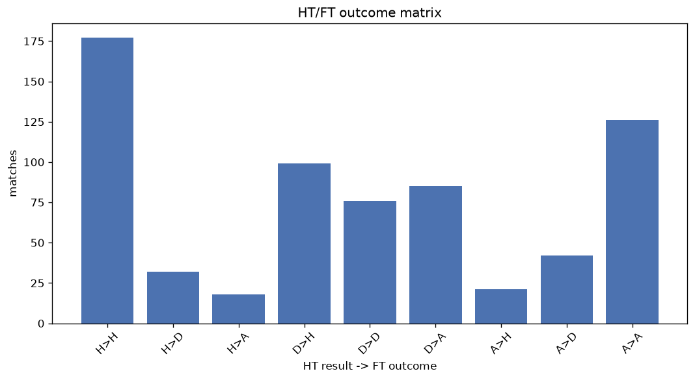
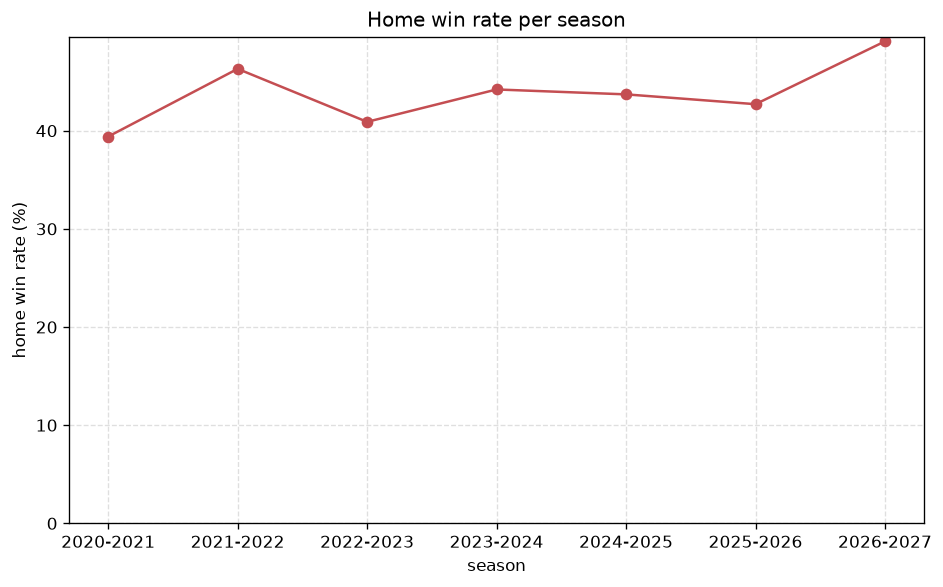

# Match Analysis
- Report: `matches_analysis`
- Generated: 2026-10-30T04:03:06+00:00
- Script: `backend/scripts/analyze_matches.py` v1.0.0
- League: National League North (England)
- Scope: league `north`

## 1. Overall summary
| metric | value |
|---|---|
| Matches | 3004 |
| Home wins | 1308 (43.5%) |
| Draws | 740 (24.6%) |
| Away wins | 956 (31.8%) |
| Total goals | 8109 |
| Average goals per match | 2.699 |
| Goalless matches | 211 (7.0%) |

## 2. Per-season breakdown
| season | matches | home wins | draws | away wins | total goals | avg goals | goalless |
|---|---|---|---|---|---|---|---|
| 2020-2021 | 165 | 65 (39.4%) | 50 (30.3%) | 50 (30.3%) | 458 | 2.776 | 8 (4.8%) |
| 2021-2022 | 462 | 214 (46.3%) | 121 (26.2%) | 127 (27.5%) | 1220 | 2.641 | 40 (8.7%) |
| 2022-2023 | 552 | 226 (40.9%) | 161 (29.2%) | 165 (29.9%) | 1390 | 2.518 | 52 (9.4%) |
| 2023-2024 | 552 | 244 (44.2%) | 121 (21.9%) | 187 (33.9%) | 1474 | 2.67 | 40 (7.2%) |
| 2024-2025 | 552 | 241 (43.7%) | 127 (23.0%) | 184 (33.3%) | 1420 | 2.572 | 42 (7.6%) |
| 2025-2026 | 560 | 239 (42.7%) | 126 (22.5%) | 195 (34.8%) | 1707 | 3.048 | 23 (4.1%) |
| 2026-2027 | 161 | 79 (49.1%) | 34 (21.1%) | 48 (29.8%) | 440 | 2.733 | 6 (3.7%) |

## 3. HT/FT outcome matrix
| HT result \ FT result | Home | Draw | Away | total |
|---|---|---|---|---|
| HT home lead | 830 (80.8%) | 135 (13.1%) | 62 (6.0%) | 1027 |
| HT draw | 400 (33.5%) | 434 (36.4%) | 359 (30.1%) | 1193 |
| HT away lead | 78 (10.0%) | 169 (21.7%) | 533 (68.3%) | 780 |
- *4 match(es) excluded (no HT score recorded).*

## 4. Comeback matches
- Home comebacks (trailing at HT, won at FT): **78** (2.6%)
- Away comebacks (trailing at HT, won at FT): **62** (2.1%)

### Home comebacks
| season | home | away | HT | FT |
|---|---|---|---|---|
| 2020-2021 | AFC Fylde | Kettering | 0-1 | 3-2 |
| 2020-2021 | Leamington | Alfreton | 0-3 | 4-3 |
| 2020-2021 | AFC Fylde | Boston Utd | 0-1 | 2-1 |
| 2020-2021 | Chester | Hereford | 1-2 | 5-3 |
| 2020-2021 | Gloucester | Kidderminster | 1-2 | 3-2 |
| 2020-2021 | Chorley | Farsley | 1-2 | 3-2 |
| 2020-2021 | Brackley Town | Chorley | 0-1 | 2-1 |
| 2021-2022 | Guiseley | Gloucester | 0-1 | 2-1 |
| 2021-2022 | Leamington | Gateshead | 0-1 | 2-1 |
| 2021-2022 | Chester | Blyth | 0-1 | 5-1 |
| 2021-2022 | Bradford PA | Blyth | 0-1 | 2-1 |
| 2021-2022 | Bradford PA | AFC Telford | 0-1 | 3-2 |
| 2021-2022 | Gateshead | Alfreton | 0-1 | 2-1 |
| 2021-2022 | Chorley | Hereford | 0-1 | 3-2 |
| 2021-2022 | Boston Utd | Kettering | 1-2 | 3-2 |
| 2021-2022 | Spennymoor | Kettering | 0-1 | 2-1 |
| 2021-2022 | Chorley | Southport | 0-1 | 2-1 |
| 2021-2022 | Boston Utd | Bradford PA | 0-1 | 2-1 |
| 2021-2022 | Gateshead | Darlington | 0-2 | 4-2 |
| 2022-2023 | King’s Lynn | Brackley Town | 0-1 | 2-1 |
| 2022-2023 | Darlington | Boston Utd | 0-1 | 3-2 |
| 2022-2023 | Banbury | Southport | 0-1 | 3-1 |
| 2022-2023 | Banbury | Scarborough | 0-1 | 2-1 |
| 2022-2023 | Bradford PA | Curzon Ashton | 0-1 | 2-1 |
| 2022-2023 | Gloucester | Southport | 1-2 | 3-2 |
| 2022-2023 | Kettering | Spennymoor | 0-1 | 2-1 |
| 2022-2023 | Leamington | AFC Fylde | 0-1 | 2-1 |
| 2022-2023 | Chorley | Farsley | 1-2 | 4-3 |
| 2022-2023 | Southport | Chorley | 0-1 | 2-1 |
| 2022-2023 | Bradford PA | Boston Utd | 0-1 | 2-1 |
| 2022-2023 | King’s Lynn | Hereford | 0-1 | 2-1 |
| 2022-2023 | Brackley Town | Spennymoor | 0-1 | 2-1 |
| 2022-2023 | Spennymoor | Boston Utd | 0-1 | 3-2 |
| 2022-2023 | Curzon Ashton | Buxton | 0-1 | 2-1 |
| 2022-2023 | Kettering | Boston Utd | 0-2 | 3-2 |
| 2022-2023 | Curzon Ashton | Gloucester | 1-2 | 4-3 |
| 2022-2023 | AFC Fylde | Darlington | 1-2 | 3-2 |
| 2023-2024 | Boston Utd | Blyth | 0-1 | 3-1 |
| 2023-2024 | Chester | Peterborough Sports | 1-2 | 3-2 |
| 2023-2024 | Warrington | Rushall | 0-1 | 2-1 |
| 2023-2024 | Farsley | Curzon Ashton | 0-1 | 2-1 |
| 2023-2024 | Hereford | Spennymoor | 0-1 | 2-1 |
| 2023-2024 | Curzon Ashton | Southport | 1-2 | 3-2 |
| 2023-2024 | Southport | Brackley Town | 0-1 | 3-1 |
| 2023-2024 | Chorley | Spennymoor | 0-1 | 2-1 |
| 2023-2024 | Darlington | Buxton | 0-1 | 2-1 |
| 2023-2024 | Scunthorpe | Hereford | 0-1 | 4-1 |
| 2024-2025 | Alfreton | Farsley | 0-1 | 2-1 |
| 2024-2025 | Peterborough Sports | Alfreton | 0-1 | 3-1 |
| 2024-2025 | Spennymoor | Leamington | 0-1 | 2-1 |
| 2024-2025 | Rushall | Scunthorpe | 0-1 | 2-1 |
| 2024-2025 | Hereford | Brackley Town | 0-1 | 3-2 |
| 2024-2025 | Brackley Town | Needham Market | 0-1 | 2-1 |
| 2024-2025 | Peterborough Sports | Oxford City | 0-1 | 2-1 |
| 2024-2025 | Needham Market | Chorley | 0-1 | 2-1 |
| 2024-2025 | Chester | Darlington | 0-1 | 2-1 |
| 2025-2026 | AFC Fylde | Oxford City | 0-1 | 3-2 |
| 2025-2026 | Radcliffe | Worksop | 0-1 | 2-1 |
| 2025-2026 | Spennymoor | Merthyr Town | 1-2 | 6-4 |
| 2025-2026 | Marine | AFC Telford | 0-1 | 2-1 |
| 2025-2026 | Alfreton | Spennymoor | 0-1 | 2-1 |
| 2025-2026 | King’s Lynn | Buxton | 0-1 | 3-2 |
| 2025-2026 | Peterborough Sports | Macclesfield | 2-3 | 4-3 |
| 2025-2026 | Darlington | Merthyr Town | 0-1 | 3-1 |
| 2025-2026 | Macclesfield | Leamington | 0-1 | 3-1 |
| 2025-2026 | Curzon Ashton | Worksop | 0-1 | 3-1 |
| 2025-2026 | Alfreton | Merthyr Town | 0-1 | 3-2 |
| 2025-2026 | AFC Fylde | AFC Telford | 0-1 | 2-1 |
| 2025-2026 | Southport | Alfreton | 0-1 | 2-1 |
| 2025-2026 | Oxford City | Kidderminster | 1-2 | 3-2 |
| 2025-2026 | Spennymoor | Kidderminster | 0-1 | 3-1 |
| 2025-2026 | Scarborough | Merthyr Town | 0-1 | 2-1 |
| 2025-2026 | Macclesfield | Chester | 0-1 | 2-1 |
| 2026-2027 | South Shields | Chorley | 0-1 | 2-1 |
| 2026-2027 | Macclesfield | Brackley Town | 0-1 | 2-1 |
| 2026-2027 | Harborough | Darlington | 1-2 | 4-2 |
| 2026-2027 | Hebburn Town | King’s Lynn | 1-2 | 4-2 |
| 2026-2027 | Macclesfield | South Shields | 2-3 | 4-3 |

### Away comebacks
| season | home | away | HT | FT |
|---|---|---|---|---|
| 2020-2021 | Southport | York City | 1-0 | 2-3 |
| 2021-2022 | York City | Brackley Town | 1-0 | 1-2 |
| 2021-2022 | Gloucester | Kidderminster | 1-0 | 1-3 |
| 2021-2022 | Farsley | Gateshead | 2-1 | 3-4 |
| 2021-2022 | Blyth | Southport | 1-0 | 1-2 |
| 2021-2022 | AFC Telford | Alfreton | 1-0 | 2-3 |
| 2021-2022 | Curzon Ashton | Gloucester | 1-0 | 1-2 |
| 2021-2022 | Chorley | Alfreton | 1-0 | 1-2 |
| 2022-2023 | Buxton | Blyth | 1-0 | 1-2 |
| 2022-2023 | Leamington | Alfreton | 1-0 | 1-2 |
| 2022-2023 | Bradford PA | Brackley Town | 1-0 | 1-2 |
| 2022-2023 | Bradford PA | Peterborough Sports | 1-0 | 1-2 |
| 2022-2023 | AFC Telford | Kidderminster | 1-0 | 1-2 |
| 2022-2023 | Hereford | Banbury | 1-0 | 2-3 |
| 2022-2023 | Chorley | Southport | 1-0 | 1-2 |
| 2022-2023 | Bradford PA | Chester | 1-0 | 1-2 |
| 2022-2023 | Banbury | AFC Telford | 1-0 | 1-2 |
| 2022-2023 | Southport | Banbury | 1-0 | 1-2 |
| 2022-2023 | Brackley Town | AFC Telford | 1-0 | 1-2 |
| 2022-2023 | Chorley | Scarborough | 2-1 | 2-3 |
| 2023-2024 | Chester | Hereford | 1-0 | 1-2 |
| 2023-2024 | Peterborough Sports | South Shields | 1-0 | 2-4 |
| 2023-2024 | Boston Utd | Banbury | 1-0 | 1-2 |
| 2023-2024 | Spennymoor | Curzon Ashton | 1-0 | 1-2 |
| 2023-2024 | Rushall | King’s Lynn | 1-0 | 1-2 |
| 2023-2024 | Rushall | Blyth | 1-0 | 1-3 |
| 2023-2024 | Peterborough Sports | Tamworth | 1-0 | 1-4 |
| 2023-2024 | Southport | Alfreton | 2-1 | 2-3 |
| 2023-2024 | Farsley | Chester | 1-0 | 1-2 |
| 2023-2024 | Warrington | Gloucester | 1-0 | 1-2 |
| 2023-2024 | Blyth | Curzon Ashton | 1-0 | 2-3 |
| 2023-2024 | King’s Lynn | Scarborough | 3-0 | 3-4 |
| 2023-2024 | Gloucester | Scunthorpe | 1-0 | 1-2 |
| 2024-2025 | Needham Market | Southport | 1-0 | 1-2 |
| 2024-2025 | Chorley | Scarborough | 1-0 | 1-2 |
| 2024-2025 | Warrington | Farsley | 1-0 | 1-2 |
| 2024-2025 | Rushall | Chester | 1-0 | 1-2 |
| 2024-2025 | Radcliffe | Warrington | 1-0 | 1-2 |
| 2024-2025 | Spennymoor | King’s Lynn | 1-0 | 1-2 |
| 2024-2025 | Oxford City | Alfreton | 1-0 | 1-2 |
| 2024-2025 | Marine | Scunthorpe | 1-0 | 1-2 |
| 2024-2025 | Rushall | Oxford City | 1-0 | 1-2 |
| 2024-2025 | Darlington | Brackley Town | 2-1 | 2-4 |
| 2024-2025 | South Shields | Oxford City | 1-0 | 1-2 |
| 2025-2026 | Darlington | Chorley | 2-1 | 2-3 |
| 2025-2026 | Merthyr Town | Scarborough | 1-0 | 1-3 |
| 2025-2026 | AFC Telford | AFC Fylde | 1-0 | 1-3 |
| 2025-2026 | AFC Fylde | Worksop | 1-0 | 2-3 |
| 2025-2026 | Bedford | Southport | 2-1 | 2-3 |
| 2025-2026 | Buxton | Spennymoor | 1-0 | 1-2 |
| 2025-2026 | Bedford | Chester | 1-0 | 1-2 |
| 2025-2026 | Merthyr Town | Spennymoor | 1-0 | 2-3 |
| 2025-2026 | Chorley | Buxton | 1-0 | 1-2 |
| 2025-2026 | Leamington | Scarborough | 1-0 | 1-2 |
| 2025-2026 | Leamington | Alfreton | 1-0 | 1-2 |
| 2025-2026 | Hereford | Oxford City | 1-0 | 1-2 |
| 2025-2026 | Marine | Alfreton | 1-0 | 2-3 |
| 2025-2026 | Merthyr Town | AFC Fylde | 1-0 | 2-4 |
| 2026-2027 | King’s Lynn | Marine | 1-0 | 1-4 |
| 2026-2027 | Darlington | Macclesfield | 1-0 | 1-2 |
| 2026-2027 | Worksop | Bedford | 1-0 | 1-2 |
| 2026-2027 | Spennymoor | Spalding United | 1-0 | 1-3 |

## 5. HT lead conversion
| HT state | matches | converted to win | held as draw | collapsed to loss |
|---|---|---|---|---|
| Home lead | 1027 | 830 (80.8%) | 135 (13.1%) | 62 (6.0%) |
| Away lead | 780 | 533 (68.3%) | 169 (21.7%) | 78 (10.0%) |

### Matches level at half-time
| FT result | count | pct |
|---|---|---|
| Home win | 400 | 33.5% |
| Draw | 434 | 36.4% |
| Away win | 359 | 30.1% |
- *4 match(es) excluded (no HT score recorded).*

## 6. First-goal timing
- Matches with a first-goal time recorded: `2790` of `3004` (92.9%)

Outcome distribution by first-goal timing bucket:
| bucket | matches | % of matches | home | draw | away |
|---|---|---|---|---|---|
| 1-15 | 939 | 31.3% | 463 (49.3%) | 169 (18.0%) | 307 (32.7%) |
| 16-30 | 661 | 22.0% | 322 (48.7%) | 132 (20.0%) | 207 (31.3%) |
| 31-45 | 475 | 15.8% | 215 (45.3%) | 95 (20.0%) | 165 (34.7%) |
| 46-60 | 375 | 12.5% | 168 (44.8%) | 78 (20.8%) | 129 (34.4%) |
| 61-75 | 178 | 5.9% | 63 (35.4%) | 37 (20.8%) | 78 (43.8%) |
| 76-90 | 130 | 4.3% | 59 (45.4%) | 17 (13.1%) | 54 (41.5%) |
| 91-120 | 32 | 1.1% | 18 (56.2%) | 0 (0.0%) | 14 (43.8%) |

## 7. Goalless matches
- Overall: **211** of `3004` (7.0%)

| season | matches | goalless | pct |
|---|---|---|---|
| 2020-2021 | 165 | 8 | 4.8% |
| 2021-2022 | 462 | 40 | 8.7% |
| 2022-2023 | 552 | 52 | 9.4% |
| 2023-2024 | 552 | 40 | 7.2% |
| 2024-2025 | 552 | 42 | 7.6% |
| 2025-2026 | 560 | 23 | 4.1% |
| 2026-2027 | 161 | 6 | 3.7% |

---
*All statistics are computed from PostgreSQL tables (read-only). Run with `python backend/scripts/analyze_matches.py` to regenerate.*

## Charts

