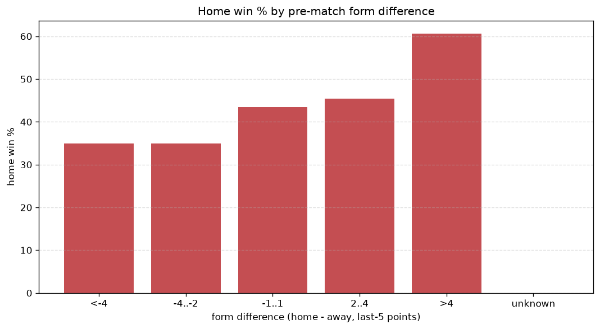
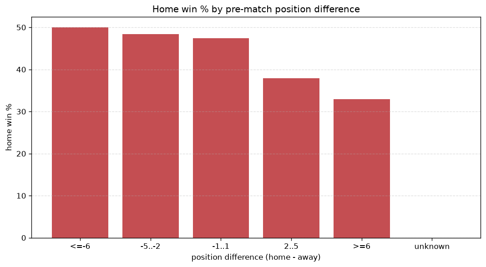

# Relationships Analysis
- Report: `relationships`
- Generated: 2026-10-27T02:23:45+00:00
- Script: `backend/scripts/analyze_relationships.py` v1.0.0
- League: National League North (England)
- Scope: league `north`

- Matches analysed: **2843** (23 leakage-safe pre-match features).

## 1. Correlation matrix
_Pearson correlation of each pre-match feature with observed goals; sorted by |corr(total goals)|._

| feature | corr(home) | corr(away) | corr(total) |
|---|---|---|---|
| away_team_goals_conceded_last_5 | 0.105 | -0.036 | 0.058 |
| home_team_goals_scored_last_5 | 0.121 | -0.054 | 0.058 |
| away_team_points_last_5 | -0.107 | 0.045 | -0.053 |
| away_team_wins_last_5 | -0.101 | 0.040 | -0.051 |
| points_difference | 0.225 | -0.191 | 0.044 |
| home_team_home_conceded_avg | -0.026 | 0.087 | 0.041 |
| home_team_wins_last_5 | 0.128 | -0.090 | 0.038 |
| position_difference | -0.191 | 0.164 | -0.035 |
| away_team_away_conceded_avg | 0.085 | -0.045 | 0.035 |
| away_points_before_match | -0.091 | 0.057 | -0.031 |
| away_position_before_match | 0.132 | -0.108 | 0.028 |
| home_team_home_goals_avg | 0.080 | -0.051 | 0.027 |
| home_team_goals_conceded_last_5 | -0.076 | 0.117 | 0.022 |
| away_team_away_win_rate | -0.091 | 0.072 | -0.021 |
| home_position_before_match | -0.132 | 0.119 | -0.020 |
| home_rest_days | 0.004 | 0.024 | 0.020 |
| home_team_points_last_5 | 0.117 | -0.104 | 0.019 |
| rest_days_difference | -0.013 | 0.033 | 0.013 |
| away_rest_days | 0.017 | -0.007 | 0.008 |
| home_team_home_win_rate | 0.067 | -0.081 | -0.004 |
| away_team_goals_scored_last_5 | -0.065 | 0.068 | -0.003 |
| home_points_before_match | 0.056 | -0.067 | -0.003 |
| away_team_away_goals_avg | -0.067 | 0.077 | 0.002 |

## 2. Form vs outcome
_Home win/draw/away % per bucket of `home_team_points_last_5 - away_team_points_last_5`._

| bucket | matches | home | draw | away | home % | draw % | away % |
|---|---|---|---|---|---|---|---|
| <-4 | 474 | 166 | 120 | 188 | 35.0% | 25.3% | 39.7% |
| -4..-2 | 562 | 196 | 153 | 213 | 34.9% | 27.2% | 37.9% |
| -1..1 | 847 | 368 | 203 | 276 | 43.4% | 24.0% | 32.6% |
| 2..4 | 546 | 248 | 142 | 156 | 45.4% | 26.0% | 28.6% |
| >4 | 414 | 251 | 88 | 75 | 60.6% | 21.3% | 18.1% |
| unknown | 0 | 0 | 0 | 0 | - | - | - |

## 3. Position vs outcome
_Home win/draw/away % per bucket of `position_difference` (home position - away position; negative favours the home team)._

| bucket | matches | home | draw | away | home % | draw % | away % |
|---|---|---|---|---|---|---|---|
| <=-6 | 819 | 458 | 187 | 174 | 55.9% | 22.8% | 21.2% |
| -5..-2 | 432 | 188 | 111 | 133 | 43.5% | 25.7% | 30.8% |
| -1..1 | 308 | 140 | 79 | 89 | 45.5% | 25.6% | 28.9% |
| 2..5 | 418 | 161 | 99 | 158 | 38.5% | 23.7% | 37.8% |
| >=6 | 866 | 282 | 230 | 354 | 32.6% | 26.6% | 40.9% |
| unknown | 0 | 0 | 0 | 0 | - | - | - |

## 4. Rest advantage
_Home win/draw/away % per bucket of `rest_days_difference` (home rest - away rest). Matches with unknown rest are bucketed separately._

| bucket | matches | home | draw | away | home % | draw % | away % |
|---|---|---|---|---|---|---|---|
| <-1 | 383 | 167 | 97 | 119 | 43.6% | 25.3% | 31.1% |
| -1..0 | 25 | 12 | 4 | 9 | 48.0% | 16.0% | 36.0% |
| 0 | 1945 | 843 | 478 | 624 | 43.3% | 24.6% | 32.1% |
| 1..2 | 37 | 16 | 12 | 9 | 43.2% | 32.4% | 24.3% |
| >2 | 380 | 157 | 99 | 124 | 41.3% | 26.1% | 32.6% |
| unknown | 73 | 34 | 16 | 23 | 46.6% | 21.9% | 31.5% |
- *73 match(es) had unknown rest difference (missing rest data on at least one side).*

## 5. Home team quality
_Home win rate by `home_team_home_win_rate` tier (split at 0.5)._

- `< 0.5` tier: **39.7%** home win (688/1734)
- `>= 0.5` tier: **48.8%** home win (541/1109)
- Home-win gap (>= split minus < split): **+9.1 pp**

| tier | label | matches | home | draw | away | home % |
|---|---|---|---|---|---|---|
| low | < 0.5 | 1734 | 688 | 431 | 615 | 39.7% |
| high | >= 0.5 | 1109 | 541 | 275 | 293 | 48.8% |

## 6. Feature averages by result
_Mean feature value per outcome; `range` is home-minus-away spread of the group means._

| feature | home mean | draw mean | away mean | range |
|---|---|---|---|---|
| points_difference | 3.121 | -0.993 | -4.137 | 7.258 |
| position_difference | -1.825 | 0.562 | 2.664 | 4.489 |
| away_points_before_match | 27.814 | 29.578 | 31.915 | 4.102 |
| home_points_before_match | 30.935 | 28.585 | 27.779 | 3.156 |
| home_position_before_match | 11.037 | 12.271 | 13.523 | 2.486 |
| away_position_before_match | 12.862 | 11.708 | 10.859 | 2.003 |
| home_team_points_last_5 | 6.784 | 6.255 | 5.686 | 1.098 |
| home_team_goals_conceded_last_5 | 5.905 | 6.317 | 6.881 | 0.976 |
| home_team_goals_scored_last_5 | 6.582 | 5.905 | 5.770 | 0.812 |
| away_team_points_last_5 | 6.143 | 6.656 | 6.787 | 0.644 |
| away_team_goals_scored_last_5 | 6.066 | 6.348 | 6.610 | 0.544 |
| away_team_goals_conceded_last_5 | 6.392 | 5.928 | 5.901 | 0.491 |
| home_team_wins_last_5 | 1.890 | 1.701 | 1.513 | 0.377 |
| away_team_wins_last_5 | 1.662 | 1.857 | 1.865 | 0.202 |
| rest_days_difference | -0.109 | 0.070 | 0.084 | 0.192 |
| away_rest_days | 6.052 | 6.038 | 5.866 | 0.186 |
| home_rest_days | 5.941 | 6.107 | 5.948 | 0.167 |
| home_team_home_goals_avg | 1.476 | 1.433 | 1.365 | 0.111 |
| away_team_away_goals_avg | 1.102 | 1.124 | 1.211 | 0.109 |
| home_team_home_conceded_avg | 1.107 | 1.146 | 1.202 | 0.094 |
| away_team_away_conceded_avg | 1.478 | 1.393 | 1.387 | 0.091 |
| home_team_home_win_rate | 0.440 | 0.421 | 0.389 | 0.051 |
| away_team_away_win_rate | 0.275 | 0.297 | 0.324 | 0.050 |

---
*All features are leakage-safe pre-match values built by `ml.features.build_features.build_rows` from strictly prior matches. Run with `python backend/scripts/analyze_relationships.py` to regenerate.*

## Charts

