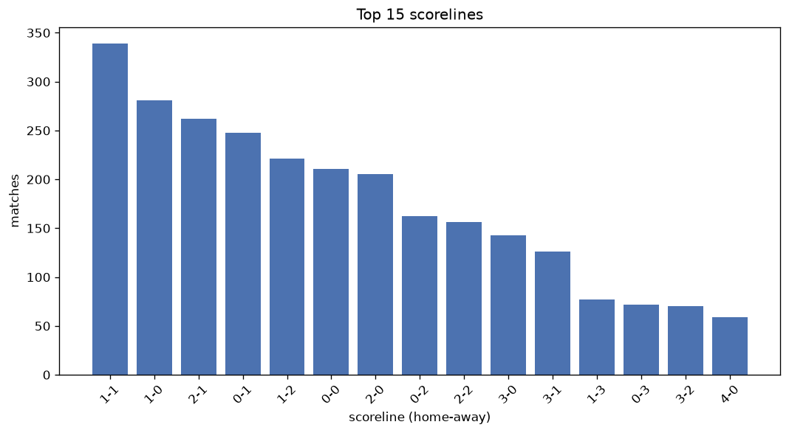
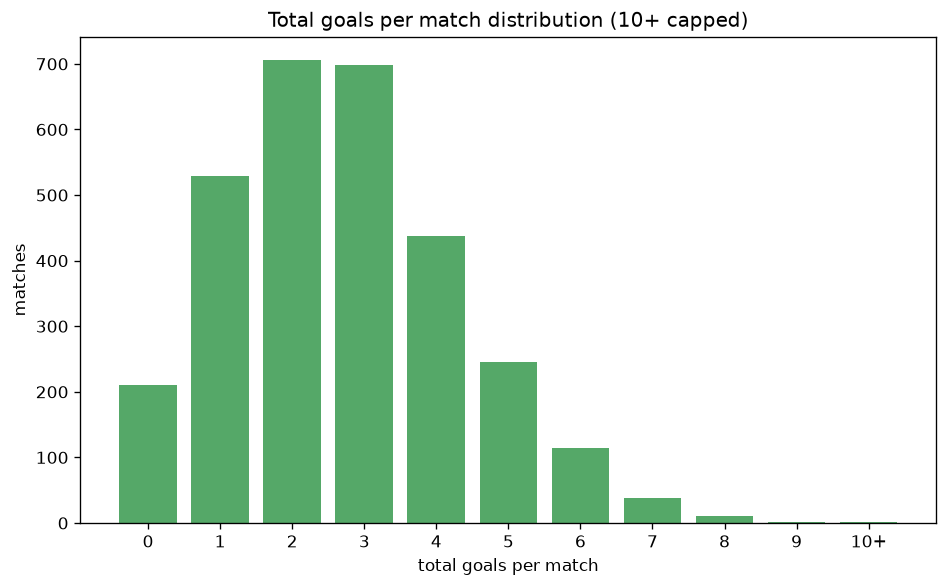

# Scoreline Analysis
- Report: `scoreline_analysis`
- Generated: 2026-10-26T01:41:54+00:00
- Script: `backend/scripts/analyze_scorelines.py` v1.0.0
- League: National League North (England)
- Scope: league `north`

## 1. Scoreline frequency
- Matches analysed: **2994** across **7** seasons.
- Distinct scorelines seen: **47**.

| scoreline | count | pct |
|---|---|---|
| 1-1 | 339 | 11.3% |
| 1-0 | 281 | 9.4% |
| 2-1 | 262 | 8.8% |
| 0-1 | 248 | 8.3% |
| 1-2 | 221 | 7.4% |
| 0-0 | 211 | 7.0% |
| 2-0 | 205 | 6.8% |
| 0-2 | 162 | 5.4% |
| 2-2 | 156 | 5.2% |
| 3-0 | 143 | 4.8% |
| 3-1 | 126 | 4.2% |
| 1-3 | 77 | 2.6% |
| 0-3 | 72 | 2.4% |
| 3-2 | 70 | 2.3% |
| 4-0 | 59 | 2.0% |
| 2-3 | 56 | 1.9% |
| 4-1 | 53 | 1.8% |
| 1-4 | 37 | 1.2% |
| 3-3 | 32 | 1.1% |
| 4-2 | 24 | 0.8% |

## 2. Scoreline frequency per season

### 2020-2021
| scoreline | count | pct |
|---|---|---|
| 1-1 | 25 | 15.2% |
| 1-0 | 15 | 9.1% |
| 1-2 | 12 | 7.3% |
| 2-1 | 12 | 7.3% |
| 2-2 | 12 | 7.3% |

### 2021-2022
| scoreline | count | pct |
|---|---|---|
| 1-0 | 51 | 11.0% |
| 1-1 | 51 | 11.0% |
| 2-1 | 46 | 10.0% |
| 0-0 | 40 | 8.7% |
| 0-1 | 32 | 6.9% |

### 2022-2023
| scoreline | count | pct |
|---|---|---|
| 1-1 | 68 | 12.3% |
| 1-0 | 55 | 10.0% |
| 0-1 | 52 | 9.4% |
| 0-0 | 52 | 9.4% |
| 1-2 | 44 | 8.0% |

### 2023-2024
| scoreline | count | pct |
|---|---|---|
| 1-0 | 52 | 9.4% |
| 1-1 | 52 | 9.4% |
| 0-1 | 50 | 9.1% |
| 2-0 | 49 | 8.9% |
| 0-0 | 40 | 7.2% |

### 2024-2025
| scoreline | count | pct |
|---|---|---|
| 1-1 | 63 | 11.4% |
| 0-1 | 53 | 9.6% |
| 1-0 | 53 | 9.6% |
| 2-1 | 48 | 8.7% |
| 0-0 | 42 | 7.6% |

### 2025-2026
| scoreline | count | pct |
|---|---|---|
| 1-1 | 59 | 10.5% |
| 2-1 | 56 | 10.0% |
| 1-2 | 53 | 9.5% |
| 1-0 | 42 | 7.5% |
| 2-2 | 36 | 6.4% |

### 2026-2027
| scoreline | count | pct |
|---|---|---|
| 2-1 | 25 | 16.6% |
| 1-1 | 21 | 13.9% |
| 0-1 | 16 | 10.6% |
| 1-0 | 13 | 8.6% |
| 1-2 | 9 | 6.0% |

## 3. Total-goal histogram
_10+ groups all matches with 10 or more total goals._

| total goals | matches | pct |
|---|---|---|
| 0 | 211 | 7.0% |
| 1 | 529 | 17.7% |
| 2 | 706 | 23.6% |
| 3 | 698 | 23.3% |
| 4 | 438 | 14.6% |
| 5 | 246 | 8.2% |
| 6 | 114 | 3.8% |
| 7 | 38 | 1.3% |
| 8 | 11 | 0.4% |
| 9 | 1 | 0.0% |
| 10+ | 2 | 0.1% |

## 4. Extreme scorelines
- Matches with 7+ total goals: **52**

| season | date | scoreline | total goals |
|---|---|---|---|
| 2023-2024 | 2024-03-09 | 3-7 | 10 |
| 2025-2026 | 2025-10-18 | 6-4 | 10 |
| 2021-2022 | 2021-09-04 | 9-0 | 9 |
| 2020-2021 | 2020-11-14 | 4-4 | 8 |
| 2020-2021 | 2020-12-08 | 5-3 | 8 |
| 2022-2023 | 2022-08-06 | 3-5 | 8 |
| 2022-2023 | 2022-12-10 | 2-6 | 8 |
| 2023-2024 | 2023-11-14 | 8-0 | 8 |
| 2024-2025 | 2024-10-26 | 7-1 | 8 |
| 2025-2026 | 2025-11-22 | 6-2 | 8 |
| 2025-2026 | 2026-01-10 | 3-5 | 8 |
| 2025-2026 | 2026-01-17 | 0-8 | 8 |
| 2025-2026 | 2026-02-14 | 7-1 | 8 |
| 2025-2026 | 2026-04-18 | 8-0 | 8 |
| 2020-2021 | 2020-10-17 | 6-1 | 7 |
| 2020-2021 | 2020-11-17 | 4-3 | 7 |
| 2021-2022 | 2021-12-11 | 3-4 | 7 |
| 2021-2022 | 2021-12-28 | 4-3 | 7 |
| 2021-2022 | 2022-01-22 | 4-3 | 7 |
| 2021-2022 | 2022-04-09 | 4-3 | 7 |
| 2022-2023 | 2022-10-29 | 4-3 | 7 |
| 2022-2023 | 2023-01-02 | 2-5 | 7 |
| 2022-2023 | 2023-01-28 | 5-2 | 7 |
| 2022-2023 | 2023-02-11 | 4-3 | 7 |
| 2022-2023 | 2023-04-29 | 4-3 | 7 |
| 2023-2024 | 2023-10-28 | 6-1 | 7 |
| 2023-2024 | 2023-11-14 | 2-5 | 7 |
| 2023-2024 | 2024-01-13 | 4-3 | 7 |
| 2023-2024 | 2024-02-03 | 5-2 | 7 |
| 2023-2024 | 2024-04-01 | 3-4 | 7 |
| 2023-2024 | 2024-04-06 | 1-6 | 7 |
| 2023-2024 | 2024-04-06 | 7-0 | 7 |
| 2023-2024 | 2024-04-11 | 5-2 | 7 |
| 2024-2025 | 2024-12-10 | 7-0 | 7 |
| 2024-2025 | 2024-12-26 | 4-3 | 7 |
| 2024-2025 | 2025-01-14 | 3-4 | 7 |
| 2024-2025 | 2025-01-18 | 7-0 | 7 |
| 2024-2025 | 2025-02-08 | 1-6 | 7 |
| 2024-2025 | 2025-02-25 | 6-1 | 7 |
| 2024-2025 | 2025-03-08 | 0-7 | 7 |
| 2025-2026 | 2025-11-08 | 3-4 | 7 |
| 2025-2026 | 2025-11-18 | 5-2 | 7 |
| 2025-2026 | 2025-11-29 | 3-4 | 7 |
| 2025-2026 | 2026-01-27 | 4-3 | 7 |
| 2025-2026 | 2026-02-03 | 5-2 | 7 |
| 2025-2026 | 2026-02-24 | 5-2 | 7 |
| 2025-2026 | 2026-03-24 | 2-5 | 7 |
| 2025-2026 | 2026-04-06 | 4-3 | 7 |
| 2025-2026 | 2026-04-11 | 2-5 | 7 |
| 2026-2027 | 2026-08-15 | 3-4 | 7 |
| 2026-2027 | 2026-09-08 | 5-2 | 7 |
| 2026-2027 | 2026-10-10 | 4-3 | 7 |

## 5. Margin-of-victory distribution (decided matches)
- Decided matches: **2255** (draws: **739**)
- Average winning margin: **1.82**

| margin | matches | pct |
|---|---|---|
| 1 | 1156 | 51.3% |
| 2 | 617 | 27.4% |
| 3+ | 482 | 21.4% |

## 6. Margin by outcome

### Home wins
- Matches: **1302** | avg margin: **1.9** | max margin: **9**
| margin | matches | pct |
|---|---|---|
| 1 | 625 | 48.0% |
| 2 | 357 | 27.4% |
| 3+ | 320 | 24.6% |
- *Full match-by-match list available in `scoreline_analysis.json`.*

### Away wins
- Matches: **953** | avg margin: **1.69** | max margin: **8**
| margin | matches | pct |
|---|---|---|
| 1 | 531 | 55.7% |
| 2 | 260 | 27.3% |
| 3+ | 162 | 17.0% |
- *Full match-by-match list available in `scoreline_analysis.json`.*

## 7. Most common exact score by outcome type
| outcome | matches | most common score | count | pct |
|---|---|---|---|---|
| home | 1302 | 1-0 | 281 | 21.6% |
| draw | 739 | 1-1 | 339 | 45.9% |
| away | 953 | 0-1 | 248 | 26.0% |

---
*All statistics are computed from PostgreSQL tables (read-only). Run with `python backend/scripts/analyze_scorelines.py` to regenerate.*

## Charts

