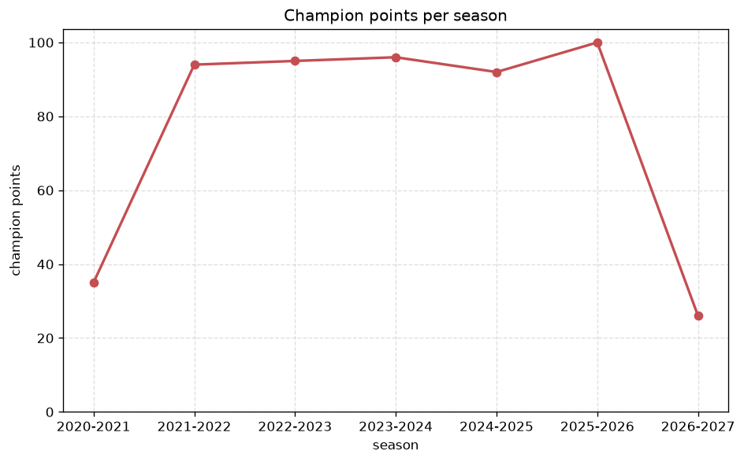
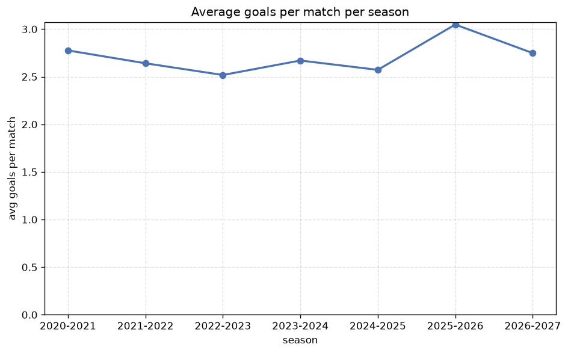

# Season Trends Analysis
- Report: `season_trends`
- Generated: 2026-10-26T01:41:53+00:00
- Script: `backend/scripts/analyze_seasons.py` v1.0.0
- League: National League North (England)
- Scope: league `north`

## 1. Champions per season
| season | champion | pts | runner-up | margin |
|---|---|---|---|---|
| 2020-2021 | Gloucester | 35 | AFC Fylde | 5 pts |
| 2021-2022 | Gateshead | 94 | Brackley Town | 7 pts |
| 2022-2023 | AFC Fylde | 95 | King’s Lynn | 2 pts |
| 2023-2024 | Tamworth | 96 | Scunthorpe | 8 pts |
| 2024-2025 | Brackley Town | 92 | Scunthorpe | 2 pts |
| 2025-2026 | AFC Fylde | 100 | South Shields | 2 pts |
| 2026-2027 | Hereford | 26 | Oxford City | 2 pts |

## 2. Title-race tightness
- Tight races (margin <= 3 pts): **4** of 7 seasons
- Tightest race: **2022-2023** - AFC Fylde beat King’s Lynn by **2** pts

| season | margin | tight |
|---|---|---|
| 2020-2021 | 5 pts |  |
| 2021-2022 | 7 pts |  |
| 2022-2023 | 2 pts | yes |
| 2023-2024 | 8 pts |  |
| 2024-2025 | 2 pts | yes |
| 2025-2026 | 2 pts | yes |
| 2026-2027 | 2 pts | yes |

## 3. Points thresholds
_Position-specific points per season. Key: 1 = champion, 2 = runner-up, 4 = CL line, 6 = Europa, 21 = last safe, 24 = bottom._

| season | pos 1 | pos 2 | pos 4 | pos 6 | pos 21 | pos 24 |
|---|---|---|---|---|---|---|
| 2020-2021 | 35 | 30 | 27 | 23 | 12 | - |
| 2021-2022 | 94 | 87 | 74 | 65 | 37 | - |
| 2022-2023 | 95 | 93 | 69 | 69 | 49 | 32 |
| 2023-2024 | 96 | 88 | 83 | 75 | 50 | 21 |
| 2024-2025 | 92 | 90 | 87 | 79 | 39 | 26 |
| 2025-2026 | 100 | 98 | 82 | 76 | 52 | 29 |
| 2026-2027 | 26 | 24 | 24 | 21 | 13 | 7 |

## 4. Relegation battle
| season | safe pos | safe pts | drop pos | drop pts | gap |
|---|---|---|---|---|---|
| 2020-2021 | 21 | 12 | 22 | 6 | 6 pts |
| 2021-2022 | 21 | 37 | 22 | 35 | 2 pts |
| 2022-2023 | 21 | 49 | 22 | 48 | 1 pts |
| 2023-2024 | 21 | 50 | 22 | 38 | 12 pts |
| 2024-2025 | 21 | 39 | 22 | 35 | 4 pts |
| 2025-2026 | 21 | 52 | 22 | 50 | 2 pts |
| 2026-2027 | 21 | 13 | 22 | 11 | 2 pts |

## 5. League-level trends
| season | matches | total goals | avg goals | home win | draw | away win | goalless | avg pts/team |
|---|---|---|---|---|---|---|---|---|
| 2020-2021 | 165 | 458 | 2.776 | 39.4% | 30.3% | 30.3% | 4.8% | 20.23 |
| 2021-2022 | 462 | 1220 | 2.641 | 46.3% | 26.2% | 27.5% | 8.7% | 57.5 |
| 2022-2023 | 552 | 1390 | 2.518 | 40.9% | 29.2% | 29.9% | 9.4% | 62.29 |
| 2023-2024 | 552 | 1474 | 2.67 | 44.2% | 21.9% | 33.9% | 7.2% | 63.96 |
| 2024-2025 | 552 | 1420 | 2.572 | 43.7% | 23.0% | 33.3% | 7.6% | 63.71 |
| 2025-2026 | 560 | 1707 | 3.048 | 42.7% | 22.5% | 34.8% | 4.1% | 64.75 |
| 2026-2027 | 151 | 415 | 2.748 | 48.3% | 21.9% | 29.8% | 4.0% | 17.5 |

## 6. View divergence
- Largest divergence: **2023-2024** (goals view, avg abs position diff = 9.250)

_Avg absolute position difference between classic view and alternative view per season._

| season | classic vs luck | classic vs goals |
|---|---|---|
| 2020-2021 | 2.909 | 6.818 |
| 2021-2022 | 4.091 | 7.909 |
| 2022-2023 | 5.333 | 6.917 |
| 2023-2024 | 3.250 | 9.250 |
| 2024-2025 | 2.917 | 8.833 |
| 2025-2026 | 3.333 | 7.417 |
| 2026-2027 | 3.000 | 8.667 |

---
*All statistics are computed from PostgreSQL tables (read-only). Run with `python backend/scripts/analyze_seasons.py` to regenerate.*

## Charts

