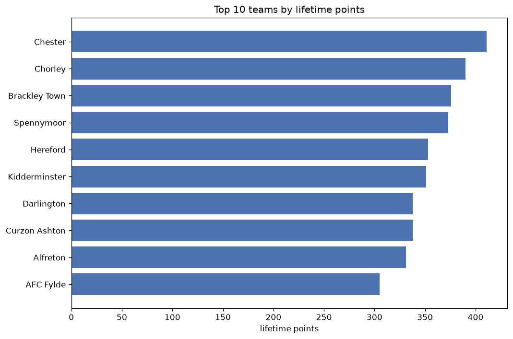
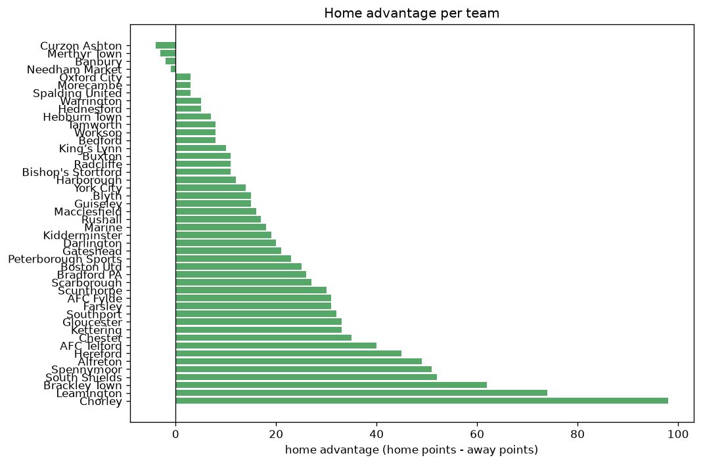

# Team Analysis
- Report: `teams_analysis`
- Generated: 2026-10-26T01:41:51+00:00
- Script: `backend/scripts/analyze_teams.py` v1.0.0
- League: National League North (England)
- Scope: league `north`

- Teams: **46** | Seasons: **7** | Matches: **2994**

## 1. Team standings (lifetime)
| team | seasons | played | W | D | L | pts | GF | GA | GD | avg pts/season | best pos | worst pos | titles |
|---|---|---|---|---|---|---|---|---|---|---|---|---|---|
| Chester | 7 | 257 | 112 | 75 | 70 | 411 | 389 | 296 | 93 | 58.71 | 3 | 16 | 0 |
| Chorley | 7 | 256 | 107 | 69 | 80 | 390 | 388 | 309 | 79 | 55.71 | 4 | 15 | 0 |
| Brackley Town | 6 | 210 | 108 | 52 | 50 | 376 | 287 | 192 | 95 | 62.67 | 1 | 17 | 1 |
| Spennymoor | 7 | 252 | 103 | 64 | 85 | 373 | 365 | 341 | 24 | 53.29 | 9 | 24 | 0 |
| Hereford | 7 | 251 | 99 | 56 | 96 | 353 | 336 | 327 | 9 | 50.43 | 1 | 20 | 1 |
| Kidderminster | 5 | 198 | 101 | 48 | 49 | 351 | 311 | 184 | 127 | 70.2 | 3 | 6 | 0 |
| Darlington | 7 | 250 | 93 | 59 | 98 | 338 | 354 | 351 | 3 | 48.29 | 9 | 22 | 0 |
| Curzon Ashton | 6 | 243 | 91 | 65 | 87 | 338 | 315 | 322 | -7 | 56.33 | 7 | 21 | 0 |
| Alfreton | 6 | 241 | 86 | 73 | 82 | 331 | 306 | 321 | -15 | 55.17 | 5 | 22 | 0 |
| AFC Fylde | 4 | 149 | 94 | 23 | 32 | 305 | 286 | 148 | 138 | 76.25 | 1 | 3 | 2 |
| Buxton | 5 | 200 | 89 | 38 | 73 | 305 | 312 | 256 | 56 | 61.0 | 5 | 14 | 0 |
| Southport | 7 | 253 | 78 | 68 | 107 | 302 | 300 | 363 | -63 | 43.14 | 11 | 23 | 0 |
| King’s Lynn | 5 | 197 | 81 | 57 | 59 | 300 | 268 | 234 | 34 | 60.0 | 2 | 19 | 0 |
| Scarborough | 5 | 198 | 75 | 56 | 67 | 281 | 273 | 256 | 17 | 56.2 | 7 | 18 | 0 |
| South Shields | 4 | 153 | 74 | 28 | 51 | 250 | 260 | 189 | 71 | 62.5 | 2 | 17 | 0 |
| Boston Utd | 4 | 147 | 60 | 37 | 50 | 217 | 219 | 179 | 40 | 54.25 | 6 | 15 | 0 |
| Peterborough Sports | 4 | 184 | 58 | 43 | 83 | 217 | 211 | 273 | -62 | 54.25 | 12 | 23 | 0 |
| Leamington | 5 | 196 | 49 | 55 | 92 | 202 | 195 | 274 | -79 | 40.4 | 9 | 24 | 0 |
| Farsley | 5 | 197 | 46 | 49 | 102 | 187 | 184 | 351 | -167 | 37.4 | 11 | 24 | 0 |
| Gloucester | 4 | 152 | 48 | 41 | 63 | 185 | 207 | 239 | -32 | 46.25 | 1 | 23 | 1 |
| Scunthorpe | 2 | 92 | 52 | 22 | 18 | 178 | 160 | 68 | 92 | 89.0 | 2 | 2 | 0 |
| AFC Telford | 5 | 164 | 38 | 52 | 74 | 166 | 198 | 249 | -51 | 33.2 | 11 | 24 | 0 |
| Blyth | 4 | 148 | 38 | 35 | 75 | 149 | 166 | 256 | -90 | 37.25 | 19 | 22 | 0 |
| Marine | 3 | 104 | 39 | 19 | 46 | 136 | 121 | 142 | -21 | 45.33 | 12 | 15 | 0 |
| Oxford City | 3 | 104 | 35 | 28 | 41 | 133 | 142 | 149 | -7 | 44.33 | 2 | 19 | 0 |
| Radcliffe | 3 | 106 | 36 | 19 | 51 | 127 | 149 | 180 | -31 | 42.33 | 13 | 20 | 0 |
| Kettering | 3 | 102 | 30 | 35 | 37 | 125 | 116 | 134 | -18 | 41.67 | 8 | 21 | 0 |
| Gateshead | 2 | 56 | 35 | 10 | 11 | 115 | 116 | 62 | 54 | 57.5 | 1 | 10 | 1 |
| Bradford PA | 3 | 104 | 26 | 30 | 48 | 108 | 115 | 165 | -50 | 36.0 | 15 | 23 | 0 |
| Macclesfield | 2 | 60 | 32 | 10 | 18 | 106 | 102 | 83 | 19 | 53.0 | 3 | 4 | 0 |
| Tamworth | 1 | 46 | 29 | 9 | 8 | 96 | 74 | 29 | 45 | 96.0 | 1 | 1 | 1 |
| Warrington | 2 | 92 | 23 | 26 | 43 | 95 | 98 | 130 | -32 | 47.5 | 12 | 23 | 0 |
| Banbury | 2 | 92 | 23 | 23 | 46 | 92 | 93 | 148 | -55 | 46.0 | 17 | 22 | 0 |
| Rushall | 2 | 92 | 24 | 17 | 51 | 89 | 103 | 171 | -68 | 44.5 | 19 | 22 | 0 |
| York City | 2 | 55 | 25 | 13 | 17 | 88 | 80 | 67 | 13 | 44.0 | 5 | 8 | 0 |
| Merthyr Town | 2 | 59 | 25 | 10 | 24 | 85 | 110 | 102 | 8 | 42.5 | 8 | 19 | 0 |
| Worksop | 2 | 59 | 21 | 11 | 27 | 74 | 81 | 94 | -13 | 37.0 | 14 | 16 | 0 |
| Bedford | 2 | 58 | 19 | 15 | 24 | 72 | 82 | 93 | -11 | 36.0 | 9 | 18 | 0 |
| Guiseley | 2 | 57 | 12 | 11 | 34 | 47 | 48 | 91 | -43 | 23.5 | 20 | 22 | 0 |
| Needham Market | 1 | 46 | 10 | 9 | 27 | 39 | 44 | 76 | -32 | 39.0 | 21 | 21 | 0 |
| Hednesford | 1 | 13 | 6 | 3 | 4 | 21 | 23 | 19 | 4 | 21.0 | 6 | 6 | 0 |
| Bishop's Stortford | 1 | 46 | 6 | 3 | 37 | 21 | 35 | 112 | -77 | 21.0 | 24 | 24 | 0 |
| Hebburn Town | 1 | 13 | 5 | 4 | 4 | 19 | 18 | 23 | -5 | 19.0 | 10 | 10 | 0 |
| Morecambe | 1 | 12 | 5 | 2 | 5 | 17 | 18 | 12 | 6 | 17.0 | 11 | 11 | 0 |
| Spalding United | 1 | 12 | 5 | 2 | 5 | 17 | 14 | 11 | 3 | 17.0 | 12 | 12 | 0 |
| Harborough | 1 | 12 | 4 | 4 | 4 | 16 | 12 | 13 | -1 | 16.0 | 16 | 16 | 0 |

## 2. Home vs away split
| team | home P | H-W | H-D | H-L | H-pts | away P | A-W | A-D | A-L | A-pts | adv |
|---|---|---|---|---|---|---|---|---|---|---|---|
| Chorley | 127 | 72 | 28 | 27 | 244 | 129 | 35 | 41 | 53 | 146 | 98 |
| Leamington | 99 | 38 | 24 | 37 | 138 | 97 | 11 | 31 | 55 | 64 | 74 |
| Brackley Town | 107 | 66 | 21 | 20 | 219 | 103 | 42 | 31 | 30 | 157 | 62 |
| South Shields | 77 | 46 | 13 | 18 | 151 | 76 | 28 | 15 | 33 | 99 | 52 |
| Spennymoor | 125 | 58 | 38 | 29 | 212 | 127 | 45 | 26 | 56 | 161 | 51 |
| Alfreton | 120 | 50 | 40 | 30 | 190 | 121 | 36 | 33 | 52 | 141 | 49 |
| Hereford | 126 | 56 | 31 | 39 | 199 | 125 | 43 | 25 | 57 | 154 | 45 |
| AFC Telford | 83 | 26 | 25 | 32 | 103 | 81 | 12 | 27 | 42 | 63 | 40 |
| Chester | 127 | 62 | 37 | 28 | 223 | 130 | 50 | 38 | 42 | 188 | 35 |
| Gloucester | 77 | 29 | 22 | 26 | 109 | 75 | 19 | 19 | 37 | 76 | 33 |
| Kettering | 50 | 20 | 19 | 11 | 79 | 52 | 10 | 16 | 26 | 46 | 33 |
| Southport | 127 | 41 | 44 | 42 | 167 | 126 | 37 | 24 | 65 | 135 | 32 |
| AFC Fylde | 74 | 53 | 9 | 12 | 168 | 75 | 41 | 14 | 20 | 137 | 31 |
| Farsley | 98 | 27 | 28 | 43 | 109 | 99 | 19 | 21 | 59 | 78 | 31 |
| Scunthorpe | 46 | 31 | 11 | 4 | 104 | 46 | 21 | 11 | 14 | 74 | 30 |
| Scarborough | 98 | 42 | 28 | 28 | 154 | 100 | 33 | 28 | 39 | 127 | 27 |
| Bradford PA | 53 | 18 | 13 | 22 | 67 | 51 | 8 | 17 | 26 | 41 | 26 |
| Boston Utd | 73 | 35 | 16 | 22 | 121 | 74 | 25 | 21 | 28 | 96 | 25 |
| Peterborough Sports | 92 | 33 | 21 | 38 | 120 | 92 | 25 | 22 | 45 | 97 | 23 |
| Gateshead | 29 | 22 | 2 | 5 | 68 | 27 | 13 | 8 | 6 | 47 | 21 |
| Darlington | 125 | 48 | 35 | 42 | 179 | 125 | 45 | 24 | 56 | 159 | 20 |
| Kidderminster | 99 | 54 | 23 | 22 | 185 | 99 | 47 | 25 | 27 | 166 | 19 |
| Marine | 53 | 22 | 11 | 20 | 77 | 51 | 17 | 8 | 26 | 59 | 18 |
| Rushall | 46 | 14 | 11 | 21 | 53 | 46 | 10 | 6 | 30 | 36 | 17 |
| Macclesfield | 31 | 19 | 4 | 8 | 61 | 29 | 13 | 6 | 10 | 45 | 16 |
| Blyth | 74 | 20 | 22 | 32 | 82 | 74 | 18 | 13 | 43 | 67 | 15 |
| Guiseley | 28 | 8 | 7 | 13 | 31 | 29 | 4 | 4 | 21 | 16 | 15 |
| York City | 28 | 15 | 6 | 7 | 51 | 27 | 10 | 7 | 10 | 37 | 14 |
| Harborough | 7 | 4 | 2 | 1 | 14 | 5 | 0 | 2 | 3 | 2 | 12 |
| Buxton | 99 | 46 | 20 | 33 | 158 | 101 | 43 | 18 | 40 | 147 | 11 |
| Radcliffe | 53 | 20 | 9 | 24 | 69 | 53 | 16 | 10 | 27 | 58 | 11 |
| Bishop's Stortford | 23 | 5 | 1 | 17 | 16 | 23 | 1 | 2 | 20 | 5 | 11 |
| King’s Lynn | 99 | 43 | 26 | 30 | 155 | 98 | 38 | 31 | 29 | 145 | 10 |
| Tamworth | 23 | 16 | 4 | 3 | 52 | 23 | 13 | 5 | 5 | 44 | 8 |
| Worksop | 29 | 12 | 5 | 12 | 41 | 30 | 9 | 6 | 15 | 33 | 8 |
| Bedford | 28 | 11 | 7 | 10 | 40 | 30 | 8 | 8 | 14 | 32 | 8 |
| Hebburn Town | 7 | 4 | 1 | 2 | 13 | 6 | 1 | 3 | 2 | 6 | 7 |
| Warrington | 46 | 13 | 11 | 22 | 50 | 46 | 10 | 15 | 21 | 45 | 5 |
| Hednesford | 7 | 4 | 1 | 2 | 13 | 6 | 2 | 2 | 2 | 8 | 5 |
| Oxford City | 51 | 19 | 11 | 21 | 68 | 53 | 16 | 17 | 20 | 65 | 3 |
| Morecambe | 5 | 3 | 1 | 1 | 10 | 7 | 2 | 1 | 4 | 7 | 3 |
| Spalding United | 5 | 3 | 1 | 1 | 10 | 7 | 2 | 1 | 4 | 7 | 3 |
| Needham Market | 23 | 5 | 4 | 14 | 19 | 23 | 5 | 5 | 13 | 20 | -1 |
| Banbury | 46 | 10 | 15 | 21 | 45 | 46 | 13 | 8 | 25 | 47 | -2 |
| Merthyr Town | 30 | 12 | 5 | 13 | 41 | 29 | 13 | 5 | 11 | 44 | -3 |
| Curzon Ashton | 121 | 47 | 26 | 48 | 167 | 122 | 44 | 39 | 39 | 171 | -4 |

## 3. Top performers
### Best points per game (PPG)
| rank | team | PPG |
|---|---|---|
| 1 | Tamworth | 2.09 |
| 2 | Gateshead | 2.05 |
| 3 | AFC Fylde | 2.05 |
| 4 | Scunthorpe | 1.94 |
| 5 | Brackley Town | 1.79 |

### Most goals scored
| rank | team | goals |
|---|---|---|
| 1 | Chester | 389 |
| 2 | Chorley | 388 |
| 3 | Spennymoor | 365 |
| 4 | Darlington | 354 |
| 5 | Hereford | 336 |

### Best goal difference
| rank | team | GD |
|---|---|---|
| 1 | AFC Fylde | 138 |
| 2 | Kidderminster | 127 |
| 3 | Brackley Town | 95 |
| 4 | Chester | 93 |
| 5 | Scunthorpe | 92 |

### Best defence (goals against per match, standings)
| rank | team | GA/match |
|---|---|---|
| 1 | Tamworth | 0.630 |
| 2 | Scunthorpe | 0.739 |
| 3 | Brackley Town | 0.914 |
| 4 | Spalding United | 0.917 |
| 5 | Kidderminster | 0.929 |

## 4. Team consistency
- Teams present in all **7** seasons: **6**

Chester, Chorley, Darlington, Hereford, Southport, Spennymoor

## 5. Head-to-head dominance
- Distinct fixtures: **706** (showing the 15 most frequent)

| fixture | meetings | home wins | draws | away wins | home pct | draw pct | away pct |
|---|---|---|---|---|---|---|---|
| Spennymoor vs Darlington | 12 | 6 | 4 | 2 | 50.0% | 33.3% | 16.7% |
| Chester vs Spennymoor | 12 | 5 | 2 | 5 | 41.7% | 16.7% | 41.7% |
| Spennymoor vs Southport | 12 | 5 | 2 | 5 | 41.7% | 16.7% | 41.7% |
| Chester vs Chorley | 12 | 4 | 4 | 4 | 33.3% | 33.3% | 33.3% |
| Chester vs Hereford | 12 | 4 | 4 | 4 | 33.3% | 33.3% | 33.3% |
| Hereford vs Southport | 12 | 3 | 2 | 7 | 25.0% | 16.7% | 58.3% |
| Chorley vs Curzon Ashton | 11 | 7 | 1 | 3 | 63.6% | 9.1% | 27.3% |
| Chorley vs Southport | 11 | 6 | 3 | 2 | 54.5% | 27.3% | 18.2% |
| Hereford vs Spennymoor | 11 | 6 | 2 | 3 | 54.5% | 18.2% | 27.3% |
| Spennymoor vs Alfreton | 11 | 6 | 3 | 2 | 54.5% | 27.3% | 18.2% |
| Chester vs Darlington | 11 | 5 | 3 | 3 | 45.5% | 27.3% | 27.3% |
| Chorley vs Alfreton | 11 | 5 | 2 | 4 | 45.5% | 18.2% | 36.4% |
| Chorley vs Darlington | 11 | 5 | 2 | 4 | 45.5% | 18.2% | 36.4% |
| Chorley vs Hereford | 11 | 5 | 3 | 3 | 45.5% | 27.3% | 27.3% |
| Southport vs Alfreton | 11 | 5 | 4 | 2 | 45.5% | 36.4% | 18.2% |

## 6. Position per season (classic view)
_Cells show final position; '-' when the team was absent from that season._

| team | 2020-2021 | 2021-2022 | 2022-2023 | 2023-2024 | 2024-2025 | 2025-2026 | 2026-2027 |
|---|---|---|---|---|---|---|---|
| Chester | 3 | 16 | 3 | 10 | 4 | 6 | 7 |
| Chorley | 7 | 6 | 12 | 4 | 5 | 15 | 13 |
| Brackley Town | 4 | 2 | 4 | 3 | 1 | - | 17 |
| Spennymoor | 13 | 10 | 9 | 9 | 9 | 10 | 24 |
| Hereford | 12 | 12 | 16 | 11 | 10 | 20 | 1 |
| Kidderminster | 5 | 4 | 6 | - | 3 | 3 | - |
| Darlington | 19 | 13 | 10 | 16 | 11 | 9 | 22 |
| Curzon Ashton | 16 | 14 | 13 | 7 | 8 | 21 | - |
| Alfreton | 21 | 9 | 5 | 5 | 14 | 22 | - |
| AFC Fylde | 2 | 3 | 1 | - | - | 1 | - |
| Buxton | - | - | 11 | 14 | 7 | 5 | 8 |
| Southport | 17 | 11 | 18 | 17 | 18 | 14 | 23 |
| King’s Lynn | - | - | 2 | 18 | 6 | 19 | 5 |
| Scarborough | - | - | 8 | 13 | 13 | 7 | 18 |
| South Shields | - | - | - | 8 | 17 | 2 | 4 |
| Boston Utd | 6 | 7 | 15 | 6 | - | - | - |
| Peterborough Sports | - | - | 14 | 15 | 12 | 23 | - |
| Leamington | 9 | 15 | 22 | - | 16 | 24 | - |
| Farsley | 11 | 21 | 20 | 20 | 24 | - | - |
| Gloucester | 1 | 17 | 7 | 23 | - | - | - |
| Scunthorpe | - | - | - | 2 | 2 | - | - |
| AFC Telford | 14 | 20 | 24 | - | - | 11 | 21 |
| Blyth | 22 | 19 | 19 | 21 | - | - | - |
| Marine | - | - | - | - | 15 | 12 | 15 |
| Oxford City | - | - | - | - | 19 | 17 | 2 |
| Radcliffe | - | - | - | - | 20 | 13 | 20 |
| Kettering | 18 | 8 | 21 | - | - | - | - |
| Gateshead | 10 | 1 | - | - | - | - | - |
| Bradford PA | 15 | 18 | 23 | - | - | - | - |
| Macclesfield | - | - | - | - | - | 4 | 3 |
| Tamworth | - | - | - | 1 | - | - | - |
| Warrington | - | - | - | 12 | 23 | - | - |
| Banbury | - | - | 17 | 22 | - | - | - |
| Rushall | - | - | - | 19 | 22 | - | - |
| York City | 8 | 5 | - | - | - | - | - |
| Merthyr Town | - | - | - | - | - | 8 | 19 |
| Worksop | - | - | - | - | - | 16 | 14 |
| Bedford | - | - | - | - | - | 18 | 9 |
| Guiseley | 20 | 22 | - | - | - | - | - |
| Needham Market | - | - | - | - | 21 | - | - |
| Hednesford | - | - | - | - | - | - | 6 |
| Bishop's Stortford | - | - | - | 24 | - | - | - |
| Hebburn Town | - | - | - | - | - | - | 10 |
| Morecambe | - | - | - | - | - | - | 11 |
| Spalding United | - | - | - | - | - | - | 12 |
| Harborough | - | - | - | - | - | - | 16 |

---
*All statistics are computed from PostgreSQL tables (read-only). Run with `python backend/scripts/analyze_teams.py` to regenerate.*

## Charts

