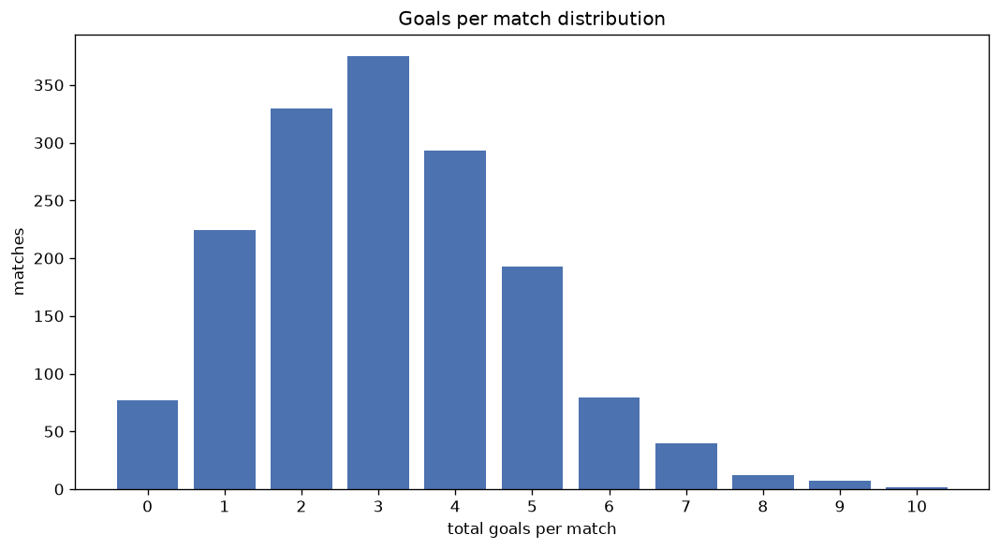
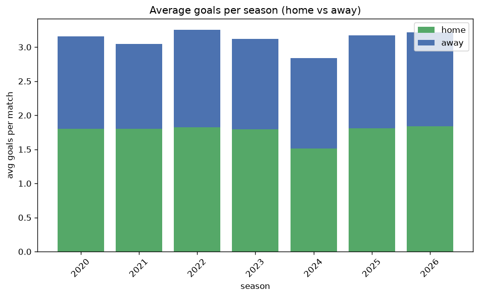

# Goal Analysis
- Report: `goals_analysis`
- Generated: 2026-10-27T02:23:56+00:00
- Script: `backend/scripts/analyze_goals.py` v1.0.0
- League: Eliteserien (Norway)
- Scope: league `norway`

## 1. Goals per match distribution
| goals | matches | pct |
|---|---|---|
| 0 | 77 | 4.7% |
| 1 | 224 | 13.7% |
| 2 | 330 | 20.2% |
| 3 | 375 | 23.0% |
| 4 | 293 | 18.0% |
| 5 | 193 | 11.8% |
| 6 | 79 | 4.8% |
| 7 | 40 | 2.5% |
| 8 | 12 | 0.7% |
| 9 | 7 | 0.4% |
| 10 | 2 | 0.1% |

## 2. Goals per match per season
| season | matches | total goals | avg home | avg away | avg total |
|---|---|---|---|---|---|
| 2020 | 240 | 758 | 1.8 | 1.358 | 3.158 |
| 2021 | 240 | 732 | 1.804 | 1.246 | 3.05 |
| 2022 | 240 | 781 | 1.821 | 1.433 | 3.254 |
| 2023 | 240 | 748 | 1.792 | 1.325 | 3.117 |
| 2024 | 240 | 681 | 1.512 | 1.325 | 2.837 |
| 2025 | 240 | 762 | 1.808 | 1.367 | 3.175 |
| 2026 | 192 | 617 | 1.839 | 1.375 | 3.214 |

## 3. Home vs away goal share
- Home goals: **2882** (56.7%)
- Away goals: **2197** (43.3%)
- Home/away ratio: **1.312**

| season | home goals | away goals | total | home pct | away pct |
|---|---|---|---|---|---|
| 2020 | 432 | 326 | 758 | 57.0% | 43.0% |
| 2021 | 433 | 299 | 732 | 59.2% | 40.8% |
| 2022 | 437 | 344 | 781 | 56.0% | 44.0% |
| 2023 | 430 | 318 | 748 | 57.5% | 42.5% |
| 2024 | 363 | 318 | 681 | 53.3% | 46.7% |
| 2025 | 434 | 328 | 762 | 57.0% | 43.0% |
| 2026 | 353 | 264 | 617 | 57.2% | 42.8% |

## 4. BTTS (Both Teams To Score)
- Overall: **953** of `1632` (58.4%)

| season | matches | BTTS | pct |
|---|---|---|---|
| 2020 | 240 | 142 | 59.2% |
| 2021 | 240 | 145 | 60.4% |
| 2022 | 240 | 152 | 63.3% |
| 2023 | 240 | 136 | 56.7% |
| 2024 | 240 | 127 | 52.9% |
| 2025 | 240 | 136 | 56.7% |
| 2026 | 192 | 115 | 59.9% |

## 5. Clean sheets
- Home clean sheets: **449** (27.5%)
- Away clean sheets: **307** (18.8%)
- Total clean sheets recorded: **756**
- Matches with at least one clean sheet: **679** (41.6%)
- Both teams kept clean sheets (0-0): **77**

| season | matches | home CS | away CS | total CS | matches w/ CS |
|---|---|---|---|---|---|
| 2020 | 240 | 65 | 46 | 111 | 98 (40.8%) |
| 2021 | 240 | 70 | 39 | 109 | 95 (39.6%) |
| 2022 | 240 | 60 | 35 | 95 | 88 (36.7%) |
| 2023 | 240 | 66 | 51 | 117 | 104 (43.3%) |
| 2024 | 240 | 69 | 57 | 126 | 113 (47.1%) |
| 2025 | 240 | 69 | 46 | 115 | 104 (43.3%) |
| 2026 | 192 | 50 | 33 | 83 | 77 (40.1%) |

## 6. Scoring intensity
- First-half goals: **2252** (44.4%)
- Second-half goals: **2824** (55.6%)
- Avg first-half goals per match: **1.381**
- Avg second-half goals per match: **1.731**
- Second-half-only scoring (HT 0-0, FT goals >= 1): **342** (21.0%)
- *1 match(es) excluded (no HT score recorded).*

| season | matches | 1st half | 2nd half | 1st half pct | 2nd half pct |
|---|---|---|---|---|---|
| 2020 | 240 | 326 | 432 | 43.0% | 57.0% |
| 2021 | 240 | 304 | 428 | 41.5% | 58.5% |
| 2022 | 240 | 366 | 415 | 46.9% | 53.1% |
| 2023 | 240 | 326 | 422 | 43.6% | 56.4% |
| 2024 | 240 | 290 | 391 | 42.6% | 57.4% |
| 2025 | 240 | 344 | 415 | 45.3% | 54.7% |
| 2026 | 192 | 296 | 321 | 48.0% | 52.0% |

## 7. First-goal timing
- Matches with first-goal time recorded: `1554` of `1632` (95.2%)
- Goalless matches: `78`
- Min `1` | Max `96` | Mean `29.37` | Median (p50) `24.0`

| bucket | count | % of matches | % of scoring matches |
|---|---|---|---|
| 1-15 | 549 | 33.6% | 35.3% |
| 16-30 | 385 | 23.6% | 24.8% |
| 31-45 | 248 | 15.2% | 16.0% |
| 46-60 | 191 | 11.7% | 12.3% |
| 61-75 | 108 | 6.6% | 6.9% |
| 76-90 | 57 | 3.5% | 3.7% |
| 91-120 | 16 | 1.0% | 1.0% |

---
*All statistics are computed from PostgreSQL tables (read-only). Run with `python backend/scripts/analyze_goals.py` to regenerate.*

## Charts

