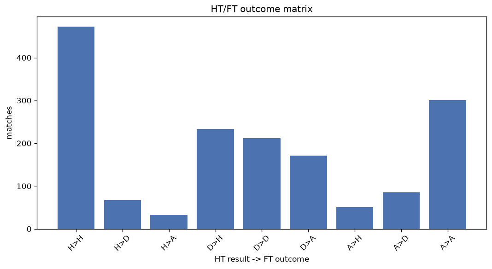
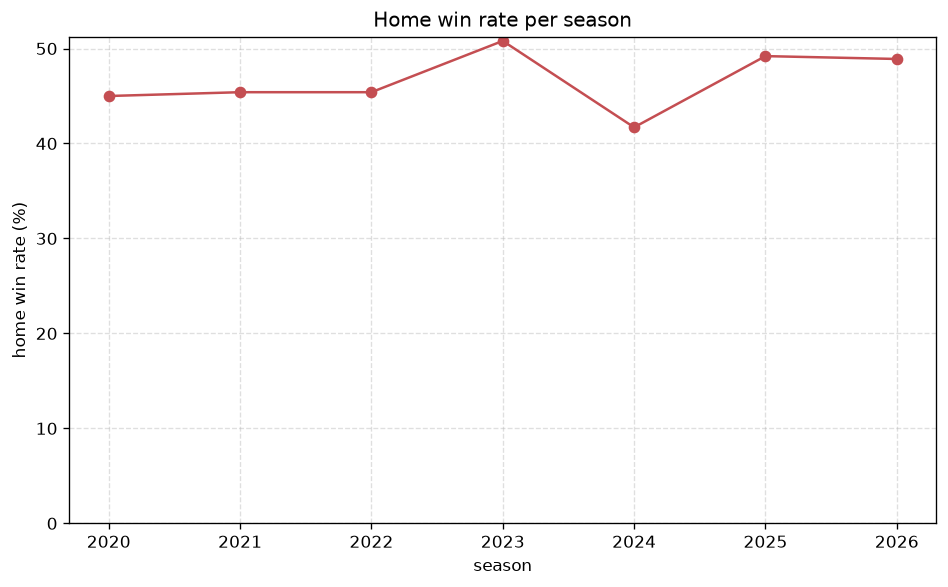

# Match Analysis
- Report: `matches_analysis`
- Generated: 2026-10-26T01:42:04+00:00
- Script: `backend/scripts/analyze_matches.py` v1.0.0
- League: Eliteserien (Norway)
- Scope: league `norway`

## 1. Overall summary
| metric | value |
|---|---|
| Matches | 1626 |
| Home wins | 757 (46.6%) |
| Draws | 364 (22.4%) |
| Away wins | 505 (31.1%) |
| Total goals | 5056 |
| Average goals per match | 3.109 |
| Goalless matches | 77 (4.7%) |

## 2. Per-season breakdown
| season | matches | home wins | draws | away wins | total goals | avg goals | goalless |
|---|---|---|---|---|---|---|---|
| 2020 | 240 | 108 (45.0%) | 58 (24.2%) | 74 (30.8%) | 758 | 3.158 | 13 (5.4%) |
| 2021 | 240 | 109 (45.4%) | 65 (27.1%) | 66 (27.5%) | 732 | 3.05 | 14 (5.8%) |
| 2022 | 240 | 109 (45.4%) | 57 (23.8%) | 74 (30.8%) | 781 | 3.254 | 7 (2.9%) |
| 2023 | 240 | 122 (50.8%) | 42 (17.5%) | 76 (31.7%) | 748 | 3.117 | 13 (5.4%) |
| 2024 | 240 | 100 (41.7%) | 60 (25.0%) | 80 (33.3%) | 681 | 2.837 | 13 (5.4%) |
| 2025 | 240 | 118 (49.2%) | 45 (18.8%) | 77 (32.1%) | 762 | 3.175 | 11 (4.6%) |
| 2026 | 186 | 91 (48.9%) | 37 (19.9%) | 58 (31.2%) | 594 | 3.194 | 6 (3.2%) |

## 3. HT/FT outcome matrix
| HT result \ FT result | Home | Draw | Away | total |
|---|---|---|---|---|
| HT home lead | 472 (82.5%) | 67 (11.7%) | 33 (5.8%) | 572 |
| HT draw | 233 (37.8%) | 212 (34.4%) | 171 (27.8%) | 616 |
| HT away lead | 51 (11.7%) | 85 (19.5%) | 301 (68.9%) | 437 |
- *1 match(es) excluded (no HT score recorded).*

## 4. Comeback matches
- Home comebacks (trailing at HT, won at FT): **51** (3.1%)
- Away comebacks (trailing at HT, won at FT): **33** (2.0%)

### Home comebacks
| season | home | away | HT | FT |
|---|---|---|---|---|
| 2020 | Bodo/Glimt | Kristiansund | 0-1 | 2-1 |
| 2020 | Kristiansund | Sandefjord | 0-1 | 3-1 |
| 2020 | Aalesund | Start | 1-2 | 3-2 |
| 2020 | Valerenga | Sandefjord | 0-1 | 2-1 |
| 2020 | Rosenborg | Haugesund | 0-1 | 2-1 |
| 2020 | Start | Sarpsborg 08 | 1-2 | 3-2 |
| 2020 | Kristiansund | Stromsgodset | 0-1 | 2-1 |
| 2021 | Viking | Mjondalen | 0-1 | 2-1 |
| 2021 | Rosenborg | Stabaek | 0-1 | 4-2 |
| 2021 | Stromsgodset | Rosenborg | 0-1 | 2-1 |
| 2021 | Kristiansund | Brann | 0-1 | 3-2 |
| 2021 | Viking | Molde | 0-2 | 3-2 |
| 2021 | Brann | Sandefjord | 1-2 | 3-2 |
| 2021 | Stromsgodset | Brann | 0-1 | 3-1 |
| 2021 | Viking | Rosenborg | 0-1 | 2-1 |
| 2021 | Valerenga | Haugesund | 0-1 | 2-1 |
| 2022 | Haugesund | Viking | 1-2 | 4-2 |
| 2022 | Tromso | Rosenborg | 2-3 | 4-3 |
| 2022 | Sarpsborg 08 | HamKam | 0-1 | 2-1 |
| 2022 | Sarpsborg 08 | Jerv | 2-3 | 4-3 |
| 2022 | Bodo/Glimt | Sandefjord | 0-1 | 4-1 |
| 2022 | Rosenborg | Bodo/Glimt | 0-1 | 3-2 |
| 2023 | Viking | HamKam | 0-1 | 7-3 |
| 2023 | Viking | Odd | 0-2 | 3-2 |
| 2023 | Tromso | Sarpsborg 08 | 0-1 | 2-1 |
| 2023 | Bodo/Glimt | Haugesund | 0-1 | 2-1 |
| 2023 | Sarpsborg 08 | Haugesund | 0-1 | 2-1 |
| 2023 | Rosenborg | Odd | 0-2 | 3-2 |
| 2023 | Tromso | Lillestrom | 0-1 | 3-1 |
| 2023 | Brann | Molde | 0-1 | 3-2 |
| 2023 | Stromsgodset | Odd | 0-1 | 3-1 |
| 2023 | Viking | Sarpsborg 08 | 0-1 | 2-1 |
| 2024 | Sandefjord | Molde | 0-1 | 3-1 |
| 2024 | Tromso | Rosenborg | 0-2 | 3-2 |
| 2024 | Rosenborg | Kristiansund | 0-1 | 2-1 |
| 2024 | Stromsgodset | Lillestrom | 1-2 | 3-2 |
| 2024 | Rosenborg | Molde | 0-1 | 2-1 |
| 2024 | Sandefjord | KFUM Oslo | 0-1 | 2-1 |
| 2024 | Haugesund | Odd | 0-1 | 2-1 |
| 2025 | Brann | Tromso | 0-1 | 3-1 |
| 2025 | Viking | Kristiansund | 0-1 | 3-1 |
| 2025 | Brann | Bryne | 0-2 | 3-2 |
| 2025 | Tromso | Bodo/Glimt | 0-1 | 2-1 |
| 2025 | Sarpsborg 08 | Haugesund | 0-1 | 3-1 |
| 2025 | Fredrikstad | Molde | 0-1 | 4-2 |
| 2025 | Kristiansund | Molde | 0-1 | 2-1 |
| 2025 | Valerenga | Stromsgodset | 0-1 | 2-1 |
| 2026 | Viking | Start | 1-3 | 6-3 |
| 2026 | Fredrikstad | Start | 0-1 | 2-1 |
| 2026 | Viking | Aalesund | 0-1 | 2-1 |
| 2026 | Viking | Fredrikstad | 1-2 | 3-2 |

### Away comebacks
| season | home | away | HT | FT |
|---|---|---|---|---|
| 2020 | Viking | Bodo/Glimt | 2-1 | 2-4 |
| 2020 | Viking | Kristiansund | 1-0 | 1-2 |
| 2020 | Aalesund | Kristiansund | 1-0 | 1-2 |
| 2020 | Mjondalen | Molde | 1-0 | 1-3 |
| 2020 | Odd | Molde | 1-0 | 1-4 |
| 2020 | Kristiansund | Haugesund | 1-0 | 1-3 |
| 2021 | Sarpsborg 08 | Viking | 1-0 | 1-2 |
| 2021 | Viking | Bodo/Glimt | 1-0 | 1-3 |
| 2021 | Rosenborg | Lillestrom | 1-0 | 1-3 |
| 2022 | Stromsgodset | Molde | 1-0 | 1-3 |
| 2022 | Molde | Viking | 3-1 | 3-4 |
| 2022 | Viking | Sandefjord | 1-0 | 1-2 |
| 2022 | Kristiansund | Lillestrom | 1-0 | 1-3 |
| 2022 | Odd | Rosenborg | 1-0 | 2-3 |
| 2022 | Valerenga | Molde | 1-0 | 1-2 |
| 2023 | Valerenga | Lillestrom | 3-1 | 3-4 |
| 2023 | Aalesund | Brann | 1-0 | 1-3 |
| 2023 | Rosenborg | Lillestrom | 1-0 | 1-2 |
| 2023 | Haugesund | Rosenborg | 1-0 | 1-2 |
| 2023 | Sarpsborg 08 | Stromsgodset | 1-0 | 1-2 |
| 2024 | Brann | Molde | 1-0 | 1-3 |
| 2024 | Sarpsborg 08 | Bodo/Glimt | 1-0 | 1-2 |
| 2024 | KFUM Oslo | Viking | 1-0 | 1-2 |
| 2024 | KFUM Oslo | Sarpsborg 08 | 1-0 | 1-2 |
| 2025 | Tromso | Kristiansund | 1-0 | 2-3 |
| 2025 | Stromsgodset | Brann | 1-0 | 1-2 |
| 2025 | Stromsgodset | Kristiansund | 1-0 | 1-2 |
| 2025 | Bodo/Glimt | Viking | 2-1 | 2-4 |
| 2025 | Valerenga | Molde | 2-1 | 2-3 |
| 2025 | Sandefjord | Viking | 1-0 | 1-2 |
| 2025 | Tromso | Brann | 1-0 | 1-2 |
| 2025 | HamKam | Stromsgodset | 1-0 | 1-2 |
| 2025 | Brann | Bodo/Glimt | 1-0 | 1-2 |

## 5. HT lead conversion
| HT state | matches | converted to win | held as draw | collapsed to loss |
|---|---|---|---|---|
| Home lead | 572 | 472 (82.5%) | 67 (11.7%) | 33 (5.8%) |
| Away lead | 437 | 301 (68.9%) | 85 (19.5%) | 51 (11.7%) |

### Matches level at half-time
| FT result | count | pct |
|---|---|---|
| Home win | 233 | 37.8% |
| Draw | 212 | 34.4% |
| Away win | 171 | 27.8% |
- *1 match(es) excluded (no HT score recorded).*

## 6. First-goal timing
- Matches with a first-goal time recorded: `1548` of `1626` (95.2%)

Outcome distribution by first-goal timing bucket:
| bucket | matches | % of matches | home | draw | away |
|---|---|---|---|---|---|
| 1-15 | 547 | 33.6% | 275 (50.3%) | 84 (15.4%) | 188 (34.4%) |
| 16-30 | 382 | 23.5% | 188 (49.2%) | 79 (20.7%) | 115 (30.1%) |
| 31-45 | 248 | 15.3% | 115 (46.4%) | 48 (19.4%) | 85 (34.3%) |
| 46-60 | 191 | 11.7% | 89 (46.6%) | 43 (22.5%) | 59 (30.9%) |
| 61-75 | 107 | 6.6% | 50 (46.7%) | 24 (22.4%) | 33 (30.8%) |
| 76-90 | 57 | 3.5% | 32 (56.1%) | 5 (8.8%) | 20 (35.1%) |
| 91-120 | 16 | 1.0% | 7 (43.8%) | 4 (25.0%) | 5 (31.2%) |

## 7. Goalless matches
- Overall: **77** of `1626` (4.7%)

| season | matches | goalless | pct |
|---|---|---|---|
| 2020 | 240 | 13 | 5.4% |
| 2021 | 240 | 14 | 5.8% |
| 2022 | 240 | 7 | 2.9% |
| 2023 | 240 | 13 | 5.4% |
| 2024 | 240 | 13 | 5.4% |
| 2025 | 240 | 11 | 4.6% |
| 2026 | 186 | 6 | 3.2% |

---
*All statistics are computed from PostgreSQL tables (read-only). Run with `python backend/scripts/analyze_matches.py` to regenerate.*

## Charts

