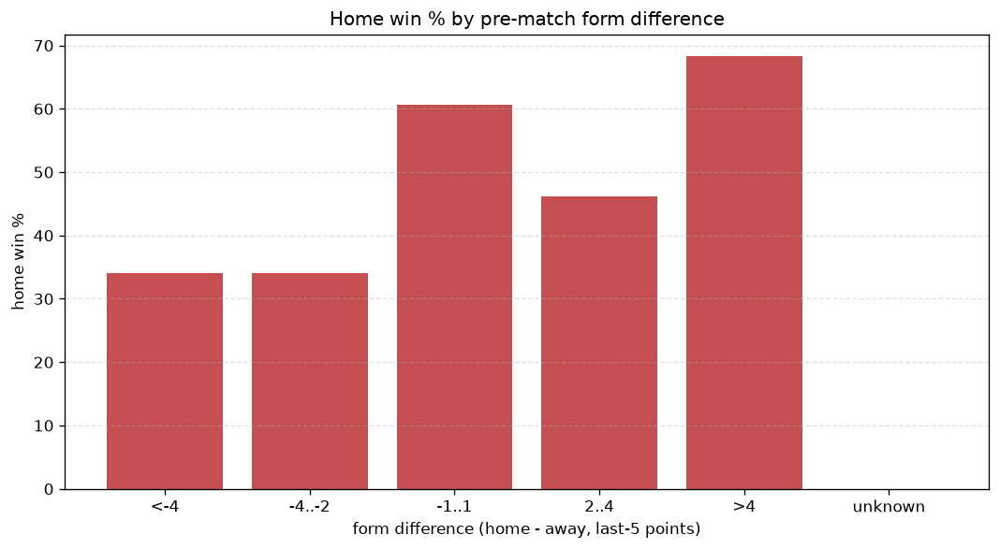
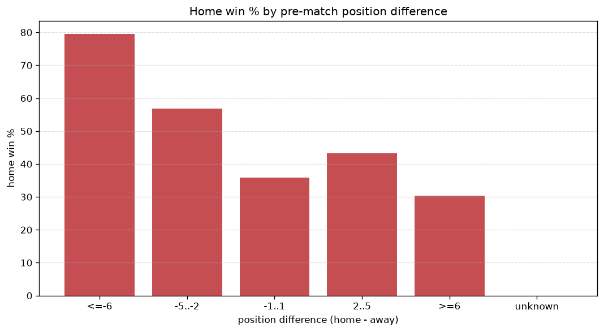

# Relationships Analysis
- Report: `relationships`
- Generated: 2026-10-30T04:03:37+00:00
- Script: `backend/scripts/analyze_relationships.py` v1.0.0
- League: Eliteserien (Norway)
- Scope: league `norway`

- Matches analysed: **1440** (23 leakage-safe pre-match features).

## 1. Correlation matrix
_Pearson correlation of each pre-match feature with observed goals; sorted by |corr(total goals)|._

| feature | corr(home) | corr(away) | corr(total) |
|---|---|---|---|
| home_team_home_goals_avg | 0.213 | -0.030 | 0.153 |
| home_team_goals_scored_last_5 | 0.209 | -0.037 | 0.144 |
| home_points_before_match | 0.206 | -0.060 | 0.127 |
| home_team_wins_last_5 | 0.228 | -0.092 | 0.122 |
| home_team_points_last_5 | 0.222 | -0.090 | 0.119 |
| home_team_home_win_rate | 0.198 | -0.069 | 0.114 |
| home_position_before_match | -0.241 | 0.150 | -0.094 |
| away_team_goals_scored_last_5 | -0.046 | 0.162 | 0.073 |
| away_points_before_match | -0.029 | 0.137 | 0.070 |
| points_difference | 0.286 | -0.241 | 0.068 |
| away_team_away_goals_avg | -0.048 | 0.156 | 0.067 |
| position_difference | -0.273 | 0.235 | -0.062 |
| away_team_goals_conceded_last_5 | 0.102 | -0.043 | 0.054 |
| home_rest_days | 0.026 | 0.035 | 0.045 |
| away_team_away_conceded_avg | 0.080 | -0.038 | 0.039 |
| away_team_wins_last_5 | -0.078 | 0.143 | 0.035 |
| away_team_points_last_5 | -0.075 | 0.138 | 0.033 |
| away_team_away_win_rate | -0.079 | 0.136 | 0.029 |
| away_rest_days | 0.008 | 0.032 | 0.029 |
| rest_days_difference | 0.025 | 0.003 | 0.022 |
| away_position_before_match | 0.142 | -0.178 | -0.007 |
| home_team_home_conceded_avg | -0.102 | 0.116 | -0.004 |
| home_team_goals_conceded_last_5 | -0.084 | 0.095 | -0.003 |

## 2. Form vs outcome
_Home win/draw/away % per bucket of `home_team_points_last_5 - away_team_points_last_5`._

| bucket | matches | home | draw | away | home % | draw % | away % |
|---|---|---|---|---|---|---|---|
| <-4 | 267 | 78 | 64 | 125 | 29.2% | 24.0% | 46.8% |
| -4..-2 | 274 | 109 | 57 | 108 | 39.8% | 20.8% | 39.4% |
| -1..1 | 394 | 196 | 93 | 105 | 49.7% | 23.6% | 26.6% |
| 2..4 | 268 | 125 | 66 | 77 | 46.6% | 24.6% | 28.7% |
| >4 | 237 | 158 | 47 | 32 | 66.7% | 19.8% | 13.5% |
| unknown | 0 | 0 | 0 | 0 | - | - | - |

## 3. Position vs outcome
_Home win/draw/away % per bucket of `position_difference` (home position - away position; negative favours the home team)._

| bucket | matches | home | draw | away | home % | draw % | away % |
|---|---|---|---|---|---|---|---|
| <=-6 | 294 | 194 | 62 | 38 | 66.0% | 21.1% | 12.9% |
| -5..-2 | 295 | 160 | 64 | 71 | 54.2% | 21.7% | 24.1% |
| -1..1 | 222 | 93 | 55 | 74 | 41.9% | 24.8% | 33.3% |
| 2..5 | 311 | 127 | 76 | 108 | 40.8% | 24.4% | 34.7% |
| >=6 | 318 | 92 | 70 | 156 | 28.9% | 22.0% | 49.1% |
| unknown | 0 | 0 | 0 | 0 | - | - | - |

## 4. Rest advantage
_Home win/draw/away % per bucket of `rest_days_difference` (home rest - away rest). Matches with unknown rest are bucketed separately._

| bucket | matches | home | draw | away | home % | draw % | away % |
|---|---|---|---|---|---|---|---|
| <-1 | 107 | 42 | 27 | 38 | 39.3% | 25.2% | 35.5% |
| -1..0 | 204 | 98 | 37 | 69 | 48.0% | 18.1% | 33.8% |
| 0 | 761 | 356 | 179 | 226 | 46.8% | 23.5% | 29.7% |
| 1..2 | 213 | 106 | 47 | 60 | 49.8% | 22.1% | 28.2% |
| >2 | 106 | 42 | 27 | 37 | 39.6% | 25.5% | 34.9% |
| unknown | 49 | 22 | 10 | 17 | 44.9% | 20.4% | 34.7% |
- *49 match(es) had unknown rest difference (missing rest data on at least one side).*

## 5. Home team quality
_Home win rate by `home_team_home_win_rate` tier (split at 0.5)._

- `< 0.5` tier: **40.8%** home win (333/817)
- `>= 0.5` tier: **53.5%** home win (333/623)
- Home-win gap (>= split minus < split): **+12.7 pp**

| tier | label | matches | home | draw | away | home % |
|---|---|---|---|---|---|---|
| low | < 0.5 | 817 | 333 | 190 | 294 | 40.8% |
| high | >= 0.5 | 623 | 333 | 137 | 153 | 53.5% |

## 6. Feature averages by result
_Mean feature value per outcome; `range` is home-minus-away spread of the group means._

| feature | home mean | draw mean | away mean | range |
|---|---|---|---|---|
| points_difference | 3.381 | -0.823 | -5.327 | 8.708 |
| home_points_before_match | 22.156 | 19.364 | 17.036 | 5.120 |
| position_difference | -1.703 | 0.199 | 2.870 | 4.573 |
| away_points_before_match | 18.775 | 20.187 | 22.362 | 3.588 |
| home_position_before_match | 7.640 | 8.749 | 10.031 | 2.392 |
| away_position_before_match | 9.342 | 8.550 | 7.161 | 2.181 |
| home_team_points_last_5 | 6.809 | 6.235 | 5.150 | 1.659 |
| home_team_goals_scored_last_5 | 7.446 | 6.719 | 6.110 | 1.336 |
| away_team_points_last_5 | 5.787 | 6.471 | 6.982 | 1.195 |
| away_team_goals_scored_last_5 | 6.514 | 7.037 | 7.696 | 1.182 |
| home_team_goals_conceded_last_5 | 6.646 | 7.003 | 7.546 | 0.900 |
| away_team_goals_conceded_last_5 | 7.212 | 6.645 | 6.485 | 0.726 |
| home_team_wins_last_5 | 1.938 | 1.734 | 1.360 | 0.578 |
| away_rest_days | 7.597 | 7.612 | 8.077 | 0.480 |
| away_team_wins_last_5 | 1.580 | 1.810 | 2.004 | 0.425 |
| home_rest_days | 7.653 | 7.691 | 8.035 | 0.382 |
| home_team_home_goals_avg | 1.662 | 1.525 | 1.379 | 0.283 |
| away_team_away_goals_avg | 1.135 | 1.189 | 1.358 | 0.223 |
| home_team_home_conceded_avg | 1.131 | 1.276 | 1.327 | 0.196 |
| away_team_away_conceded_avg | 1.602 | 1.560 | 1.468 | 0.133 |
| rest_days_difference | 0.057 | 0.079 | -0.042 | 0.121 |
| home_team_home_win_rate | 0.461 | 0.413 | 0.362 | 0.099 |
| away_team_away_win_rate | 0.265 | 0.294 | 0.345 | 0.080 |

---
*All features are leakage-safe pre-match values built by `ml.features.build_features.build_rows` from strictly prior matches. Run with `python backend/scripts/analyze_relationships.py` to regenerate.*

## Charts

