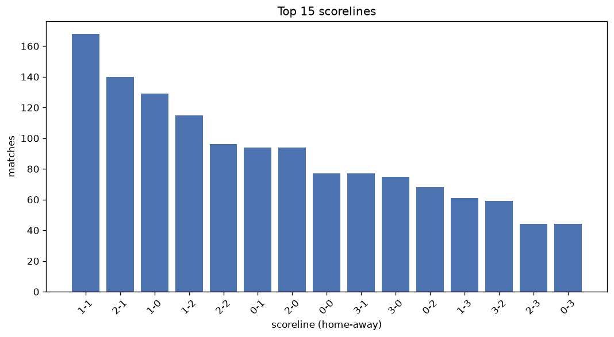
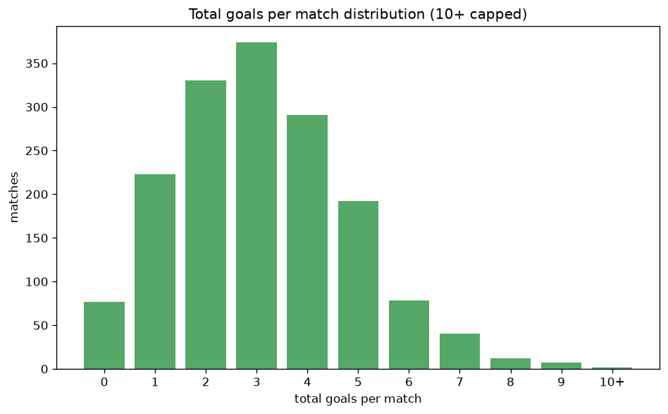

# Scoreline Analysis
- Report: `scoreline_analysis`
- Generated: 2026-10-26T01:42:11+00:00
- Script: `backend/scripts/analyze_scorelines.py` v1.0.0
- League: Eliteserien (Norway)
- Scope: league `norway`

## 1. Scoreline frequency
- Matches analysed: **1626** across **7** seasons.
- Distinct scorelines seen: **47**.

| scoreline | count | pct |
|---|---|---|
| 1-1 | 168 | 10.3% |
| 2-1 | 140 | 8.6% |
| 1-0 | 129 | 7.9% |
| 1-2 | 115 | 7.1% |
| 2-2 | 96 | 5.9% |
| 0-1 | 94 | 5.8% |
| 2-0 | 94 | 5.8% |
| 0-0 | 77 | 4.7% |
| 3-1 | 77 | 4.7% |
| 3-0 | 75 | 4.6% |
| 0-2 | 68 | 4.2% |
| 1-3 | 61 | 3.8% |
| 3-2 | 59 | 3.6% |
| 2-3 | 44 | 2.7% |
| 0-3 | 44 | 2.7% |
| 4-0 | 42 | 2.6% |
| 4-1 | 38 | 2.3% |
| 5-0 | 22 | 1.4% |
| 5-1 | 22 | 1.4% |
| 1-4 | 21 | 1.3% |

## 2. Scoreline frequency per season

### 2020
| scoreline | count | pct |
|---|---|---|
| 1-1 | 23 | 9.6% |
| 2-1 | 21 | 8.8% |
| 1-2 | 20 | 8.3% |
| 2-2 | 18 | 7.5% |
| 1-0 | 17 | 7.1% |

### 2021
| scoreline | count | pct |
|---|---|---|
| 1-1 | 33 | 13.8% |
| 2-1 | 17 | 7.1% |
| 2-0 | 16 | 6.7% |
| 1-2 | 16 | 6.7% |
| 3-0 | 15 | 6.2% |

### 2022
| scoreline | count | pct |
|---|---|---|
| 1-1 | 26 | 10.8% |
| 2-2 | 21 | 8.8% |
| 2-1 | 21 | 8.8% |
| 1-2 | 21 | 8.8% |
| 1-0 | 20 | 8.3% |

### 2023
| scoreline | count | pct |
|---|---|---|
| 1-0 | 21 | 8.8% |
| 1-1 | 20 | 8.3% |
| 2-1 | 19 | 7.9% |
| 0-1 | 16 | 6.7% |
| 3-1 | 16 | 6.7% |

### 2024
| scoreline | count | pct |
|---|---|---|
| 1-0 | 27 | 11.2% |
| 1-1 | 24 | 10.0% |
| 2-1 | 22 | 9.2% |
| 0-1 | 21 | 8.8% |
| 2-2 | 17 | 7.1% |

### 2025
| scoreline | count | pct |
|---|---|---|
| 1-1 | 22 | 9.2% |
| 1-0 | 20 | 8.3% |
| 2-1 | 19 | 7.9% |
| 3-1 | 17 | 7.1% |
| 2-0 | 14 | 5.8% |

### 2026
| scoreline | count | pct |
|---|---|---|
| 2-1 | 21 | 11.3% |
| 1-1 | 20 | 10.8% |
| 2-0 | 16 | 8.6% |
| 1-2 | 14 | 7.5% |
| 0-2 | 11 | 5.9% |

## 3. Total-goal histogram
_10+ groups all matches with 10 or more total goals._

| total goals | matches | pct |
|---|---|---|
| 0 | 77 | 4.7% |
| 1 | 223 | 13.7% |
| 2 | 330 | 20.3% |
| 3 | 374 | 23.0% |
| 4 | 291 | 17.9% |
| 5 | 192 | 11.8% |
| 6 | 78 | 4.8% |
| 7 | 40 | 2.5% |
| 8 | 12 | 0.7% |
| 9 | 7 | 0.4% |
| 10+ | 2 | 0.1% |

## 4. Extreme scorelines
- Matches with 7+ total goals: **61**

| season | date | scoreline | total goals |
|---|---|---|---|
| 2023 | 2023-04-30 | 7-3 | 10 |
| 2026 | 2026-08-16 | 5-5 | 10 |
| 2020 | 2020-06-21 | 7-2 | 9 |
| 2021 | 2021-06-16 | 7-2 | 9 |
| 2021 | 2021-08-08 | 5-4 | 9 |
| 2022 | 2022-11-06 | 5-4 | 9 |
| 2025 | 2025-07-26 | 7-2 | 9 |
| 2026 | 2026-05-16 | 6-3 | 9 |
| 2026 | 2026-09-13 | 8-1 | 9 |
| 2020 | 2020-09-12 | 3-5 | 8 |
| 2020 | 2020-09-27 | 4-4 | 8 |
| 2022 | 2022-10-02 | 4-4 | 8 |
| 2023 | 2023-09-03 | 4-4 | 8 |
| 2023 | 2023-11-26 | 4-4 | 8 |
| 2024 | 2024-05-16 | 1-7 | 8 |
| 2024 | 2024-09-28 | 5-3 | 8 |
| 2025 | 2025-04-27 | 4-4 | 8 |
| 2025 | 2025-09-12 | 7-1 | 8 |
| 2025 | 2025-11-22 | 2-6 | 8 |
| 2026 | 2026-08-02 | 2-6 | 8 |
| 2026 | 2026-09-12 | 5-3 | 8 |
| 2020 | 2020-06-21 | 6-1 | 7 |
| 2020 | 2020-07-12 | 1-6 | 7 |
| 2020 | 2020-08-09 | 3-4 | 7 |
| 2020 | 2020-08-30 | 6-1 | 7 |
| 2020 | 2020-09-13 | 6-1 | 7 |
| 2020 | 2020-09-20 | 5-2 | 7 |
| 2020 | 2020-11-08 | 7-0 | 7 |
| 2020 | 2020-12-06 | 5-2 | 7 |
| 2020 | 2020-12-09 | 4-3 | 7 |
| 2021 | 2021-10-17 | 7-0 | 7 |
| 2022 | 2022-04-24 | 2-5 | 7 |
| 2022 | 2022-05-07 | 3-4 | 7 |
| 2022 | 2022-07-03 | 4-3 | 7 |
| 2022 | 2022-07-30 | 2-5 | 7 |
| 2022 | 2022-08-06 | 7-0 | 7 |
| 2022 | 2022-08-12 | 2-5 | 7 |
| 2022 | 2022-08-28 | 4-3 | 7 |
| 2022 | 2022-09-18 | 4-3 | 7 |
| 2023 | 2023-04-19 | 4-3 | 7 |
| 2023 | 2023-05-01 | 3-4 | 7 |
| 2023 | 2023-06-04 | 3-4 | 7 |
| 2023 | 2023-07-02 | 6-1 | 7 |
| 2023 | 2023-07-09 | 5-2 | 7 |
| 2023 | 2023-07-23 | 2-5 | 7 |
| 2023 | 2023-09-24 | 4-3 | 7 |
| 2023 | 2023-10-04 | 5-2 | 7 |
| 2023 | 2023-10-08 | 5-2 | 7 |
| 2023 | 2023-10-21 | 4-3 | 7 |
| 2023 | 2023-10-22 | 3-4 | 7 |
| 2023 | 2023-10-28 | 6-1 | 7 |
| 2024 | 2024-07-28 | 4-3 | 7 |
| 2024 | 2024-08-25 | 5-2 | 7 |
| 2024 | 2024-09-14 | 6-1 | 7 |
| 2024 | 2024-12-01 | 5-2 | 7 |
| 2025 | 2025-04-21 | 2-5 | 7 |
| 2025 | 2025-05-24 | 4-3 | 7 |
| 2025 | 2025-10-18 | 2-5 | 7 |
| 2026 | 2026-07-16 | 6-1 | 7 |
| 2026 | 2026-08-30 | 3-4 | 7 |
| 2026 | 2026-10-18 | 6-1 | 7 |

## 5. Margin-of-victory distribution (decided matches)
- Decided matches: **1262** (draws: **364**)
- Average winning margin: **1.96**

| margin | matches | pct |
|---|---|---|
| 1 | 598 | 47.4% |
| 2 | 332 | 26.3% |
| 3+ | 332 | 26.3% |

## 6. Margin by outcome

### Home wins
- Matches: **757** | avg margin: **2.08** | max margin: **7**
| margin | matches | pct |
|---|---|---|
| 1 | 339 | 44.8% |
| 2 | 188 | 24.8% |
| 3+ | 230 | 30.4% |
- *Full match-by-match list available in `scoreline_analysis.json`.*

### Away wins
- Matches: **505** | avg margin: **1.78** | max margin: **6**
| margin | matches | pct |
|---|---|---|
| 1 | 259 | 51.3% |
| 2 | 144 | 28.5% |
| 3+ | 102 | 20.2% |
- *Full match-by-match list available in `scoreline_analysis.json`.*

## 7. Most common exact score by outcome type
| outcome | matches | most common score | count | pct |
|---|---|---|---|---|
| home | 757 | 2-1 | 140 | 18.5% |
| draw | 364 | 1-1 | 168 | 46.2% |
| away | 505 | 1-2 | 115 | 22.8% |

---
*All statistics are computed from PostgreSQL tables (read-only). Run with `python backend/scripts/analyze_scorelines.py` to regenerate.*

## Charts

