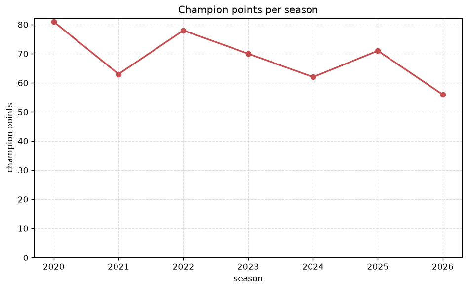
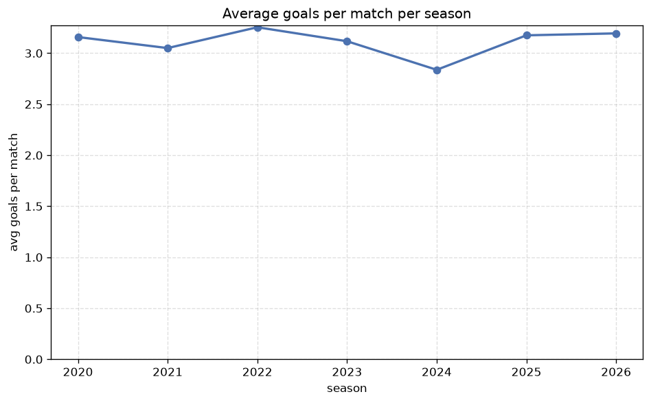

# Season Trends Analysis
- Report: `season_trends`
- Generated: 2026-10-26T01:42:09+00:00
- Script: `backend/scripts/analyze_seasons.py` v1.0.0
- League: Eliteserien (Norway)
- Scope: league `norway`

## 1. Champions per season
| season | champion | pts | runner-up | margin |
|---|---|---|---|---|
| 2020 | Bodo/Glimt | 81 | Molde | 19 pts |
| 2021 | Bodo/Glimt | 63 | Molde | 3 pts |
| 2022 | Molde | 78 | Bodo/Glimt | 18 pts |
| 2023 | Bodo/Glimt | 70 | Brann | 9 pts |
| 2024 | Bodo/Glimt | 62 | Brann | 3 pts |
| 2025 | Viking | 71 | Bodo/Glimt | 1 pts |
| 2026 | Viking | 56 | Bodo/Glimt | 0 pts |

## 2. Title-race tightness
- Tight races (margin <= 3 pts): **4** of 7 seasons
- Tightest race: **2026** - Viking beat Bodo/Glimt by **0** pts

| season | margin | tight |
|---|---|---|
| 2020 | 19 pts |  |
| 2021 | 3 pts | yes |
| 2022 | 18 pts |  |
| 2023 | 9 pts |  |
| 2024 | 3 pts | yes |
| 2025 | 1 pts | yes |
| 2026 | 0 pts | yes |

## 3. Points thresholds
_Position-specific points per season. Key: 1 = champion, 2 = runner-up, 4 = CL line, 6 = Europa, 13 = last safe, 16 = bottom._

| season | pos 1 | pos 2 | pos 4 | pos 6 | pos 13 | pos 16 |
|---|---|---|---|---|---|---|
| 2020 | 81 | 62 | 52 | 44 | 31 | 11 |
| 2021 | 63 | 60 | 49 | 46 | 33 | 22 |
| 2022 | 78 | 60 | 53 | 44 | 31 | 20 |
| 2023 | 70 | 61 | 58 | 43 | 31 | 18 |
| 2024 | 62 | 59 | 53 | 51 | 33 | 23 |
| 2025 | 71 | 70 | 56 | 43 | 34 | 9 |
| 2026 | 56 | 56 | 40 | 36 | 24 | 16 |

## 4. Relegation battle
| season | safe pos | safe pts | drop pos | drop pts | gap |
|---|---|---|---|---|---|
| 2020 | 13 | 31 | 14 | 27 | 4 pts |
| 2021 | 13 | 33 | 14 | 26 | 7 pts |
| 2022 | 13 | 31 | 14 | 24 | 7 pts |
| 2023 | 13 | 31 | 14 | 29 | 2 pts |
| 2024 | 13 | 33 | 14 | 33 | 0 pts |
| 2025 | 13 | 34 | 14 | 31 | 3 pts |
| 2026 | 13 | 24 | 14 | 24 | 0 pts |

## 5. League-level trends
| season | matches | total goals | avg goals | home win | draw | away win | goalless | avg pts/team |
|---|---|---|---|---|---|---|---|---|
| 2020 | 240 | 758 | 3.158 | 45.0% | 24.2% | 30.8% | 5.4% | 41.38 |
| 2021 | 240 | 732 | 3.05 | 45.4% | 27.1% | 27.5% | 5.8% | 40.94 |
| 2022 | 240 | 781 | 3.254 | 45.4% | 23.8% | 30.8% | 2.9% | 41.44 |
| 2023 | 240 | 748 | 3.117 | 50.8% | 17.5% | 31.7% | 5.4% | 42.38 |
| 2024 | 240 | 681 | 2.837 | 41.7% | 25.0% | 33.3% | 5.4% | 41.25 |
| 2025 | 240 | 762 | 3.175 | 49.2% | 18.8% | 32.1% | 4.6% | 42.19 |
| 2026 | 186 | 594 | 3.194 | 48.9% | 19.9% | 31.2% | 3.2% | 32.56 |

## 6. View divergence
- Largest divergence: **2022** (goals view, avg abs position diff = 5.250)

_Avg absolute position difference between classic view and alternative view per season._

| season | classic vs luck | classic vs goals |
|---|---|---|
| 2020 | 2.000 | 3.875 |
| 2021 | 2.625 | 5.125 |
| 2022 | 2.500 | 5.250 |
| 2023 | 3.375 | 4.000 |
| 2024 | 3.250 | 4.000 |
| 2025 | 2.750 | 4.250 |
| 2026 | 3.625 | 5.000 |

---
*All statistics are computed from PostgreSQL tables (read-only). Run with `python backend/scripts/analyze_seasons.py` to regenerate.*

## Charts

