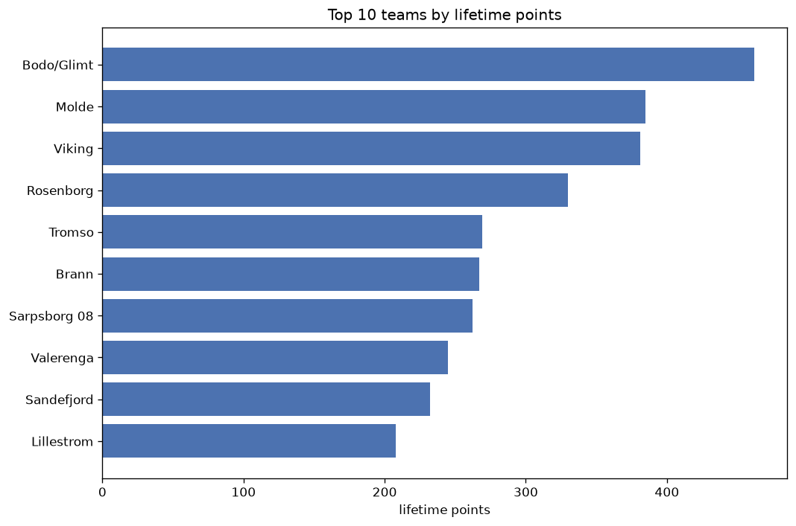
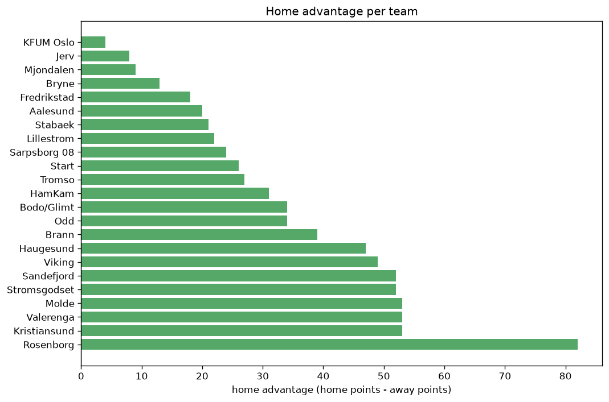

# Team Analysis
- Report: `teams_analysis`
- Generated: 2026-10-29T02:09:14+00:00
- Script: `backend/scripts/analyze_teams.py` v1.0.0
- League: Eliteserien (Norway)
- Scope: league `norway`

- Teams: **23** | Seasons: **7** | Matches: **1632**

## 1. Team standings (lifetime)
| team | seasons | played | W | D | L | pts | GF | GA | GD | avg pts/season | best pos | worst pos | titles |
|---|---|---|---|---|---|---|---|---|---|---|---|---|---|
| Bodo/Glimt | 7 | 204 | 142 | 36 | 26 | 462 | 540 | 216 | 324 | 66.0 | 1 | 2 | 4 |
| Molde | 7 | 204 | 118 | 31 | 55 | 385 | 450 | 254 | 196 | 55.0 | 1 | 10 | 1 |
| Viking | 7 | 204 | 113 | 42 | 49 | 381 | 423 | 299 | 124 | 54.43 | 1 | 11 | 2 |
| Rosenborg | 7 | 204 | 94 | 48 | 62 | 330 | 366 | 283 | 83 | 47.14 | 3 | 9 | 0 |
| Tromso | 6 | 174 | 75 | 44 | 55 | 269 | 254 | 240 | 14 | 44.83 | 3 | 13 | 0 |
| Brann | 6 | 174 | 76 | 39 | 59 | 267 | 285 | 258 | 27 | 44.5 | 2 | 14 | 0 |
| Sarpsborg 08 | 7 | 204 | 72 | 46 | 86 | 262 | 305 | 333 | -28 | 37.43 | 7 | 12 | 0 |
| Valerenga | 6 | 174 | 67 | 44 | 63 | 245 | 276 | 265 | 11 | 40.83 | 3 | 14 | 0 |
| Sandefjord | 7 | 204 | 63 | 43 | 98 | 232 | 276 | 337 | -61 | 33.14 | 5 | 14 | 0 |
| Lillestrom | 5 | 144 | 62 | 22 | 60 | 208 | 215 | 219 | -4 | 41.6 | 4 | 15 | 0 |
| Kristiansund | 6 | 174 | 53 | 46 | 75 | 205 | 226 | 304 | -78 | 34.17 | 5 | 15 | 0 |
| Stromsgodset | 6 | 180 | 54 | 38 | 88 | 200 | 234 | 302 | -68 | 33.33 | 7 | 15 | 0 |
| Haugesund | 6 | 180 | 50 | 37 | 93 | 187 | 212 | 308 | -96 | 31.17 | 9 | 16 | 0 |
| Odd | 5 | 150 | 49 | 35 | 66 | 182 | 207 | 252 | -45 | 36.4 | 5 | 16 | 0 |
| HamKam | 5 | 144 | 41 | 38 | 65 | 161 | 181 | 239 | -58 | 32.2 | 11 | 13 | 0 |
| Fredrikstad | 3 | 84 | 33 | 23 | 28 | 122 | 106 | 111 | -5 | 40.67 | 6 | 11 | 0 |
| KFUM Oslo | 3 | 84 | 25 | 27 | 32 | 102 | 107 | 116 | -9 | 34.0 | 8 | 12 | 0 |
| Stabaek | 3 | 90 | 22 | 27 | 41 | 93 | 106 | 155 | -49 | 31.0 | 8 | 15 | 0 |
| Aalesund | 4 | 114 | 22 | 26 | 66 | 92 | 125 | 256 | -131 | 23.0 | 9 | 16 | 0 |
| Mjondalen | 2 | 60 | 12 | 13 | 35 | 49 | 59 | 97 | -38 | 24.5 | 14 | 16 | 0 |
| Start | 2 | 54 | 11 | 13 | 30 | 46 | 59 | 110 | -51 | 23.0 | 15 | 16 | 0 |
| Bryne | 1 | 30 | 8 | 7 | 15 | 31 | 37 | 56 | -19 | 31.0 | 14 | 14 | 0 |
| Jerv | 1 | 30 | 5 | 5 | 20 | 20 | 30 | 69 | -39 | 20.0 | 16 | 16 | 0 |

## 2. Home vs away split
| team | home P | H-W | H-D | H-L | H-pts | away P | A-W | A-D | A-L | A-pts | adv |
|---|---|---|---|---|---|---|---|---|---|---|---|
| Rosenborg | 102 | 61 | 23 | 18 | 206 | 102 | 33 | 25 | 44 | 124 | 82 |
| Molde | 103 | 69 | 12 | 22 | 219 | 101 | 49 | 19 | 33 | 166 | 53 |
| Valerenga | 87 | 42 | 23 | 22 | 149 | 87 | 25 | 21 | 41 | 96 | 53 |
| Kristiansund | 87 | 35 | 24 | 28 | 129 | 87 | 18 | 22 | 47 | 76 | 53 |
| Sandefjord | 102 | 37 | 31 | 34 | 142 | 102 | 26 | 12 | 64 | 90 | 52 |
| Stromsgodset | 90 | 36 | 18 | 36 | 126 | 90 | 18 | 20 | 52 | 74 | 52 |
| Viking | 102 | 65 | 20 | 17 | 215 | 102 | 48 | 22 | 32 | 166 | 49 |
| Haugesund | 90 | 34 | 15 | 41 | 117 | 90 | 16 | 22 | 52 | 70 | 47 |
| Brann | 87 | 45 | 18 | 24 | 153 | 87 | 31 | 21 | 35 | 114 | 39 |
| Bodo/Glimt | 102 | 77 | 17 | 8 | 248 | 102 | 65 | 19 | 18 | 214 | 34 |
| Odd | 75 | 31 | 15 | 29 | 108 | 75 | 18 | 20 | 37 | 74 | 34 |
| HamKam | 72 | 26 | 18 | 28 | 96 | 72 | 15 | 20 | 37 | 65 | 31 |
| Tromso | 87 | 42 | 22 | 23 | 148 | 87 | 33 | 22 | 32 | 121 | 27 |
| Start | 27 | 9 | 9 | 9 | 36 | 27 | 2 | 4 | 21 | 10 | 26 |
| Sarpsborg 08 | 102 | 40 | 23 | 39 | 143 | 102 | 32 | 23 | 47 | 119 | 24 |
| Lillestrom | 72 | 35 | 10 | 27 | 115 | 72 | 27 | 12 | 33 | 93 | 22 |
| Stabaek | 45 | 15 | 12 | 18 | 57 | 45 | 7 | 15 | 23 | 36 | 21 |
| Aalesund | 57 | 13 | 17 | 27 | 56 | 57 | 9 | 9 | 39 | 36 | 20 |
| Fredrikstad | 41 | 19 | 13 | 9 | 70 | 43 | 14 | 10 | 19 | 52 | 18 |
| Bryne | 15 | 6 | 4 | 5 | 22 | 15 | 2 | 3 | 10 | 9 | 13 |
| Mjondalen | 30 | 8 | 5 | 17 | 29 | 30 | 4 | 8 | 18 | 20 | 9 |
| Jerv | 15 | 4 | 2 | 9 | 14 | 15 | 1 | 3 | 11 | 6 | 8 |
| KFUM Oslo | 42 | 13 | 14 | 15 | 53 | 42 | 12 | 13 | 17 | 49 | 4 |

## 3. Top performers
### Best points per game (PPG)
| rank | team | PPG |
|---|---|---|
| 1 | Bodo/Glimt | 2.27 |
| 2 | Molde | 1.89 |
| 3 | Viking | 1.87 |
| 4 | Rosenborg | 1.62 |
| 5 | Tromso | 1.55 |

### Most goals scored
| rank | team | goals |
|---|---|---|
| 1 | Bodo/Glimt | 540 |
| 2 | Molde | 450 |
| 3 | Viking | 423 |
| 4 | Rosenborg | 366 |
| 5 | Sarpsborg 08 | 305 |

### Best goal difference
| rank | team | GD |
|---|---|---|
| 1 | Bodo/Glimt | 324 |
| 2 | Molde | 196 |
| 3 | Viking | 124 |
| 4 | Rosenborg | 83 |
| 5 | Brann | 27 |

### Best defence (goals against per match, standings)
| rank | team | GA/match |
|---|---|---|
| 1 | Bodo/Glimt | 1.059 |
| 2 | Molde | 1.245 |
| 3 | Fredrikstad | 1.321 |
| 4 | Tromso | 1.379 |
| 5 | KFUM Oslo | 1.381 |

## 4. Team consistency
- Teams present in all **7** seasons: **6**

Bodo/Glimt, Molde, Rosenborg, Sandefjord, Sarpsborg 08, Viking

## 5. Head-to-head dominance
- Distinct fixtures: **235** (showing the 15 most frequent)

| fixture | meetings | home wins | draws | away wins | home pct | draw pct | away pct |
|---|---|---|---|---|---|---|---|
| Rosenborg vs Viking | 14 | 11 | 2 | 1 | 78.6% | 14.3% | 7.1% |
| Sandefjord vs Sarpsborg 08 | 14 | 9 | 2 | 3 | 64.3% | 14.3% | 21.4% |
| Bodo/Glimt vs Sandefjord | 14 | 8 | 1 | 5 | 57.1% | 7.1% | 35.7% |
| Molde vs Sarpsborg 08 | 14 | 8 | 2 | 4 | 57.1% | 14.3% | 28.6% |
| Viking vs Sandefjord | 14 | 7 | 3 | 4 | 50.0% | 21.4% | 28.6% |
| Rosenborg vs Sandefjord | 14 | 6 | 5 | 3 | 42.9% | 35.7% | 21.4% |
| Bodo/Glimt vs Rosenborg | 14 | 5 | 6 | 3 | 35.7% | 42.9% | 21.4% |
| Viking vs Sarpsborg 08 | 14 | 5 | 2 | 7 | 35.7% | 14.3% | 50.0% |
| Rosenborg vs Sarpsborg 08 | 14 | 4 | 3 | 7 | 28.6% | 21.4% | 50.0% |
| Molde vs Rosenborg | 13 | 8 | 4 | 1 | 61.5% | 30.8% | 7.7% |
| Bodo/Glimt vs Viking | 13 | 7 | 2 | 4 | 53.8% | 15.4% | 30.8% |
| Molde vs Sandefjord | 13 | 7 | 1 | 5 | 53.8% | 7.7% | 38.5% |
| Molde vs Viking | 13 | 7 | 2 | 4 | 53.8% | 15.4% | 30.8% |
| Bodo/Glimt vs Sarpsborg 08 | 13 | 5 | 2 | 6 | 38.5% | 15.4% | 46.2% |
| Bodo/Glimt vs Molde | 13 | 4 | 4 | 5 | 30.8% | 30.8% | 38.5% |

## 6. Position per season (classic view)
_Cells show final position; '-' when the team was absent from that season._

| team | 2020 | 2021 | 2022 | 2023 | 2024 | 2025 | 2026 |
|---|---|---|---|---|---|---|---|
| Bodo/Glimt | 1 | 1 | 2 | 1 | 1 | 2 | 2 |
| Molde | 2 | 2 | 1 | 5 | 5 | 10 | 3 |
| Viking | 6 | 3 | 11 | 4 | 3 | 1 | 1 |
| Rosenborg | 4 | 5 | 3 | 9 | 4 | 7 | 4 |
| Tromso | - | 12 | 7 | 3 | 13 | 3 | 5 |
| Brann | 10 | 14 | - | 2 | 2 | 4 | 9 |
| Sarpsborg 08 | 12 | 8 | 8 | 8 | 9 | 9 | 7 |
| Valerenga | 3 | 7 | 6 | 14 | - | 6 | 10 |
| Sandefjord | 11 | 10 | 14 | 13 | 10 | 5 | 13 |
| Lillestrom | - | 4 | 4 | 6 | 15 | - | 6 |
| Kristiansund | 5 | 6 | 15 | - | 11 | 13 | 15 |
| Stromsgodset | 13 | 9 | 12 | 7 | 7 | 15 | - |
| Haugesund | 9 | 11 | 10 | 12 | 14 | 16 | - |
| Odd | 7 | 13 | 5 | 10 | 16 | - | - |
| HamKam | - | - | 13 | 11 | 12 | 11 | 12 |
| Fredrikstad | - | - | - | - | 6 | 8 | 11 |
| KFUM Oslo | - | - | - | - | 8 | 12 | 8 |
| Stabaek | 8 | 15 | - | 15 | - | - | - |
| Aalesund | 16 | - | 9 | 16 | - | - | 14 |
| Mjondalen | 14 | 16 | - | - | - | - | - |
| Start | 15 | - | - | - | - | - | 16 |
| Bryne | - | - | - | - | - | 14 | - |
| Jerv | - | - | 16 | - | - | - | - |

---
*All statistics are computed from PostgreSQL tables (read-only). Run with `python backend/scripts/analyze_teams.py` to regenerate.*

## Charts

