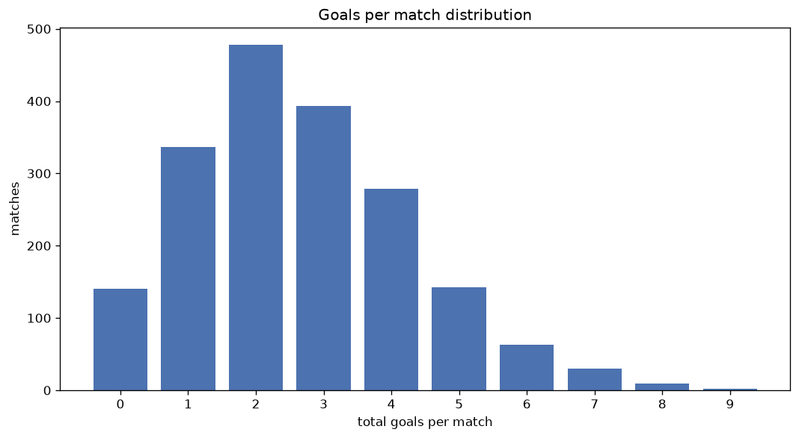
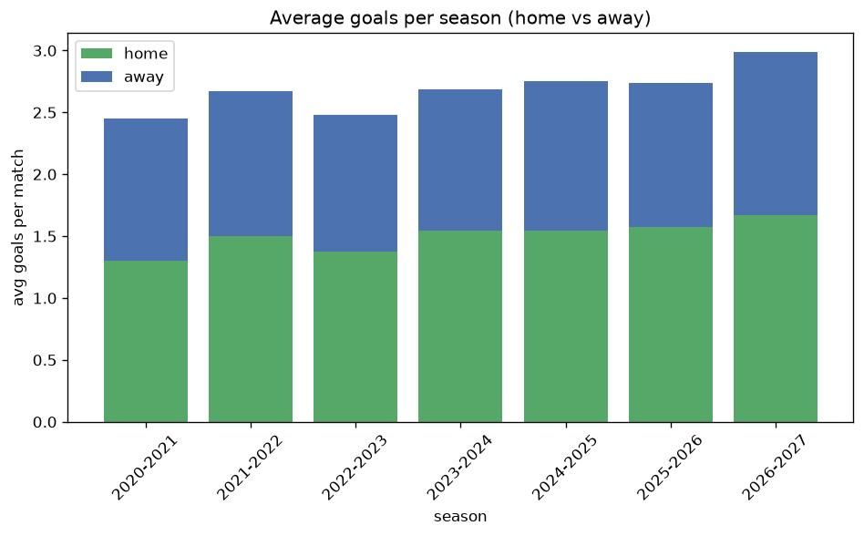

# Goal Analysis
- Report: `goals_analysis`
- Generated: 2026-10-26T01:42:23+00:00
- Script: `backend/scripts/analyze_goals.py` v1.0.0
- League: Ekstraklasa (Poland)
- Scope: league `poland1`

## 1. Goals per match distribution
| goals | matches | pct |
|---|---|---|
| 0 | 140 | 7.5% |
| 1 | 337 | 18.0% |
| 2 | 478 | 25.5% |
| 3 | 393 | 21.0% |
| 4 | 279 | 14.9% |
| 5 | 142 | 7.6% |
| 6 | 63 | 3.4% |
| 7 | 30 | 1.6% |
| 8 | 9 | 0.5% |
| 9 | 2 | 0.1% |

## 2. Goals per match per season
| season | matches | total goals | avg home | avg away | avg total |
|---|---|---|---|---|---|
| 2020-2021 | 240 | 589 | 1.304 | 1.15 | 2.454 |
| 2021-2022 | 306 | 818 | 1.5 | 1.173 | 2.673 |
| 2022-2023 | 306 | 758 | 1.373 | 1.105 | 2.477 |
| 2023-2024 | 306 | 823 | 1.546 | 1.144 | 2.69 |
| 2024-2025 | 306 | 843 | 1.542 | 1.212 | 2.755 |
| 2025-2026 | 306 | 837 | 1.575 | 1.16 | 2.735 |
| 2026-2027 | 103 | 308 | 1.67 | 1.32 | 2.99 |

## 3. Home vs away goal share
- Home goals: **2791** (56.1%)
- Away goals: **2185** (43.9%)
- Home/away ratio: **1.277**

| season | home goals | away goals | total | home pct | away pct |
|---|---|---|---|---|---|
| 2020-2021 | 313 | 276 | 589 | 53.1% | 46.9% |
| 2021-2022 | 459 | 359 | 818 | 56.1% | 43.9% |
| 2022-2023 | 420 | 338 | 758 | 55.4% | 44.6% |
| 2023-2024 | 473 | 350 | 823 | 57.5% | 42.5% |
| 2024-2025 | 472 | 371 | 843 | 56.0% | 44.0% |
| 2025-2026 | 482 | 355 | 837 | 57.6% | 42.4% |
| 2026-2027 | 172 | 136 | 308 | 55.8% | 44.2% |

## 4. BTTS (Both Teams To Score)
- Overall: **1010** of `1873` (53.9%)

| season | matches | BTTS | pct |
|---|---|---|---|
| 2020-2021 | 240 | 116 | 48.3% |
| 2021-2022 | 306 | 166 | 54.2% |
| 2022-2023 | 306 | 148 | 48.4% |
| 2023-2024 | 306 | 165 | 53.9% |
| 2024-2025 | 306 | 171 | 55.9% |
| 2025-2026 | 306 | 176 | 57.5% |
| 2026-2027 | 103 | 68 | 66.0% |

## 5. Clean sheets
- Home clean sheets: **571** (30.5%)
- Away clean sheets: **432** (23.1%)
- Total clean sheets recorded: **1003**
- Matches with at least one clean sheet: **863** (46.1%)
- Both teams kept clean sheets (0-0): **140**

| season | matches | home CS | away CS | total CS | matches w/ CS |
|---|---|---|---|---|---|
| 2020-2021 | 240 | 79 | 69 | 148 | 124 (51.7%) |
| 2021-2022 | 306 | 92 | 67 | 159 | 140 (45.8%) |
| 2022-2023 | 306 | 99 | 82 | 181 | 158 (51.6%) |
| 2023-2024 | 306 | 97 | 69 | 166 | 141 (46.1%) |
| 2024-2025 | 306 | 88 | 65 | 153 | 135 (44.1%) |
| 2025-2026 | 306 | 91 | 62 | 153 | 130 (42.5%) |
| 2026-2027 | 103 | 25 | 18 | 43 | 35 (34.0%) |

## 6. Scoring intensity
- First-half goals: **2238** (45.0%)
- Second-half goals: **2735** (55.0%)
- Avg first-half goals per match: **1.196**
- Avg second-half goals per match: **1.461**
- Second-half-only scoring (HT 0-0, FT goals >= 1): **414** (22.1%)
- *1 match(es) excluded (no HT score recorded).*

| season | matches | 1st half | 2nd half | 1st half pct | 2nd half pct |
|---|---|---|---|---|---|
| 2020-2021 | 240 | 266 | 323 | 45.2% | 54.8% |
| 2021-2022 | 306 | 363 | 455 | 44.4% | 55.6% |
| 2022-2023 | 306 | 332 | 423 | 44.0% | 56.0% |
| 2023-2024 | 306 | 371 | 452 | 45.1% | 54.9% |
| 2024-2025 | 306 | 400 | 443 | 47.4% | 52.6% |
| 2025-2026 | 306 | 385 | 452 | 46.0% | 54.0% |
| 2026-2027 | 103 | 121 | 187 | 39.3% | 60.7% |

## 7. First-goal timing
- Matches with first-goal time recorded: `1732` of `1873` (92.5%)
- Goalless matches: `141`
- Min `1` | Max `103` | Mean `32.0` | Median (p50) `27.0`

| bucket | count | % of matches | % of scoring matches |
|---|---|---|---|
| 1-15 | 534 | 28.5% | 30.8% |
| 16-30 | 427 | 22.8% | 24.7% |
| 31-45 | 304 | 16.2% | 17.6% |
| 46-60 | 229 | 12.2% | 13.2% |
| 61-75 | 122 | 6.5% | 7.0% |
| 76-90 | 82 | 4.4% | 4.7% |
| 91-120 | 34 | 1.8% | 2.0% |

---
*All statistics are computed from PostgreSQL tables (read-only). Run with `python backend/scripts/analyze_goals.py` to regenerate.*

## Charts

