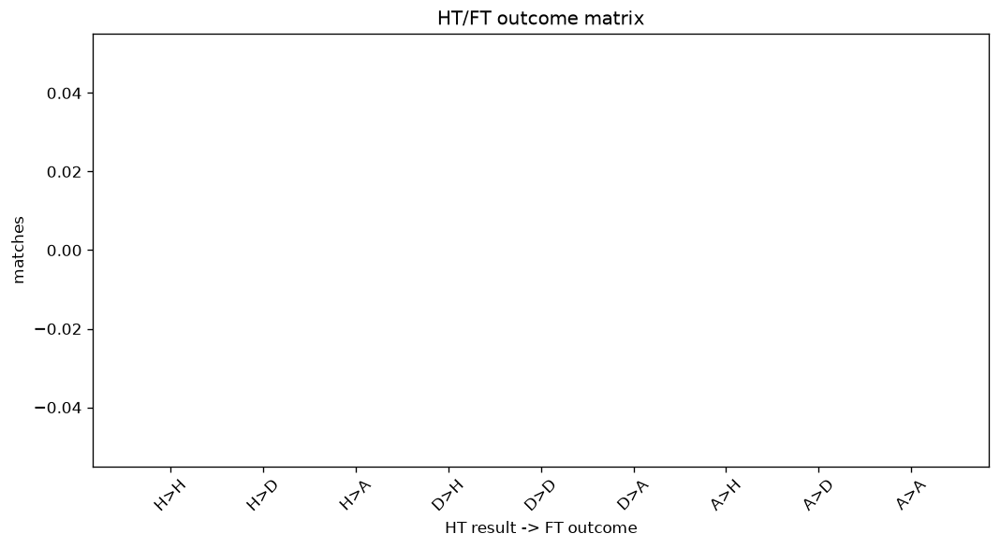

# Match Analysis
- Report: `matches_analysis`
- Generated: 2026-10-29T02:09:28+00:00
- Script: `backend/scripts/analyze_matches.py` v1.0.0
- League: Ekstraklasa (Poland)
- Scope: league `poland1`

## 1. Overall summary
| metric | value |
|---|---|
| Matches | 1876 |
| Home wins | 821 (43.8%) |
| Draws | 510 (27.2%) |
| Away wins | 545 (29.1%) |
| Total goals | 4982 |
| Average goals per match | 2.656 |
| Goalless matches | 140 (7.5%) |

## 2. Per-season breakdown
| season | matches | home wins | draws | away wins | total goals | avg goals | goalless |
|---|---|---|---|---|---|---|---|
| 2020-2021 | 240 | 98 (40.8%) | 66 (27.5%) | 76 (31.7%) | 589 | 2.454 | 24 (10.0%) |
| 2021-2022 | 306 | 135 (44.1%) | 84 (27.5%) | 87 (28.4%) | 818 | 2.673 | 19 (6.2%) |
| 2022-2023 | 306 | 129 (42.2%) | 81 (26.5%) | 96 (31.4%) | 758 | 2.477 | 23 (7.5%) |
| 2023-2024 | 306 | 133 (43.5%) | 93 (30.4%) | 80 (26.1%) | 823 | 2.69 | 25 (8.2%) |
| 2024-2025 | 306 | 137 (44.8%) | 77 (25.2%) | 92 (30.1%) | 843 | 2.755 | 18 (5.9%) |
| 2025-2026 | 306 | 138 (45.1%) | 85 (27.8%) | 83 (27.1%) | 837 | 2.735 | 23 (7.5%) |
| 2026-2027 | 106 | 51 (48.1%) | 24 (22.6%) | 31 (29.2%) | 314 | 2.962 | 8 (7.5%) |

## 3. HT/FT outcome matrix
| HT result \ FT result | Home | Draw | Away | total |
|---|---|---|---|---|
| HT home lead | 490 (77.5%) | 106 (16.8%) | 36 (5.7%) | 632 |
| HT draw | 275 (35.3%) | 305 (39.1%) | 200 (25.6%) | 780 |
| HT away lead | 55 (11.9%) | 99 (21.4%) | 309 (66.7%) | 463 |
- *1 match(es) excluded (no HT score recorded).*

## 4. Comeback matches
- Home comebacks (trailing at HT, won at FT): **55** (2.9%)
- Away comebacks (trailing at HT, won at FT): **36** (1.9%)

### Home comebacks
| season | home | away | HT | FT |
|---|---|---|---|---|
| 2020-2021 | Zaglebie | Lech Poznan | 0-1 | 2-1 |
| 2020-2021 | Legia | Lech Poznan | 0-1 | 2-1 |
| 2020-2021 | Lechia Gdansk | Slask Wroclaw | 0-1 | 3-2 |
| 2020-2021 | Warta Poznan | Wisla | 0-1 | 2-1 |
| 2020-2021 | Jagiellonia | Warta Poznan | 2-3 | 4-3 |
| 2020-2021 | Zaglebie | Slask Wroclaw | 0-1 | 2-1 |
| 2020-2021 | Podbeskidzie | Gornik Zabrze | 0-1 | 2-1 |
| 2020-2021 | Gornik Zabrze | Stal Mielec | 0-1 | 2-1 |
| 2020-2021 | Piast Gliwice | Stal Mielec | 0-1 | 2-1 |
| 2020-2021 | Stal Mielec | Podbeskidzie | 0-1 | 2-1 |
| 2020-2021 | Zaglebie | Podbeskidzie | 0-1 | 2-1 |
| 2021-2022 | Pogon Szczecin | Stal Mielec | 0-1 | 4-1 |
| 2021-2022 | Leczna | Wisla Plock | 0-1 | 3-2 |
| 2021-2022 | Zaglebie | Termalica B-B. | 0-1 | 2-1 |
| 2021-2022 | Stal Mielec | Zaglebie | 1-2 | 4-2 |
| 2021-2022 | Lechia Gdansk | Zaglebie | 0-1 | 2-1 |
| 2021-2022 | Piast Gliwice | Termalica B-B. | 0-1 | 2-1 |
| 2021-2022 | Lechia Gdansk | Rakow | 0-1 | 3-1 |
| 2021-2022 | Zaglebie | Wisla | 0-1 | 2-1 |
| 2021-2022 | Leczna | Zaglebie | 0-1 | 2-1 |
| 2021-2022 | Warta Poznan | Radomiak Radom | 0-1 | 3-1 |
| 2021-2022 | Gornik Zabrze | Leczna | 0-1 | 4-2 |
| 2021-2022 | Radomiak Radom | Wisla | 0-1 | 4-2 |
| 2022-2023 | Jagiellonia | Legnica | 0-1 | 2-1 |
| 2022-2023 | Slask Wroclaw | Lechia Gdansk | 0-1 | 2-1 |
| 2022-2023 | Lechia Gdansk | Gornik Zabrze | 0-1 | 2-1 |
| 2022-2023 | Cracovia | Stal Mielec | 0-1 | 2-1 |
| 2022-2023 | Gornik Zabrze | Wisla Plock | 0-2 | 3-2 |
| 2022-2023 | Korona Kielce | Jagiellonia | 0-1 | 2-1 |
| 2023-2024 | Zaglebie | Ruch Chorzow | 0-1 | 2-1 |
| 2023-2024 | Pogon Szczecin | Widzew Lodz | 0-1 | 2-1 |
| 2023-2024 | Jagiellonia | Widzew Lodz | 0-1 | 2-1 |
| 2023-2024 | Widzew Lodz | Ruch Chorzow | 0-1 | 2-1 |
| 2023-2024 | Puszcza | Gornik Zabrze | 0-1 | 2-1 |
| 2023-2024 | Stal Mielec | Puszcza | 0-1 | 2-1 |
| 2024-2025 | Cracovia | Gornik Zabrze | 1-2 | 3-2 |
| 2024-2025 | Motor Lublin | Slask Wroclaw | 0-1 | 2-1 |
| 2024-2025 | Stal Mielec | Lechia Gdansk | 0-1 | 2-1 |
| 2024-2025 | Zaglebie | Gornik Zabrze | 0-1 | 2-1 |
| 2024-2025 | GKS Katowice | Puszcza | 0-1 | 3-1 |
| 2024-2025 | Lechia Gdansk | Stal Mielec | 0-2 | 3-2 |
| 2025-2026 | Jagiellonia | Cracovia | 1-2 | 5-2 |
| 2025-2026 | Wisla Plock | Zaglebie | 0-1 | 2-1 |
| 2025-2026 | Piast Gliwice | Termalica B-B. | 1-2 | 4-2 |
| 2025-2026 | Pogon Szczecin | Cracovia | 0-1 | 2-1 |
| 2025-2026 | Arka Gdynia | Lech Poznan | 0-1 | 3-1 |
| 2025-2026 | Zaglebie | Widzew Lodz | 0-1 | 2-1 |
| 2025-2026 | Pogon Szczecin | Korona Kielce | 0-1 | 2-1 |
| 2026-2027 | Gornik Zabrze | Slask Wroclaw | 0-1 | 2-1 |
| 2026-2027 | GKS Katowice | Radomiak Radom | 0-1 | 3-1 |
| 2026-2027 | Zaglebie | Slask Wroclaw | 0-1 | 2-1 |
| 2026-2027 | Cracovia | Rakow | 0-1 | 2-1 |
| 2026-2027 | Gornik Zabrze | Lech Poznan | 0-1 | 2-1 |
| 2026-2027 | Cracovia | Zaglebie | 0-1 | 3-1 |
| 2026-2027 | Motor Lublin | Slask Wroclaw | 0-1 | 3-2 |

### Away comebacks
| season | home | away | HT | FT |
|---|---|---|---|---|
| 2020-2021 | Lechia Gdansk | Rakow | 1-0 | 1-3 |
| 2020-2021 | Wisla | Legia | 1-0 | 1-2 |
| 2020-2021 | Wisla | Piast Gliwice | 3-2 | 3-4 |
| 2020-2021 | Lech Poznan | Jagiellonia | 2-1 | 2-3 |
| 2020-2021 | Warta Poznan | Slask Wroclaw | 1-0 | 2-3 |
| 2021-2022 | Wisla | Rakow | 1-0 | 1-2 |
| 2021-2022 | Rakow | Gornik Zabrze | 1-0 | 1-2 |
| 2021-2022 | Stal Mielec | Gornik Zabrze | 1-0 | 1-2 |
| 2021-2022 | Gornik Zabrze | Jagiellonia | 1-0 | 1-2 |
| 2021-2022 | Wisla Plock | Slask Wroclaw | 1-0 | 1-2 |
| 2021-2022 | Pogon Szczecin | Rakow | 1-0 | 1-2 |
| 2021-2022 | Slask Wroclaw | Gornik Zabrze | 3-2 | 3-4 |
| 2022-2023 | Jagiellonia | Radomiak Radom | 1-0 | 1-2 |
| 2022-2023 | Wisla Plock | Jagiellonia | 2-1 | 2-4 |
| 2022-2023 | Wisla Plock | Rakow | 1-0 | 1-2 |
| 2023-2024 | Piast Gliwice | Lech Poznan | 1-0 | 1-2 |
| 2023-2024 | Slask Wroclaw | Zaglebie | 1-0 | 1-2 |
| 2023-2024 | Puszcza | Slask Wroclaw | 1-0 | 1-3 |
| 2023-2024 | Pogon Szczecin | Stal Mielec | 2-1 | 2-3 |
| 2023-2024 | Lech Poznan | Korona Kielce | 1-0 | 1-2 |
| 2023-2024 | Rakow | Slask Wroclaw | 1-0 | 1-2 |
| 2023-2024 | Radomiak Radom | Widzew Lodz | 1-0 | 1-3 |
| 2024-2025 | Slask Wroclaw | Cracovia | 2-1 | 2-4 |
| 2024-2025 | Slask Wroclaw | Radomiak Radom | 1-0 | 1-2 |
| 2024-2025 | Puszcza | Zaglebie | 1-0 | 1-2 |
| 2024-2025 | Cracovia | Radomiak Radom | 1-0 | 1-2 |
| 2024-2025 | Lechia Gdansk | Gornik Zabrze | 1-0 | 1-2 |
| 2024-2025 | Gornik Zabrze | Legia | 1-0 | 1-2 |
| 2025-2026 | Lechia Gdansk | Lech Poznan | 2-0 | 3-4 |
| 2025-2026 | Termalica B-B. | Korona Kielce | 1-0 | 1-3 |
| 2025-2026 | Pogon Szczecin | Lechia Gdansk | 2-1 | 3-4 |
| 2025-2026 | Korona Kielce | Zaglebie | 1-0 | 1-2 |
| 2025-2026 | Cracovia | Piast Gliwice | 1-0 | 2-3 |
| 2025-2026 | Zaglebie | Termalica B-B. | 1-0 | 1-2 |
| 2026-2027 | Rakow | Zaglebie | 1-0 | 2-3 |
| 2026-2027 | Radomiak Radom | Motor Lublin | 1-0 | 2-3 |

## 5. HT lead conversion
| HT state | matches | converted to win | held as draw | collapsed to loss |
|---|---|---|---|---|
| Home lead | 632 | 490 (77.5%) | 106 (16.8%) | 36 (5.7%) |
| Away lead | 463 | 309 (66.7%) | 99 (21.4%) | 55 (11.9%) |

### Matches level at half-time
| FT result | count | pct |
|---|---|---|
| Home win | 275 | 35.3% |
| Draw | 305 | 39.1% |
| Away win | 200 | 25.6% |
- *1 match(es) excluded (no HT score recorded).*

## 6. First-goal timing
- Matches with a first-goal time recorded: `1735` of `1876` (92.5%)

Outcome distribution by first-goal timing bucket:
| bucket | matches | % of matches | home | draw | away |
|---|---|---|---|---|---|
| 1-15 | 534 | 28.5% | 263 (49.3%) | 109 (20.4%) | 162 (30.3%) |
| 16-30 | 428 | 22.8% | 198 (46.3%) | 105 (24.5%) | 125 (29.2%) |
| 31-45 | 304 | 16.2% | 143 (47.0%) | 63 (20.7%) | 98 (32.2%) |
| 46-60 | 230 | 12.3% | 108 (47.0%) | 52 (22.6%) | 70 (30.4%) |
| 61-75 | 122 | 6.5% | 52 (42.6%) | 29 (23.8%) | 41 (33.6%) |
| 76-90 | 83 | 4.4% | 40 (48.2%) | 10 (12.0%) | 33 (39.8%) |
| 91-120 | 34 | 1.8% | 16 (47.1%) | 2 (5.9%) | 16 (47.1%) |

## 7. Goalless matches
- Overall: **140** of `1876` (7.5%)

| season | matches | goalless | pct |
|---|---|---|---|
| 2020-2021 | 240 | 24 | 10.0% |
| 2021-2022 | 306 | 19 | 6.2% |
| 2022-2023 | 306 | 23 | 7.5% |
| 2023-2024 | 306 | 25 | 8.2% |
| 2024-2025 | 306 | 18 | 5.9% |
| 2025-2026 | 306 | 23 | 7.5% |
| 2026-2027 | 106 | 8 | 7.5% |

---
*All statistics are computed from PostgreSQL tables (read-only). Run with `python backend/scripts/analyze_matches.py` to regenerate.*

## Charts

