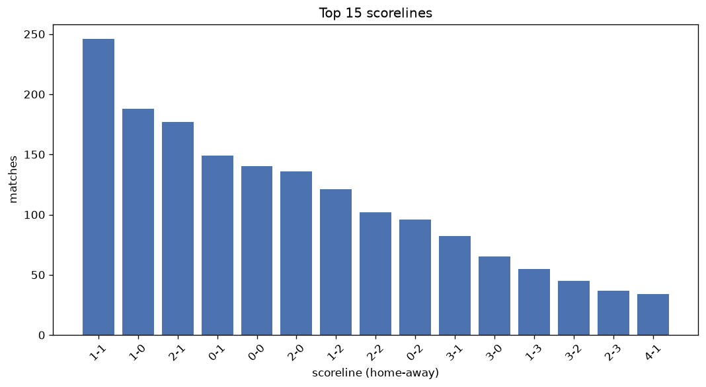
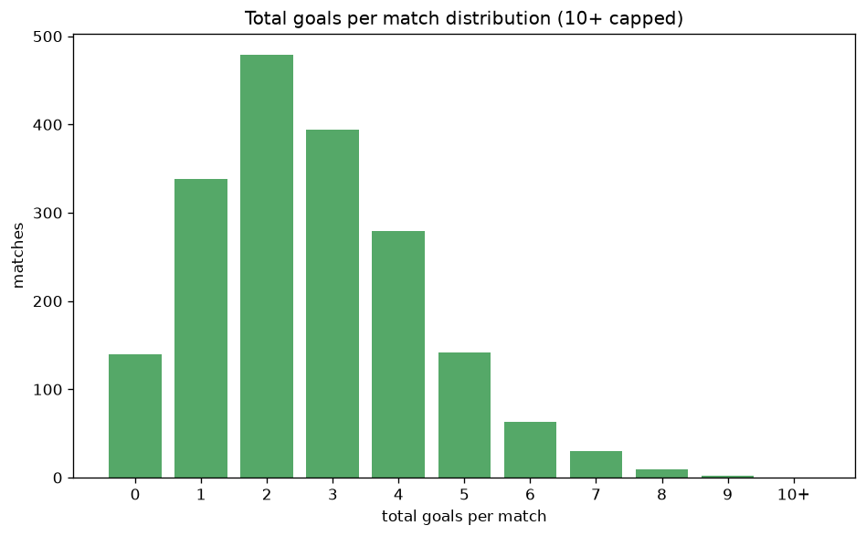

# Scoreline Analysis
- Report: `scoreline_analysis`
- Generated: 2026-10-30T04:04:04+00:00
- Script: `backend/scripts/analyze_scorelines.py` v1.0.0
- League: Ekstraklasa (Poland)
- Scope: league `poland1`

## 1. Scoreline frequency
- Matches analysed: **1876** across **7** seasons.
- Distinct scorelines seen: **41**.

| scoreline | count | pct |
|---|---|---|
| 1-1 | 246 | 13.1% |
| 1-0 | 189 | 10.1% |
| 2-1 | 177 | 9.4% |
| 0-1 | 149 | 7.9% |
| 0-0 | 140 | 7.5% |
| 2-0 | 137 | 7.3% |
| 1-2 | 122 | 6.5% |
| 2-2 | 102 | 5.4% |
| 0-2 | 96 | 5.1% |
| 3-1 | 82 | 4.4% |
| 3-0 | 65 | 3.5% |
| 1-3 | 55 | 2.9% |
| 3-2 | 45 | 2.4% |
| 2-3 | 37 | 2.0% |
| 4-1 | 34 | 1.8% |
| 0-3 | 30 | 1.6% |
| 4-0 | 28 | 1.5% |
| 3-3 | 21 | 1.1% |
| 4-2 | 16 | 0.9% |
| 0-4 | 12 | 0.6% |

## 2. Scoreline frequency per season

### 2020-2021
| scoreline | count | pct |
|---|---|---|
| 0-1 | 29 | 12.1% |
| 1-0 | 26 | 10.8% |
| 1-1 | 25 | 10.4% |
| 0-0 | 24 | 10.0% |
| 2-1 | 23 | 9.6% |

### 2021-2022
| scoreline | count | pct |
|---|---|---|
| 1-1 | 46 | 15.0% |
| 1-0 | 35 | 11.4% |
| 2-1 | 25 | 8.2% |
| 0-1 | 24 | 7.8% |
| 1-2 | 20 | 6.5% |

### 2022-2023
| scoreline | count | pct |
|---|---|---|
| 1-1 | 40 | 13.1% |
| 1-0 | 32 | 10.5% |
| 0-1 | 28 | 9.2% |
| 2-1 | 26 | 8.5% |
| 2-0 | 25 | 8.2% |

### 2023-2024
| scoreline | count | pct |
|---|---|---|
| 1-1 | 45 | 14.7% |
| 2-1 | 30 | 9.8% |
| 1-0 | 27 | 8.8% |
| 0-0 | 25 | 8.2% |
| 2-0 | 22 | 7.2% |

### 2024-2025
| scoreline | count | pct |
|---|---|---|
| 1-1 | 38 | 12.4% |
| 1-0 | 32 | 10.5% |
| 2-1 | 28 | 9.2% |
| 2-0 | 25 | 8.2% |
| 0-1 | 23 | 7.5% |

### 2025-2026
| scoreline | count | pct |
|---|---|---|
| 1-1 | 41 | 13.4% |
| 1-0 | 30 | 9.8% |
| 2-1 | 27 | 8.8% |
| 1-2 | 23 | 7.5% |
| 0-0 | 23 | 7.5% |

### 2026-2027
| scoreline | count | pct |
|---|---|---|
| 2-1 | 18 | 17.0% |
| 1-1 | 11 | 10.4% |
| 1-2 | 9 | 8.5% |
| 0-0 | 8 | 7.5% |
| 1-0 | 7 | 6.6% |

## 3. Total-goal histogram
_10+ groups all matches with 10 or more total goals._

| total goals | matches | pct |
|---|---|---|
| 0 | 140 | 7.5% |
| 1 | 338 | 18.0% |
| 2 | 479 | 25.5% |
| 3 | 394 | 21.0% |
| 4 | 279 | 14.9% |
| 5 | 142 | 7.6% |
| 6 | 63 | 3.4% |
| 7 | 30 | 1.6% |
| 8 | 9 | 0.5% |
| 9 | 2 | 0.1% |
| 10+ | 0 | 0.0% |

## 4. Extreme scorelines
- Matches with 7+ total goals: **41**

| season | date | scoreline | total goals |
|---|---|---|---|
| 2024-2025 | 2025-04-25 | 4-5 | 9 |
| 2024-2025 | 2025-05-03 | 8-1 | 9 |
| 2021-2022 | 2022-05-06 | 5-3 | 8 |
| 2022-2023 | 2022-11-05 | 7-1 | 8 |
| 2023-2024 | 2023-09-24 | 3-5 | 8 |
| 2023-2024 | 2023-10-27 | 5-3 | 8 |
| 2023-2024 | 2023-12-03 | 4-4 | 8 |
| 2024-2025 | 2024-09-01 | 5-3 | 8 |
| 2024-2025 | 2024-10-26 | 6-2 | 8 |
| 2025-2026 | 2025-08-15 | 6-2 | 8 |
| 2025-2026 | 2026-05-23 | 6-2 | 8 |
| 2020-2021 | 2020-11-23 | 5-2 | 7 |
| 2020-2021 | 2020-12-05 | 4-3 | 7 |
| 2020-2021 | 2021-01-31 | 3-4 | 7 |
| 2020-2021 | 2021-02-20 | 5-2 | 7 |
| 2020-2021 | 2021-04-20 | 4-3 | 7 |
| 2021-2022 | 2021-08-14 | 4-3 | 7 |
| 2021-2022 | 2021-10-30 | 4-3 | 7 |
| 2021-2022 | 2022-04-25 | 3-4 | 7 |
| 2021-2022 | 2022-05-06 | 1-6 | 7 |
| 2021-2022 | 2022-05-21 | 3-4 | 7 |
| 2022-2023 | 2022-10-29 | 2-5 | 7 |
| 2023-2024 | 2023-09-27 | 3-4 | 7 |
| 2023-2024 | 2024-04-22 | 5-2 | 7 |
| 2023-2024 | 2024-04-28 | 3-4 | 7 |
| 2024-2025 | 2024-09-01 | 5-2 | 7 |
| 2024-2025 | 2024-10-19 | 3-4 | 7 |
| 2024-2025 | 2024-11-09 | 3-4 | 7 |
| 2024-2025 | 2024-11-10 | 5-2 | 7 |
| 2024-2025 | 2025-03-14 | 5-2 | 7 |
| 2025-2026 | 2025-07-26 | 3-4 | 7 |
| 2025-2026 | 2025-08-10 | 5-2 | 7 |
| 2025-2026 | 2025-09-21 | 3-4 | 7 |
| 2025-2026 | 2025-10-17 | 2-5 | 7 |
| 2025-2026 | 2025-12-05 | 5-2 | 7 |
| 2025-2026 | 2026-03-01 | 4-3 | 7 |
| 2026-2027 | 2026-08-01 | 4-3 | 7 |
| 2026-2027 | 2026-08-15 | 3-4 | 7 |
| 2026-2027 | 2026-08-30 | 2-5 | 7 |
| 2026-2027 | 2026-10-18 | 6-1 | 7 |
| 2026-2027 | 2026-10-24 | 4-3 | 7 |

## 5. Margin-of-victory distribution (decided matches)
- Decided matches: **1366** (draws: **510**)
- Average winning margin: **1.71**

| margin | matches | pct |
|---|---|---|
| 1 | 737 | 54.0% |
| 2 | 401 | 29.4% |
| 3+ | 228 | 16.7% |

## 6. Margin by outcome

### Home wins
- Matches: **821** | avg margin: **1.79** | max margin: **7**
| margin | matches | pct |
|---|---|---|
| 1 | 418 | 50.9% |
| 2 | 238 | 29.0% |
| 3+ | 165 | 20.1% |
- *Full match-by-match list available in `scoreline_analysis.json`.*

### Away wins
- Matches: **545** | avg margin: **1.58** | max margin: **6**
| margin | matches | pct |
|---|---|---|
| 1 | 319 | 58.5% |
| 2 | 163 | 29.9% |
| 3+ | 63 | 11.6% |
- *Full match-by-match list available in `scoreline_analysis.json`.*

## 7. Most common exact score by outcome type
| outcome | matches | most common score | count | pct |
|---|---|---|---|---|
| home | 821 | 1-0 | 189 | 23.0% |
| draw | 510 | 1-1 | 246 | 48.2% |
| away | 545 | 0-1 | 149 | 27.3% |

---
*All statistics are computed from PostgreSQL tables (read-only). Run with `python backend/scripts/analyze_scorelines.py` to regenerate.*

## Charts

