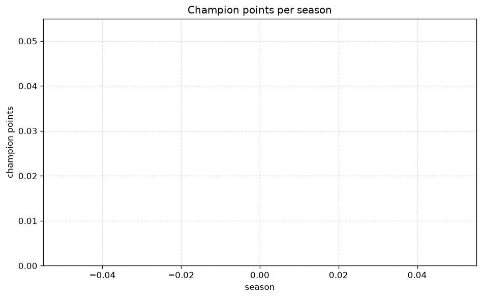
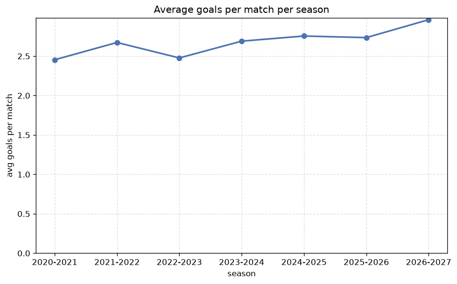

# Season Trends Analysis
- Report: `season_trends`
- Generated: 2026-10-29T02:09:34+00:00
- Script: `backend/scripts/analyze_seasons.py` v1.0.0
- League: Ekstraklasa (Poland)
- Scope: league `poland1`

## 1. Champions per season
| season | champion | pts | runner-up | margin |
|---|---|---|---|---|
| 2020-2021 | Legia | 64 | Rakow | 5 pts |
| 2021-2022 | Lech Poznan | 71 | Rakow | 5 pts |
| 2022-2023 | Rakow | 75 | Legia | 9 pts |
| 2023-2024 | Jagiellonia | 63 | Slask Wroclaw | 0 pts |
| 2024-2025 | Lech Poznan | 70 | Rakow | 1 pts |
| 2025-2026 | Lech Poznan | 60 | Jagiellonia | 4 pts |
| 2026-2027 | Lech Poznan | 28 | Gornik Zabrze | 1 pts |

## 2. Title-race tightness
- Tight races (margin <= 3 pts): **3** of 7 seasons
- Tightest race: **2023-2024** - Jagiellonia beat Slask Wroclaw by **0** pts

| season | margin | tight |
|---|---|---|
| 2020-2021 | 5 pts |  |
| 2021-2022 | 5 pts |  |
| 2022-2023 | 9 pts |  |
| 2023-2024 | 0 pts | yes |
| 2024-2025 | 1 pts | yes |
| 2025-2026 | 4 pts |  |
| 2026-2027 | 1 pts | yes |

## 3. Points thresholds
_Position-specific points per season. Key: 1 = champion, 2 = runner-up, 4 = CL line, 6 = Europa, 15 = last safe, 18 = bottom._

| season | pos 1 | pos 2 | pos 4 | pos 6 | pos 15 | pos 18 |
|---|---|---|---|---|---|---|
| 2020-2021 | 64 | 59 | 43 | 42 | 29 | - |
| 2021-2022 | 71 | 66 | 54 | 48 | 35 | - |
| 2022-2023 | 75 | 66 | 60 | 48 | 38 | 23 |
| 2023-2024 | 63 | 63 | 55 | 53 | 38 | 24 |
| 2024-2025 | 70 | 69 | 58 | 51 | 36 | 28 |
| 2025-2026 | 60 | 56 | 55 | 49 | 42 | 36 |
| 2026-2027 | 28 | 27 | 23 | 20 | 9 | 6 |

## 4. Relegation battle
| season | safe pos | safe pts | drop pos | drop pts | gap |
|---|---|---|---|---|---|
| 2020-2021 | 15 | 29 | 16 | 25 | 4 pts |
| 2021-2022 | 15 | 35 | 16 | 30 | 5 pts |
| 2022-2023 | 15 | 38 | 16 | 37 | 1 pts |
| 2023-2024 | 15 | 38 | 16 | 37 | 1 pts |
| 2024-2025 | 15 | 36 | 16 | 31 | 5 pts |
| 2025-2026 | 15 | 42 | 16 | 42 | 0 pts |
| 2026-2027 | 15 | 9 | 16 | 8 | 1 pts |

## 5. League-level trends
| season | matches | total goals | avg goals | home win | draw | away win | goalless | avg pts/team |
|---|---|---|---|---|---|---|---|---|
| 2020-2021 | 240 | 589 | 2.454 | 40.8% | 27.5% | 31.7% | 10.0% | 40.88 |
| 2021-2022 | 306 | 818 | 2.673 | 44.1% | 27.5% | 28.4% | 6.2% | 43.78 |
| 2022-2023 | 306 | 758 | 2.477 | 42.2% | 26.5% | 31.4% | 7.5% | 46.5 |
| 2023-2024 | 306 | 823 | 2.69 | 43.5% | 30.4% | 26.1% | 8.2% | 45.83 |
| 2024-2025 | 306 | 843 | 2.755 | 44.8% | 25.2% | 30.1% | 5.9% | 46.72 |
| 2025-2026 | 306 | 837 | 2.735 | 45.1% | 27.8% | 27.1% | 7.5% | 46.72 |
| 2026-2027 | 106 | 314 | 2.962 | 48.1% | 22.6% | 29.2% | 7.5% | 16.33 |

## 6. View divergence
- Largest divergence: **2020-2021** (goals view, avg abs position diff = 7.250)

_Avg absolute position difference between classic view and alternative view per season._

| season | classic vs luck | classic vs goals |
|---|---|---|
| 2020-2021 | 2.500 | 7.250 |
| 2021-2022 | 2.833 | 6.611 |
| 2022-2023 | 2.444 | 6.556 |
| 2023-2024 | 4.333 | 5.222 |
| 2024-2025 | 2.778 | 5.889 |
| 2025-2026 | 4.000 | 6.000 |
| 2026-2027 | 1.333 | 6.556 |

---
*All statistics are computed from PostgreSQL tables (read-only). Run with `python backend/scripts/analyze_seasons.py` to regenerate.*

## Charts

