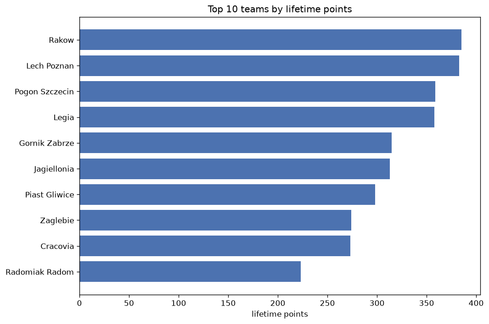
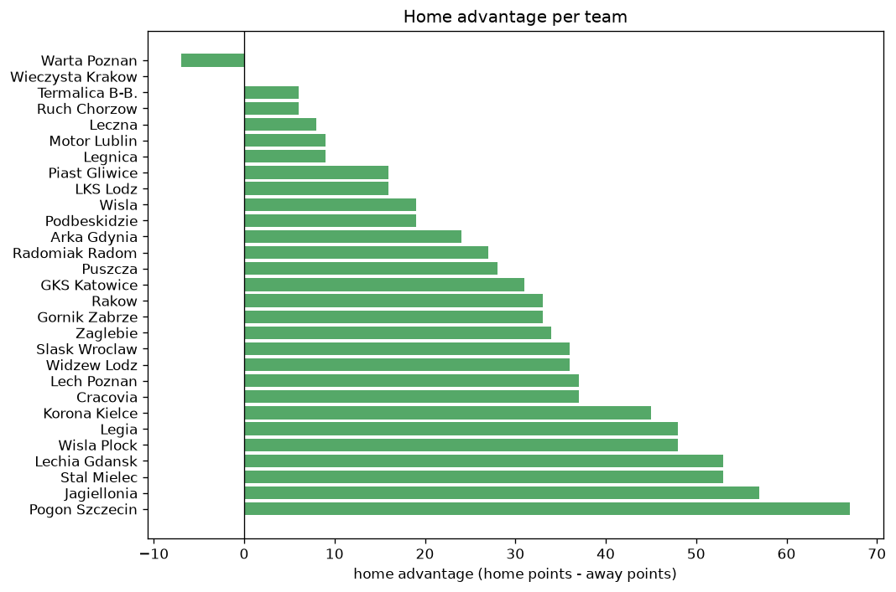

# Team Analysis
- Report: `teams_analysis`
- Generated: 2026-10-27T02:24:17+00:00
- Script: `backend/scripts/analyze_teams.py` v1.0.0
- League: Ekstraklasa (Poland)
- Scope: league `poland1`

- Teams: **29** | Seasons: **7** | Matches: **1876**

## 1. Team standings (lifetime)
| team | seasons | played | W | D | L | pts | GF | GA | GD | avg pts/season | best pos | worst pos | titles |
|---|---|---|---|---|---|---|---|---|---|---|---|---|---|
| Rakow | 7 | 212 | 112 | 49 | 51 | 385 | 341 | 209 | 132 | 55.0 | 1 | 18 | 1 |
| Lech Poznan | 7 | 211 | 109 | 56 | 46 | 383 | 363 | 218 | 145 | 54.71 | 1 | 9 | 4 |
| Pogon Szczecin | 7 | 211 | 103 | 50 | 58 | 359 | 340 | 236 | 104 | 51.29 | 3 | 9 | 0 |
| Legia | 7 | 212 | 100 | 58 | 54 | 358 | 327 | 241 | 86 | 51.14 | 1 | 10 | 1 |
| Gornik Zabrze | 7 | 212 | 88 | 51 | 73 | 315 | 290 | 260 | 30 | 45.0 | 2 | 10 | 0 |
| Jagiellonia | 7 | 211 | 83 | 64 | 64 | 313 | 329 | 292 | 37 | 44.71 | 1 | 12 | 1 |
| Piast Gliwice | 7 | 212 | 78 | 64 | 70 | 298 | 263 | 235 | 28 | 42.57 | 5 | 17 | 0 |
| Zaglebie | 7 | 212 | 75 | 49 | 88 | 274 | 252 | 297 | -45 | 39.14 | 7 | 15 | 0 |
| Cracovia | 7 | 212 | 66 | 75 | 71 | 273 | 265 | 269 | -4 | 39.0 | 6 | 15 | 0 |
| Radomiak Radom | 6 | 182 | 57 | 52 | 73 | 223 | 229 | 272 | -43 | 37.17 | 8 | 17 | 0 |
| Slask Wroclaw | 6 | 178 | 53 | 59 | 66 | 218 | 217 | 238 | -21 | 36.33 | 2 | 17 | 0 |
| Lechia Gdansk | 5 | 166 | 58 | 35 | 73 | 209 | 226 | 256 | -30 | 41.8 | 4 | 17 | 0 |
| Korona Kielce | 5 | 148 | 46 | 47 | 55 | 185 | 170 | 195 | -25 | 37.0 | 9 | 14 | 0 |
| Stal Mielec | 5 | 166 | 44 | 51 | 71 | 183 | 187 | 243 | -56 | 36.6 | 11 | 16 | 0 |
| Widzew Lodz | 5 | 148 | 48 | 36 | 64 | 180 | 177 | 199 | -22 | 36.0 | 9 | 14 | 0 |
| Wisla Plock | 5 | 143 | 49 | 31 | 63 | 178 | 170 | 199 | -29 | 35.6 | 6 | 16 | 0 |
| Warta Poznan | 4 | 132 | 45 | 32 | 55 | 167 | 138 | 148 | -10 | 41.75 | 5 | 16 | 0 |
| GKS Katowice | 3 | 80 | 34 | 15 | 31 | 117 | 122 | 109 | 13 | 39.0 | 5 | 8 | 0 |
| Motor Lublin | 3 | 80 | 27 | 24 | 29 | 105 | 111 | 133 | -22 | 35.0 | 8 | 13 | 0 |
| Wisla | 3 | 76 | 21 | 22 | 33 | 85 | 95 | 111 | -16 | 28.33 | 5 | 16 | 0 |
| Puszcza | 2 | 68 | 15 | 23 | 30 | 68 | 76 | 112 | -36 | 34.0 | 12 | 18 | 0 |
| Termalica B-B. | 2 | 68 | 16 | 18 | 34 | 66 | 79 | 121 | -42 | 33.0 | 16 | 19 | 0 |
| Arka Gdynia | 1 | 34 | 9 | 9 | 16 | 36 | 34 | 61 | -27 | 36.0 | 18 | 18 | 0 |
| Ruch Chorzow | 1 | 34 | 6 | 14 | 14 | 32 | 40 | 55 | -15 | 32.0 | 17 | 17 | 0 |
| Leczna | 1 | 34 | 6 | 10 | 18 | 28 | 29 | 60 | -31 | 28.0 | 17 | 17 | 0 |
| Podbeskidzie | 1 | 30 | 6 | 7 | 17 | 25 | 29 | 60 | -31 | 25.0 | 16 | 16 | 0 |
| LKS Lodz | 1 | 34 | 6 | 6 | 22 | 24 | 34 | 75 | -41 | 24.0 | 18 | 18 | 0 |
| Legnica | 1 | 34 | 4 | 11 | 19 | 23 | 33 | 55 | -22 | 23.0 | 18 | 18 | 0 |
| Wieczysta Krakow | 1 | 12 | 2 | 2 | 8 | 8 | 16 | 23 | -7 | 8.0 | 16 | 16 | 0 |

## 2. Home vs away split
| team | home P | H-W | H-D | H-L | H-pts | away P | A-W | A-D | A-L | A-pts | adv |
|---|---|---|---|---|---|---|---|---|---|---|---|
| Pogon Szczecin | 107 | 64 | 21 | 22 | 213 | 104 | 39 | 29 | 36 | 146 | 67 |
| Jagiellonia | 106 | 52 | 29 | 25 | 185 | 105 | 31 | 35 | 39 | 128 | 57 |
| Lechia Gdansk | 83 | 38 | 17 | 28 | 131 | 83 | 20 | 18 | 45 | 78 | 53 |
| Stal Mielec | 83 | 30 | 28 | 25 | 118 | 83 | 14 | 23 | 46 | 65 | 53 |
| Legia | 106 | 59 | 26 | 21 | 203 | 106 | 41 | 32 | 33 | 155 | 48 |
| Wisla Plock | 70 | 33 | 14 | 23 | 113 | 73 | 16 | 17 | 40 | 65 | 48 |
| Korona Kielce | 74 | 31 | 22 | 21 | 115 | 74 | 15 | 25 | 34 | 70 | 45 |
| Lech Poznan | 106 | 62 | 24 | 20 | 210 | 105 | 47 | 32 | 26 | 173 | 37 |
| Cracovia | 106 | 39 | 38 | 29 | 155 | 106 | 27 | 37 | 42 | 118 | 37 |
| Slask Wroclaw | 89 | 31 | 34 | 24 | 127 | 89 | 22 | 25 | 42 | 91 | 36 |
| Widzew Lodz | 75 | 31 | 15 | 29 | 108 | 73 | 17 | 21 | 35 | 72 | 36 |
| Zaglebie | 106 | 42 | 28 | 36 | 154 | 106 | 33 | 21 | 52 | 120 | 34 |
| Rakow | 106 | 62 | 23 | 21 | 209 | 106 | 50 | 26 | 30 | 176 | 33 |
| Gornik Zabrze | 105 | 50 | 24 | 31 | 174 | 107 | 38 | 27 | 42 | 141 | 33 |
| GKS Katowice | 39 | 22 | 8 | 9 | 74 | 41 | 12 | 7 | 22 | 43 | 31 |
| Puszcza | 34 | 11 | 15 | 8 | 48 | 34 | 4 | 8 | 22 | 20 | 28 |
| Radomiak Radom | 91 | 33 | 26 | 32 | 125 | 91 | 24 | 26 | 41 | 98 | 27 |
| Arka Gdynia | 17 | 8 | 6 | 3 | 30 | 17 | 1 | 3 | 13 | 6 | 24 |
| Wisla | 38 | 15 | 7 | 16 | 52 | 38 | 6 | 15 | 17 | 33 | 19 |
| Podbeskidzie | 15 | 6 | 4 | 5 | 22 | 15 | 0 | 3 | 12 | 3 | 19 |
| Piast Gliwice | 107 | 42 | 31 | 34 | 157 | 105 | 36 | 33 | 36 | 141 | 16 |
| LKS Lodz | 17 | 5 | 5 | 7 | 20 | 17 | 1 | 1 | 15 | 4 | 16 |
| Motor Lublin | 41 | 14 | 15 | 12 | 57 | 39 | 13 | 9 | 17 | 48 | 9 |
| Legnica | 17 | 3 | 7 | 7 | 16 | 17 | 1 | 4 | 12 | 7 | 9 |
| Leczna | 17 | 4 | 6 | 7 | 18 | 17 | 2 | 4 | 11 | 10 | 8 |
| Termalica B-B. | 34 | 9 | 9 | 16 | 36 | 34 | 7 | 9 | 18 | 30 | 6 |
| Ruch Chorzow | 17 | 4 | 7 | 6 | 19 | 17 | 2 | 7 | 8 | 13 | 6 |
| Wieczysta Krakow | 4 | 1 | 1 | 2 | 4 | 8 | 1 | 1 | 6 | 4 | 0 |
| Warta Poznan | 66 | 20 | 20 | 26 | 80 | 66 | 25 | 12 | 29 | 87 | -7 |

## 3. Top performers
### Best points per game (PPG)
| rank | team | PPG |
|---|---|---|
| 1 | Rakow | 1.82 |
| 2 | Lech Poznan | 1.81 |
| 3 | Pogon Szczecin | 1.70 |
| 4 | Legia | 1.69 |
| 5 | Gornik Zabrze | 1.49 |

### Most goals scored
| rank | team | goals |
|---|---|---|
| 1 | Lech Poznan | 363 |
| 2 | Rakow | 341 |
| 3 | Pogon Szczecin | 340 |
| 4 | Jagiellonia | 329 |
| 5 | Legia | 327 |

### Best goal difference
| rank | team | GD |
|---|---|---|
| 1 | Lech Poznan | 145 |
| 2 | Rakow | 132 |
| 3 | Pogon Szczecin | 104 |
| 4 | Legia | 86 |
| 5 | Jagiellonia | 37 |

### Best defence (goals against per match, standings)
| rank | team | GA/match |
|---|---|---|
| 1 | Rakow | 0.991 |
| 2 | Lech Poznan | 1.033 |
| 3 | Piast Gliwice | 1.114 |
| 4 | Pogon Szczecin | 1.119 |
| 5 | Warta Poznan | 1.122 |

## 4. Team consistency
- Teams present in all **7** seasons: **9**

Cracovia, Gornik Zabrze, Jagiellonia, Lech Poznan, Legia, Piast Gliwice, Pogon Szczecin, Rakow, Zaglebie

## 5. Head-to-head dominance
- Distinct fixtures: **336** (showing the 15 most frequent)

| fixture | meetings | home wins | draws | away wins | home pct | draw pct | away pct |
|---|---|---|---|---|---|---|---|
| Legia vs Cracovia | 13 | 9 | 3 | 1 | 69.2% | 23.1% | 7.7% |
| Legia vs Zaglebie | 13 | 8 | 0 | 5 | 61.5% | 0.0% | 38.5% |
| Gornik Zabrze vs Cracovia | 13 | 7 | 2 | 4 | 53.8% | 15.4% | 30.8% |
| Lech Poznan vs Jagiellonia | 13 | 7 | 3 | 3 | 53.8% | 23.1% | 23.1% |
| Pogon Szczecin vs Cracovia | 13 | 7 | 4 | 2 | 53.8% | 30.8% | 15.4% |
| Pogon Szczecin vs Zaglebie | 13 | 7 | 3 | 3 | 53.8% | 23.1% | 23.1% |
| Rakow vs Cracovia | 13 | 7 | 5 | 1 | 53.8% | 38.5% | 7.7% |
| Gornik Zabrze vs Jagiellonia | 13 | 6 | 2 | 5 | 46.2% | 15.4% | 38.5% |
| Piast Gliwice vs Lech Poznan | 13 | 6 | 3 | 4 | 46.2% | 23.1% | 30.8% |
| Rakow vs Zaglebie | 13 | 6 | 2 | 5 | 46.2% | 15.4% | 38.5% |
| Lech Poznan vs Gornik Zabrze | 13 | 5 | 4 | 4 | 38.5% | 30.8% | 30.8% |
| Legia vs Piast Gliwice | 13 | 5 | 3 | 5 | 38.5% | 23.1% | 38.5% |
| Legia vs Pogon Szczecin | 13 | 5 | 4 | 4 | 38.5% | 30.8% | 30.8% |
| Piast Gliwice vs Gornik Zabrze | 13 | 5 | 4 | 4 | 38.5% | 30.8% | 30.8% |
| Rakow vs Gornik Zabrze | 13 | 5 | 3 | 5 | 38.5% | 23.1% | 38.5% |

## 6. Position per season (classic view)
_Cells show final position; '-' when the team was absent from that season._

| team | 2020-2021 | 2021-2022 | 2022-2023 | 2023-2024 | 2024-2025 | 2025-2026 | 2026-2027 |
|---|---|---|---|---|---|---|---|
| Rakow | 2 | 2 | 1 | 7 | 2 | 4 | 18 |
| Lech Poznan | 9 | 1 | 3 | 5 | 1 | 1 | 1 |
| Pogon Szczecin | 3 | 3 | 4 | 4 | 4 | 9 | 3 |
| Legia | 1 | 10 | 2 | 3 | 5 | 6 | 4 |
| Gornik Zabrze | 10 | 7 | 6 | 6 | 9 | 3 | 2 |
| Jagiellonia | 12 | 12 | 12 | 1 | 3 | 2 | 10 |
| Piast Gliwice | 6 | 5 | 5 | 10 | 10 | 17 | 6 |
| Zaglebie | 8 | 15 | 9 | 8 | 15 | 7 | 7 |
| Cracovia | 11 | 9 | 7 | 13 | 6 | 15 | 13 |
| Radomiak Radom | - | 8 | 10 | 15 | 12 | 10 | 17 |
| Slask Wroclaw | 4 | 14 | 15 | 2 | 17 | - | 15 |
| Lechia Gdansk | 7 | 4 | 17 | - | 14 | 12 | - |
| Korona Kielce | - | - | 13 | 14 | 11 | 11 | 9 |
| Stal Mielec | 15 | 13 | 11 | 11 | 16 | - | - |
| Widzew Lodz | - | - | 14 | 9 | 13 | 14 | 14 |
| Wisla Plock | 14 | 6 | 16 | - | - | 8 | 11 |
| Warta Poznan | 5 | 11 | 8 | 16 | - | - | - |
| GKS Katowice | - | - | - | - | 7 | 5 | 8 |
| Motor Lublin | - | - | - | - | 8 | 13 | 12 |
| Wisla | 13 | 16 | - | - | - | - | 5 |
| Puszcza | - | - | - | 12 | 18 | - | - |
| Termalica B-B. | - | 19 | - | - | - | 16 | - |
| Arka Gdynia | - | - | - | - | - | 18 | - |
| Ruch Chorzow | - | - | - | 17 | - | - | - |
| Leczna | - | 17 | - | - | - | - | - |
| Podbeskidzie | 16 | - | - | - | - | - | - |
| LKS Lodz | - | - | - | 18 | - | - | - |
| Legnica | - | - | 18 | - | - | - | - |
| Wieczysta Krakow | - | - | - | - | - | - | 16 |

---
*All statistics are computed from PostgreSQL tables (read-only). Run with `python backend/scripts/analyze_teams.py` to regenerate.*

## Charts

