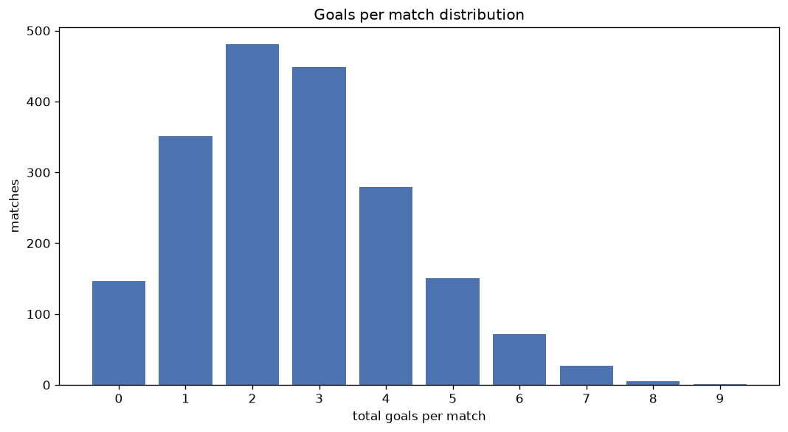
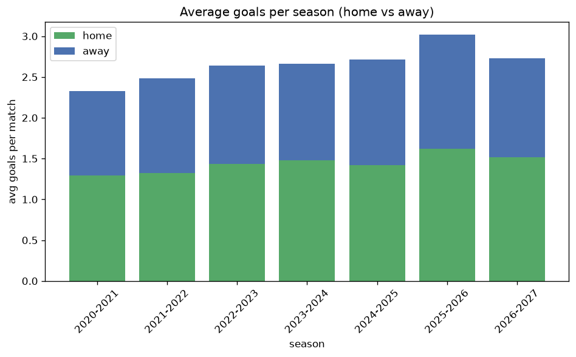

# Goal Analysis
- Report: `goals_analysis`
- Generated: 2026-10-26T01:42:42+00:00
- Script: `backend/scripts/analyze_goals.py` v1.0.0
- League: Division 1 (Poland)
- Scope: league `poland2`

## 1. Goals per match distribution
| goals | matches | pct |
|---|---|---|
| 0 | 146 | 7.4% |
| 1 | 351 | 17.9% |
| 2 | 481 | 24.5% |
| 3 | 449 | 22.9% |
| 4 | 279 | 14.2% |
| 5 | 151 | 7.7% |
| 6 | 72 | 3.7% |
| 7 | 27 | 1.4% |
| 8 | 5 | 0.3% |
| 9 | 1 | 0.1% |

## 2. Goals per match per season
| season | matches | total goals | avg home | avg away | avg total |
|---|---|---|---|---|---|
| 2020-2021 | 306 | 713 | 1.294 | 1.036 | 2.33 |
| 2021-2022 | 306 | 760 | 1.324 | 1.16 | 2.484 |
| 2022-2023 | 306 | 808 | 1.435 | 1.206 | 2.641 |
| 2023-2024 | 306 | 814 | 1.48 | 1.18 | 2.66 |
| 2024-2025 | 306 | 831 | 1.422 | 1.294 | 2.716 |
| 2025-2026 | 328 | 991 | 1.619 | 1.402 | 3.021 |
| 2026-2027 | 104 | 284 | 1.519 | 1.212 | 2.731 |

## 3. Home vs away goal share
- Home goals: **2817** (54.2%)
- Away goals: **2384** (45.8%)
- Home/away ratio: **1.182**

| season | home goals | away goals | total | home pct | away pct |
|---|---|---|---|---|---|
| 2020-2021 | 396 | 317 | 713 | 55.5% | 44.5% |
| 2021-2022 | 405 | 355 | 760 | 53.3% | 46.7% |
| 2022-2023 | 439 | 369 | 808 | 54.3% | 45.7% |
| 2023-2024 | 453 | 361 | 814 | 55.7% | 44.3% |
| 2024-2025 | 435 | 396 | 831 | 52.3% | 47.7% |
| 2025-2026 | 531 | 460 | 991 | 53.6% | 46.4% |
| 2026-2027 | 158 | 126 | 284 | 55.6% | 44.4% |

## 4. BTTS (Both Teams To Score)
- Overall: **1034** of `1962` (52.7%)

| season | matches | BTTS | pct |
|---|---|---|---|
| 2020-2021 | 306 | 127 | 41.5% |
| 2021-2022 | 306 | 148 | 48.4% |
| 2022-2023 | 306 | 166 | 54.2% |
| 2023-2024 | 306 | 159 | 52.0% |
| 2024-2025 | 306 | 164 | 53.6% |
| 2025-2026 | 328 | 213 | 64.9% |
| 2026-2027 | 104 | 57 | 54.8% |

## 5. Clean sheets
- Home clean sheets: **590** (30.1%)
- Away clean sheets: **484** (24.7%)
- Total clean sheets recorded: **1074**
- Matches with at least one clean sheet: **928** (47.3%)
- Both teams kept clean sheets (0-0): **146**

| season | matches | home CS | away CS | total CS | matches w/ CS |
|---|---|---|---|---|---|
| 2020-2021 | 306 | 121 | 87 | 208 | 179 (58.5%) |
| 2021-2022 | 306 | 98 | 90 | 188 | 158 (51.6%) |
| 2022-2023 | 306 | 89 | 71 | 160 | 140 (45.8%) |
| 2023-2024 | 306 | 97 | 73 | 170 | 147 (48.0%) |
| 2024-2025 | 306 | 84 | 82 | 166 | 142 (46.4%) |
| 2025-2026 | 328 | 71 | 59 | 130 | 115 (35.1%) |
| 2026-2027 | 104 | 30 | 22 | 52 | 47 (45.2%) |

## 6. Scoring intensity
- First-half goals: **2349** (45.2%)
- Second-half goals: **2846** (54.8%)
- Avg first-half goals per match: **1.198**
- Avg second-half goals per match: **1.452**
- Second-half-only scoring (HT 0-0, FT goals >= 1): **436** (22.2%)
- *2 match(es) excluded (no HT score recorded).*

| season | matches | 1st half | 2nd half | 1st half pct | 2nd half pct |
|---|---|---|---|---|---|
| 2020-2021 | 306 | 303 | 410 | 42.5% | 57.5% |
| 2021-2022 | 306 | 348 | 412 | 45.8% | 54.2% |
| 2022-2023 | 306 | 377 | 431 | 46.7% | 53.3% |
| 2023-2024 | 306 | 354 | 460 | 43.5% | 56.5% |
| 2024-2025 | 306 | 387 | 441 | 46.7% | 53.3% |
| 2025-2026 | 328 | 452 | 536 | 45.7% | 54.3% |
| 2026-2027 | 104 | 128 | 156 | 45.1% | 54.9% |

## 7. First-goal timing
- Matches with first-goal time recorded: `1814` of `1962` (92.5%)
- Goalless matches: `148`
- Min `1` | Max `98` | Mean `31.68` | Median (p50) `26.0`

| bucket | count | % of matches | % of scoring matches |
|---|---|---|---|
| 1-15 | 584 | 29.8% | 32.2% |
| 16-30 | 426 | 21.7% | 23.5% |
| 31-45 | 318 | 16.2% | 17.5% |
| 46-60 | 232 | 11.8% | 12.8% |
| 61-75 | 129 | 6.6% | 7.1% |
| 76-90 | 99 | 5.0% | 5.5% |
| 91-120 | 26 | 1.3% | 1.4% |

---
*All statistics are computed from PostgreSQL tables (read-only). Run with `python backend/scripts/analyze_goals.py` to regenerate.*

## Charts

