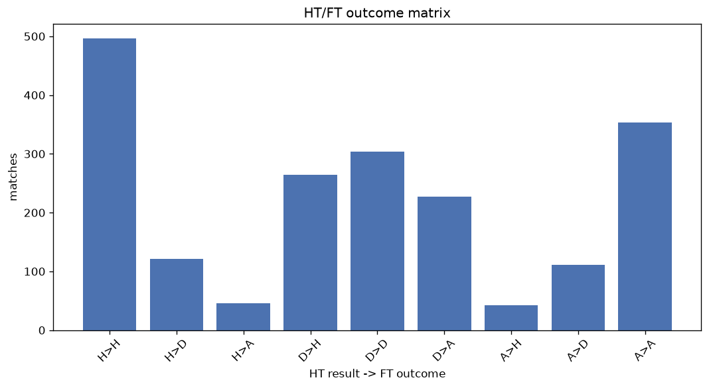
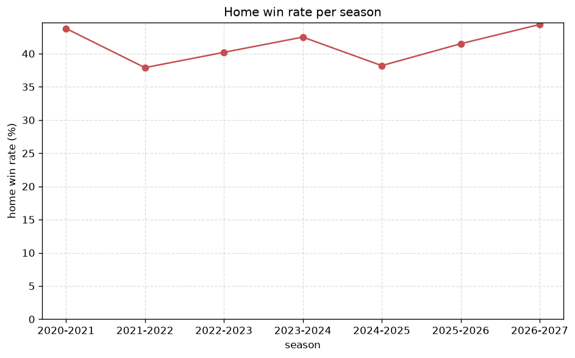

# Match Analysis
- Report: `matches_analysis`
- Generated: 2026-10-29T02:09:47+00:00
- Script: `backend/scripts/analyze_matches.py` v1.0.0
- League: Division 1 (Poland)
- Scope: league `poland2`

## 1. Overall summary
| metric | value |
|---|---|
| Matches | 1966 |
| Home wins | 804 (40.9%) |
| Draws | 536 (27.3%) |
| Away wins | 626 (31.8%) |
| Total goals | 5208 |
| Average goals per match | 2.649 |
| Goalless matches | 146 (7.4%) |

## 2. Per-season breakdown
| season | matches | home wins | draws | away wins | total goals | avg goals | goalless |
|---|---|---|---|---|---|---|---|
| 2020-2021 | 306 | 134 (43.8%) | 78 (25.5%) | 94 (30.7%) | 713 | 2.33 | 29 (9.5%) |
| 2021-2022 | 306 | 116 (37.9%) | 90 (29.4%) | 100 (32.7%) | 760 | 2.484 | 30 (9.8%) |
| 2022-2023 | 306 | 123 (40.2%) | 92 (30.1%) | 91 (29.7%) | 808 | 2.641 | 20 (6.5%) |
| 2023-2024 | 306 | 130 (42.5%) | 78 (25.5%) | 98 (32.0%) | 814 | 2.66 | 23 (7.5%) |
| 2024-2025 | 306 | 117 (38.2%) | 83 (27.1%) | 106 (34.6%) | 831 | 2.716 | 24 (7.8%) |
| 2025-2026 | 328 | 136 (41.5%) | 89 (27.1%) | 103 (31.4%) | 991 | 3.021 | 15 (4.6%) |
| 2026-2027 | 108 | 48 (44.4%) | 26 (24.1%) | 34 (31.5%) | 291 | 2.694 | 5 (4.6%) |

## 3. HT/FT outcome matrix
| HT result \ FT result | Home | Draw | Away | total |
|---|---|---|---|---|
| HT home lead | 496 (74.8%) | 121 (18.3%) | 46 (6.9%) | 663 |
| HT draw | 264 (33.2%) | 304 (38.2%) | 227 (28.6%) | 795 |
| HT away lead | 42 (8.3%) | 111 (21.9%) | 353 (69.8%) | 506 |
- *2 match(es) excluded (no HT score recorded).*

## 4. Comeback matches
- Home comebacks (trailing at HT, won at FT): **42** (2.1%)
- Away comebacks (trailing at HT, won at FT): **46** (2.3%)

### Home comebacks
| season | home | away | HT | FT |
|---|---|---|---|---|
| 2020-2021 | Radomiak Radom | Widzew Lodz | 0-1 | 4-1 |
| 2020-2021 | R. Rzeszow | Termalica B-B. | 0-1 | 3-1 |
| 2020-2021 | GKS Jastrzebie | R. Rzeszow | 0-1 | 2-1 |
| 2021-2022 | GKS Katowice | Zaglebie Sosnowiec | 0-2 | 3-2 |
| 2021-2022 | Stomil Olsztyn | R. Rzeszow | 0-1 | 4-2 |
| 2021-2022 | Tychy | Zaglebie Sosnowiec | 0-1 | 2-1 |
| 2021-2022 | Widzew Lodz | Tychy | 0-1 | 2-1 |
| 2021-2022 | Korona Kielce | Polkowice | 0-1 | 2-1 |
| 2021-2022 | R. Rzeszow | Arka Gdynia | 0-1 | 4-1 |
| 2022-2023 | Wisla | GKS Katowice | 0-1 | 2-1 |
| 2022-2023 | Termalica B-B. | Chrobry Glogow | 0-1 | 3-1 |
| 2022-2023 | Chrobry Glogow | Wisla | 0-1 | 2-1 |
| 2022-2023 | Ruch Chorzow | Sandecja Nowy S. | 0-1 | 2-1 |
| 2022-2023 | Wisla | Odra Opole | 0-1 | 2-1 |
| 2022-2023 | S. Rzeszow | Skra | 0-1 | 2-1 |
| 2022-2023 | Podbeskidzie | R. Rzeszow | 1-3 | 4-3 |
| 2023-2024 | Motor Lublin | Zaglebie Sosnowiec | 0-1 | 3-2 |
| 2023-2024 | Wisla Plock | Termalica B-B. | 0-1 | 3-1 |
| 2023-2024 | Chrobry Glogow | Tychy | 0-1 | 2-1 |
| 2023-2024 | Tychy | Pruszkow | 0-1 | 2-1 |
| 2023-2024 | Tychy | Termalica B-B. | 0-2 | 3-2 |
| 2023-2024 | Legnica | Polonia Warszawa | 0-1 | 2-1 |
| 2023-2024 | Chrobry Glogow | Wisla | 0-1 | 3-2 |
| 2023-2024 | Podbeskidzie | Termalica B-B. | 0-1 | 2-1 |
| 2023-2024 | Wisla Plock | Legnica | 0-1 | 2-1 |
| 2024-2025 | Pruszkow | Wisla | 0-1 | 2-1 |
| 2024-2025 | Termalica B-B. | Wisla Plock | 0-1 | 4-2 |
| 2024-2025 | Odra Opole | S. Wola | 0-1 | 2-1 |
| 2024-2025 | Chrobry Glogow | Kotwica Kolobrzeg | 0-1 | 3-2 |
| 2024-2025 | Pogon Siedlce | Kotwica Kolobrzeg | 0-1 | 2-1 |
| 2024-2025 | Warta Poznan | Pogon Siedlce | 0-1 | 2-1 |
| 2024-2025 | Wisla | LKS Lodz | 0-1 | 2-1 |
| 2024-2025 | Termalica B-B. | Chrobry Glogow | 1-2 | 3-2 |
| 2024-2025 | Polonia Warszawa | Chrobry Glogow | 1-2 | 4-2 |
| 2025-2026 | Pogon Siedlce | Ruch Chorzow | 0-1 | 2-1 |
| 2025-2026 | Grodzisk M. | Polonia Bytom | 0-1 | 2-1 |
| 2025-2026 | Puszcza | Polonia Warszawa | 0-1 | 2-1 |
| 2025-2026 | Wieczysta Krakow | Polonia Bytom | 0-2 | 4-3 |
| 2025-2026 | LKS Lodz | Leczna | 0-1 | 3-1 |
| 2026-2027 | Polonia Warszawa | Skierniewice | 0-1 | 3-1 |
| 2026-2027 | Skierniewice | Grodzisk M. | 0-1 | 3-2 |
| 2026-2027 | Podbeskidzie | S. Rzeszow | 0-1 | 2-1 |

### Away comebacks
| season | home | away | HT | FT |
|---|---|---|---|---|
| 2020-2021 | Chrobry Glogow | Odra Opole | 1-0 | 2-3 |
| 2020-2021 | GKS Belchatow | Termalica B-B. | 1-0 | 1-2 |
| 2020-2021 | LKS Lodz | Arka Gdynia | 1-0 | 1-2 |
| 2020-2021 | Zaglebie Sosnowiec | Arka Gdynia | 2-1 | 2-3 |
| 2020-2021 | Puszcza | LKS Lodz | 1-0 | 2-3 |
| 2021-2022 | Odra Opole | Sandecja Nowy S. | 1-0 | 1-2 |
| 2021-2022 | Puszcza | Skra | 1-0 | 1-2 |
| 2021-2022 | Legnica | Stomil Olsztyn | 1-0 | 1-2 |
| 2021-2022 | Odra Opole | Puszcza | 1-0 | 1-2 |
| 2022-2023 | Zaglebie Sosnowiec | Chrobry Glogow | 1-0 | 1-2 |
| 2022-2023 | Arka Gdynia | Chrobry Glogow | 2-1 | 3-4 |
| 2022-2023 | Arka Gdynia | Termalica B-B. | 1-0 | 1-2 |
| 2022-2023 | Odra Opole | Termalica B-B. | 1-0 | 1-2 |
| 2022-2023 | Arka Gdynia | Wisla | 1-0 | 1-3 |
| 2022-2023 | R. Rzeszow | Termalica B-B. | 1-0 | 1-2 |
| 2022-2023 | Wisla | Zaglebie Sosnowiec | 1-0 | 1-2 |
| 2023-2024 | Polonia Warszawa | Tychy | 2-1 | 2-3 |
| 2023-2024 | Wisla | Odra Opole | 1-0 | 1-3 |
| 2023-2024 | Termalica B-B. | S. Rzeszow | 1-0 | 1-2 |
| 2023-2024 | Podbeskidzie | Lechia Gdansk | 1-0 | 1-2 |
| 2023-2024 | Termalica B-B. | R. Rzeszow | 1-0 | 1-4 |
| 2023-2024 | Pruszkow | Wisla | 2-0 | 2-3 |
| 2023-2024 | Polonia Warszawa | GKS Katowice | 1-0 | 1-2 |
| 2023-2024 | Tychy | GKS Katowice | 2-1 | 2-3 |
| 2024-2025 | Warta Poznan | Wisla Plock | 1-0 | 1-2 |
| 2024-2025 | S. Wola | Pogon Siedlce | 1-0 | 1-3 |
| 2024-2025 | Pruszkow | Ruch Chorzow | 2-1 | 2-3 |
| 2024-2025 | Leczna | Pruszkow | 1-0 | 1-2 |
| 2024-2025 | Legnica | Polonia Warszawa | 1-0 | 2-3 |
| 2024-2025 | Chrobry Glogow | LKS Lodz | 1-0 | 1-2 |
| 2024-2025 | Leczna | Pogon Siedlce | 1-0 | 1-3 |
| 2024-2025 | Ruch Chorzow | LKS Lodz | 1-0 | 1-3 |
| 2024-2025 | LKS Lodz | Pruszkow | 1-0 | 2-3 |
| 2025-2026 | Puszcza | Tychy | 1-0 | 1-2 |
| 2025-2026 | Pogon Siedlce | Slask Wroclaw | 2-1 | 2-3 |
| 2025-2026 | Leczna | Wisla | 1-0 | 1-2 |
| 2025-2026 | Stal Mielec | Legnica | 1-0 | 1-2 |
| 2025-2026 | Wieczysta Krakow | Grodzisk M. | 2-1 | 2-3 |
| 2025-2026 | KS Wieczysta Krakow | Grodzisk M. | 2-1 | 2-3 |
| 2025-2026 | Polonia Bytom | LKS Lodz | 1-0 | 2-3 |
| 2025-2026 | Stal Mielec | LKS Lodz | 1-0 | 1-2 |
| 2025-2026 | Pruszkow | Odra Opole | 2-0 | 2-3 |
| 2025-2026 | S. Rzeszow | Wisla | 1-0 | 1-2 |
| 2025-2026 | Polonia Bytom | Slask Wroclaw | 1-0 | 1-3 |
| 2025-2026 | Odra Opole | Polonia Warszawa | 1-0 | 1-2 |
| 2026-2027 | Pogon Siedlce | Termalica B-B. | 1-0 | 1-2 |

## 5. HT lead conversion
| HT state | matches | converted to win | held as draw | collapsed to loss |
|---|---|---|---|---|
| Home lead | 663 | 496 (74.8%) | 121 (18.3%) | 46 (6.9%) |
| Away lead | 506 | 353 (69.8%) | 111 (21.9%) | 42 (8.3%) |

### Matches level at half-time
| FT result | count | pct |
|---|---|---|
| Home win | 264 | 33.2% |
| Draw | 304 | 38.2% |
| Away win | 227 | 28.6% |
- *2 match(es) excluded (no HT score recorded).*

## 6. First-goal timing
- Matches with a first-goal time recorded: `1818` of `1966` (92.5%)

Outcome distribution by first-goal timing bucket:
| bucket | matches | % of matches | home | draw | away |
|---|---|---|---|---|---|
| 1-15 | 584 | 29.7% | 256 (43.8%) | 141 (24.1%) | 187 (32.0%) |
| 16-30 | 427 | 21.7% | 185 (43.3%) | 98 (23.0%) | 144 (33.7%) |
| 31-45 | 319 | 16.2% | 155 (48.6%) | 60 (18.8%) | 104 (32.6%) |
| 46-60 | 233 | 11.9% | 92 (39.5%) | 55 (23.6%) | 86 (36.9%) |
| 61-75 | 129 | 6.6% | 58 (45.0%) | 24 (18.6%) | 47 (36.4%) |
| 76-90 | 100 | 5.1% | 44 (44.0%) | 10 (10.0%) | 46 (46.0%) |
| 91-120 | 26 | 1.3% | 12 (46.2%) | 2 (7.7%) | 12 (46.2%) |

## 7. Goalless matches
- Overall: **146** of `1966` (7.4%)

| season | matches | goalless | pct |
|---|---|---|---|
| 2020-2021 | 306 | 29 | 9.5% |
| 2021-2022 | 306 | 30 | 9.8% |
| 2022-2023 | 306 | 20 | 6.5% |
| 2023-2024 | 306 | 23 | 7.5% |
| 2024-2025 | 306 | 24 | 7.8% |
| 2025-2026 | 328 | 15 | 4.6% |
| 2026-2027 | 108 | 5 | 4.6% |

---
*All statistics are computed from PostgreSQL tables (read-only). Run with `python backend/scripts/analyze_matches.py` to regenerate.*

## Charts

