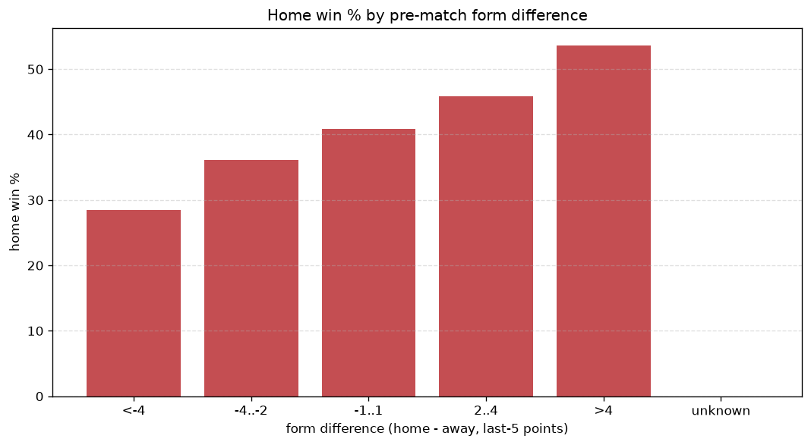
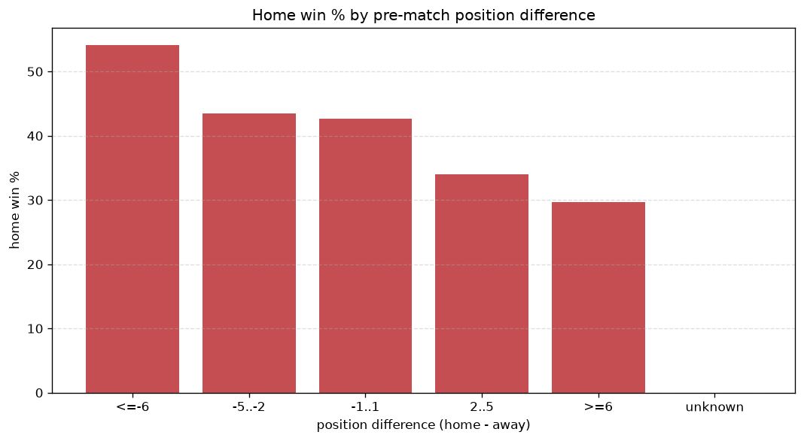

# Relationships Analysis
- Report: `relationships`
- Generated: 2026-10-27T02:24:48+00:00
- Script: `backend/scripts/analyze_relationships.py` v1.0.0
- League: Division 1 (Poland)
- Scope: league `poland2`

- Matches analysed: **1858** (23 leakage-safe pre-match features).

## 1. Correlation matrix
_Pearson correlation of each pre-match feature with observed goals; sorted by |corr(total goals)|._

| feature | corr(home) | corr(away) | corr(total) |
|---|---|---|---|
| home_team_home_goals_avg | 0.131 | -0.011 | 0.092 |
| home_team_goals_scored_last_5 | 0.130 | -0.043 | 0.069 |
| home_position_before_match | -0.164 | 0.101 | -0.054 |
| position_difference | -0.204 | 0.159 | -0.044 |
| points_difference | 0.184 | -0.151 | 0.034 |
| home_points_before_match | 0.073 | -0.031 | 0.033 |
| home_team_home_win_rate | 0.137 | -0.111 | 0.026 |
| away_team_goals_scored_last_5 | -0.050 | 0.091 | 0.025 |
| away_team_wins_last_5 | -0.096 | 0.071 | -0.023 |
| away_team_points_last_5 | -0.086 | 0.065 | -0.020 |
| home_team_points_last_5 | 0.109 | -0.096 | 0.016 |
| away_team_away_goals_avg | -0.054 | 0.080 | 0.014 |
| away_team_away_conceded_avg | 0.043 | -0.067 | -0.014 |
| home_team_home_conceded_avg | -0.097 | 0.087 | -0.013 |
| home_team_goals_conceded_last_5 | -0.077 | 0.066 | -0.012 |
| home_team_wins_last_5 | 0.102 | -0.093 | 0.012 |
| away_rest_days | -0.010 | -0.006 | -0.012 |
| home_rest_days | -0.003 | -0.012 | -0.011 |
| away_points_before_match | -0.060 | 0.077 | 0.009 |
| away_position_before_match | 0.120 | -0.120 | 0.007 |
| rest_days_difference | 0.019 | -0.017 | 0.003 |
| away_team_goals_conceded_last_5 | 0.067 | -0.072 | 0.001 |
| away_team_away_win_rate | -0.064 | 0.068 | -0.001 |

## 2. Form vs outcome
_Home win/draw/away % per bucket of `home_team_points_last_5 - away_team_points_last_5`._

| bucket | matches | home | draw | away | home % | draw % | away % |
|---|---|---|---|---|---|---|---|
| <-4 | 305 | 87 | 82 | 136 | 28.5% | 26.9% | 44.6% |
| -4..-2 | 402 | 145 | 120 | 137 | 36.1% | 29.9% | 34.1% |
| -1..1 | 506 | 207 | 139 | 160 | 40.9% | 27.5% | 31.6% |
| 2..4 | 367 | 168 | 94 | 105 | 45.8% | 25.6% | 28.6% |
| >4 | 278 | 149 | 75 | 54 | 53.6% | 27.0% | 19.4% |
| unknown | 0 | 0 | 0 | 0 | - | - | - |

## 3. Position vs outcome
_Home win/draw/away % per bucket of `position_difference` (home position - away position; negative favours the home team)._

| bucket | matches | home | draw | away | home % | draw % | away % |
|---|---|---|---|---|---|---|---|
| <=-6 | 436 | 236 | 113 | 87 | 54.1% | 25.9% | 20.0% |
| -5..-2 | 359 | 156 | 109 | 94 | 43.5% | 30.4% | 26.2% |
| -1..1 | 251 | 107 | 71 | 73 | 42.6% | 28.3% | 29.1% |
| 2..5 | 368 | 125 | 97 | 146 | 34.0% | 26.4% | 39.7% |
| >=6 | 444 | 132 | 120 | 192 | 29.7% | 27.0% | 43.2% |
| unknown | 0 | 0 | 0 | 0 | - | - | - |

## 4. Rest advantage
_Home win/draw/away % per bucket of `rest_days_difference` (home rest - away rest). Matches with unknown rest are bucketed separately._

| bucket | matches | home | draw | away | home % | draw % | away % |
|---|---|---|---|---|---|---|---|
| <-1 | 286 | 108 | 85 | 93 | 37.8% | 29.7% | 32.5% |
| -1..0 | 389 | 143 | 109 | 137 | 36.8% | 28.0% | 35.2% |
| 0 | 448 | 204 | 124 | 120 | 45.5% | 27.7% | 26.8% |
| 1..2 | 567 | 238 | 146 | 183 | 42.0% | 25.7% | 32.3% |
| >2 | 112 | 44 | 26 | 42 | 39.3% | 23.2% | 37.5% |
| unknown | 56 | 19 | 20 | 17 | 33.9% | 35.7% | 30.4% |
- *56 match(es) had unknown rest difference (missing rest data on at least one side).*

## 5. Home team quality
_Home win rate by `home_team_home_win_rate` tier (split at 0.5)._

- `< 0.5` tier: **35.7%** home win (419/1174)
- `>= 0.5` tier: **49.3%** home win (337/684)
- Home-win gap (>= split minus < split): **+13.6 pp**

| tier | label | matches | home | draw | away | home % |
|---|---|---|---|---|---|---|
| low | < 0.5 | 1174 | 419 | 322 | 433 | 35.7% |
| high | >= 0.5 | 684 | 337 | 188 | 159 | 49.3% |

## 6. Feature averages by result
_Mean feature value per outcome; `range` is home-minus-away spread of the group means._

| feature | home mean | draw mean | away mean | range |
|---|---|---|---|---|
| points_difference | 2.586 | -0.718 | -3.421 | 6.007 |
| position_difference | -1.661 | 0.273 | 2.297 | 3.959 |
| home_points_before_match | 23.890 | 22.329 | 20.796 | 3.095 |
| away_points_before_match | 21.304 | 23.047 | 24.216 | 2.912 |
| home_position_before_match | 8.950 | 9.798 | 11.186 | 2.236 |
| away_rest_days | 8.883 | 10.481 | 8.572 | 1.908 |
| away_position_before_match | 10.611 | 9.525 | 8.889 | 1.723 |
| home_rest_days | 8.996 | 10.200 | 8.616 | 1.584 |
| home_team_points_last_5 | 6.623 | 6.149 | 5.514 | 1.110 |
| away_team_points_last_5 | 5.856 | 6.371 | 6.706 | 0.850 |
| home_team_goals_scored_last_5 | 6.251 | 6.035 | 5.427 | 0.824 |
| home_team_goals_conceded_last_5 | 5.627 | 6.214 | 6.387 | 0.760 |
| away_team_goals_scored_last_5 | 5.705 | 6.069 | 6.416 | 0.711 |
| away_team_goals_conceded_last_5 | 6.212 | 5.912 | 5.557 | 0.654 |
| rest_days_difference | 0.115 | -0.284 | 0.043 | 0.399 |
| home_team_wins_last_5 | 1.772 | 1.659 | 1.397 | 0.376 |
| away_team_wins_last_5 | 1.513 | 1.696 | 1.834 | 0.321 |
| home_team_home_conceded_avg | 1.062 | 1.137 | 1.266 | 0.204 |
| home_team_home_goals_avg | 1.391 | 1.350 | 1.252 | 0.138 |
| away_team_away_conceded_avg | 1.392 | 1.358 | 1.266 | 0.126 |
| away_team_away_goals_avg | 1.106 | 1.160 | 1.228 | 0.122 |
| home_team_home_win_rate | 0.416 | 0.393 | 0.326 | 0.090 |
| away_team_away_win_rate | 0.283 | 0.297 | 0.333 | 0.050 |

---
*All features are leakage-safe pre-match values built by `ml.features.build_features.build_rows` from strictly prior matches. Run with `python backend/scripts/analyze_relationships.py` to regenerate.*

## Charts

