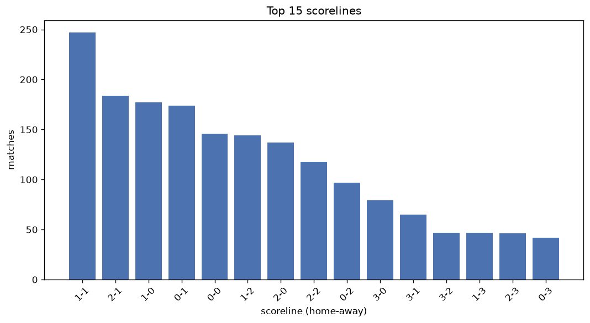
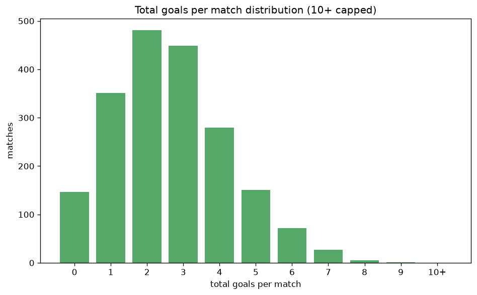

# Scoreline Analysis
- Report: `scoreline_analysis`
- Generated: 2026-10-26T01:42:47+00:00
- Script: `backend/scripts/analyze_scorelines.py` v1.0.0
- League: Division 1 (Poland)
- Scope: league `poland2`

## 1. Scoreline frequency
- Matches analysed: **1962** across **7** seasons.
- Distinct scorelines seen: **40**.

| scoreline | count | pct |
|---|---|---|
| 1-1 | 247 | 12.6% |
| 2-1 | 184 | 9.4% |
| 1-0 | 177 | 9.0% |
| 0-1 | 174 | 8.9% |
| 0-0 | 146 | 7.4% |
| 1-2 | 144 | 7.3% |
| 2-0 | 137 | 7.0% |
| 2-2 | 118 | 6.0% |
| 0-2 | 97 | 4.9% |
| 3-0 | 79 | 4.0% |
| 3-1 | 65 | 3.3% |
| 3-2 | 47 | 2.4% |
| 1-3 | 47 | 2.4% |
| 2-3 | 46 | 2.3% |
| 0-3 | 42 | 2.1% |
| 4-0 | 33 | 1.7% |
| 3-3 | 24 | 1.2% |
| 4-1 | 21 | 1.1% |
| 4-2 | 19 | 1.0% |
| 1-4 | 17 | 0.9% |

## 2. Scoreline frequency per season

### 2020-2021
| scoreline | count | pct |
|---|---|---|
| 1-1 | 40 | 13.1% |
| 1-0 | 37 | 12.1% |
| 0-0 | 29 | 9.5% |
| 2-0 | 29 | 9.5% |
| 0-2 | 25 | 8.2% |

### 2021-2022
| scoreline | count | pct |
|---|---|---|
| 1-1 | 36 | 11.8% |
| 0-1 | 33 | 10.8% |
| 1-0 | 31 | 10.1% |
| 0-0 | 30 | 9.8% |
| 1-2 | 23 | 7.5% |

### 2022-2023
| scoreline | count | pct |
|---|---|---|
| 1-1 | 41 | 13.4% |
| 1-0 | 34 | 11.1% |
| 2-1 | 32 | 10.5% |
| 0-1 | 28 | 9.2% |
| 2-2 | 24 | 7.8% |

### 2023-2024
| scoreline | count | pct |
|---|---|---|
| 1-1 | 36 | 11.8% |
| 0-1 | 29 | 9.5% |
| 2-0 | 28 | 9.2% |
| 1-0 | 28 | 9.2% |
| 2-1 | 27 | 8.8% |

### 2024-2025
| scoreline | count | pct |
|---|---|---|
| 1-1 | 34 | 11.1% |
| 2-1 | 34 | 11.1% |
| 0-1 | 32 | 10.5% |
| 0-0 | 24 | 7.8% |
| 2-2 | 23 | 7.5% |

### 2025-2026
| scoreline | count | pct |
|---|---|---|
| 1-1 | 47 | 14.3% |
| 2-1 | 39 | 11.9% |
| 1-2 | 32 | 9.8% |
| 2-2 | 21 | 6.4% |
| 2-0 | 20 | 6.1% |

### 2026-2027
| scoreline | count | pct |
|---|---|---|
| 1-1 | 13 | 12.5% |
| 0-1 | 11 | 10.6% |
| 2-1 | 10 | 9.6% |
| 1-0 | 10 | 9.6% |
| 2-0 | 9 | 8.7% |

## 3. Total-goal histogram
_10+ groups all matches with 10 or more total goals._

| total goals | matches | pct |
|---|---|---|
| 0 | 146 | 7.4% |
| 1 | 351 | 17.9% |
| 2 | 481 | 24.5% |
| 3 | 449 | 22.9% |
| 4 | 279 | 14.2% |
| 5 | 151 | 7.7% |
| 6 | 72 | 3.7% |
| 7 | 27 | 1.4% |
| 8 | 5 | 0.3% |
| 9 | 1 | 0.1% |
| 10+ | 0 | 0.0% |

## 4. Extreme scorelines
- Matches with 7+ total goals: **33**

| season | date | scoreline | total goals |
|---|---|---|---|
| 2025-2026 | 2025-07-25 | 4-5 | 9 |
| 2020-2021 | 2020-11-22 | 4-4 | 8 |
| 2020-2021 | 2021-05-05 | 6-2 | 8 |
| 2023-2024 | 2023-10-07 | 6-2 | 8 |
| 2023-2024 | 2024-05-04 | 8-0 | 8 |
| 2026-2027 | 2026-09-19 | 7-1 | 8 |
| 2020-2021 | 2020-12-01 | 3-4 | 7 |
| 2021-2022 | 2021-11-27 | 5-2 | 7 |
| 2021-2022 | 2022-02-25 | 2-5 | 7 |
| 2022-2023 | 2022-09-11 | 5-2 | 7 |
| 2022-2023 | 2022-09-16 | 3-4 | 7 |
| 2022-2023 | 2022-10-01 | 3-4 | 7 |
| 2022-2023 | 2023-02-25 | 5-2 | 7 |
| 2022-2023 | 2023-06-03 | 4-3 | 7 |
| 2023-2024 | 2023-07-24 | 2-5 | 7 |
| 2023-2024 | 2023-08-14 | 3-4 | 7 |
| 2023-2024 | 2023-09-03 | 5-2 | 7 |
| 2023-2024 | 2024-05-11 | 3-4 | 7 |
| 2023-2024 | 2024-05-13 | 6-1 | 7 |
| 2023-2024 | 2024-05-18 | 5-2 | 7 |
| 2023-2024 | 2024-05-19 | 6-1 | 7 |
| 2024-2025 | 2025-04-22 | 3-4 | 7 |
| 2025-2026 | 2025-07-19 | 4-3 | 7 |
| 2025-2026 | 2025-08-04 | 3-4 | 7 |
| 2025-2026 | 2025-08-19 | 1-6 | 7 |
| 2025-2026 | 2025-08-19 | 1-6 | 7 |
| 2025-2026 | 2025-08-19 | 0-7 | 7 |
| 2025-2026 | 2025-11-28 | 6-1 | 7 |
| 2025-2026 | 2026-02-08 | 5-2 | 7 |
| 2025-2026 | 2026-04-23 | 4-3 | 7 |
| 2026-2027 | 2026-07-24 | 4-3 | 7 |
| 2026-2027 | 2026-08-16 | 5-2 | 7 |
| 2026-2027 | 2026-10-18 | 3-4 | 7 |

## 5. Margin-of-victory distribution (decided matches)
- Decided matches: **1426** (draws: **536**)
- Average winning margin: **1.73**

| margin | matches | pct |
|---|---|---|
| 1 | 785 | 55.0% |
| 2 | 376 | 26.4% |
| 3+ | 265 | 18.6% |

## 6. Margin by outcome

### Home wins
- Matches: **802** | avg margin: **1.81** | max margin: **8**
| margin | matches | pct |
|---|---|---|
| 1 | 412 | 51.4% |
| 2 | 221 | 27.6% |
| 3+ | 169 | 21.1% |
- *Full match-by-match list available in `scoreline_analysis.json`.*

### Away wins
- Matches: **624** | avg margin: **1.63** | max margin: **7**
| margin | matches | pct |
|---|---|---|
| 1 | 373 | 59.8% |
| 2 | 155 | 24.8% |
| 3+ | 96 | 15.4% |
- *Full match-by-match list available in `scoreline_analysis.json`.*

## 7. Most common exact score by outcome type
| outcome | matches | most common score | count | pct |
|---|---|---|---|---|
| home | 802 | 2-1 | 184 | 22.9% |
| draw | 536 | 1-1 | 247 | 46.1% |
| away | 624 | 0-1 | 174 | 27.9% |

---
*All statistics are computed from PostgreSQL tables (read-only). Run with `python backend/scripts/analyze_scorelines.py` to regenerate.*

## Charts

