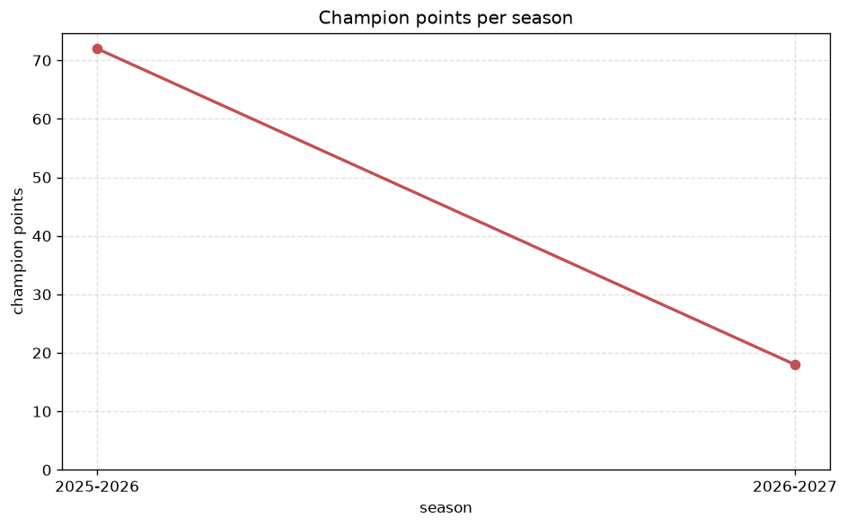
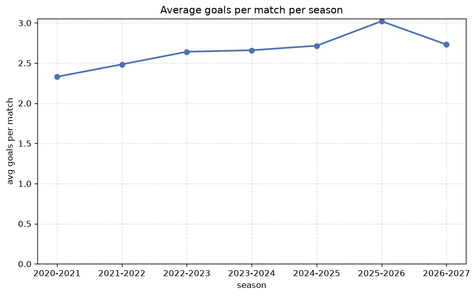

# Season Trends Analysis
- Report: `season_trends`
- Generated: 2026-10-30T04:04:37+00:00
- Script: `backend/scripts/analyze_seasons.py` v1.0.0
- League: Division 1 (Poland)
- Scope: league `poland2`

## 1. Champions per season
| season | champion | pts | runner-up | margin |
|---|---|---|---|---|
| 2020-2021 | Radomiak Radom | 68 | Tychy | 6 pts |
| 2021-2022 | Legnica | 77 | Widzew Lodz | 15 pts |
| 2022-2023 | LKS Lodz | 65 | Ruch Chorzow | 3 pts |
| 2023-2024 | Lechia Gdansk | 67 | Arka Gdynia | 5 pts |
| 2024-2025 | Arka Gdynia | 72 | Wisla Plock | 8 pts |
| 2025-2026 | Wisla | 72 | Slask Wroclaw | 8 pts |
| 2026-2027 | Grodzisk M. | 21 | Polonia Warszawa | 0 pts |

## 2. Title-race tightness
- Tight races (margin <= 3 pts): **2** of 7 seasons
- Tightest race: **2026-2027** - Grodzisk M. beat Polonia Warszawa by **0** pts

| season | margin | tight |
|---|---|---|
| 2020-2021 | 6 pts |  |
| 2021-2022 | 15 pts |  |
| 2022-2023 | 3 pts | yes |
| 2023-2024 | 5 pts |  |
| 2024-2025 | 8 pts |  |
| 2025-2026 | 8 pts |  |
| 2026-2027 | 0 pts | yes |

## 3. Points thresholds
_Position-specific points per season. Key: 1 = champion, 2 = runner-up, 4 = CL line, 6 = Europa, 15 = last safe, 18 = bottom._

| season | pos 1 | pos 2 | pos 4 | pos 6 | pos 15 | pos 18 |
|---|---|---|---|---|---|---|
| 2020-2021 | 68 | 62 | 57 | 48 | 34 | 30 |
| 2021-2022 | 77 | 62 | 56 | 50 | 36 | 25 |
| 2022-2023 | 65 | 62 | 58 | 48 | 36 | 26 |
| 2023-2024 | 67 | 62 | 55 | 51 | 31 | 19 |
| 2024-2025 | 72 | 64 | 55 | 53 | 30 | 24 |
| 2025-2026 | 72 | 64 | 55 | 55 | 36 | 28 |
| 2026-2027 | 21 | 21 | 21 | 19 | 13 | 11 |

## 4. Relegation battle
| season | safe pos | safe pts | drop pos | drop pts | gap |
|---|---|---|---|---|---|
| 2020-2021 | 15 | 34 | 16 | 32 | 2 pts |
| 2021-2022 | 15 | 36 | 16 | 35 | 1 pts |
| 2022-2023 | 15 | 36 | 16 | 31 | 5 pts |
| 2023-2024 | 15 | 31 | 16 | - | - |
| 2024-2025 | 15 | 30 | 16 | 29 | 1 pts |
| 2025-2026 | 15 | 36 | 16 | 30 | 6 pts |
| 2026-2027 | 15 | 13 | 16 | 12 | 1 pts |

## 5. League-level trends
| season | matches | total goals | avg goals | home win | draw | away win | goalless | avg pts/team |
|---|---|---|---|---|---|---|---|---|
| 2020-2021 | 306 | 713 | 2.33 | 43.8% | 25.5% | 30.7% | 9.5% | 44.11 |
| 2021-2022 | 306 | 760 | 2.484 | 37.9% | 29.4% | 32.7% | 9.8% | 46.0 |
| 2022-2023 | 306 | 808 | 2.641 | 40.2% | 30.1% | 29.7% | 6.5% | 43.39 |
| 2023-2024 | 306 | 814 | 2.66 | 42.5% | 25.5% | 32.0% | 7.5% | 44.22 |
| 2024-2025 | 306 | 831 | 2.716 | 38.2% | 27.1% | 34.6% | 7.8% | 43.83 |
| 2025-2026 | 328 | 991 | 3.021 | 41.5% | 27.1% | 31.4% | 4.6% | 46.95 |
| 2026-2027 | 108 | 291 | 2.694 | 44.4% | 24.1% | 31.5% | 4.6% | 16.56 |

## 6. View divergence
- Largest divergence: **2025-2026** (goals view, avg abs position diff = 6.526)

_Avg absolute position difference between classic view and alternative view per season._

| season | classic vs luck | classic vs goals |
|---|---|---|
| 2020-2021 | 3.500 | 6.333 |
| 2021-2022 | 2.667 | 5.889 |
| 2022-2023 | 3.389 | 5.500 |
| 2023-2024 | 2.667 | 5.778 |
| 2024-2025 | 2.889 | 6.056 |
| 2025-2026 | 3.474 | 6.526 |
| 2026-2027 | 2.889 | 5.778 |

---
*All statistics are computed from PostgreSQL tables (read-only). Run with `python backend/scripts/analyze_seasons.py` to regenerate.*

## Charts

