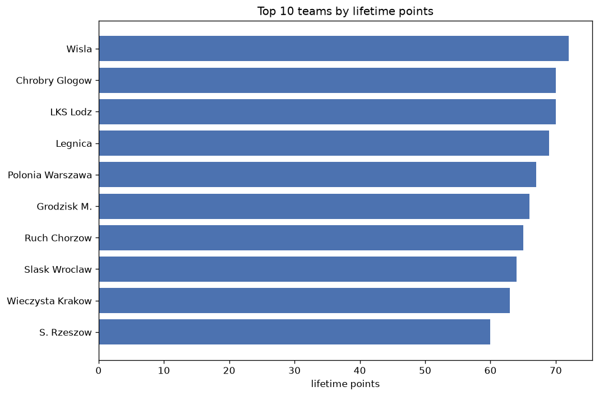
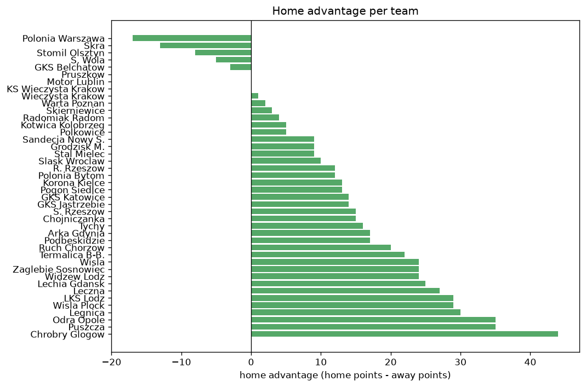

# Team Analysis
- Report: `teams_analysis`
- Generated: 2026-10-27T02:24:41+00:00
- Script: `backend/scripts/analyze_teams.py` v1.0.0
- League: Division 1 (Poland)
- Scope: league `poland2`

- Teams: **42** | Seasons: **7** | Matches: **1965**

## 1. Team standings (lifetime)
| team | seasons | played | W | D | L | pts | GF | GA | GD | avg pts/season | best pos | worst pos | titles |
|---|---|---|---|---|---|---|---|---|---|---|---|---|---|
| Arka Gdynia | 6 | 182 | 92 | 41 | 49 | 317 | 300 | 190 | 110 | 52.83 | 1 | 12 | 1 |
| Legnica | 6 | 183 | 86 | 50 | 47 | 308 | 286 | 205 | 81 | 51.33 | 1 | 10 | 1 |
| LKS Lodz | 6 | 183 | 81 | 46 | 56 | 289 | 271 | 216 | 55 | 48.17 | 1 | 10 | 1 |
| Chrobry Glogow | 7 | 219 | 76 | 58 | 85 | 286 | 258 | 296 | -38 | 40.86 | 4 | 14 | 0 |
| Odra Opole | 7 | 217 | 74 | 57 | 86 | 279 | 242 | 281 | -39 | 39.86 | 5 | 17 | 0 |
| Tychy | 6 | 205 | 73 | 55 | 77 | 274 | 265 | 280 | -15 | 45.67 | 2 | 19 | 0 |
| Termalica B-B. | 5 | 148 | 71 | 45 | 32 | 258 | 256 | 173 | 83 | 51.6 | 4 | 19 | 0 |
| Wisla | 4 | 137 | 69 | 37 | 31 | 244 | 259 | 153 | 106 | 61.0 | 1 | 7 | 1 |
| Leczna | 5 | 171 | 56 | 61 | 54 | 229 | 213 | 210 | 3 | 45.8 | 4 | 17 | 0 |
| S. Rzeszow | 5 | 149 | 55 | 32 | 62 | 197 | 219 | 246 | -27 | 39.4 | 5 | 13 | 0 |
| Puszcza | 5 | 149 | 52 | 37 | 60 | 193 | 180 | 190 | -10 | 38.6 | 4 | 16 | 0 |
| Ruch Chorzow | 4 | 115 | 50 | 34 | 31 | 184 | 170 | 140 | 30 | 46.0 | 2 | 9 | 0 |
| Polonia Warszawa | 4 | 116 | 45 | 30 | 41 | 165 | 161 | 159 | 2 | 41.25 | 2 | 14 | 0 |
| GKS Katowice | 3 | 102 | 39 | 35 | 28 | 152 | 153 | 121 | 32 | 50.67 | 3 | 9 | 0 |
| R. Rzeszow | 4 | 136 | 37 | 37 | 62 | 148 | 151 | 195 | -44 | 37.0 | 11 | 16 | 0 |
| Podbeskidzie | 4 | 114 | 29 | 44 | 41 | 131 | 145 | 163 | -18 | 32.75 | 7 | 17 | 0 |
| Zaglebie Sosnowiec | 4 | 136 | 28 | 40 | 68 | 124 | 130 | 189 | -59 | 31.0 | 10 | 19 | 0 |
| Pruszkow | 3 | 103 | 33 | 23 | 47 | 122 | 126 | 159 | -33 | 40.67 | 8 | 18 | 0 |
| Sandecja Nowy S. | 3 | 102 | 29 | 32 | 41 | 119 | 109 | 140 | -31 | 39.67 | 7 | 17 | 0 |
| Wisla Plock | 2 | 68 | 32 | 19 | 17 | 115 | 104 | 84 | 20 | 57.5 | 2 | 9 | 0 |
| Widzew Lodz | 2 | 68 | 29 | 21 | 18 | 108 | 83 | 74 | 9 | 54.0 | 2 | 8 | 0 |
| Korona Kielce | 2 | 68 | 26 | 19 | 23 | 97 | 77 | 83 | -6 | 48.5 | 4 | 11 | 0 |
| Lechia Gdansk | 2 | 46 | 27 | 6 | 13 | 87 | 82 | 53 | 29 | 43.5 | 1 | 5 | 1 |
| Pogon Siedlce | 3 | 82 | 20 | 21 | 41 | 81 | 86 | 115 | -29 | 27.0 | 11 | 16 | 0 |
| Stomil Olsztyn | 2 | 68 | 19 | 13 | 36 | 70 | 63 | 100 | -37 | 35.0 | 15 | 16 | 0 |
| Grodzisk M. | 2 | 47 | 18 | 15 | 14 | 69 | 73 | 67 | 6 | 34.5 | 1 | 11 | 1 |
| Skra | 2 | 68 | 17 | 18 | 33 | 69 | 47 | 91 | -44 | 34.5 | 13 | 16 | 0 |
| Radomiak Radom | 1 | 34 | 20 | 8 | 6 | 68 | 49 | 20 | 29 | 68.0 | 1 | 1 | 1 |
| Polonia Bytom | 2 | 47 | 18 | 14 | 15 | 68 | 80 | 72 | 8 | 34.0 | 9 | 9 | 0 |
| Slask Wroclaw | 1 | 36 | 17 | 13 | 6 | 64 | 73 | 51 | 22 | 64.0 | 2 | 2 | 0 |
| Wieczysta Krakow | 1 | 36 | 18 | 9 | 9 | 63 | 75 | 50 | 25 | 63.0 | 3 | 3 | 0 |
| GKS Jastrzebie | 2 | 68 | 15 | 15 | 38 | 60 | 64 | 106 | -42 | 30.0 | 14 | 18 | 0 |
| Motor Lublin | 1 | 34 | 16 | 8 | 10 | 56 | 49 | 42 | 7 | 56.0 | 5 | 5 | 0 |
| Stal Mielec | 2 | 47 | 13 | 10 | 24 | 49 | 67 | 91 | -24 | 24.5 | 14 | 15 | 0 |
| Warta Poznan | 2 | 45 | 12 | 6 | 27 | 42 | 41 | 71 | -30 | 21.0 | 7 | 18 | 0 |
| KS Wieczysta Krakow | 1 | 19 | 8 | 6 | 5 | 30 | 40 | 29 | 11 | 30.0 | 16 | 16 | 0 |
| Polkowice | 1 | 34 | 5 | 14 | 15 | 29 | 32 | 54 | -22 | 29.0 | 17 | 17 | 0 |
| Kotwica Kolobrzeg | 1 | 34 | 6 | 11 | 17 | 29 | 29 | 55 | -26 | 29.0 | 17 | 17 | 0 |
| Chojniczanka | 1 | 34 | 5 | 12 | 17 | 27 | 35 | 57 | -22 | 27.0 | 18 | 18 | 0 |
| GKS Belchatow | 1 | 34 | 6 | 7 | 21 | 25 | 24 | 51 | -27 | 25.0 | 19 | 19 | 0 |
| S. Wola | 1 | 34 | 4 | 11 | 19 | 23 | 27 | 65 | -38 | 23.0 | 19 | 19 | 0 |
| Skierniewice | 1 | 12 | 3 | 2 | 7 | 11 | 13 | 20 | -7 | 11.0 | 18 | 18 | 0 |

## 2. Home vs away split
| team | home P | H-W | H-D | H-L | H-pts | away P | A-W | A-D | A-L | A-pts | adv |
|---|---|---|---|---|---|---|---|---|---|---|---|
| Chrobry Glogow | 110 | 45 | 30 | 35 | 165 | 109 | 31 | 28 | 50 | 121 | 44 |
| Odra Opole | 109 | 43 | 28 | 38 | 157 | 108 | 31 | 29 | 48 | 122 | 35 |
| Puszcza | 76 | 32 | 18 | 26 | 114 | 73 | 20 | 19 | 34 | 79 | 35 |
| Legnica | 93 | 48 | 25 | 20 | 169 | 90 | 38 | 25 | 27 | 139 | 30 |
| LKS Lodz | 92 | 46 | 21 | 25 | 159 | 91 | 35 | 25 | 31 | 130 | 29 |
| Wisla Plock | 34 | 22 | 6 | 6 | 72 | 34 | 10 | 13 | 11 | 43 | 29 |
| Leczna | 85 | 32 | 32 | 21 | 128 | 86 | 24 | 29 | 33 | 101 | 27 |
| Lechia Gdansk | 23 | 18 | 2 | 3 | 56 | 23 | 9 | 4 | 10 | 31 | 25 |
| Wisla | 68 | 39 | 17 | 12 | 134 | 69 | 30 | 20 | 19 | 110 | 24 |
| Zaglebie Sosnowiec | 68 | 19 | 17 | 32 | 74 | 68 | 9 | 23 | 36 | 50 | 24 |
| Widzew Lodz | 34 | 19 | 9 | 6 | 66 | 34 | 10 | 12 | 12 | 42 | 24 |
| Termalica B-B. | 74 | 39 | 23 | 12 | 140 | 74 | 32 | 22 | 20 | 118 | 22 |
| Ruch Chorzow | 57 | 29 | 15 | 13 | 102 | 58 | 21 | 19 | 18 | 82 | 20 |
| Arka Gdynia | 91 | 47 | 26 | 18 | 167 | 91 | 45 | 15 | 31 | 150 | 17 |
| Podbeskidzie | 56 | 18 | 20 | 18 | 74 | 58 | 11 | 24 | 23 | 57 | 17 |
| Tychy | 103 | 38 | 31 | 34 | 145 | 102 | 35 | 24 | 43 | 129 | 16 |
| S. Rzeszow | 72 | 31 | 13 | 28 | 106 | 77 | 24 | 19 | 34 | 91 | 15 |
| Chojniczanka | 17 | 5 | 6 | 6 | 21 | 17 | 0 | 6 | 11 | 6 | 15 |
| GKS Katowice | 51 | 23 | 14 | 14 | 83 | 51 | 16 | 21 | 14 | 69 | 14 |
| GKS Jastrzebie | 34 | 10 | 7 | 17 | 37 | 34 | 5 | 8 | 21 | 23 | 14 |
| Korona Kielce | 34 | 16 | 7 | 11 | 55 | 34 | 10 | 12 | 12 | 42 | 13 |
| Pogon Siedlce | 42 | 12 | 11 | 19 | 47 | 40 | 8 | 10 | 22 | 34 | 13 |
| R. Rzeszow | 68 | 19 | 23 | 26 | 80 | 68 | 18 | 14 | 36 | 68 | 12 |
| Polonia Bytom | 24 | 10 | 10 | 4 | 40 | 23 | 8 | 4 | 11 | 28 | 12 |
| Slask Wroclaw | 18 | 10 | 7 | 1 | 37 | 18 | 7 | 6 | 5 | 27 | 10 |
| Sandecja Nowy S. | 51 | 16 | 16 | 19 | 64 | 51 | 13 | 16 | 22 | 55 | 9 |
| Grodzisk M. | 23 | 10 | 9 | 4 | 39 | 24 | 8 | 6 | 10 | 30 | 9 |
| Stal Mielec | 24 | 7 | 8 | 9 | 29 | 23 | 6 | 2 | 15 | 20 | 9 |
| Kotwica Kolobrzeg | 17 | 3 | 8 | 6 | 17 | 17 | 3 | 3 | 11 | 12 | 5 |
| Polkowice | 17 | 3 | 8 | 6 | 17 | 17 | 2 | 6 | 9 | 12 | 5 |
| Radomiak Radom | 17 | 11 | 3 | 3 | 36 | 17 | 9 | 5 | 3 | 32 | 4 |
| Skierniewice | 7 | 2 | 1 | 4 | 7 | 5 | 1 | 1 | 3 | 4 | 3 |
| Warta Poznan | 20 | 7 | 1 | 12 | 22 | 25 | 5 | 5 | 15 | 20 | 2 |
| Wieczysta Krakow | 19 | 9 | 5 | 5 | 32 | 17 | 9 | 4 | 4 | 31 | 1 |
| Pruszkow | 51 | 17 | 10 | 24 | 61 | 52 | 16 | 13 | 23 | 61 | 0 |
| Motor Lublin | 17 | 7 | 7 | 3 | 28 | 17 | 9 | 1 | 7 | 28 | 0 |
| KS Wieczysta Krakow | 9 | 4 | 3 | 2 | 15 | 10 | 4 | 3 | 3 | 15 | 0 |
| GKS Belchatow | 17 | 3 | 2 | 12 | 11 | 17 | 3 | 5 | 9 | 14 | -3 |
| S. Wola | 17 | 1 | 6 | 10 | 9 | 17 | 3 | 5 | 9 | 14 | -5 |
| Stomil Olsztyn | 34 | 9 | 4 | 21 | 31 | 34 | 10 | 9 | 15 | 39 | -8 |
| Skra | 34 | 5 | 13 | 16 | 28 | 34 | 12 | 5 | 17 | 41 | -13 |
| Polonia Warszawa | 58 | 20 | 14 | 24 | 74 | 58 | 25 | 16 | 17 | 91 | -17 |

## 3. Top performers
### Best points per game (PPG)
| rank | team | PPG |
|---|---|---|
| 1 | Radomiak Radom | 2.00 |
| 2 | Lechia Gdansk | 1.89 |
| 3 | Wisla | 1.78 |
| 4 | Slask Wroclaw | 1.78 |
| 5 | Wieczysta Krakow | 1.75 |

### Most goals scored
| rank | team | goals |
|---|---|---|
| 1 | Arka Gdynia | 300 |
| 2 | Legnica | 286 |
| 3 | LKS Lodz | 271 |
| 4 | Tychy | 265 |
| 5 | Wisla | 259 |

### Best goal difference
| rank | team | GD |
|---|---|---|
| 1 | Arka Gdynia | 110 |
| 2 | Wisla | 106 |
| 3 | Termalica B-B. | 83 |
| 4 | Legnica | 81 |
| 5 | LKS Lodz | 55 |

### Best defence (goals against per match, standings)
| rank | team | GA/match |
|---|---|---|
| 1 | Radomiak Radom | 0.515 |
| 2 | Arka Gdynia | 1.034 |
| 3 | Widzew Lodz | 1.075 |
| 4 | Wisla | 1.112 |
| 5 | Legnica | 1.128 |

## 4. Team consistency
- Teams present in all **7** seasons: **2**

Chrobry Glogow, Odra Opole

## 5. Head-to-head dominance
- Distinct fixtures: **552** (showing the 15 most frequent)

| fixture | meetings | home wins | draws | away wins | home pct | draw pct | away pct |
|---|---|---|---|---|---|---|---|
| Odra Opole vs Chrobry Glogow | 13 | 6 | 3 | 4 | 46.2% | 23.1% | 30.8% |
| Tychy vs Chrobry Glogow | 12 | 8 | 2 | 2 | 66.7% | 16.7% | 16.7% |
| LKS Lodz vs Chrobry Glogow | 12 | 7 | 0 | 5 | 58.3% | 0.0% | 41.7% |
| Tychy vs Odra Opole | 12 | 5 | 4 | 3 | 41.7% | 33.3% | 25.0% |
| Legnica vs Odra Opole | 11 | 7 | 1 | 3 | 63.6% | 9.1% | 27.3% |
| Arka Gdynia vs Odra Opole | 11 | 3 | 4 | 4 | 27.3% | 36.4% | 36.4% |
| LKS Lodz vs Odra Opole | 11 | 3 | 3 | 5 | 27.3% | 27.3% | 45.5% |
| Legnica vs Chrobry Glogow | 11 | 2 | 8 | 1 | 18.2% | 72.7% | 9.1% |
| Leczna vs Tychy | 10 | 6 | 3 | 1 | 60.0% | 30.0% | 10.0% |
| Leczna vs Chrobry Glogow | 10 | 5 | 3 | 2 | 50.0% | 30.0% | 20.0% |
| Arka Gdynia vs Chrobry Glogow | 10 | 4 | 2 | 4 | 40.0% | 20.0% | 40.0% |
| Arka Gdynia vs Tychy | 10 | 3 | 3 | 4 | 30.0% | 30.0% | 40.0% |
| LKS Lodz vs Tychy | 10 | 3 | 3 | 4 | 30.0% | 30.0% | 40.0% |
| Leczna vs Odra Opole | 10 | 3 | 4 | 3 | 30.0% | 40.0% | 30.0% |
| Legnica vs Tychy | 10 | 3 | 3 | 4 | 30.0% | 30.0% | 40.0% |

## 6. Position per season (classic view)
_Cells show final position; '-' when the team was absent from that season._

| team | 2020-2021 | 2021-2022 | 2022-2023 | 2023-2024 | 2024-2025 | 2025-2026 | 2026-2027 |
|---|---|---|---|---|---|---|---|
| Arka Gdynia | 4 | 3 | 6 | 2 | 1 | - | 12 |
| Legnica | 6 | 1 | - | 10 | 4 | 6 | 6 |
| LKS Lodz | 3 | 10 | 1 | - | 10 | 5 | 8 |
| Chrobry Glogow | 10 | 6 | 8 | 13 | 14 | 4 | 14 |
| Odra Opole | 7 | 5 | 13 | 8 | 15 | 12 | 17 |
| Tychy | 2 | 12 | 15 | 6 | 5 | 19 | - |
| Termalica B-B. | 17 | - | 19 | 18 | 11 | - | 4 |
| Wisla | - | - | 3 | 7 | 3 | 1 | - |
| Leczna | 5 | - | 11 | 4 | 7 | 17 | - |
| S. Rzeszow | - | - | 5 | 11 | 13 | 13 | 10 |
| Puszcza | 12 | 14 | 4 | - | - | 10 | 16 |
| Ruch Chorzow | - | - | 2 | - | 9 | 7 | 3 |
| Polonia Warszawa | - | - | - | 14 | 6 | 8 | 2 |
| GKS Katowice | - | 8 | 9 | 3 | - | - | - |
| R. Rzeszow | 16 | 11 | 12 | 15 | - | - | - |
| Podbeskidzie | - | 9 | 7 | 17 | - | - | 13 |
| Zaglebie Sosnowiec | 18 | 15 | 10 | 19 | - | - | - |
| Pruszkow | - | - | - | 12 | 8 | 18 | - |
| Sandecja Nowy S. | 9 | 7 | 17 | - | - | - | - |
| Wisla Plock | - | - | - | 9 | 2 | - | - |
| Widzew Lodz | 8 | 2 | - | - | - | - | - |
| Korona Kielce | 11 | 4 | - | - | - | - | - |
| Lechia Gdansk | - | - | - | 1 | - | - | 5 |
| Pogon Siedlce | - | - | - | - | 16 | 15 | 11 |
| Stomil Olsztyn | 15 | 16 | - | - | - | - | - |
| Grodzisk M. | - | - | - | - | - | 11 | 1 |
| Skra | - | 13 | 16 | - | - | - | - |
| Radomiak Radom | 1 | - | - | - | - | - | - |
| Polonia Bytom | - | - | - | - | - | 9 | 9 |
| Slask Wroclaw | - | - | - | - | - | 2 | - |
| Wieczysta Krakow | - | - | - | - | - | 3 | - |
| GKS Jastrzebie | 14 | 18 | - | - | - | - | - |
| Motor Lublin | - | - | - | 5 | - | - | - |
| Stal Mielec | - | - | - | - | - | 14 | 15 |
| Warta Poznan | - | - | - | - | 18 | - | 7 |
| KS Wieczysta Krakow | - | - | - | - | - | 16 | - |
| Polkowice | - | 17 | - | - | - | - | - |
| Kotwica Kolobrzeg | - | - | - | - | 17 | - | - |
| Chojniczanka | - | - | 18 | - | - | - | - |
| GKS Belchatow | 19 | - | - | - | - | - | - |
| S. Wola | - | - | - | - | 19 | - | - |
| Skierniewice | - | - | - | - | - | - | 18 |

---
*All statistics are computed from PostgreSQL tables (read-only). Run with `python backend/scripts/analyze_teams.py` to regenerate.*

## Charts

