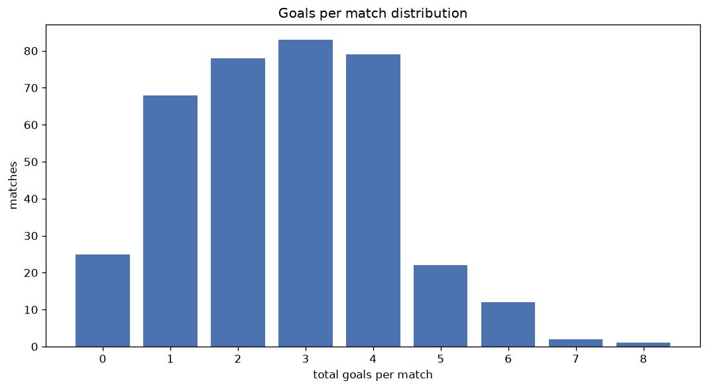
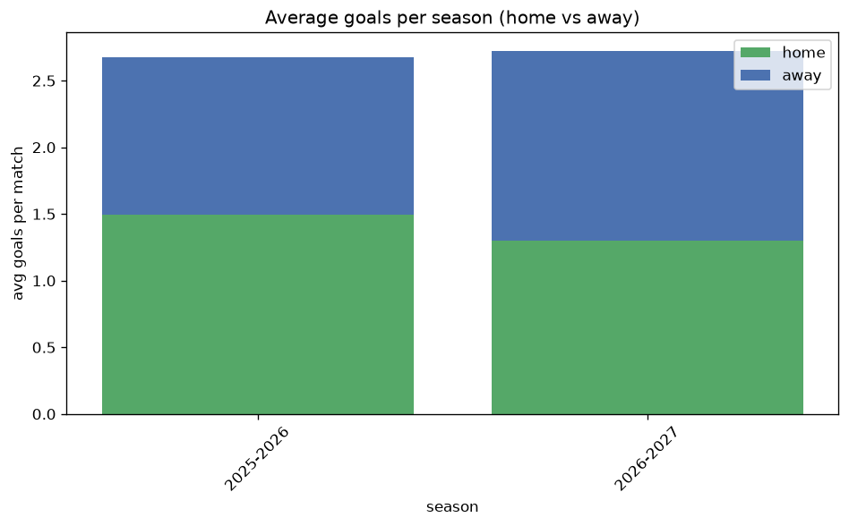

# Goal Analysis
- Report: `goals_analysis`
- Generated: 2026-10-30T04:04:57+00:00
- Script: `backend/scripts/analyze_goals.py` v1.0.0
- League: Liga Portugal (Portugal)
- Scope: league `portugal1`

## 1. Goals per match distribution
| goals | matches | pct |
|---|---|---|
| 0 | 25 | 6.4% |
| 1 | 74 | 19.0% |
| 2 | 80 | 20.6% |
| 3 | 88 | 22.6% |
| 4 | 82 | 21.1% |
| 5 | 25 | 6.4% |
| 6 | 12 | 3.1% |
| 7 | 2 | 0.5% |
| 8 | 1 | 0.3% |

## 2. Goals per match per season
| season | matches | total goals | avg home | avg away | avg total |
|---|---|---|---|---|---|
| 2025-2026 | 308 | 823 | 1.494 | 1.179 | 2.672 |
| 2026-2027 | 81 | 222 | 1.272 | 1.469 | 2.741 |

## 3. Home vs away goal share
- Home goals: **563** (53.9%)
- Away goals: **482** (46.1%)
- Home/away ratio: **1.168**

| season | home goals | away goals | total | home pct | away pct |
|---|---|---|---|---|---|
| 2025-2026 | 460 | 363 | 823 | 55.9% | 44.1% |
| 2026-2027 | 103 | 119 | 222 | 46.4% | 53.6% |

## 4. BTTS (Both Teams To Score)
- Overall: **187** of `389` (48.1%)

| season | matches | BTTS | pct |
|---|---|---|---|
| 2025-2026 | 308 | 147 | 47.7% |
| 2026-2027 | 81 | 40 | 49.4% |

## 5. Clean sheets
- Home clean sheets: **123** (31.6%)
- Away clean sheets: **104** (26.7%)
- Total clean sheets recorded: **227**
- Matches with at least one clean sheet: **202** (51.9%)
- Both teams kept clean sheets (0-0): **25**

| season | matches | home CS | away CS | total CS | matches w/ CS |
|---|---|---|---|---|---|
| 2025-2026 | 308 | 101 | 81 | 182 | 161 (52.3%) |
| 2026-2027 | 81 | 22 | 23 | 45 | 41 (50.6%) |

## 6. Scoring intensity
- First-half goals: **465** (44.5%)
- Second-half goals: **580** (55.5%)
- Avg first-half goals per match: **1.195**
- Avg second-half goals per match: **1.491**
- Second-half-only scoring (HT 0-0, FT goals >= 1): **93** (23.9%)

| season | matches | 1st half | 2nd half | 1st half pct | 2nd half pct |
|---|---|---|---|---|---|
| 2025-2026 | 308 | 368 | 455 | 44.7% | 55.3% |
| 2026-2027 | 81 | 97 | 125 | 43.7% | 56.3% |

## 7. First-goal timing
- Matches with first-goal time recorded: `364` of `389` (93.6%)
- Goalless matches: `25`
- Min `1` | Max `95` | Mean `31.42` | Median (p50) `27.0`

| bucket | count | % of matches | % of scoring matches |
|---|---|---|---|
| 1-15 | 123 | 31.6% | 33.8% |
| 16-30 | 73 | 18.8% | 20.1% |
| 31-45 | 70 | 18.0% | 19.2% |
| 46-60 | 45 | 11.6% | 12.4% |
| 61-75 | 31 | 8.0% | 8.5% |
| 76-90 | 17 | 4.4% | 4.7% |
| 91-120 | 5 | 1.3% | 1.4% |

---
*All statistics are computed from PostgreSQL tables (read-only). Run with `python backend/scripts/analyze_goals.py` to regenerate.*

## Charts

